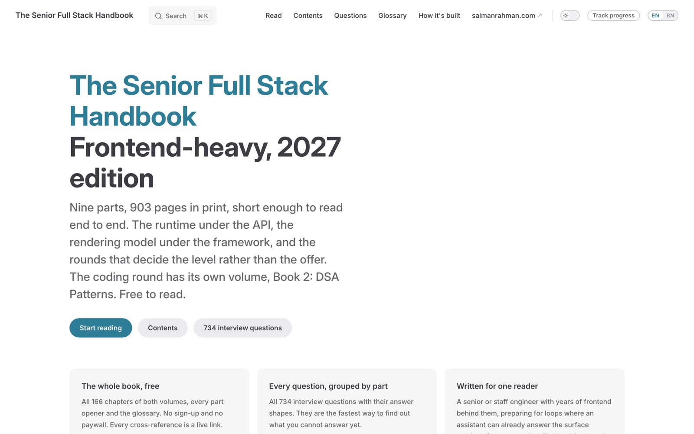
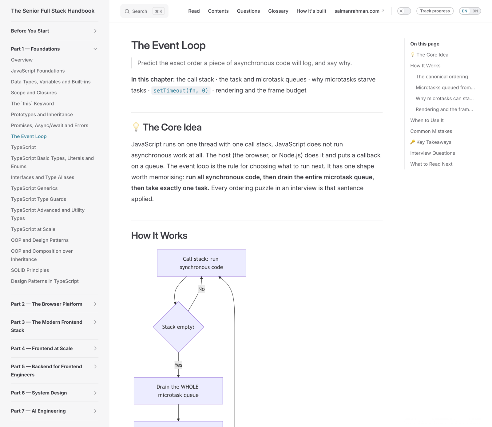
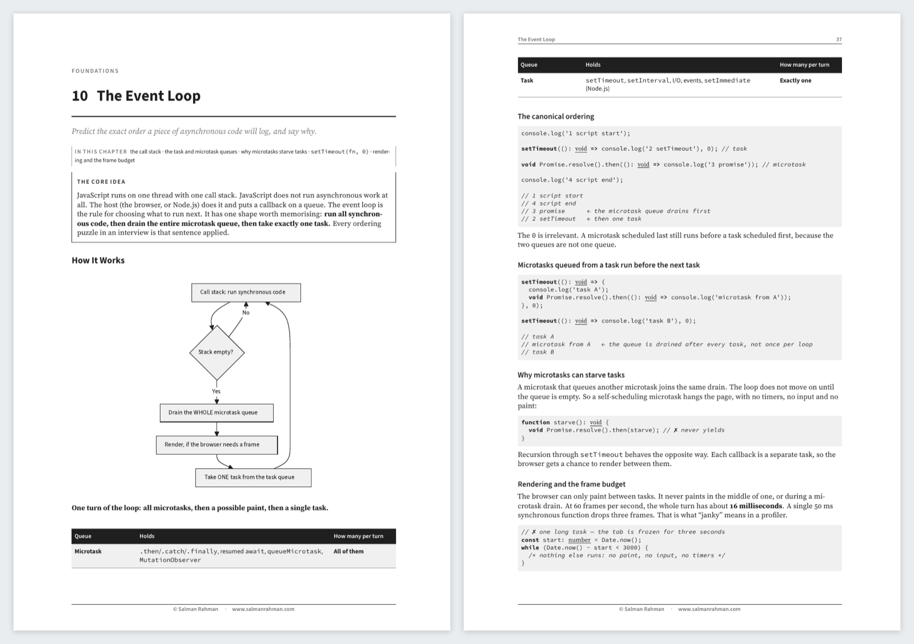
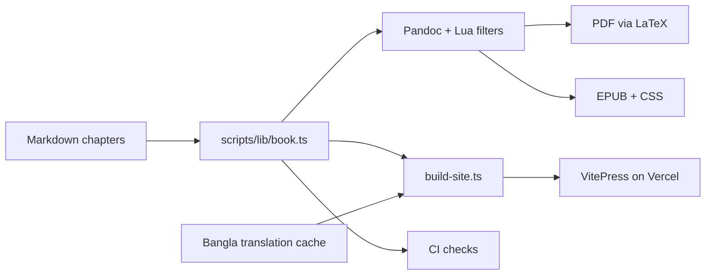
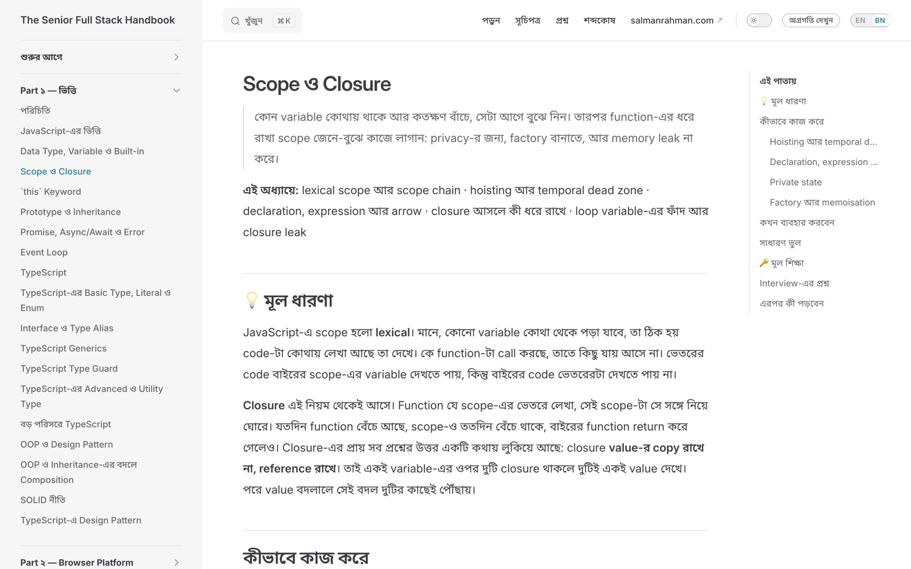

<div align="center">

# The Senior Full Stack Handbook

**Frontend-heavy engineering for 2027: fundamentals, the modern stack, system design and AI**

[](https://www.salmanrahman.com/handbook/)
[](https://github.com/salmanbd100/full-stack-software-engineer-guide/releases/latest)
[](https://www.salmanrahman.com/handbook/bn/)

[](https://github.com/salmanbd100/full-stack-software-engineer-guide/actions/workflows/lint-docs.yml)
[](LICENSE)
[](scripts/LICENSE)

**903 pages · 150 chapters · 647 interview questions · 580 compiled TypeScript samples · English and Bangla**



</div>

## What It Is

A book for engineers with 3–8 years' experience going for a senior or staff frontend-heavy full
stack role. It assumes you already write TypeScript and use a framework. It explains the layer under
the definition: the runtime under the API, the rendering model under the framework, and the rounds
that decide the level rather than the offer.

Every chapter has the same shape: the core idea, how it works, when to use it, common mistakes, key
takeaways, interview questions with answer shapes, and what to read next.

| Part | Covers |
| ---- | ------ |
| **1. Foundations** | JavaScript, TypeScript, design patterns |
| **2. The Browser Platform** | HTML and CSS, browser APIs, accessibility |
| **3. The Modern Frontend Stack** | React, Next.js, Svelte, rendering, state, tooling |
| **4. Frontend at Scale** | Architecture, performance, security, testing |
| **5. Backend for Frontend Engineers** | Node.js, APIs, SQL and NoSQL |
| **6. System Design** | Fundamentals, building blocks, frontend system design, 20 case studies |
| **7. AI Engineering** | LLM integration, RAG, agents, AI UX, evals in production |
| **8. Ship and Operate** | Git, CI/CD, observability, deployment |
| **9. The Human Layer** | Behavioural rounds and communication |

A companion volume, **Book 2: DSA Patterns**, covers the coding round in sixteen patterns.

<div align="center">

</div>

## Three Editions, One Manuscript

| Edition | What it is | Get it |
| ------- | ---------- | ------ |
| **Web** | The whole book, free, searchable, with an optional reading-progress tracker | [salmanrahman.com/handbook](https://www.salmanrahman.com/handbook/) |
| **PDF** | The print edition: typeset diagrams and page-numbered cross-references | [Latest release](https://github.com/salmanbd100/full-stack-software-engineer-guide/releases/latest) |
| **EPUB** | The same design in CSS for e-readers, validated with epubcheck | [Latest release](https://github.com/salmanbd100/full-stack-software-engineer-guide/releases/latest) |

The web edition is also published in **Bangla**, translated chapter by chapter into natural Bangla
rather than word for word.

<div align="center">

</div>

## How It Is Built

The manuscript is plain Markdown. One model of the book, `scripts/lib/book.ts`, decides what counts
as a chapter and in what order. Every build and every check imports it, so they cannot disagree.



The engineering details:

- **Shared callout classifier.** Four Lua filters turn the chapter standard's own shapes (callouts,
  cross-references, Mermaid fences) into the print design. One file decides what each shape is, so
  a callout cannot render one way in the PDF and another in the EPUB.
- **Page-numbered cross-references.** A link such as `[Chapter ?? — Title](#ch-slug)` becomes
  "Chapter 14 — Title (p. 212)" in print and a live link on the web.
- **Diagram font fitting.** Each Mermaid diagram is rendered, measured and re-rendered until its
  labels land at the body's label size once shrunk to the page. Results are cached by content hash.
- **Every code sample is compiled.** CI runs the TypeScript compiler over all 580 fences. Syntax
  errors fail the build; type diagnostics are held to a baseline that can only go down.
- **Linted chapters.** `pnpm lint:docs` enforces eleven rules of the chapter standard: structure,
  cross-reference syntax, callout budget, heading depth and more. It uses the same ratchet.
- **Content-hashed translations.** Each Bangla page is keyed by a SHA-256 of its English source.
  When a chapter changes, its translation is marked stale and the site falls back to English with a
  notice until it is re-translated.
- **Reading progress.** A Vercel function over Upstash Redis stores which chapters a reader has
  finished, shown as checkboxes in the sidebar and a progress bar in the nav.

The full write-up is in [Building This Book](https://www.salmanrahman.com/handbook/building-this-book).

<div align="center">

</div>

## Build It Yourself

```bash
pnpm install
pnpm site:dev       # the web edition, locally
pnpm book:build     # PDF + EPUB into build/ (needs pandoc, tectonic and mermaid-cli)
pnpm lint:docs      # the chapter standard
pnpm test           # the tooling's own tests
```

## Licence

The book's text is licensed under [CC BY-NC-SA 4.0](LICENSE): share and adapt it with credit, not
for commercial use. The build tooling in `scripts/` is [MIT](scripts/LICENSE).

## Author

Written by **Salman Rahman**, a senior frontend engineer with 9+ years of experience. See
[salmanrahman.com](https://www.salmanrahman.com).
