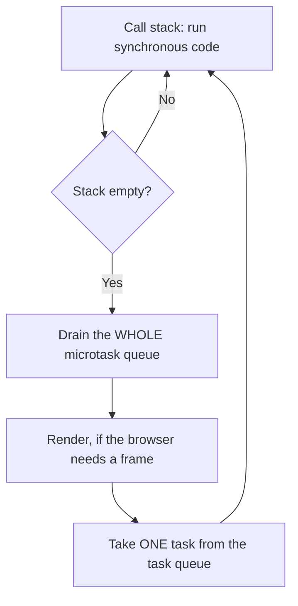

# Event Loop {#ch-event-loop}

> একটি asynchronous code ঠিক কোন ক্রমে log করবে, সেটা আগে থেকে বলুন, আর কেন সেটাও বলুন।

**এই অধ্যায়ে:** call stack · task আর microtask queue · microtask কেন task-কে starve করে · `setTimeout(fn, 0)` · rendering আর frame budget

## 💡 মূল ধারণা

JavaScript একটি thread-এ, একটি call stack নিয়ে চলে। Asynchronous কাজ JavaScript নিজে একদমই চালায় না। Host
(browser, বা Node.js) সেটা করে, আর একটি callback একটি queue-তে রেখে দেয়। পরের বার কী চলবে, তা বেছে নেওয়ার
নিয়মটাই event loop। এর একটিই রূপ মুখস্থ রাখার মতো: **সব synchronous code চালাও, তারপর পুরো microtask queue খালি
করো, তারপর ঠিক একটি task নাও।** Interview-এর প্রতিটি ক্রম-ধাঁধা আসলে এই বাক্যটিরই প্রয়োগ।

## কীভাবে কাজ করে



**Loop-এর একটি পাক: সব microtask, তারপর হয়তো একটি paint, তারপর একটিমাত্র task।**

| Queue         | কী থাকে                                                               | প্রতি পাকে কয়টি    |
| ------------- | --------------------------------------------------------------------- | ----------------- |
| **Microtask** | `.then`/`.catch`/`.finally`, আবার চালু হওয়া `await`, `queueMicrotask`, `MutationObserver` | **সবগুলো**   |
| **Task**      | `setTimeout`, `setInterval`, I/O, event, `setImmediate` (Node.js)      | **ঠিক একটি**     |

### প্রচলিত ক্রম

```typescript
console.log('1 script start');

setTimeout((): void => console.log('2 setTimeout'), 0); // task

void Promise.resolve().then((): void => console.log('3 promise')); // microtask

console.log('4 script end');

// 1 script start
// 4 script end
// 3 promise      ← the microtask queue drains first
// 2 setTimeout   ← then one task
```

`0`-এর কোনো গুরুত্ব নেই। সবার শেষে schedule করা microtask-ও সবার আগে schedule করা task-এর আগে চলে, কারণ দুটি
queue আসলে একই queue নয়।

### Task থেকে queue করা microtask পরের task-এর আগে চলে

```typescript
setTimeout((): void => {
  console.log('task A');
  void Promise.resolve().then((): void => console.log('microtask from A'));
}, 0);

setTimeout((): void => console.log('task B'), 0);

// task A
// microtask from A   ← the queue is drained after every task, not once per loop
// task B
```

### Microtask কেন task-কে starve করতে পারে

যে microtask আরেকটি microtask queue করে, সেটা একই drain-এ যোগ হয়। Queue খালি না হওয়া পর্যন্ত loop এগোয় না। তাই
নিজেকে বারবার schedule করা একটি microtask page-কে আটকে দেয়। কোনো timer চলে না, কোনো input আসে না, কোনো paint
হয় না:

```typescript
function starve(): void {
  void Promise.resolve().then(starve); // ❌ never yields
}
```

`setTimeout` দিয়ে recursion ঠিক উল্টো আচরণ করে। প্রতিটি callback আলাদা task, তাই মাঝখানে browser render করার
সুযোগ পায়।

### Rendering আর frame budget

Browser শুধু দুটি task-এর মাঝখানে paint করতে পারে। একটি task-এর মাঝপথে, বা microtask drain চলার সময়, কখনো paint
করে না। সেকেন্ডে 60 frame হলে পুরো পাকের জন্য সময় থাকে মোটামুটি **16 milliseconds**। একটিমাত্র 50 ms-এর
synchronous function তিনটি frame ফেলে দেয়। Profiler-এ "janky" বলতে এটাই বোঝায়।

```typescript
// ❌ one long task — the tab is frozen for three seconds
const start: number = Date.now();
while (Date.now() - start < 3000) {
  /* nothing else runs: no paint, no input, no timers */
}
```

## কখন ব্যবহার করবেন

| আপনি যা চান                                          | কী বেছে নেবেন                          | কেন                                                 |
| --------------------------------------------------- | ------------------------------------- | --------------------------------------------------- |
| বর্তমান code-এর পরে, কিন্তু paint-এর আগে চালাতে         | `queueMicrotask` বা `Promise.resolve().then` | Rendering-এর আগেই microtask drain হয়        |
| আগে browser-কে paint আর input handle করতে দিতে       | `setTimeout(fn, 0)`                   | পাকটা ছেড়ে দেয়। একটি microtask তা করত না             |
| পরের frame-এর সঙ্গে মিলিয়ে কাজ করতে                   | `requestAnimationFrame`               | Paint-এর ঠিক আগে চলে, frame-এর timestamp সহ          |
| লম্বা একটি computation main thread থেকে দূরে রাখতে    | একটি Web Worker                       | Chunking jank লুকায়। Worker সেটা দূর করে              |

লম্বা একটি কাজ chunk করতে কাজটাকে টুকরো করুন, আর প্রতি টুকরোর মাঝে একটি `setTimeout(resolve, 0)` `await` করুন।
Yield-টা **অবশ্যই** একটি task হতে হবে। আগে থেকেই resolve হওয়া promise await করলে একটি microtask queue হয়। Loop
এগোনোর আগে সেটা drain করে ফেলে, তাই কিছুই paint হয় না।

## সাধারণ ভুল

**❌ `setTimeout(fn, 0)`-কে "এখনই চালাও" ধরে নেওয়া।** এর মানে "একটি task queue করো"। সেই task সব synchronous code
আর প্রতিটি অপেক্ষমাণ microtask-এর জন্য অপেক্ষা করে। Browser nested timer-কে মোটামুটি 4 ms-এ clamp করে, আর
background tab-এ জোরেশোরে throttle করে।

**❌ ধরে নেওয়া যে `await` চারপাশের code-কে অপেক্ষা করায়।** `await` নিজের function-কে থামায় আর নিয়ন্ত্রণ loop-কে
ফিরিয়ে দেয়। একসঙ্গে শুরু হওয়া দুটি async function একে অপরের মধ্যে জড়িয়ে চলে:

```typescript
void task1(); // logs 'start', suspends
void task2(); // logs 'start', suspends — before task1 resumes
```

**❌ আশা করা যে state update একই পাকে দেখা যাবে।** React 19-এ মানটি একটি `const`, যা ওই render-এর closure ধরে
রেখেছে। তাই handler থেকে schedule করা কিছুই নতুন মানটি দেখতে পায় না:

```tsx
const handleClick = (): void => {
  setCount(count + 1);
  console.log(count); // this render's value
  setTimeout((): void => console.log(count), 0); // still this render's value
};
```

Re-render পরে হয়, একটি নতুন closure নিয়ে। পরের মান যখন বর্তমান মানের ওপর নির্ভর করে, তখন updater রূপটি ব্যবহার
করুন, `setCount((c) => c + 1)`।

**❌ "Yield" করতে microtask ব্যবহার করা।** Loop এগোনোর আগে microtask drain করে। তাই একটি loop-এর ভেতরে resolve
হওয়া promise await করলে কিছুই yield হয় না, আর rendering তবুও আটকে থাকে।

> ⚠️ Node.js-এ এমন কিছু বাড়তি phase আছে, যা browser-এ নেই। `process.nextTick` অন্য microtask-এর আগে drain হয়, আর
> `setImmediate` timer থেকে আলাদা একটি phase। Synchronous → microtask → task ক্রমটা তবুও ঠিক থাকে। শুধু task
> phase-এর ভেতরের খুঁটিনাটি আলাদা।

## 🔑 মূল শিক্ষা

- একটি thread, একটি stack: async callback host queue করে, আপনার code-এর সঙ্গে একসঙ্গে কখনো চলে না।
- প্রতিটি পাক **পুরো** microtask queue drain করে, কিন্তু task নেয় শুধু **একটি**।
- Task-কে যত delay-ই দেওয়া হোক, microtask সবসময় আগে চলে।
- Browser শুধু task-এর মাঝখানে paint করতে পারে, তাই লম্বা synchronous function frame ফেলে দেয়।
- সত্যিই yield করতে একটি task queue করুন — একটি microtask loop-কে এগোনোর সুযোগ দেয় না।

## Interview-এর প্রশ্ন

**Q: এটা কী log করবে — `setTimeout(() => log('A'), 0)`, তারপর `Promise.resolve().then(() => log('B'))`?**

আগে `B`, তারপর `A`। Promise callback একটি microtask, আর timer callback একটি task। Synchronous script শেষ হলে loop
একটিও task নেওয়ার আগে প্রতিটি microtask drain করে। তাই শূন্য millisecond-এর timer তবুও দ্বিতীয় হয়।

**Q: Synchronous-ভাবে কিছুই আটকে না রাখলেও একটি page কীভাবে freeze হতে পারে?**

যে microtask আরেকটি microtask schedule করে, সেটা page-কে freeze করতে পারে। Loop এগোনোর আগে queue পুরো খালি করে।
তাই নিজেকে বারবার schedule করা একটি promise chain কোনো task চলতে বা কোনো frame paint হতে দেয় না। `setTimeout`
দিয়ে recursion এটা এড়ায়, কারণ প্রতিটি callback নিজেই একটি আলাদা task।

**Q: কখন আপনি `setTimeout` দিয়ে কাজ chunk না করে একটি Web Worker বেছে নেবেন?**

যখন কাজটা সত্যিই CPU-ভারী, আর পরিষ্কারভাবে মাঝপথে থামানো যায় না। উদাহরণ: একটি বড় file parse করা, একটি diff চালানো,
বা image process করা। Chunking jank দূর করে না, ছড়িয়ে দেয়, আর বাড়তি coordination code যোগ করে। একটি worker
কাজটাকে পুরোপুরি main thread থেকে সরিয়ে নেয়। এর খরচ হলো structured-clone message passing (thread-এর মধ্যে data
কপি করা), আর DOM-এ কোনো access থাকে না।

## এরপর কী পড়বেন

- [Chapter ?? — Promise, Async/Await ও Error](#ch-promises-async) — যে microtask উৎপাদকগুলো আপনি সবচেয়ে বেশি ব্যবহার করেন
- [Chapter ?? — Scope ও Closure](#ch-closures) — একটি পিছিয়ে দেওয়া callback কেন ঠিক ওই মানটাই দেখে
- [Chapter ?? — Core Web Vitals](#ch-core-web-vitals) — frame budget, ব্যবহারকারীর দিক থেকে একটি metric হিসেবে মাপা
