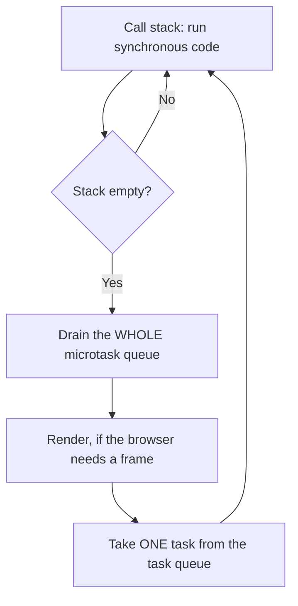

# Event Loop {#ch-event-loop}

> একটি asynchronous code ঠিক কোন ক্রমে log করবে, আগে থেকে বলে দিন, আর কেন সেটাও।

**এই অধ্যায়ে:** call stack · task আর microtask queue · microtask কেন task-কে না খাইয়ে রাখে · `setTimeout(fn, 0)` · rendering আর frame budget

## 💡 মূল ধারণা

JavaScript চলে একটি thread-এ, একটি call stack নিয়ে। Asynchronous কাজ JavaScript নিজে চালায়ই না। কাজটা করে host
(browser, বা Node.js), তারপর একটি callback queue-তে রেখে দেয়। এরপর কী চলবে, তা বেছে নেওয়ার নিয়মটাই event loop।
এর একটি রূপ মুখস্থ রাখার মতো: **সব synchronous code চালাও, তারপর পুরো microtask queue খালি করো, তারপর ঠিক একটি
task নাও।** Interview-এ ক্রম নিয়ে যত ধাঁধা আসে, সবই এই বাক্যটা প্রয়োগ করে মেলে।

## কীভাবে কাজ করে



**Loop-এর এক পাক: সব microtask, তারপর হয়তো একবার paint, তারপর একটিমাত্র task।**

| Queue         | কী থাকে                                                                 | এক পাকে কয়টি |
| ------------- | --------------------------------------------------------------------- | ----------------- |
| **Microtask** | `.then`/`.catch`/`.finally`, আবার শুরু হওয়া `await`, `queueMicrotask`, `MutationObserver` | **সবগুলো**   |
| **Task**      | `setTimeout`, `setInterval`, I/O, event, `setImmediate` (Node.js)     | **ঠিক একটি**   |

### চেনা ক্রমটা

```typescript
console.log('1 script start');

setTimeout((): void => console.log('2 setTimeout'), 0); // task

void Promise.resolve().then((): void => console.log('3 promise')); // microtask

console.log('4 script end');

// 1 script start
// 4 script end
// 3 promise      ← the microtask queue drains first
// 2 setTimeout   ← then one task
```

`0`-এর এখানে কোনো ভূমিকা নেই। সবার শেষে schedule করা microtask-ও সবার আগে schedule করা task-এর আগে চলে, কারণ
দুটি queue আসলে একটি queue নয়।

### Task-এর ভেতর থেকে queue করা microtask পরের task-এর আগেই চলে

```typescript
setTimeout((): void => {
  console.log('task A');
  void Promise.resolve().then((): void => console.log('microtask from A'));
}, 0);

setTimeout((): void => console.log('task B'), 0);

// task A
// microtask from A   ← the queue is drained after every task, not once per loop
// task B
```

### Microtask কেন task-কে না খাইয়ে রাখতে পারে

যে microtask আরেকটি microtask queue করে, সেটাও একই খালি করার পালায় যোগ হয়। Queue খালি না হওয়া পর্যন্ত loop
এগোয় না। তাই নিজেকে বারবার schedule করা একটি microtask পুরো page আটকে দেয়: কোনো timer নেই, কোনো input নেই,
কোনো paint নেই:

```typescript
function starve(): void {
  void Promise.resolve().then(starve); // ❌ never yields
}
```

`setTimeout` দিয়ে recursion করলে হয় ঠিক উল্টো। প্রতিটি callback আলাদা একটি task, তাই মাঝখানে browser render করার
সুযোগ পায়।

### Rendering আর frame budget

Browser paint করতে পারে শুধু দুটি task-এর মাঝখানে। একটি task-এর মাঝপথে বা microtask খালি করার সময় কখনো paint হয় না।
প্রতি সেকেন্ডে 60 frame হলে পুরো এক পাকের জন্য সময় মোটামুটি **16 millisecond**। মাত্র একটি 50 ms-এর synchronous
function তিনটি frame ফেলে দেয়। Profiler-এ "janky" বলতে এটাই বোঝায়।

```typescript
// ❌ one long task — the tab is frozen for three seconds
const start: number = Date.now();
while (Date.now() - start < 3000) {
  /* nothing else runs: no paint, no input, no timers */
}
```

## কখন ব্যবহার করবেন

| আপনি যা চান                                     | কী ব্যবহার করবেন                             | কেন                                              |
| -------------------------------------------- | ------------------------------------- | ------------------------------------------------ |
| বর্তমান code-এর পরে, কিন্তু paint-এর আগে চালাতে | `queueMicrotask` বা `Promise.resolve().then` | Rendering-এর আগেই microtask খালি হয়          |
| আগে browser-কে paint আর input সামলাতে দিতে | `setTimeout(fn, 0)`                 | পালাটা ছেড়ে দেয়; microtask সেটা করত না            |
| পরের frame-এর সঙ্গে মিলিয়ে কাজ করতে          | `requestAnimationFrame`               | Paint-এর ঠিক আগে চলে, frame-এর timestamp সহ |
| লম্বা হিসাব main thread থেকে দূরে রাখতে | একটি Web Worker                         | টুকরো করলে jank ঢাকা পড়ে; worker সেটা দূর করে          |

লম্বা কাজ টুকরো করতে কাজটা ভাগ করুন, আর প্রতি দুই ভাগের মাঝে একটি `setTimeout(resolve, 0)` `await` করুন। এই বিরতি
**অবশ্যই** একটি task হতে হবে। আগে থেকে resolved promise await করলে queue হয় একটি microtask। Loop এগোনোর আগেই সেটা খালি
করে ফেলে, তাই কিছুই paint হয় না।

## সাধারণ ভুল

**❌ `setTimeout(fn, 0)`-কে "এখনই চালাও" ভাবা।** এর মানে "একটি task queue করো"। সেই task অপেক্ষা করে সব
synchronous code আর প্রতিটি বাকি microtask-এর জন্য। তার ওপর browser nested timer-কে মোটামুটি 4 ms-এর নিচে নামতে
দেয় না, আর background tab-এ সেগুলো ভীষণ ধীর করে দেয়।

**❌ ধরে নেওয়া যে `await` চারপাশের code-কেও অপেক্ষা করায়।** `await` থামায় শুধু নিজের function-কে, আর নিয়ন্ত্রণ
ফিরিয়ে দেয় loop-কে। একসঙ্গে শুরু হওয়া দুটি async function তাই একে অপরের ফাঁকে ফাঁকে চলে:

```typescript
void task1(); // logs 'start', suspends
void task2(); // logs 'start', suspends — before task1 resumes
```

**❌ আশা করা যে state update একই পাকেই দেখা যাবে।** React 19-এ value-টা একটি `const`, যা সেই render-এর closure
ধরে রেখেছে। তাই handler থেকে schedule করা কোনো কিছুই নতুন value দেখতে পায় না:

```tsx
const handleClick = (): void => {
  setCount(count + 1);
  console.log(count); // this render's value
  setTimeout((): void => console.log(count), 0); // still this render's value
};
```

Re-render হয় পরে, নতুন closure নিয়ে। পরের value বর্তমানটার ওপর নির্ভর করলে updater রূপটা ব্যবহার করুন,
`setCount((c) => c + 1)`।

**❌ "বিরতি" দিতে microtask ব্যবহার করা।** Loop এগোনোর আগে microtask খালি করে ফেলে। তাই loop-এর ভেতরে resolved
promise await করলে কোনো বিরতিই হয় না, আর rendering তখনো আটকে থাকে।

> ⚠️ Node.js-এ কিছু বাড়তি phase আছে, যা browser-এ নেই। `process.nextTick` অন্য microtask-এর আগেই খালি হয়, আর
> `setImmediate` timer থেকে আলাদা একটি phase। তবু synchronous → microtask → task ক্রমটা একই থাকে। তফাত শুধু
> task phase-এর ভেতরের খুঁটিনাটিতে।

## 🔑 মূল শিক্ষা

- একটি thread, একটি stack: async callback host queue করে, আপনার code-এর সঙ্গে একই সময়ে কখনো চলে না।
- প্রতিটি পাক **পুরো** microtask queue খালি করে, কিন্তু task নেয় মাত্র **একটি**।
- Task-কে যত delay-ই দেওয়া হোক, microtask সবসময় আগে চলে।
- Browser paint করতে পারে শুধু task-এর মাঝখানে, তাই লম্বা synchronous function frame ফেলে দেয়।
- সত্যিকারের বিরতি দিতে task queue করুন; microtask loop-কে এগোনোর সুযোগ দেয় না।

## Interview-এর প্রশ্ন

**Q: এটা কী log করবে: `setTimeout(() => log('A'), 0)`, তারপর `Promise.resolve().then(() => log('B'))`?**

আগে `B`, তারপর `A`। Promise-এর callback একটি microtask, আর timer-এর callback একটি task। Synchronous script শেষ হলে
loop একটি task ধরার আগে প্রতিটি microtask খালি করে। তাই শূন্য millisecond-এর timer-ও আসে দ্বিতীয় হয়ে।

**Q: Synchronous ভাবে কিছুই আটকে না থাকলেও একটি page কীভাবে জমে যেতে পারে?**

যে microtask আরেকটি microtask schedule করে, সেটাই page জমিয়ে দিতে পারে। Loop এগোনোর আগে queue পুরো খালি করে। তাই
নিজেকে বারবার schedule করা promise chain কোনো task-কে চলতে বা কোনো frame-কে paint হতে দেয় না। `setTimeout` দিয়ে
recursion করলে এটা হয় না, কারণ প্রতিটি callback তখন নিজেই একটি task।

**Q: কখন `setTimeout` দিয়ে কাজ টুকরো না করে Web Worker নেবেন?**

যখন কাজটা সত্যিই CPU-ভারী, আর মাঝপথে পরিষ্কারভাবে থামানো যায় না। যেমন বড় একটি file parse করা, diff চালানো, বা
image process করা। টুকরো করলে jank দূর হয় না, শুধু ছড়িয়ে পড়ে, আর সমন্বয়ের code বাড়ে। Worker কাজটাকে main
thread থেকে পুরোপুরি সরিয়ে নেয়। দাম হলো structured-clone দিয়ে message পাঠানো (thread-এর মধ্যে data copy করা), আর
DOM-এ হাত দেওয়ার উপায় না থাকা।

## এরপর কী পড়বেন

- [Chapter ?? — Promise, Async/Await ও Error](#ch-promises-async) — যেসব জিনিস থেকে সবচেয়ে বেশি microtask তৈরি হয়
- [Chapter ?? — Scope ও Closure](#ch-closures) — পিছিয়ে দেওয়া callback ঠিক ওই value-টাই কেন দেখে
- [Chapter ?? — Core Web Vitals](#ch-core-web-vitals) — user যা টের পান, সেই metric হিসেবে frame budget-এর মাপ
