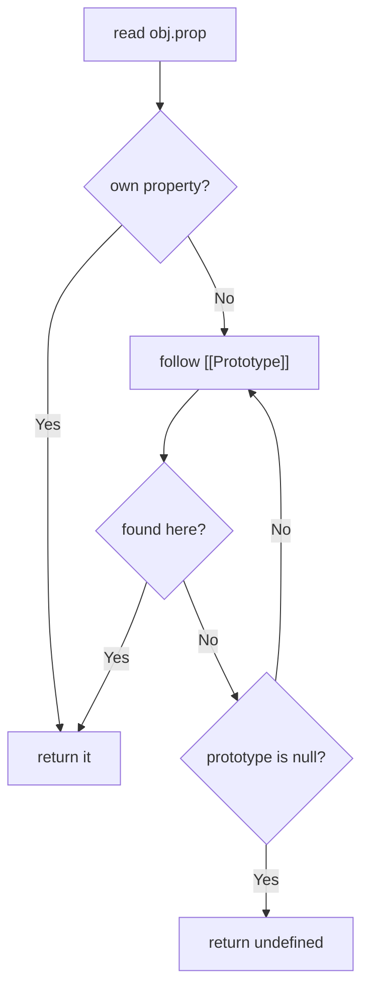

# Prototype ও Inheritance {#ch-prototypes-inheritance}

> Prototype chain ধরে একটি property খোঁজা শেষ পর্যন্ত অনুসরণ করুন, আর `class` ভেতরে ভেতরে আসলে কী করছে তা বুঝিয়ে বলুন।

**এই অধ্যায়ে:** delegation আর classical inheritance · prototype chain · `Object.create` · constructor function · `class` compile হয়ে কী হয়

## 💡 মূল ধারণা

Runtime-এ JavaScript-এর কোনো class নেই। আছে এমন object, যারা কাজ অন্য object-কে **delegate** করে। প্রতিটি object-এর
ভেতরে আরেকটি object-এর দিকে একটি লুকানো link থাকে, `[[Prototype]]`। Object-এর নিজের নেই এমন property পড়তে গেলে
JavaScript সেই link ধরে যায়, তারপর পরের link ধরে। কিছু মিলে গেলে, বা chain `null`-এ পৌঁছালে থামে। `class` ঠিক এর
ওপরেই বসানো syntax: একই link বানানোর একটি সুন্দর উপায়।

## কীভাবে কাজ করে

| দিক           | Classical (Java, C#)             | Prototypal (JavaScript)           |
| ------------- | -------------------------------- | --------------------------------- |
| **Model**     | Class-এর নকশা → instance-এর copy | Object → object-এ delegation        |
| **Method**   | প্রতিটি instance-এর type-এ copy হয়  | Share হয়, chain ধরে হেঁটে খুঁজে পাওয়া যায় |
| **কখন ঠিক হয়**    | Class compile হওয়ার সময়ই, তারপর স্থির  | Runtime-এ বদলানো যায়                |
| **কী দিয়ে বানানো** | `class`, `extends`               | `[[Prototype]]` link, `Object.create` |

### খোঁজার ধাপ



**Property পড়ার সময় chain ধরে এক link এক link করে এগোয়, আর প্রথম মিল পেলেই থামে।**

ধরুন `const buddy = new Dog()`, যেখানে `Dog extends Animal`। তাহলে chain হলো
`buddy → Dog.prototype → Animal.prototype → Object.prototype → null`। এজন্যই কেউ define না করলেও প্রতিটি object-এ
`toString` থাকে।

**Link পড়া আর বসানো:**

<!-- lint-allow-fence: javascript — `__proto__` is a deprecated accessor that TypeScript does not put on the object type; the fence exists to compare it with `Object.getPrototypeOf` -->
```javascript
const obj = {};

obj.__proto__;               // deprecated accessor — recognise it, don't write it
Object.getPrototypeOf(obj);  // ✅ the standard read
Object.setPrototypeOf(a, b); // ✅ the standard write — slow, so avoid it in hot paths
```

### Method কেন prototype-এ রাখা হয়

Instance property প্রতিটি object-এ নিজের আলাদা copy রাখে। Prototype method হলো একটিই function, যেটা সব instance মিলে
share করে।

<!-- lint-allow-fence: javascript — a constructor function assigning to `this` and hanging methods off `.prototype` has no TypeScript form — `class` is the TypeScript form, and using it here would hide the mechanism the chapter exists to explain -->
```javascript
// ❌ assigning in the constructor: one greet function per instance
function PersonBad(name) { this.name = name; this.greet = function () {}; }
new PersonBad('a').greet === new PersonBad('b').greet; // false

// ✅ on the prototype: one greet function, shared
function Person(name) { this.name = name; }
Person.prototype.greet = function () { console.log(this.name); };
new Person('a').greet === new Person('b').greet; // true
```

হাজারটা instance হলে প্রথম রূপে হাজারটা closure, আর দ্বিতীয় রূপে মাত্র একটি function।

### `new` কী করে

`new` চারটি ধাপে কাজ করে:

1. একটি খালি object বানায়।
2. তার `[[Prototype]]` বসিয়ে দেয় constructor-এর `.prototype`-এ।
3. `this`-কে সেই object-এ bind করে constructor-এর body চালায়।
4. Object-টা return করে। তবে body নিজে অন্য কোনো object return করলে সেটাই ফেরত যায়।

`Object.create(Person.prototype)` শুধু প্রথম দুটি ধাপ করে। তাই constructor ছাড়াই delegation বোঝানোর সবচেয়ে সরাসরি
উপায় এটাই।

```typescript
const personPrototype = {
  greet(this: { name: string }): void {
    console.log(`Hello, I'm ${this.name}`);
  },
};

const alice = Object.create(personPrototype) as { name: string; greet(): void };
alice.name = 'Alice';
alice.greet(); // 'Hello, I'm Alice' — found by delegation, not ownership
```

### `class`, আর এটা আসলে কিসের ওপর বসানো

```typescript
class Animal {
  constructor(public name: string) {}

  eat(): void {
    console.log(`${this.name} is eating`);
  }
}

class Dog extends Animal {
  // `extends` is what wires Dog.prototype → Animal.prototype
  override eat(): void {
    super.eat(); // reaches the shadowed prototype method
    console.log('and wagging');
  }
}

typeof Animal; // 'function' — still a function, still a prototype
Object.getPrototypeOf(new Dog('a')) === Dog.prototype; // true
```

2015-এর আগে একই জিনিস পেতে হাতে করে তিন লাইন জোড়াতালি দিতে হতো। Child constructor call করত
`Animal.call(this, name)`। তারপর `Dog.prototype = Object.create(Animal.prototype)` chain-টা জুড়ে দিত। শেষে
`Dog.prototype.constructor = Dog` সেই reference-টা ঠিক করত, যেটা আগের assignment মুছে দিয়েছিল। পুরনো code-এ এটা চিনে
রাখুন, কিন্তু নিজে কখনো লিখবেন না।

## কখন ব্যবহার করবেন

| পরিস্থিতি                                        | কী ব্যবহার করবেন                | কেন                                             |
| ----------------------------------------------- | ------------------------ | ----------------------------------------------- |
| Shared behaviour আর অনেক instance-ওয়ালা type  | `class`                  | Method নিজে থেকেই prototype-এ গিয়ে বসে      |
| এমন একটি object, যার অন্যটার কাছে delegate করার কথা | `Object.create(proto)`   | নতুন class না বানিয়েই delegation বোঝায়  |
| কয়েকটি আলাদা উৎস থেকে জোড়া লাগানো behaviour | Composition, বা mixin class expression | Single inheritance দিয়ে এটা বোঝানো যায় না |
| Array বা string-এ helper যোগ করা             | আলাদা একটি function    | Built-in prototype-এ হাত দিলে অন্যের code ভাঙে |

## সাধারণ ভুল

**❌ Instance তৈরি হয়ে যাওয়ার পর prototype object বদলে ফেলা।** আগের instance-গুলো পুরনো link-ই ধরে রাখে, নতুন
method-গুলো পায় না:

```typescript
Person.prototype = { greet() {} }; // ❌ old instances are stranded
Person.prototype.greet = function () {}; // ✅ add to the existing object
```

**❌ Built-in prototype-এ হাত দেওয়া।** `Array.prototype.first = ...` পাতার প্রতিটি library দেখতে পায়। এটা
`for...in`-এও দেখা দেয়, আর ভবিষ্যতের standard method-এর সঙ্গে ধাক্কা খায়। তার বদলে `first(arr)` লিখুন।

**❌ ধরে নেওয়া যে ঢাকা পড়া property মুছে গেছে।** `alice.age = 25` assign করলে একটি *নিজের* property তৈরি হয়, যেটা
prototype-এরটাকে ঢেকে দেয়। `delete alice.age` করার পর prototype-এর value আবার দেখা যায়।

**❌ `super()`-এর আগে `this` ব্যবহার করা।** Derived constructor-এ `super` return না করা পর্যন্ত `this`-এর অস্তিত্বই
নেই। TypeScript এটা ধরে ফেলে। সাধারণ JavaScript runtime-এ `ReferenceError` throw করে।

> ⚠️ চালু থাকা object-এর ওপর `Object.setPrototypeOf` চালালে প্রতিটি বড় engine-এ সেটা ধীর হয়ে যায়। তার বদলে তৈরির
> সময়েই `Object.create` বা `class` দিয়ে prototype বসিয়ে দিন।

## 🔑 মূল শিক্ষা

- Property খোঁজা `[[Prototype]]` chain ধরে এগোয়, প্রথম মিলে থামে, আর শেষ হয় `null`-এ গিয়ে।
- `class` শুধু syntax: class-এর `typeof` হলো `'function'`, আর তার method থাকে `.prototype`-এ।
- Prototype-এর method সবাই share করে। Constructor-এর ভেতরে assign করা method প্রতিটি instance-এ আলাদা copy হয়।
- `Fn.prototype` হলো সেই object, যার কাছে instance-গুলো delegate করে। `obj.__proto__` হলো তার দিকে দেখানো link।
- Property assign করলে prototype-এরটা বদলায় না, শুধু ঢাকা পড়ে।

## Interview-এর প্রশ্ন

**Q: `prototype` আর `__proto__`-এর পার্থক্য কী?**

`prototype` হলো constructor function-এর একটি property। এতে থাকে সেই object, যার কাছে এর instance-গুলো delegate করবে।
`__proto__` হলো instance-এর delegation link। `const a = new Person()` হলে
`a.__proto__ === Person.prototype`। Link-টা পড়ুন `Object.getPrototypeOf` দিয়ে, কারণ `__proto__` একটি deprecated
accessor।

**Q: ES2015-এর class কি সত্যিকারের class?**

না। `class` হলো constructor function আর prototype-এর ওপর বসানো syntax। Class তখনো একটি function, তার method তখনো
`.prototype`-এ বসে, আর `extends` তখনো শুধু এক prototype-কে আরেকটির সঙ্গে জোড়ে। তবে এটা ওপরে কিছু সত্যিকারের নিয়ম
যোগ করে। Declaration না চলা পর্যন্ত class-এর নাম TDZ-এ (temporal dead zone) থাকে, আর `this`-এর আগে `super()` আসতেই
হবে। এর method-গুলো enumerable নয়, আর `new` দিয়ে call করা যায় না। কিন্তু নিচের object model একই থাকে।

**Q: কখন `class`-এর বদলে `Object.create` বেছে নেবেন?**

যখন এক object-এর আরেকটির কাছে delegate করার কথা, আর নতুন type বানিয়ে কোনো লাভ নেই। যেমন এমন config object, যেটা
না পেলে default-এ ফিরে যায়, বা এমন test double, যেটা আসল implementation-এর কাছে delegate করে। আরেকটি উদাহরণ:
data থেকে runtime-এ বানানো prototype chain। এটা property descriptor দিয়ে খুঁটিনাটি নিয়ন্ত্রণও দেয়, যেটা class syntax
খুলে দেয় না।

## এরপর কী পড়বেন

- [Chapter ?? — `this` Keyword](#ch-this-keyword) — `new` binding কীভাবে object-টা জোগায়
- [Chapter ?? — OOP ও Inheritance-এর বদলে Composition](#ch-composition-over-inheritance) — এই model-এর ওপর encapsulation, আর chain যখন আর কাজে দেয় না তখন কী করবেন
