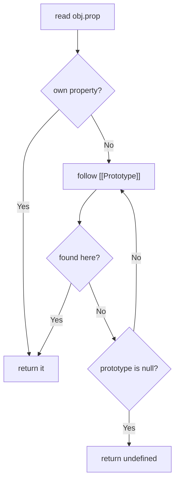

# Prototype ও Inheritance {#ch-prototypes-inheritance}

> Prototype chain ধরে একটি property lookup কীভাবে ওপরে ওঠে, সেটা অনুসরণ করুন। আর `class` আসলে নিচে কী করছে, সেটা ব্যাখ্যা করুন।

**এই অধ্যায়ে:** delegation বনাম classical inheritance · prototype chain · `Object.create` · constructor function · `class` আসলে কীসে compile হয়

## 💡 মূল ধারণা

Runtime-এ JavaScript-এ কোনো class নেই। আছে object, যারা অন্য object-কে **delegate** করে। প্রতিটি object-এ
একটি লুকানো link থাকে, `[[Prototype]]`, যা আরেকটি object-এর দিকে নির্দেশ করে। যে property object-টির নিজের নেই,
সেটা পড়তে গেলে JavaScript ওই link ধরে এগোয়, তারপর পরেরটা। কিছু মিলে গেলে, অথবা chain `null`-এ পৌঁছালে, থামে।
`class` ঠিক এটারই ওপরে একটি syntax: একই link বানানোর একটু সুন্দর উপায়।

## কীভাবে কাজ করে

| দিক            | Classical (Java, C#)                    | Prototypal (JavaScript)                    |
| ------------- | --------------------------------------- | ------------------------------------------ |
| **Model**     | Class-এর নকশা → instance-এ কপি           | Object → object delegation                 |
| **Method**    | প্রতিটি instance-এর type-এ কপি হয়        | Shared, chain ধরে হেঁটে খুঁজে পাওয়া যায়      |
| **কখন ঠিক হয়** | Class compile হওয়ার সময় স্থির           | Runtime-এ বদলানো যায়                        |
| **কী দিয়ে বানানো** | `class`, `extends`                  | `[[Prototype]]` link, `Object.create`      |

### Lookup



**একটি property পড়া chain ধরে এক link করে এগোয়, আর প্রথম মিলেই থামে।**

`const buddy = new Dog()`-এর জন্য, যেখানে `Dog extends Animal`, chain-টি হলো
`buddy → Dog.prototype → Animal.prototype → Object.prototype → null`। এ কারণেই কেউ define না করলেও প্রতিটি
object-এ `toString` থাকে।

**Link পড়া ও set করা:**

<!-- lint-allow-fence: javascript — `__proto__` is a deprecated accessor that TypeScript does not put on the object type; the fence exists to compare it with `Object.getPrototypeOf` -->
```javascript
const obj = {};

obj.__proto__;               // deprecated accessor — recognise it, don't write it
Object.getPrototypeOf(obj);  // ✅ the standard read
Object.setPrototypeOf(a, b); // ✅ the standard write — slow, so avoid it in hot paths
```

### Method কেন prototype-এ রাখা হয়

Instance property-তে প্রতিটি object-এর নিজের আলাদা কপি থাকে। Prototype method হলো একটিই function, যা সব
instance share করে।

<!-- lint-allow-fence: javascript — a constructor function assigning to `this` and hanging methods off `.prototype` has no TypeScript form — `class` is the TypeScript form, and using it here would hide the mechanism the chapter exists to explain -->
```javascript
// ❌ assigning in the constructor: one greet function per instance
function PersonBad(name) { this.name = name; this.greet = function () {}; }
new PersonBad('a').greet === new PersonBad('b').greet; // false

// ✅ on the prototype: one greet function, shared
function Person(name) { this.name = name; }
Person.prototype.greet = function () { console.log(this.name); };
new Person('a').greet === new Person('b').greet; // true
```

হাজারটা instance মানে প্রথম রূপে হাজারটা closure, আর দ্বিতীয় রূপে একটিই function।

### `new` কী করে

`new` চারটি ধাপে কাজ করে:

1. একটি খালি object তৈরি করে।
2. তার `[[Prototype]]`-কে constructor-এর `.prototype`-এ set করে।
3. `this`-কে ওই object-এ bind করে constructor-এর body চালায়।
4. Object-টি return করে, যদি না body স্পষ্টভাবে অন্য কোনো object return করে।

`Object.create(Person.prototype)` শুধু প্রথম দুটি ধাপ করে। তাই কোনো constructor ছাড়াই delegation প্রকাশ করার
সরাসরি উপায় এটাই।

```typescript
const personPrototype = {
  greet(this: { name: string }): void {
    console.log(`Hello, I'm ${this.name}`);
  },
};

const alice = Object.create(personPrototype) as { name: string; greet(): void };
alice.name = 'Alice';
alice.greet(); // 'Hello, I'm Alice' — found by delegation, not ownership
```

### `class`, আর এটি আসলে কীসের sugar

```typescript
class Animal {
  constructor(public name: string) {}

  eat(): void {
    console.log(`${this.name} is eating`);
  }
}

class Dog extends Animal {
  // `extends` is what wires Dog.prototype → Animal.prototype
  override eat(): void {
    super.eat(); // reaches the shadowed prototype method
    console.log('and wagging');
  }
}

typeof Animal; // 'function' — still a function, still a prototype
Object.getPrototypeOf(new Dog('a')) === Dog.prototype; // true
```

2015-এর আগে একই ফলের জন্য তিন লাইনের হাতে-করা wiring লাগত। Child constructor `Animal.call(this, name)` call
করত। তারপর `Dog.prototype = Object.create(Animal.prototype)` chain-টি জুড়ত। শেষে
`Dog.prototype.constructor = Dog` সেই reference ঠিক করত, যা আগের assignment মুছে দিয়েছিল। পুরনো code-এ এটা
চিনে রাখুন, কিন্তু কখনো নিজে লিখবেন না।

## কখন ব্যবহার করবেন

| পরিস্থিতি                                          | কী বেছে নেবেন               | কেন                                              |
| ------------------------------------------------- | -------------------------- | ------------------------------------------------ |
| Shared behaviour আর অনেক instance-ওয়ালা একটি type  | `class`                    | Method নিজে থেকেই prototype-এ বসে                  |
| এমন একটি object, যা আরেকটিকে delegate করবে           | `Object.create(proto)`     | নতুন class না বানিয়েই delegation প্রকাশ করে        |
| কয়েকটি স্বাধীন উৎস থেকে জোড়া behaviour               | Composition, অথবা একটি mixin class expression | Single inheritance এটা প্রকাশ করতে পারে না |
| Array বা string-এ একটি helper যোগ করা                | একটি আলাদা function          | Built-in prototype patch করলে অন্যের code ভাঙে     |

## সাধারণ ভুল

**❌ Instance তৈরি হওয়ার পরে prototype object বদলে দেওয়া।** আগের instance-গুলো পুরনো link-টাই রেখে দেয়, আর
নতুন method-গুলো পায় না:

```typescript
Person.prototype = { greet() {} }; // ❌ old instances are stranded
Person.prototype.greet = function () {}; // ✅ add to the existing object
```

**❌ Built-in prototype patch করা।** Page-এর প্রতিটি library `Array.prototype.first = ...` দেখতে পায়। এটা
`for...in`-এও দেখা দেয়, আর ভবিষ্যতের standard method-এর সঙ্গে সংঘর্ষ বাধায়। এর বদলে `first(arr)` লিখুন।

**❌ ধরে নেওয়া যে shadow করা property মুছে গেছে।** `alice.age = 25` assign করলে একটি *নিজস্ব* property তৈরি হয়,
যা prototype-এরটাকে আড়াল করে। `delete alice.age`-এর পরে prototype-এর মান আবার দেখা দেয়।

**❌ `super()`-এর আগে `this` ব্যবহার করা।** Derived constructor-এ `super` return না করা পর্যন্ত `this`-এর
অস্তিত্বই থাকে না। TypeScript এটা ধরে ফেলে। সাধারণ JavaScript runtime-এ একটি `ReferenceError` throw করে।

> ⚠️ আগে থেকে থাকা কোনো object-এ `Object.setPrototypeOf` চালালে প্রতিটি বড় engine সেটাকে deoptimise করে।
> এর বদলে তৈরির সময়েই `Object.create` বা `class` দিয়ে prototype set করুন।

## 🔑 মূল শিক্ষা

- Property lookup `[[Prototype]]` chain ধরে হাঁটে, প্রথম মিলেই থামে, আর শেষ হয় `null`-এ।
- `class` শুধুই syntax: একটি class-এর `typeof` হলো `'function'`, আর এর method-গুলো থাকে `.prototype`-এ।
- Prototype-এর method shared। Constructor-এ assign করা method প্রতিটি instance-এ আলাদা করে কপি হয়।
- `Fn.prototype` হলো সেই object, যাকে instance-রা delegate করে। `obj.__proto__` হলো সেটার দিকে নির্দেশ করা link।
- একটি property assign করলে সেটা prototype-এরটাকে বদলায় না, shadow করে।

## Interview-এর প্রশ্ন

**Q: `prototype` আর `__proto__`-এর মধ্যে পার্থক্য কী?**

`prototype` হলো একটি constructor function-এর property। এতে সেই object থাকে, যাকে এর instance-রা delegate করবে।
`__proto__` হলো একটি instance-এর delegation link। `const a = new Person()`-এর জন্য,
`a.__proto__ === Person.prototype`। Link-টি `Object.getPrototypeOf` দিয়ে পড়ুন, কারণ `__proto__` একটি
deprecated accessor।

**Q: ES2015-এর class কি আসল class?**

না। `class` হলো constructor function আর prototype-এর ওপরে একটি syntax। একটি class এখনো একটি function, এর
method-গুলো এখনো `.prototype`-এ বসানো হয়, আর `extends` এখনো শুধু একটি prototype-কে আরেকটির সঙ্গে জোড়ে। তবে এটা
ওপরে কিছু আসল নিয়ম যোগ করে। Declaration না চলা পর্যন্ত class-এর নাম TDZ (temporal dead zone)-এ থাকে, আর
`this`-এর আগে `super()` আসতেই হবে। এর method-গুলো non-enumerable, আর `new` দিয়ে call করা যায় না। কিন্তু নিচের
object model বদলায় না।

**Q: কখন আপনি `class`-এর চেয়ে `Object.create` পছন্দ করবেন?**

যখন একটি object আরেকটিকে delegate করবে, আর নতুন type কোনো কাজে আসে না। উদাহরণ: একটি config object, যা default-এ
fall back করে। অথবা একটি test double, যা আসল implementation-কে delegate করে। আরেকটি উদাহরণ হলো data থেকে
runtime-এ বানানো prototype chain। এটা property descriptor-এর মাধ্যমে সূক্ষ্ম নিয়ন্ত্রণও দেয়, যা class syntax
দেয় না।

## এরপর কী পড়বেন

- [Chapter ?? — `this` Keyword](#ch-this-keyword) — `new` binding কীভাবে object-টি জোগায়
- [Chapter ?? — OOP ও Inheritance-এর বদলে Composition](#ch-composition-over-inheritance) — এই model-এর ওপরে encapsulation, আর chain যখন আর কাজে আসে না তখন কী করবেন
