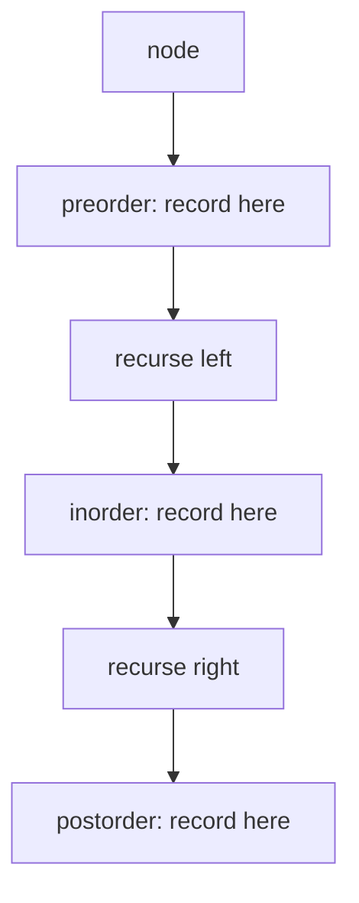

# Binary Tree Traversal {#ch-binary-tree-traversal}

> Problem যে traversal order চায়, সেটা বেছে নিন। তাহলে tree-র বেশিরভাগ প্রশ্নই চার line-এর recursion হয়ে যায়।

**এই অধ্যায়ে:** চারটি order, আর কোনটা কীসের জন্য · BST-তে inorder কেন sorted · যে iterative রূপগুলো জানা দরকার · level order আর `levelSize`-এর কৌশল · recursion-এর গভীরতা, যা ঠিক করে খরচ `O(h)` নাকি `O(n)`

## 💡 মূল ধারণা

Tree-তে একটিমাত্র "পরের" node বলে কিছু নেই। তাই প্রতিটি node ঘুরে দেখতে হলে একটি order বেছে নিতেই হয়। জানার মতো order
মাত্র চারটি। এর তিনটিতে তফাত শুধু এক জায়গায়: children-এর তুলনায় **node নিজেকে কখন দেখা হয়**।

```typescript
interface TreeNode {
  val: number;
  left: TreeNode | null;
  right: TreeNode | null;
}
```

| Order          | দেখার ক্রম         | কখন ব্যবহার করবেন                                                    |
| -------------- | ---------------------- | -------------------------------------------------------------- |
| **Preorder**   | node → left → right    | Children-এর আগে node দরকার: tree copy করা, serialise করা |
| **Inorder**    | left → node → right    | Tree-টা BST, আর আপনি sorted order চান                     |
| **Postorder**  | left → right → node    | Node-এর উত্তর তার children-এর ওপর নির্ভর করে: height, যোগফল, মুছে ফেলা |
| **Level order**| সারি ধরে, বাঁ থেকে ডানে | উত্তরটা গভীরতা নিয়ে: right-side view, minimum depth   |

তিনটি depth-first order আসলে *একই traversal*, শুধু node-এর নিজের কাজটা অন্য line-এ সরানো। পুরো অন্তর্দৃষ্টি এটুকুই:
recursion একবার লিখুন, তারপর একটি line সরান।

> Tree-র প্রশ্নে আসল কাজ হলো order বাছা। "Maximum depth" postorder, কারণ node-এর depth জানতে আগে children-এর depth
> লাগে। "Validate BST" preorder, কারণ bound-গুলো ওপর থেকে নিচে নামে।

## কীভাবে কাজ করে

### তিনটি depth-first order

```typescript
function inorder(node: TreeNode | null, out: number[] = []): number[] {
  if (node === null) return out;   // the base case: a missing child is not an error
  inorder(node.left, out);
  out.push(node.val);              // move this line to change the order
  inorder(node.right, out);
  return out;
}
// Time: O(n) — every node visited once. Space: O(h) for the call stack
```

Preorder দুটি call-এর আগে push করে, postorder দুটির পরে। আর কিছুই বদলায় না।

Space লাগে `O(h)`, `O(n)` নয়। এখানে `h` হলো height। Balanced tree-তে সেটা `O(log n)`। আর degenerate tree, মানে
ছদ্মবেশে আসলে linked list, সেখানে `O(n)`, আর input যথেষ্ট গভীর হলে stack overflow হয়। Interviewer-রা ঠিক এই
তফাতটাই জিজ্ঞেস করেন।

### BST-তে inorder কেন sorted

BST-র invariant হলো, left subtree-র সবকিছু node-এর চেয়ে ছোট, আর right subtree-র সবকিছু বড়। Inorder ঠিক এই ক্রমেই দেখে:
আগে সব ছোট value, তারপর node, তারপর সব বড় value। আর এই নিয়ম প্রতিটি স্তরে recursive-ভাবে খাটে। তাই output গঠনগতভাবেই
ascending।

কাজের দিক থেকে এর মানে: **"BST-তে kth smallest" আসলে counter-সহ inorder traversal**। পুরো list না বানিয়ে আগেভাগেই
থেমে যাওয়া যায়।

```typescript
function kthSmallest(root: TreeNode | null, k: number): number {
  const stack: TreeNode[] = [];
  let node = root;
  let remaining = k;

  while (node !== null || stack.length > 0) {
    while (node !== null) {      // walk left as far as possible, remembering the way back
      stack.push(node);
      node = node.left;
    }
    node = stack.pop()!;         // the smallest unvisited node
    if (--remaining === 0) return node.val;
    node = node.right;
  }
  throw new Error('k is larger than the tree');
}
// Time: O(h + k), Space: O(h)
```

এটাই **iterative inorder**, আর মুখস্থ রাখার মতো iterative traversal শুধু এটাই। Recursion আপনার হয়ে যা করে, stack এখানে
হাতে-কলমে ঠিক তা-ই করে। তাই "recursion ছাড়া এটা করতে পারবেন?" প্রশ্নের উত্তর এটাই।

### Level order

Level order হলো breadth-first, তাই stack নয়, queue লাগে। একমাত্র যে অংশটা চট করে চোখে পড়ে না: সারির size ধরে রাখতে হয়
loop-এর **আগে**, যাতে প্রতিটি সারি ঠিকমতো আলাদা দল হয়।

```typescript
function levelOrder(root: TreeNode | null): number[][] {
  if (root === null) return [];

  const rows: number[][] = [];
  let queue: TreeNode[] = [root];

  while (queue.length > 0) {
    const levelSize = queue.length;   // read it now — the loop below will grow the queue
    const row: number[] = [];
    const next: TreeNode[] = [];

    for (let i = 0; i < levelSize; i++) {
      const node = queue[i];
      row.push(node.val);
      if (node.left !== null) next.push(node.left);
      if (node.right !== null) next.push(node.right);
    }
    rows.push(row);
    queue = next;
  }
  return rows;
}
// Time: O(n), Space: O(w) where w is the widest level
```

প্রতিটি level-এ নতুন array নিলে `Array.prototype.shift()` এড়ানো যায়। V8-এ সেটা `O(n)`, আর চওড়া tree-তে চুপচাপ পুরো
traversal-কে `O(n²)` বানিয়ে দেয়।

Space লাগে `O(w)`, মানে সর্বোচ্চ width। Balanced tree-তে সেটা মোটামুটি `n / 2`, তাই level order-এ space লাগে `O(n)`, যেখানে
depth-first-এ লাগে `O(log n)`। Degenerate tree-তে হিসাবটা উল্টে যায়।



**Traversal একটিই, node-এর নিজের কাজ করার জায়গা তিনটি। কোন line বাছলেন, সেটাই order।**

প্রতিটি level আলাদা দল হয়ে গেলে নতুন কোনো কৌশল ছাড়াই একগাদা প্রশ্নের উত্তর বেরিয়ে আসে: right-side view হলো প্রতিটি
সারির শেষ element, minimum depth হলো প্রথম যে সারিতে কোনো leaf আছে, আর zigzag হলো একই loop, যেখানে একটি অন্তর একটি সারি
উল্টে দেওয়া হয়।

## কখন ব্যবহার করবেন

| প্রশ্ন যা চায়                                   | Traversal            | কেন                                          |
| ------------------------------------------------------- | -------------------- | -------------------------------------------- |
| BST থেকে sorted value, বা kth smallest           | Inorder              | BST invariant-এর কারণেই ascending          |
| Copy, বা এমন serialisation, যা থেকে আবার tree বানানো যায়         | Preorder             | কারও দরকার পড়ার আগেই root চলে আসে     |
| Height, diameter, subtree-র যোগফল, "balanced কিনা"        | Postorder            | Node-এর উত্তর তার children-এর ওপর নির্ভর করে |
| Level-এর গড়, right-side view, minimum depth          | Level order          | মাপা হচ্ছে গভীরতাই              |
| Unweighted graph-এ shortest path                    | BFS                  | Level order-এরই সাধারণ রূপ, BFS অধ্যায় দেখুন |
| Root থেকে leaf পর্যন্ত সব path, বা সব combination             | Backtracking-সহ preorder | Path তৈরি হয় নিচে নামার পথে       |
| কোনো node-এর parent বা ancestor                            | Postorder, ওপরে return করে | উত্তর মেলে ফেরার পথে |

⚠️ Tree মুছতে বা free করতে হলে **postorder** লাগবেই। Preorder node-টাকে আগেই free করে দেয়, অথচ তখনো children-এ পৌঁছানোর
একমাত্র পথ ছিল সেই node। ফলে পুরো subtree leak হয়। নিচ থেকে ওপরে জমানো যেকোনো হিসাবে একই যুক্তি খাটে: folder-এর size,
dependency গোনা।

## সাধারণ ভুল

**`null` যাচাই করার আগেই recursion চালানো:**

```typescript
// ❌ out.push(node.val); if (node === null) return;   // throws on a missing child
// ✅ if (node === null) return; — the base case comes first
```

**Iterative preorder-এ stack-এর ক্রম উল্টে ফেলা:**

```typescript
// ❌ stack.push(node.left); stack.push(node.right);   // pops right first
// ✅ stack.push(node.right); stack.push(node.left);   // a stack reverses what you give it
```

**Level-এর size ধরে না রাখা:**

```typescript
// ❌ for (let i = 0; i < queue.length; i++)   // the queue grows inside the loop; rows merge
// ✅ const levelSize = queue.length;          // read once, before the loop
```

**Queue হিসেবে `shift()` ব্যবহার করা:**

```typescript
// ❌ const node = queue.shift()!;   // O(n) per call — O(n²) overall on a wide tree
// ✅ index into the array, or swap in a fresh array per level
```

**ধরে নেওয়া যে যেকোনো binary tree-তে inorder sorted:**

```typescript
// ❌ inorder(root) and checking it is ascending only works if it is a BST to begin with
// ✅ that check is exactly how you validate a BST — but state the assumption
```

**Recursion-এর space `O(log n)` বলে দাবি করা:**

```typescript
// ❌ "recursion is O(log n) space"
// ✅ it is O(h). Balanced means O(log n); a skewed tree means O(n) and can overflow the stack
```

## অনুশীলনের জন্য Problem

| #   | Problem                                        | কঠিনতা | যা অনুশীলন করায়                                |
| --- | ---------------------------------------------- | ---------- | --------------------------------------------- |
| 94  | Binary Tree Inorder Traversal                  | Easy       | আগে recursion, তারপর iterative stack        |
| 102 | Binary Tree Level Order Traversal              | Medium     | `levelSize` দিয়ে দল করা                       |
| 104 | Maximum Depth of Binary Tree                   | Easy       | তিন line-এ postorder                       |
| 199 | Binary Tree Right Side View                    | Medium     | প্রতিটি সারির শেষ element                   |
| 103 | Binary Tree Zigzag Level Order Traversal       | Medium     | দিক বদলে বদলে level order         |
| 230 | Kth Smallest Element in a BST                  | Medium     | আগেভাগে থেমে যাওয়া iterative inorder               |
| 98  | Validate Binary Search Tree                    | Medium     | ওপর থেকে নামা bound, স্থানীয় তুলনা নয়    |
| 297 | Serialize and Deserialize Binary Tree          | Hard       | Null marker-সহ preorder কেন tree আবার গড়তে পারে |

94 করুন recursive-ভাবে আর iterative-ভাবে, তারপর 102। এরপর 199, 103 আর 637 একই loop, শুধু সারিটা আলাদাভাবে পড়া।

## 🔑 মূল শিক্ষা

- Preorder, inorder আর postorder একই traversal, শুধু node-এর নিজের কাজ আলাদা line-এ।
- BST-তে inorder sorted। তাই kth-smallest হলো counter-সহ inorder walk।
- Node যা কিছু তার children থেকে হিসাব করে, সেখানেই postorder: height, যোগফল, মুছে ফেলা।
- Level order-এ লাগে queue, আর সারির size পড়তে হয় loop-এর **আগে**, নইলে সারিগুলো মিশে যায়।
- Recursive traversal-এ stack space লাগে `O(h)`: balanced হলে `O(log n)`, হেলে থাকা tree-তে `O(n)`, আর overflow-এর ঝুঁকি।

## Interview-এর প্রশ্ন

**Q: BST-র inorder traversal কেন sorted output দেয়?**

BST invariant বলে, left subtree-র প্রতিটি value node-এর চেয়ে ছোট, আর right subtree-র প্রতিটি value বড়। Inorder আগে left
subtree দেখে, তারপর node, তারপর right। তাই আগে আসে সব ছোট value, তারপর node, তারপর সব বড় value। Invariant প্রতিটি node-এ
খাটে, তাই নিয়মটা recursive-ভাবে জুড়ে যায়, আর পুরো output হয় ascending।

**Q: Tree-র height বের করতে কোন traversal, আর কেন?**

Postorder। কোনো node-এর height তার children-এর মধ্যে উঁচুটার height-এর চেয়ে এক বেশি। তাই node উত্তর দেওয়ার আগে দুই
child-এরই হিসাব শেষ হতে হবে। Preorder node-টা দেখে যখন children তখনো অজানা। নিচ থেকে ওপরে জমানো যেকোনো হিসাবের জন্য
সেটা উল্টো দিক।

**Q: Recursion ছাড়া traversal কীভাবে করবেন, আর কখন সেটা জরুরি?**

Call stack-এর জায়গায় নিজের stack রাখুন: বাঁ দিকে নামতে নামতে প্রতিটি node push করুন, pop করে দেখুন, তারপর pop হওয়া
node-এর right child-এ যান। এটা জরুরি যখন tree এত গভীর হতে পারে যে call stack overflow হবে, যেমন 10⁵ node-এর degenerate
tree-তে হবেই। আর জরুরি যখন interviewer সরাসরি এটাই চান। সেটা সাধারণত যাচাই করে, recursion আসলে কী করছে তা আপনি বোঝেন
কিনা।

**Q: Level order আর depth-first-এর space complexity কত, আর কোনটা সস্তা?**

Level order একবারে একটি level ধরে রাখে, তাই `O(w)`, যেখানে `w` হলো সবচেয়ে চওড়া level। Balanced tree-তে সেটা প্রায়
`n / 2`। Depth-first ধরে রাখে root থেকে leaf পর্যন্ত একটি path, তাই `O(h)`, balanced tree-তে `O(log n)`। ফলে balanced tree-তে
depth-first অনেক সস্তা। হেলে থাকা tree-তে তুলনাটা উল্টে যায়: সেখানে width 1, আর height `n`।

**Q: প্রতিটি node-কে তার দুই child-এর সঙ্গে মিলিয়ে BST validate করা যায় না কেন?**

কারণ শর্তটা স্থানীয় নয়। Left subtree-র কোনো node-কে শুধু parent নয়, right branch ধরে নেমে আসা *প্রতিটি* ancestor-এর চেয়ে
ছোট হতে হবে। ধরুন root 5, তার নিচে 3, আর 3-এর right child 6। প্রতিটি parent-child যাচাই পেরিয়ে যায়, তবু BST ভেঙে
গেছে। সঠিক পদ্ধতি হলো recursion-এর সঙ্গে একটি `(min, max)`
range নিচে পাঠানো, নয়তো inorder traversal strictly increasing কিনা যাচাই করা।

**Q: শুধু inorder দিয়ে tree আবার গড়া যায় না, অথচ preorder দিয়ে যায় কেন?**

Preorder সবার আগে root দেয়। তাই না থাকা child-এর জন্য null marker রাখলে গঠন নিয়ে কোনো দ্বিধা থাকে না: একটি value পড়ুন,
recursive-ভাবে তার left subtree বানান, তারপর right। শুধু inorder দিয়ে root চেনা যায় না, তাই দ্বিধা কাটাতে আরেকটি traversal
লাগে, preorder বা postorder। এ কারণেই "দুটি traversal থেকে tree বানান" প্রশ্নে inorder-এর সঙ্গে সবসময় অন্য দুটির একটি
জোড়া থাকে।

## এরপর কী পড়বেন

- [Chapter ?? — Depth-First Search](#ch-depth-first-search) — একই recursion, যখন structure-টা tree নয়, graph
- [Chapter ?? — Breadth-First Search](#ch-breadth-first-search) — level order-এর সাধারণ রূপ, আর কেন এটা shortest path খুঁজে পায়
- [Chapter ?? — Top K Element](#ch-top-k-elements) — tree BST না হলে inorder walk-এর বিকল্প
