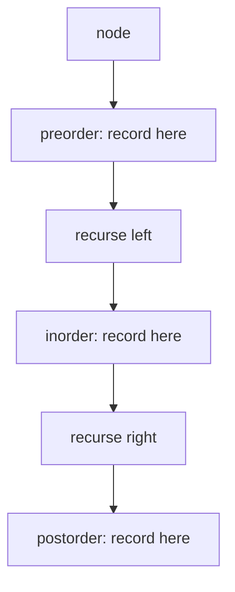

# Binary Tree Traversal {#ch-binary-tree-traversal}

> Problem-টির যে traversal order দরকার, সেটা বেছে নিন। তাহলে বেশিরভাগ tree প্রশ্ন চার line-এর recursion হয়ে যায়।

**এই অধ্যায়ে:** চারটি order আর প্রতিটি কীসের জন্য · BST-তে inorder কেন sorted · যে iterative version-গুলো জানা দরকার · level order আর `levelSize` কৌশল · recursion-এর depth, যা ঠিক করে `O(h)` নাকি `O(n)`

## 💡 মূল ধারণা

একটি tree-তে একক কোনো "পরের" node নেই। তাই প্রতিটি node visit করতে হলে একটি order বেছে নিতে হয়। জানার মতো order
মাত্র চারটি। এদের তিনটির পার্থক্য শুধু এক জায়গায়: children-দের তুলনায় **node নিজে কখন visit হয়**।

```typescript
interface TreeNode {
  val: number;
  left: TreeNode | null;
  right: TreeNode | null;
}
```

| Order          | Visit-এর ক্রম             | কখন ব্যবহার করবেন                                                    |
| -------------- | ---------------------- | -------------------------------------------------------------- |
| **Preorder**   | node → left → right    | Children-এর আগে node দরকার: একটি tree copy করা, serialise করা |
| **Inorder**    | left → node → right    | Tree-টি একটি BST, আর আপনি sorted order চান                     |
| **Postorder**  | left → right → node    | Node-এর উত্তর তার children-এর ওপর নির্ভর করে: height, sum, deletion |
| **Level order**| সারি ধরে, বাঁ থেকে ডানে | উত্তরটা depth নিয়ে: right-side view, minimum depth   |

তিনটি depth-first order আসলে *একই traversal*। শুধু node-এর নিজের কাজটা অন্য একটি line-এ সরানো। পুরো অন্তর্দৃষ্টি
এটুকুই — recursion একবার লিখুন, তারপর একটি line সরান।

> একটি tree প্রশ্নে আসল কাজ হলো order বেছে নেওয়া। "Maximum depth" postorder, কারণ একটি node-এর depth জানতে আগে
> তার children-এর depth লাগে। "Validate BST" preorder, কারণ সীমাগুলো ওপর থেকে নিচে নামে।

## কীভাবে কাজ করে

### তিনটি depth-first order

```typescript
function inorder(node: TreeNode | null, out: number[] = []): number[] {
  if (node === null) return out;   // the base case: a missing child is not an error
  inorder(node.left, out);
  out.push(node.val);              // move this line to change the order
  inorder(node.right, out);
  return out;
}
// Time: O(n) — every node visited once. Space: O(h) for the call stack
```

Preorder দুটি call-এর আগে push করে। Postorder দুটির পরে push করে। আর কিছুই বদলায় না।

Space হলো `O(h)`, `O(n)` নয় — `h` হলো height। Balanced tree-তে সেটা `O(log n)`। আর যে degenerate tree আসলে
ছদ্মবেশে একটি linked list, তাতে সেটা `O(n)`। Input যথেষ্ট গভীর হলে stack overflow হয়। Interviewer-রা ঠিক এই পার্থক্যটা
নিয়েই প্রশ্ন করেন।

### BST-তে inorder কেন sorted

BST-এর invariant হলো: left subtree-র সবকিছু node-এর চেয়ে ছোট, আর right subtree-র সবকিছু বড়। Inorder ঠিক এই
ক্রমেই visit করে — আগে সব ছোট value, তারপর node, তারপর সব বড় value। আর এই বৈশিষ্ট্য প্রতিটি level-এ recursive-ভাবে
খাটে। তাই output গঠনগতভাবেই ascending।

বাস্তব ফল: **"BST-তে kth smallest" হলো একটি counter সহ inorder traversal**। আর পুরো list বানানোর আগেই এটা থেমে
যেতে পারে।

```typescript
function kthSmallest(root: TreeNode | null, k: number): number {
  const stack: TreeNode[] = [];
  let node = root;
  let remaining = k;

  while (node !== null || stack.length > 0) {
    while (node !== null) {      // walk left as far as possible, remembering the way back
      stack.push(node);
      node = node.left;
    }
    node = stack.pop()!;         // the smallest unvisited node
    if (--remaining === 0) return node.val;
    node = node.right;
  }
  throw new Error('k is larger than the tree');
}
// Time: O(h + k), Space: O(h)
```

এটাই **iterative inorder**, আর মুখস্থ করার মতো iterative traversal শুধু এটাই। Recursion আপনার জন্য যা করে, stack
হাতে ঠিক সেটাই করছে। এ কারণেই "recursion ছাড়া এটা করতে পারবেন?" প্রশ্নের উত্তর এটা।

### Level order

Level order breadth-first, তাই এর stack নয়, queue লাগে। একমাত্র অস্পষ্ট অংশটা হলো loop-এর **আগে** সারির size ধরে
রাখা, যাতে প্রতিটি সারি ঠিকভাবে group হয়।

```typescript
function levelOrder(root: TreeNode | null): number[][] {
  if (root === null) return [];

  const rows: number[][] = [];
  let queue: TreeNode[] = [root];

  while (queue.length > 0) {
    const levelSize = queue.length;   // read it now — the loop below will grow the queue
    const row: number[] = [];
    const next: TreeNode[] = [];

    for (let i = 0; i < levelSize; i++) {
      const node = queue[i];
      row.push(node.val);
      if (node.left !== null) next.push(node.left);
      if (node.right !== null) next.push(node.right);
    }
    rows.push(row);
    queue = next;
  }
  return rows;
}
// Time: O(n), Space: O(w) where w is the widest level
```

প্রতি level-এ একটি নতুন array বসালে `Array.prototype.shift()` এড়ানো যায়। V8-এ সেটা `O(n)`, আর চওড়া tree-তে
traversal-কে চুপচাপ `O(n²)` বানিয়ে ফেলে।

Space হলো `O(w)`, অর্থাৎ সর্বোচ্চ width — balanced tree-তে যেটা মোটামুটি `n / 2`। তাই level order-এ `O(n)` space
লাগে, যেখানে depth-first-এ লাগে `O(log n)`। Degenerate tree-তে হিসাবটা উল্টে যায়।



**একটি traversal, node-এর নিজের কাজ করার তিনটি জায়গা। কোন line বেছে নেবেন, সেটাই order।**

প্রতিটি level একটি group হয়ে গেলে, নতুন কোনো কলকব্জা ছাড়াই একগুচ্ছ প্রশ্নের সমাধান বেরিয়ে আসে। Right-side view হলো
প্রতিটি সারির শেষ element। Minimum depth হলো প্রথম সারি, যাতে একটি leaf আছে। আর zigzag হলো একই loop, যেটা একটি
সারি পরপর উল্টে দেয়।

## কখন ব্যবহার করবেন

| প্রশ্নে যা চাওয়া হয়                                   | Traversal            | কেন                                          |
| ------------------------------------------------------- | -------------------- | -------------------------------------------- |
| একটি BST থেকে sorted value, বা kth smallest           | Inorder              | BST invariant এটাকে ascending করে          |
| একটি copy, বা এমন serialisation যা থেকে আবার বানানো যায়         | Preorder             | কারও দরকার হওয়ার আগেই root চলে আসে     |
| Height, diameter, subtree-র sum, "এটা কি balanced"        | Postorder            | Node-এর উত্তর তার children-এর একটি function |
| Level-এর গড়, right-side view, minimum depth          | Level order          | যা মাপা হচ্ছে, সেটাই depth              |
| Unweighted graph-এ shortest path                    | BFS                  | Level order-এর সাধারণ রূপ — BFS অধ্যায় দেখুন |
| সব root-to-leaf path, বা সব combination             | Backtracking সহ preorder | Path তৈরি হয় নিচে নামার পথে       |
| একটি node-এর parent বা ancestor-রা                            | Postorder, ওপরে return করে | উত্তর পাওয়া যায় ফেরার পথে |

⚠️ একটি tree delete বা free করা অবশ্যই **postorder** হতে হবে। Preorder node-টিকে free করে দেয়, যখন তার children-এ
তখনো শুধু ওই node দিয়েই পৌঁছানো যায়। ফলে পুরো subtree leak হয়। যেকোনো bottom-up aggregate-এ একই যুক্তি খাটে —
folder-এর size, dependency-র count।

## সাধারণ ভুল

**`null` check করার আগেই recurse করা:**

```typescript
// ❌ out.push(node.val); if (node === null) return;   // throws on a missing child
// ✅ if (node === null) return; — the base case comes first
```

**Iterative preorder-এ stack-এর ক্রম উল্টে ফেলা:**

```typescript
// ❌ stack.push(node.left); stack.push(node.right);   // pops right first
// ✅ stack.push(node.right); stack.push(node.left);   // a stack reverses what you give it
```

**Level-এর size ধরে না রাখা:**

```typescript
// ❌ for (let i = 0; i < queue.length; i++)   // the queue grows inside the loop; rows merge
// ✅ const levelSize = queue.length;          // read once, before the loop
```

**`shift()`-কে queue হিসেবে ব্যবহার করা:**

```typescript
// ❌ const node = queue.shift()!;   // O(n) per call — O(n²) overall on a wide tree
// ✅ index into the array, or swap in a fresh array per level
```

**ধরে নেওয়া যে যেকোনো binary tree-তে inorder sorted:**

```typescript
// ❌ inorder(root) and checking it is ascending only works if it is a BST to begin with
// ✅ that check is exactly how you validate a BST — but state the assumption
```

**Recursion-এর জন্য `O(log n)` space দাবি করা:**

```typescript
// ❌ "recursion is O(log n) space"
// ✅ it is O(h). Balanced means O(log n); a skewed tree means O(n) and can overflow the stack
```

## অনুশীলনের জন্য Problem

| #   | Problem                                        | কঠিনতা | যা অনুশীলন করায়                                |
| --- | ---------------------------------------------- | ---------- | --------------------------------------------- |
| 94  | Binary Tree Inorder Traversal                  | Easy       | Recursion, তারপর iterative stack        |
| 102 | Binary Tree Level Order Traversal              | Medium     | `levelSize` দিয়ে grouping                       |
| 104 | Maximum Depth of Binary Tree                   | Easy       | তিন line-এ postorder                       |
| 199 | Binary Tree Right Side View                    | Medium     | প্রতিটি সারির শেষ element                   |
| 103 | Binary Tree Zigzag Level Order Traversal       | Medium     | পালাক্রমে দিক বদলানো level order         |
| 230 | Kth Smallest Element in a BST                  | Medium     | আগেভাগে থেমে যাওয়া iterative inorder               |
| 98  | Validate Binary Search Tree                    | Medium     | ওপর থেকে নামা সীমা, local তুলনা নয়    |
| 297 | Serialize and Deserialize Binary Tree          | Hard       | Null marker সহ preorder কেন একটি tree আবার বানাতে পারে |

94 আগে recursive-ভাবে আর iterative-ভাবে করুন, তারপর 102। এরপর 199, 103 আর 637 একই loop, শুধু সারিটা অন্যভাবে
পড়া হয়।

## 🔑 মূল শিক্ষা

- Preorder, inorder আর postorder একটিই traversal, শুধু node-এর নিজের কাজ আলাদা line-এ।
- BST-তে inorder sorted। এ কারণেই kth-smallest হলো একটি counter সহ inorder walk।
- Postorder সেই সব কিছুর জন্য, যা একটি node তার children থেকে হিসাব করে — height, sum আর deletion।
- Level order-এ একটি queue লাগে, আর সারির size loop-এর **আগে** পড়তে হয়, নইলে সারিগুলো মিশে যায়।
- Recursive traversal-এ `O(h)` stack space লাগে: balanced হলে `O(log n)`, skewed হলে `O(n)`, আর overflow-এর ঝুঁকি থাকে।

## Interview-এর প্রশ্ন

**Q: একটি BST-এর inorder traversal কেন sorted output দেয়?**

BST invariant বলে, left subtree-র প্রতিটি value node-এর চেয়ে ছোট, আর right subtree-র প্রতিটি value বড়। Inorder
আগে left subtree visit করে, তারপর node, তারপর right — তাই সে আগে সব ছোট value দেয়, তারপর node, তারপর সব বড় value।
Invariant প্রতিটি node-এ খাটে, তাই বৈশিষ্ট্যটা recursive-ভাবে জুড়ে যায়, আর পুরো output ascending হয়।

**Q: একটি tree-এর height হিসাব করতে কোন traversal, আর কেন?**

Postorder। একটি node-এর height তার children-এর মধ্যে লম্বাটির height-এর চেয়ে এক বেশি। তাই node উত্তর দেওয়ার আগে
দুটি child-ই সমাধান হতে হবে। Preorder node-টিকে visit করত, যখন তার children তখনো অজানা। যেকোনো bottom-up
aggregate-এর জন্য এটা ভুল দিক।

**Q: Recursion ছাড়া কীভাবে traverse করবেন, আর কখন সেটা জরুরি?**

Call stack-এর জায়গায় একটি explicit stack বসান: বাঁ দিকে হাঁটুন আর প্রতিটি node push করুন, visit করতে pop করুন,
তারপর pop করা node-এর right child-এ যান। এটা জরুরি যখন tree এত গভীর হতে পারে যে call stack overflow হবে —
10⁵ node-এর একটি degenerate tree-তে হবেই। আর জরুরি যখন interviewer সরাসরি এটা চান। সেটা সাধারণত পরীক্ষা করে,
recursion আসলে কী করছে তা আপনি বোঝেন কি না।

**Q: Level order আর depth-first-এর space complexity কত, আর কোনটা সস্তা?**

Level order একবারে একটি level ধরে রাখে, তাই `O(w)`, যেখানে `w` হলো সবচেয়ে চওড়া level — balanced tree-তে সেটা
প্রায় `n / 2`। Depth-first একটি root-to-leaf path ধরে রাখে, তাই `O(h)` — balanced tree-তে `O(log n)`। তাই
balanced tree-তে depth-first অনেক সস্তা। Skewed tree-তে তুলনাটা উল্টে যায়, কারণ সেখানে width 1 আর height `n`।

**Q: প্রতিটি node-কে তার দুই child-এর সাথে তুলনা করে কেন একটি BST validate করা যায় না?**

কারণ শর্তটা local নয়। Left subtree-র একটি node-কে শুধু তার parent নয়, right branch ধরে যে *প্রতিটি* ancestor
থেকে সে নেমে এসেছে, সবার চেয়ে ছোট হতে হবে। 5 root-এর নিচে 3-এর right child হিসেবে 6 value প্রতিটি parent-child
check পাস করে, তবুও BST ভেঙে দেয়। সঠিক পদ্ধতি হলো recursion-এ নিচের দিকে একটি `(min, max)` range পাঠানো, অথবা
check করা যে একটি inorder traversal কঠোরভাবে বাড়ছে।

**Q: Inorder একা যেখানে পারে না, সেখানে preorder কীভাবে একটি tree আবার বানাতে দেয়?**

Preorder আপনাকে root আগে দেয়। তাই অনুপস্থিত children-এর জন্য null marker থাকলে গঠনটা দ্ব্যর্থহীন — একটি value
পড়ুন, recursive-ভাবে তার left subtree বানান, তারপর right। Inorder একা root চিনিয়ে দেয় না। তাই দ্ব্যর্থতা দূর করতে
এর দ্বিতীয় একটি traversal (preorder বা postorder) লাগে। এ কারণেই "দুটি traversal থেকে construct করুন" প্রশ্নে সবসময়
inorder-এর সাথে অন্য দুটির একটি জোড়া দেওয়া থাকে।

## এরপর কী পড়বেন

- [Chapter ?? — Depth-First Search](#ch-depth-first-search) — একই recursion, যখন গঠনটা tree নয়, graph
- [Chapter ?? — Breadth-First Search](#ch-breadth-first-search) — level order-এর সাধারণ রূপ, আর এটা কেন shortest path খুঁজে পায়
- [Chapter ?? — Top K Element](#ch-top-k-elements) — inorder walk-এর বিকল্প, যখন tree-টি BST নয়
