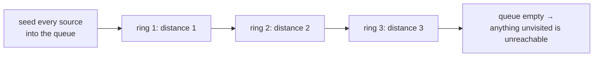

# Breadth-First Search {#ch-breadth-first-search}

> দূরত্ব বাড়িয়ে বাড়িয়ে বৃত্তে বৃত্তে ঘুরুন। তাহলে কোনো জায়গায় প্রথমবার যে পথে পৌঁছাবেন, সেটাই সবচেয়ে ছোট পথ।

**এই অধ্যায়ে:** BFS কেন shortest path খুঁজে পায় আর DFS কেন পায় না · queue template · level গোনা · multi-source BFS · enqueue করার সময়েই visited mark করা · যে memory খরচের জন্য BFS-কে default বানানো ভুল

## 💡 মূল ধারণা

BFS ছড়িয়ে পড়ে। আগে এক ধাপ দূরের সবকিছু দেখে, তারপর দুই ধাপ দূরের সবকিছু, এভাবে চলতে থাকে। শুকনো ঘাসে আগুন
যেভাবে ছড়ায়, বা পানিতে ঢেউ যেভাবে বাড়ে, অনেকটা সেরকম।

এই ক্রমটাই BFS-এর আসল মূল্য। Node-এ পৌঁছানো হয় দূরত্বের ক্রমে, তাই **BFS কোনো node-এ প্রথমবার যে পথে আসে,
সেটাই shortest path**। কোনো তুলনা নেই, আবার ফিরে দেখা নেই, আলাদা হিসাবও নেই। নিশ্চয়তাটা আসে গড়ন থেকেই।
Depth-first search-এ এমন কিছু নেই, কারণ DFS একটি branch ধরে এগোয়, আর কোনো node-এ আগে ঘুরপথেও পৌঁছে যেতে পারে।

কাজটা হয় queue দিয়ে: যা আগে ঢোকে, তা আগে বের হয়। Queue-এর জায়গায় stack বসালেই সেটা DFS হয়ে যায়। দুই
algorithm-এর পার্থক্য শুধু এই একটি বদল।

> এই নিশ্চয়তা খাটে কেবল তখন, যখন প্রতিটি edge-এর খরচ সমান। Edge-এ weight দিলেই BFS আর কাজ করে না, কারণ তিনটি
> সস্তা ধাপ একটি দামি ধাপকে হারিয়ে দিতে পারে। সেটা Dijkstra-র কাজ। দেখুন
> [Chapter ?? — Graph Algorithm](#ch-graph-algorithms)।

## কীভাবে কাজ করে

### Template

```typescript
type Graph = Map<number, number[]>;

function shortestPath(graph: Graph, start: number, goal: number): number {
  if (start === goal) return 0;

  const visited = new Set<number>([start]);
  let frontier: number[] = [start];
  let distance = 0;

  while (frontier.length > 0) {
    distance++;
    const next: number[] = [];

    for (const node of frontier) {
      for (const neighbour of graph.get(node) ?? []) {
        if (visited.has(neighbour)) continue;
        if (neighbour === goal) return distance;
        visited.add(neighbour);   // mark on enqueue, not on dequeue
        next.push(neighbour);
      }
    }
    frontier = next;   // a fresh array per ring, so shift() is never needed
  }
  return -1;   // unreachable
}
// Time: O(V + E), Space: O(V)
```

এই code-এর দুটি সিদ্ধান্ত interview-এ মুখে বলে defend করার মতো।

**Enqueue করার সময় visited mark করুন।** Dequeue করার সময় mark করলে, যে node-এর দিকে তিনটি neighbour নির্দেশ করে,
process হওয়ার আগেই সেটা queue-তে তিনবার ঢুকে যায়। উত্তর ঠিকই থাকে, কিন্তু dense graph-এ queue exponential হারে
ফুলে উঠতে পারে।

**`shift()` ব্যবহার না করে array বদলে নিন।** V8-এ `Array.prototype.shift()` হলো `O(n)`, কারণ এটা পুরো array-র
index নতুন করে সাজায়। তাই একে queue হিসেবে ব্যবহার করলে `O(V + E)` traversal হয়ে যায় `O(V²)`। হয় array-তে
একটি read index রাখুন, নয়তো ওপরের মতো প্রতিটি ring-এর জন্য আলাদা array বানান।

### Level গোনা

প্রশ্নে "কয়টি step" জানতে চাইলে গুনতে হয় ring-এর সীমানা। Loop শুরুর আগে frontier-এর size পড়ে নেওয়াই চেনা
কৌশল:

```typescript
interface TreeNode {
  val: number;
  left: TreeNode | null;
  right: TreeNode | null;
}

// LC 111 — the depth of the shallowest leaf
function minDepth(root: TreeNode | null): number {
  if (root === null) return 0;

  let queue: TreeNode[] = [root];
  let depth = 1;

  while (queue.length > 0) {
    const next: TreeNode[] = [];
    for (const node of queue) {
      if (node.left === null && node.right === null) return depth;   // first leaf found wins
      if (node.left !== null) next.push(node.left);
      if (node.right !== null) next.push(node.right);
    }
    queue = next;
    depth++;
  }
  return depth;
}
// Time: O(n), Space: O(w) where w is the widest level
```

Minimum depth এমন প্রশ্ন, যেখানে DFS-এর চেয়ে BFS-এর সুবিধা স্পষ্ট দেখা যায়। Recursive সমাধানকে কোনটা সবচেয়ে
অগভীর তা জানার আগে প্রতিটি branch একদম নিচ পর্যন্ত ঘুরে আসতে হয়। BFS প্রথম যে leaf পায়, সেখানেই return করে।
Tree-র গভীর অর্ধেকটা কখনো দেখাই হয় না।

### Multi-source BFS

একাধিক শুরুর বিন্দু থেকে একসঙ্গে ছড়ানোর কথা থাকলে, প্রথম ধাপের আগেই **সবগুলো** দিয়ে queue ভরে নিন। তখন
প্রতিটি ring দূরত্ব মাপে সবচেয়ে কাছের source থেকে, নির্দিষ্ট কোনো একটি থেকে নয়।

```typescript
// LC 994 — minutes until every fresh orange rots, or -1
function orangesRotting(grid: number[][]): number {
  const rows = grid.length;
  const cols = grid[0].length;
  let frontier: [number, number][] = [];
  let fresh = 0;

  for (let r = 0; r < rows; r++) {
    for (let c = 0; c < cols; c++) {
      if (grid[r][c] === 2) frontier.push([r, c]);   // every rotten orange is a source
      else if (grid[r][c] === 1) fresh++;
    }
  }

  let minutes = 0;
  const directions: [number, number][] = [[1, 0], [-1, 0], [0, 1], [0, -1]];

  while (frontier.length > 0 && fresh > 0) {
    const next: [number, number][] = [];
    for (const [r, c] of frontier) {
      for (const [dr, dc] of directions) {
        const nr = r + dr;
        const nc = c + dc;
        if (nr < 0 || nr >= rows || nc < 0 || nc >= cols || grid[nr][nc] !== 1) continue;
        grid[nr][nc] = 2;   // the grid is the visited set
        fresh--;
        next.push([nr, nc]);
      }
    }
    frontier = next;
    minutes++;
  }
  return fresh === 0 ? minutes : -1;   // leftover fresh oranges are unreachable
}
// Time: O(rows × cols), Space: O(rows × cols)
```

সব source একসঙ্গে বসানোর কারণেই খরচ থাকে `O(cells)`। প্রতিটি পচা কমলা থেকে আলাদা BFS চালিয়ে minimum নিলে একই
উত্তরের জন্য খরচ হয় `O(sources × cells)`।



**একটি BFS, অনেক source। প্রতিটি ring সবচেয়ে কাছের source থেকে এক একক দূরত্ব, বেছে নেওয়া কোনো একটি থেকে নয়।**

01 Matrix আর As Far from Land as Possible একই গড়নের, শুধু source বাছা হয় অন্যভাবে।

## কখন ব্যবহার করবেন

| প্রশ্নে যে সংকেত থাকে                                       | কী ব্যবহার করবেন        | কেন                                        |
| --------------------------------------------------------- | -------------------- | ------------------------------------------ |
| "Shortest path", "সবচেয়ে কম step", "সবচেয়ে কম move"         | BFS                  | প্রথম পৌঁছানোটাই সবচেয়ে ছোট পথে পৌঁছানো      |
| "কয়টি level", "minimum depth"                              | Ring গুনে BFS        | Ring-এর সীমানা *নিজেই* level-এর সংখ্যা       |
| অনেক জায়গা থেকে একসঙ্গে ছড়ানো: পচন, তাপ, বন্যা               | Multi-source BFS     | প্রথম ধাপের আগেই সব source বসিয়ে দিন          |
| প্রতিটি cell থেকে সবচেয়ে কাছের X-এর দূরত্ব                     | প্রতিটি X থেকে multi-source BFS | প্রতিটি cell-এর জন্য একবার নয়, পুরোটা একবারে |
| উত্তর সম্ভবত শুরুর কাছেই                                    | BFS                  | লম্বা কোনো ভুল branch-এ কখনো নামে না          |
| Edge-এ **weight** আছে                                      | Dijkstra             | অনেকগুলো সস্তা ধাপ কয়েকটি দামি ধাপকে হারাতে পারে |
| "কোনো path আছে কি", বা "সব path"                            | DFS                  | দূরত্বের ক্রম লাগে না, আর space `O(h)`        |
| Graph গভীর আর সরু                                          | DFS                  | BFS পুরো একটি ring ধরে রাখে, DFS শুধু একটি path |

শেষ row-টাই সত্যিকারের খরচ। BFS-এর space `O(w)`, মানে সবচেয়ে চওড়া ring। Balanced binary tree-তে সেটা প্রায়
`n / 2`, আর চওড়া grid-এ পুরো grid-টাই। DFS-এর space `O(h)`। তাই BFS ভালো default নয়। যখন দূরত্বের ক্রমটাই
আপনার দরকার, তখনই BFS ঠিক হাতিয়ার।

## সাধারণ ভুল

**Dequeue করার সময় visited mark করা:**

```typescript
// ❌ pop, then check visited — the same node gets queued once per incoming edge
// ✅ mark it the moment it is pushed
```

**Queue হিসেবে `shift()` ব্যবহার করা:**

```typescript
// ❌ const node = queue.shift()!;   // O(n) per call in V8 — the traversal becomes O(V²)
// ✅ swap in a fresh array per ring, or hold a read index
```

**Ring-এর সীমানা ধরে না রাখা:**

```typescript
// ❌ for (let i = 0; i < queue.length; i++)   // the queue grows inside the loop; levels merge
// ✅ read the size first, or build the next ring in a separate array
```

**ভুল করে stack ব্যবহার করা:**

```typescript
// ❌ const node = stack.pop()!;   // this is DFS; the shortest-path guarantee is gone
// ✅ FIFO, always
```

**Multi-source-এর শুরুর বিন্দুগুলো একটি একটি করে যোগ করা:**

```typescript
// ❌ for (const source of sources) bfs(source)   // O(sources × cells) for the same answer
// ✅ seed every source into the queue, then run one BFS
```

**Weighted graph-এ BFS shortest path দেয় বলে দাবি করা:**

```typescript
// ❌ BFS counts edges, not cost — 3 edges of weight 1 beat 1 edge of weight 10
// ✅ Dijkstra with a min-heap, or 0-1 BFS with a deque when weights are only 0 and 1
```

## অনুশীলনের জন্য Problem

| #    | Problem                             | কঠিনতা     | কী অনুশীলন হয়                                        |
| ---- | ----------------------------------- | ---------- | -------------------------------------------------- |
| 111  | Minimum Depth of Binary Tree        | Easy       | উত্তর অগভীরে থাকলে BFS কেন DFS-কে হারায়               |
| 637  | Average of Levels in Binary Tree    | Easy       | Ring-এর সীমানা দিয়ে ভাগ করা                          |
| 102  | Binary Tree Level Order Traversal   | Medium     | Tree-র ওপর template                                   |
| 994  | Rotting Oranges                     | Medium     | Multi-source seeding, আর পৌঁছানো যায় না এমন cell-এর check |
| 542  | 01 Matrix                           | Medium     | প্রতিটি zero থেকে multi-source                        |
| 1091 | Shortest Path in Binary Matrix      | Medium     | আট দিক, আর আগেভাগে return                            |
| 863  | All Nodes Distance K in Binary Tree | Medium     | Parent link বানিয়ে tree-কে graph বানানো               |
| 127  | Word Ladder                         | Hard       | Implicit graph: neighbour জমা থাকে না, হিসাব করে বের করতে হয় |

আগে 994, তারপর 542। দ্বিতীয়টা আসলে প্রথমটাই, শুধু source অন্যভাবে বাছা। তারপর 127। সেখানে পুরো কঠিনতা হলো
এটা বোঝা যে graph-টা আপনি generate না করা পর্যন্ত তার কোনো অস্তিত্বই নেই।

## 🔑 মূল শিক্ষা

- BFS node দেখে দূরত্বের ক্রমে, তাই প্রথম পৌঁছানোই সবচেয়ে ছোট পথে পৌঁছানো। কোনো তুলনা লাগে না।
- এই নিশ্চয়তার জন্য প্রতিটি edge-এর খরচ সমান হতে হয়। Weighted graph-এ লাগে Dijkstra।
- Visited mark করুন **enqueue করার সময়**। নইলে প্রতিটি আগত edge-এর জন্য একটি node একবার করে queue-তে ঢোকে।
- JavaScript-এ কখনো `shift()`-কে queue হিসেবে ব্যবহার করবেন না। এটা `O(n)`, আর এতে traversal হয়ে যায় `O(V²)`।
- Multi-source BFS প্রথম ধাপের আগেই সব শুরুর বিন্দু বসিয়ে দেয়, আর তবু খরচ একবার ঘোরার সমান।

## Interview-এর প্রশ্ন

**Q: BFS কেন shortest path-এর নিশ্চয়তা দেয়, আর DFS কেন দেয় না?**

BFS node process করে শুরু থেকে দূরত্ব না কমার ক্রমে। দূরত্ব `d`-এর পুরো ring শেষ হয়, তারপরেই `d + 1`-এর কোনো
node ছোঁয়া হয়। তাই কোনো node-এ প্রথমবার পৌঁছানোর সময় তার চেয়ে ছোট কোনো পথ থাকতে পারে না। থাকলে সেই পথ আগের
কোনো ring-এই দেখা হয়ে যেত। DFS একটি branch-এর শেষ পর্যন্ত যায়। তাই সরাসরি edge-টা দেখার আগেই লম্বা ঘুরপথে কোনো
node-এ পৌঁছে যেতে পারে।

**Q: Node-কে কোথায় visited mark করবেন, আর না করলে কী ভুল হয়?**

Queue-তে push করার মুহূর্তেই। Dequeue-এর সময় mark করলে, queue-তে আগে থেকে থাকা `k`-টি neighbour-ওয়ালা node
প্রথমবার process হওয়ার আগেই `k` বার enqueue হয়ে যায়। Result তবু ঠিক থাকে, কিন্তু queue `O(V)` ছাড়িয়ে অনেক বড়
হয়ে যায়। Dense graph-এ এটুকুই pass করা আর timeout হওয়ার মধ্যে পার্থক্য।

**Q: কখন DFS ভালো?**

যখন মাপার মতো কোনো দূরত্ব নেই: "path আছে কি", "root থেকে leaf পর্যন্ত সব path", connected component গোনা। আর
যখন গভীর, সরু structure-এ memory গুরুত্বপূর্ণ। BFS পুরো একটি ring ধরে রাখে, `O(w)`। DFS ধরে রাখে একটি path, `O(h)`।
Balanced tree-তে এই তুলনায় DFS অনেক এগিয়ে থাকে। লম্বা chain-এ উল্টো।

**Q: Multi-source BFS কী, আর কখন কাজে লাগে?**

প্রথমবার expand করার আগেই সব শুরুর বিন্দু দিয়ে queue ভরে দিন। তাহলে প্রতিটি ring দূরত্ব মাপে *সবচেয়ে কাছের*
source থেকে। যখনই কিছু একসঙ্গে অনেক জায়গা থেকে ছড়ায়, বা প্রতিটি cell থেকে সবচেয়ে কাছের X-এর দূরত্ব লাগে, তখনই
এটা খাটে: rotting oranges, 01 Matrix, সবচেয়ে কাছের gate-এর দূরত্ব। প্রতিটি source-এর জন্য আলাদা BFS-এর বদলে
পুরো কাজ হয়ে যায় একবার `O(V + E)` ঘুরেই।

**Q: শুধু path-এর দৈর্ঘ্য নয়, path-টাই কীভাবে বের করবেন?**

একটি `parent` map রাখুন। প্রতিটি node-কে প্রথম কোন node enqueue করেছে, সেটা ওখানে লেখা থাকবে। তারপর goal থেকে
পেছনের দিকে হেঁটে গিয়ে ক্রমটা উল্টে দিন। বাড়তি space লাগে `O(V)`। প্রতিটি queue entry-তে পুরো path রেখে দিলেও
কাজ হয়, লেখাও সহজ। কিন্তু তাতে প্রতিটি entry-র খরচ `O(V)`, তাই graph ছোট হলে তবেই চলে।

**Q: BFS কি recursion দিয়ে লেখা যায়?**

স্বাভাবিকভাবে নয়। Recursion আপনাকে দেয় stack, আর BFS ঠিক সেটাই ব্যবহার করে না। BFS যে ক্রমের ওপর দাঁড়িয়ে,
সেটা আসে FIFO আচরণ থেকে। চাইলে প্রতিটি level-এ একবার করে recurse করে frontier-টা argument হিসেবে পাঠিয়ে কাজ
চালানো যায়। কিন্তু সেটা আসলে বাড়তি ধাপসহ explicit queue-ই, আর কোনো লাভ ছাড়াই stack frame খরচ করে।

## এরপর কী পড়বেন

- [Chapter ?? — Depth-First Search](#ch-depth-first-search) — stack দিয়ে একই traversal, আর কখন সেটাই ভালো সমঝোতা
- [Chapter ?? — Graph Algorithm](#ch-graph-algorithms) — edge-এ weight থাকলে Dijkstra
- [Chapter ?? — Binary Tree Traversal](#ch-binary-tree-traversal) — level order, মানে cycle-হীন structure-এ BFS
