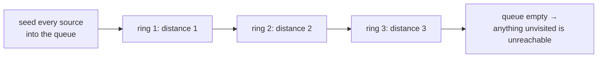

# Breadth-First Search {#ch-breadth-first-search}

> ক্রমশ বাড়তে থাকা দূরত্বের বলয় ধরে explore করুন। তাহলে কোথাও প্রথমবার পৌঁছানোর পথটাই সেখানে যাওয়ার সবচেয়ে ছোট পথ।

**এই অধ্যায়ে:** BFS কেন shortest path খুঁজে পায় আর DFS পায় না · queue template · level গোনা · multi-source BFS · enqueue-এর সময় visited mark করা · memory-র খরচ, যা একে ভুল default বানায়

## 💡 মূল ধারণা

BFS ছড়িয়ে পড়ে। আগে এক ধাপ দূরের সবকিছু visit করে, তারপর দুই ধাপ দূরের সবকিছু, এভাবে চলতে থাকে — শুকনো ঘাসে
আগুনের মতো, বা পানিতে ঢেউয়ের মতো।

পুরো মূল্যটাই এই ক্রমে। Node-গুলোতে দূরত্বের ক্রমে পৌঁছানো হয়, তাই **BFS প্রথমবার একটি node-এ যে পথে পৌঁছায়, সেটাই
একটি shortest path**। কোনো তুলনা নেই, আবার visit করা নেই, কোনো হিসাব রাখা নেই: নিশ্চয়তাটা গঠনগত। Depth-first
search-এ এর সমতুল্য কিছু নেই, কারণ সে একটি branch-এ লেগে থাকে, আর একটি node-এ আগে ঘুরপথেও পৌঁছে যেতে পারে।

Mechanism-টা হলো একটি queue — first in, first out। Queue-এর জায়গায় stack বসান, আর আপনি পেয়ে যাবেন DFS। দুই
algorithm-এর পার্থক্য এই একটিমাত্র বদল।

> নিশ্চয়তাটা তখনই খাটে, যখন প্রতিটি edge-এর খরচ সমান। Edge-এ weight দিলেই BFS ভেঙে যায়, কারণ তিনটি সস্তা step
> একটি দামি step-কে হারাতে পারে। সেটা Dijkstra-র কাজ —
> [Chapter ?? — Graph Algorithm](#ch-graph-algorithms) দেখুন।

## কীভাবে কাজ করে

### Template

```typescript
type Graph = Map<number, number[]>;

function shortestPath(graph: Graph, start: number, goal: number): number {
  if (start === goal) return 0;

  const visited = new Set<number>([start]);
  let frontier: number[] = [start];
  let distance = 0;

  while (frontier.length > 0) {
    distance++;
    const next: number[] = [];

    for (const node of frontier) {
      for (const neighbour of graph.get(node) ?? []) {
        if (visited.has(neighbour)) continue;
        if (neighbour === goal) return distance;
        visited.add(neighbour);   // mark on enqueue, not on dequeue
        next.push(neighbour);
      }
    }
    frontier = next;   // a fresh array per ring, so shift() is never needed
  }
  return -1;   // unreachable
}
// Time: O(V + E), Space: O(V)
```

ওই code-এর দুটো সিদ্ধান্ত মুখে বলে যুক্তি দেওয়ার মতো।

**Enqueue-এর সময় visited mark করুন।** এর বদলে dequeue-এর সময় mark করলে, যে node-এর দিকে তিনটি neighbour
নির্দেশ করে, সেটা একবারও process হওয়ার আগে তিনবার queue-তে ঢোকে। উত্তর ঠিক থাকে, কিন্তু dense graph-এ queue
exponential-ভাবে ফুলে উঠতে পারে।

**`shift()` ব্যবহার না করে array বদলে নিন।** V8-এ `Array.prototype.shift()` হলো `O(n)`, কারণ এটা reindex করে।
তাই একে queue হিসেবে ব্যবহার করলে একটি `O(V + E)` traversal `O(V²)` হয়ে যায়। হয় array-তে একটি read index ধরে
রাখুন, নয়তো ওপরের মতো প্রতিটি বলয়ের জন্য একটি করে array বানান।

### Level গোনা

প্রশ্নে "কত step" জানতে চাইলে, গুনতে হবে বলয়ের সীমানা। Loop-এর আগে frontier-এর size পড়ে নেওয়াই প্রচলিত idiom:

```typescript
interface TreeNode {
  val: number;
  left: TreeNode | null;
  right: TreeNode | null;
}

// LC 111 — the depth of the shallowest leaf
function minDepth(root: TreeNode | null): number {
  if (root === null) return 0;

  let queue: TreeNode[] = [root];
  let depth = 1;

  while (queue.length > 0) {
    const next: TreeNode[] = [];
    for (const node of queue) {
      if (node.left === null && node.right === null) return depth;   // first leaf found wins
      if (node.left !== null) next.push(node.left);
      if (node.right !== null) next.push(node.right);
    }
    queue = next;
    depth++;
  }
  return depth;
}
// Time: O(n), Space: O(w) where w is the widest level
```

Minimum depth হলো সেই প্রশ্ন, যেখানে BFS DFS-এর চেয়ে নিজের যোগ্যতা প্রমাণ করে। একটি recursive solution-কে কোনটা
সবচেয়ে অগভীর তা জানার আগে প্রতিটি branch একেবারে তলা পর্যন্ত explore করতে হয়। BFS প্রথম যে leaf পায়, সেখানেই return
করে, আর tree-এর গভীর অর্ধেকের দিকে কখনো তাকায়ই না।

### Multi-source BFS

একাধিক শুরুর বিন্দু একসাথে ছড়ালে, প্রথম step-এর আগে queue-তে **সবগুলোকে** বসিয়ে দিন। তখন বলয়গুলো নির্দিষ্ট কোনো
একটি থেকে নয়, সবচেয়ে কাছের source থেকে দূরত্ব মাপে।

```typescript
// LC 994 — minutes until every fresh orange rots, or -1
function orangesRotting(grid: number[][]): number {
  const rows = grid.length;
  const cols = grid[0].length;
  let frontier: [number, number][] = [];
  let fresh = 0;

  for (let r = 0; r < rows; r++) {
    for (let c = 0; c < cols; c++) {
      if (grid[r][c] === 2) frontier.push([r, c]);   // every rotten orange is a source
      else if (grid[r][c] === 1) fresh++;
    }
  }

  let minutes = 0;
  const directions: [number, number][] = [[1, 0], [-1, 0], [0, 1], [0, -1]];

  while (frontier.length > 0 && fresh > 0) {
    const next: [number, number][] = [];
    for (const [r, c] of frontier) {
      for (const [dr, dc] of directions) {
        const nr = r + dr;
        const nc = c + dc;
        if (nr < 0 || nr >= rows || nc < 0 || nc >= cols || grid[nr][nc] !== 1) continue;
        grid[nr][nc] = 2;   // the grid is the visited set
        fresh--;
        next.push([nr, nc]);
      }
    }
    frontier = next;
    minutes++;
  }
  return fresh === 0 ? minutes : -1;   // leftover fresh oranges are unreachable
}
// Time: O(rows × cols), Space: O(rows × cols)
```

সব source একসাথে বসানোর কারণেই এটা `O(cells)` থাকে। প্রতিটি পচা কমলা থেকে আলাদা BFS চালিয়ে minimum নিলে একই
উত্তরের জন্য খরচ `O(sources × cells)`।



**একটি BFS, অনেক source। প্রতিটি বলয় সবচেয়ে কাছের source থেকে এক একক দূরত্ব, বেছে নেওয়া কোনো একটি থেকে নয়।**

01 Matrix আর As Far from Land as Possible একই আকারের, শুধু source অন্যভাবে বাছা হয়েছে।

## কখন ব্যবহার করবেন

| প্রশ্নে যে সংকেত থাকে                                    | কী ব্যবহার করবেন            | কেন                                        |
| --------------------------------------------------------- | -------------------- | ------------------------------------------ |
| "Shortest path", "সবচেয়ে কম step", "minimum move"          | BFS                  | প্রথম পৌঁছানোই সবচেয়ে ছোট পৌঁছানো       |
| "কতগুলো level", "minimum depth"                        | বলয় গোনা সহ BFS | বলয়ের সীমানাই *হলো* level count   |
| একসাথে অনেক উৎস থেকে ছড়ানো — পচন, তাপ, বন্যা       | Multi-source BFS     | প্রথম step-এর আগে সব source বসিয়ে দিন      |
| প্রতিটি cell থেকে সবচেয়ে কাছের X-এর দূরত্ব                 | প্রতিটি X থেকে multi-source BFS | প্রতি cell-এ একটি নয়, একটিই pass   |
| উত্তর সম্ভবত শুরুর কাছেই                   | BFS                  | এটা কখনো লম্বা ভুল branch-এ নামে না       |
| Edge-এ **weight** আছে                                    | Dijkstra             | সস্তা-আর-অনেক দামি-আর-কম-কে হারাতে পারে   |
| "কোনো path আছে কি", বা "সব path"                       | DFS                  | দূরত্বের ক্রম লাগে না, আর `O(h)` space |
| Graph গভীর আর সরু                              | DFS                  | BFS পুরো একটি বলয় ধরে রাখে, DFS একটি path  |

শেষ row-টাই সৎ খরচ। BFS-এর space `O(w)`, অর্থাৎ সবচেয়ে চওড়া বলয় — balanced binary tree-তে সেটা প্রায় `n / 2`, আর
চওড়া grid-এ পুরো grid। DFS-এর space `O(h)`। তাই BFS ভালো default নয়। এটা সঠিক tool তখনই, যখন আপনার দরকারটাই
দূরত্বের ক্রম।

## সাধারণ ভুল

**Dequeue-এর সময় visited mark করা:**

```typescript
// ❌ pop, then check visited — the same node gets queued once per incoming edge
// ✅ mark it the moment it is pushed
```

**`shift()`-কে queue হিসেবে ব্যবহার করা:**

```typescript
// ❌ const node = queue.shift()!;   // O(n) per call in V8 — the traversal becomes O(V²)
// ✅ swap in a fresh array per ring, or hold a read index
```

**বলয়ের সীমানা ধরে না রাখা:**

```typescript
// ❌ for (let i = 0; i < queue.length; i++)   // the queue grows inside the loop; levels merge
// ✅ read the size first, or build the next ring in a separate array
```

**ভুল করে stack ব্যবহার করা:**

```typescript
// ❌ const node = stack.pop()!;   // this is DFS; the shortest-path guarantee is gone
// ✅ FIFO, always
```

**Multi-source-এর শুরুর বিন্দুগুলো একটি একটি করে যোগ করা:**

```typescript
// ❌ for (const source of sources) bfs(source)   // O(sources × cells) for the same answer
// ✅ seed every source into the queue, then run one BFS
```

**দাবি করা যে weighted graph-এ BFS shortest path দেয়:**

```typescript
// ❌ BFS counts edges, not cost — 3 edges of weight 1 beat 1 edge of weight 10
// ✅ Dijkstra with a min-heap, or 0-1 BFS with a deque when weights are only 0 and 1
```

## অনুশীলনের জন্য Problem

| #    | Problem                             | কঠিনতা | যা অনুশীলন করায়                                     |
| ---- | ----------------------------------- | ---------- | -------------------------------------------------- |
| 111  | Minimum Depth of Binary Tree        | Easy       | উত্তর অগভীর হলে BFS কেন DFS-কে হারায়        |
| 637  | Average of Levels in Binary Tree    | Easy       | Grouping হিসেবে বলয়ের সীমানা                     |
| 102  | Binary Tree Level Order Traversal   | Medium     | Template, একটি tree-তে                             |
| 994  | Rotting Oranges                     | Medium     | Multi-source seeding, আর unreachable check     |
| 542  | 01 Matrix                           | Medium     | প্রতিটি শূন্য থেকে multi-source                        |
| 1091 | Shortest Path in Binary Matrix      | Medium     | আট দিক, আর early return              |
| 863  | All Nodes Distance K in Binary Tree | Medium     | Parent link বানানো, যাতে tree একটি graph হয়ে যায়     |
| 127  | Word Ladder                         | Hard       | একটি implicit graph — neighbour জমা থাকে না, হিসাব করে বের করা হয় |

আগে 994, তারপর 542 করুন — দ্বিতীয়টা প্রথমটাই, শুধু source অন্যভাবে বাছা। তারপর 127, যেখানে পুরো কঠিনতা এটা
বুঝে ফেলা যে graph-টি আপনি generate না করা পর্যন্ত তার অস্তিত্বই নেই।

## 🔑 মূল শিক্ষা

- BFS দূরত্বের ক্রমে node visit করে, তাই প্রথম পৌঁছানোই সবচেয়ে ছোট পৌঁছানো — কোনো তুলনা লাগে না।
- এই নিশ্চয়তার জন্য সব edge-এর খরচ সমান হতে হয়। Weighted graph-এ এর বদলে Dijkstra লাগে।
- Visited mark করুন **enqueue-এর সময়**, নইলে প্রতিটি আগত edge-এর জন্য একটি node একবার করে queue-তে ঢোকে।
- JavaScript-এ কখনো `shift()`-কে queue হিসেবে ব্যবহার করবেন না। এটা `O(n)`, আর traversal-কে `O(V²)` বানিয়ে দেয়।
- Multi-source BFS প্রথম step-এর আগে প্রতিটি উৎস বসিয়ে দেয়, আর তবুও খরচ একটিই pass।

## Interview-এর প্রশ্ন

**Q: BFS কেন shortest path-এর নিশ্চয়তা দেয়, আর DFS কেন দেয় না?**

BFS শুরু থেকে দূরত্বের non-decreasing ক্রমে node process করে: `d + 1` দূরত্বের কোনো node ছোঁয়ার আগে `d` দূরত্বের
পুরো বলয় শেষ হয়ে যায়। তাই একটি node-এ প্রথমবার পৌঁছানোর সময় তার আর কোনো ছোট পথ থাকতে পারে না — এমন পথ থাকলে
সেটা আগের কোনো বলয়েই explore হয়ে যেত। DFS একটি branch তার শেষ পর্যন্ত অনুসরণ করে। তাই সরাসরি edge-টা দেখার আগেই
লম্বা ঘুরপথে একটি node-এ পৌঁছে যেতে পারে।

**Q: Node কোথায় visited mark করবেন, আর না করলে কী ভুল হয়?**

যে মুহূর্তে সেটা queue-তে push করা হয়। Dequeue-এর সময় mark করলে, যে node-এর `k`টি neighbour আগে থেকেই queue-তে
আছে, প্রথমবার process হওয়ার আগে সেটা `k` বার enqueue হয়। Result তবুও ঠিক থাকে, কিন্তু queue `O(V)` ছাড়িয়ে অনেক
বড় হয়ে যায়। আর dense graph-এ এটাই pass করা আর time out হওয়ার মধ্যে পার্থক্য।

**Q: কখন DFS ভালো পছন্দ?**

যখন মাপার মতো কোনো দূরত্ব নেই — "কোনো path আছে কি", "সব root-to-leaf path", connected component গোনা — আর যখন
গভীর, সরু গঠনে memory গুরুত্বপূর্ণ। BFS পুরো একটি বলয় ধরে রাখে, `O(w)`, আর DFS ধরে রাখে একটি path, `O(h)`।
Balanced tree-তে এই তুলনা জোরালোভাবে DFS-এর পক্ষে। লম্বা chain-এ এটা উল্টে যায়।

**Q: Multi-source BFS কী, আর কখন খাটে?**

প্রথম expansion-এর আগে queue-তে প্রতিটি শুরুর বিন্দু বসিয়ে দিন, যাতে বলয়গুলো *সবচেয়ে কাছের* source থেকে দূরত্ব
মাপে। এটা খাটে যখনই কিছু একসাথে একাধিক উৎস থেকে ছড়ায়, বা যখন প্রতিটি cell থেকে সবচেয়ে কাছের X-এর দূরত্ব দরকার —
rotting oranges, 01 Matrix, সবচেয়ে কাছের gate-এর দূরত্ব। এটা প্রতি source-এ একটি BFS-এর বদলে একটিমাত্র
`O(V + E)` pass চালায়।

**Q: শুধু দৈর্ঘ্য নয়, আসল path-টি কীভাবে বের করবেন?**

একটি `parent` map রাখুন, যেটা record করে কোন node প্রতিটি node-কে প্রথম enqueue করেছে। তারপর goal থেকে উল্টো দিকে
হেঁটে যান, আর শেষে reverse করুন। এতে `O(V)` বাড়তি space লাগে। প্রতিটি queue entry-তে পুরো path রাখাও কাজ করে, আর
লেখা সহজ। কিন্তু তাতে প্রতি entry-তে `O(V)` খরচ, তাই শুধু graph ছোট হলেই সেটা চলে।

**Q: BFS কি recursive-ভাবে লেখা যায়?**

স্বাভাবিকভাবে নয়। Recursion আপনাকে একটি stack দেয়, আর BFS ঠিক এই গঠনটাই ব্যবহার করে না — BFS যে ক্রমের ওপর
নির্ভর করে, সেটা আসে FIFO আচরণ থেকে। Frontier-কে argument হিসেবে পাঠিয়ে প্রতি level-এ একবার recurse করে এটা নকল
করা যায়। কিন্তু সেটা বাড়তি ধাপ সহ একটি explicit queue-ই, আর কোনো লাভ ছাড়াই stack frame খরচ করে।

## এরপর কী পড়বেন

- [Chapter ?? — Depth-First Search](#ch-depth-first-search) — stack দিয়ে একই traversal, আর কখন সেটা ভালো বিনিময়
- [Chapter ?? — Graph Algorithm](#ch-graph-algorithms) — Dijkstra, যখন edge-এ weight থাকে
- [Chapter ?? — Binary Tree Traversal](#ch-binary-tree-traversal) — level order, যা cycle-হীন একটি গঠনের ওপর BFS
