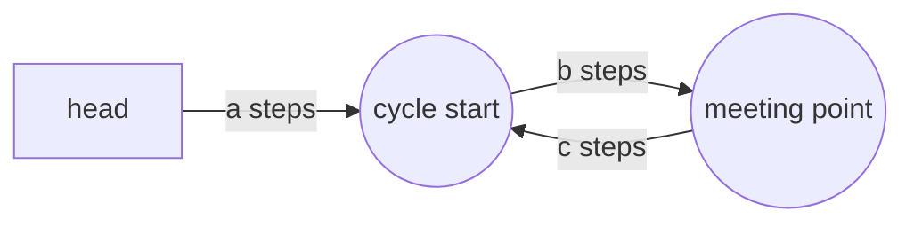

# Fast ও Slow Pointer {#ch-fast-and-slow-pointers}

> এক pass-এ, শুধু constant বাড়তি জায়গা খরচ করে cycle ধরুন বা মাঝের বিন্দু খুঁজে বের করুন।

**এই অধ্যায়ে:** fast pointer কেন slow-কে ধরবেই · cycle ধরা · মাঝের বিন্দু · যে সমীকরণ দিয়ে cycle-এর শুরু পাওয়া যায় · ছদ্মবেশী cycle-এর প্রশ্ন

## 💡 মূল ধারণা

দুটি pointer একই structure-এর ওপর আলাদা গতিতে হাঁটে। একটি প্রতি ধাপে এক node, অন্যটি দুই node। Structure-এর
শেষ থাকলে fast pointer আগে শেষ প্রান্ত পেরিয়ে পড়ে যায়। আর structure ঘুরে ফিরে এলে fast pointer পেছন থেকে এসে
slow pointer-এর ঘাড়ে এসে পড়ে।

পুরো pattern এটুকুই। এর দাম বোঝা যায় এটা কী সরিয়ে দেয় তা দেখে। Cycle খোঁজার সোজা উপায় হলো আগে দেখা সব node
একটি `Set`-এ রাখা, যাতে `O(n)` memory লাগে। Two pointers-এ লাগে মাত্র দুটি variable।

> প্রতি ধাপে দুই pointer-এর ফাঁক ঠিক এক node করে কমে। কারণ fast এগোয় দুই, slow এগোয় এক। দৈর্ঘ্য `L`-এর
> cycle-এর ভেতরে ফাঁক বড়জোর `L`, তাই `L` ধাপের মধ্যেই দুটির দেখা হয়। Slow pointer-কে লাফিয়ে পার হওয়ার কোনো
> উপায় নেই: 1-এর ফাঁক সোজা 0 হয়ে যায়।

## কীভাবে কাজ করে

### Cycle ধরা

```typescript
interface ListNode {
  val: number;
  next: ListNode | null;
}

function hasCycle(head: ListNode | null): boolean {
  let slow: ListNode | null = head;
  let fast: ListNode | null = head;

  // Guard fast and fast.next — fast is the one that runs off the end
  while (fast !== null && fast.next !== null) {
    slow = slow!.next;        // 1 step
    fast = fast.next.next;    // 2 steps
    if (slow === fast) return true;   // reference equality, not value equality
  }
  return false;               // fast reached null, so the list terminates
}
// Time: O(n), Space: O(1)  — the Set version is O(n) space
```

Cycle না থাকার case-এ সঠিকতার পুরো যুক্তি loop-এর শর্তেই আছে। `fast` দুই ঘর এগোয়, তাই ধাপ নেওয়ার আগে
`fast` আর `fast.next` দুটিই থাকতে হবে। কোনো একটি `null` হলে বোঝা যায় list-এর শেষ আছে। আর যে list শেষ হয়,
তাতে loop থাকতে পারে না।

### মাঝখান খুঁজে বের করা

একই দুই গতি, শুধু cycle নেই। Fast শেষে পৌঁছালে slow থাকে ঠিক মাঝপথে।

```typescript
function middleNode(head: ListNode | null): ListNode | null {
  let slow = head;
  let fast = head;

  while (fast !== null && fast.next !== null) {
    slow = slow!.next;
    fast = fast.next.next;
  }
  return slow;   // for even lengths this is the second of the two middles
}
// Time: O(n), Space: O(1)
```

Fast যতটা যায়, slow যায় তার অর্ধেক। তাই fast `n`-টি node পার হলে slow পার হয়
`n / 2`। দুটিকেই `head` থেকে শুরু করলে জোড় দৈর্ঘ্যের list-এ পাওয়া যায় **দ্বিতীয়** মাঝের node: `3`, যখন list-টা
`[1, 2, 3, 4]`। `fast`-কে `head.next` থেকে শুরু করলে পাবেন প্রথমটা। Problem statement পড়ে নিন:
Reorder List আর Palindrome Linked List আলাদা অর্ধেক চায়।

### Cycle কোথায় শুরু হয়, তা খুঁজে বের করা

এই অংশটা মুখস্থ রাখার মতো। কারণ চাপের মধ্যে বসে এই derivation নতুন করে বের করার জিনিস নয়।



**লেজটা `a`-টি node লম্বা। দেখা হওয়ার বিন্দু cycle-এর ভেতরে `b` দূরে, আর শুরুতে ফিরতে তখনও `c` বাকি।**

দেখা হওয়ার সময় slow হেঁটেছে `a + b`, আর fast ঠিক তার দ্বিগুণ। Fast cycle-টা কয়েকবার পুরো ঘুরেও এসেছে, তাই
তার দূরত্ব `a + b + k(b + c)`, কোনো একটি `k ≥ 1`-এর জন্য। দুটিকে সমান ধরলে:

```text
2(a + b) = a + b + k(b + c)
     a + b = k(b + c)
         a = k(b + c) − b
         a = (k − 1)(b + c) + c
```

তাহলে `a` আর `c`-এর পার্থক্য শুধু cycle-এর পুরো কয়েকটি পাক। একটি pointer `head` থেকে আর একটি দেখা হওয়ার বিন্দু
থেকে হাঁটান, দুটিই এক ধাপ করে। দুটি ঠিক cycle-এর শুরুতে গিয়ে মিলবে।

```typescript
function detectCycleStart(head: ListNode | null): ListNode | null {
  let slow = head;
  let fast = head;

  while (fast !== null && fast.next !== null) {
    slow = slow!.next;
    fast = fast.next.next;
    if (slow === fast) {
      // Phase 2: reset one pointer, then move both at the same speed
      let entry = head;
      while (entry !== slow) {
        entry = entry!.next;
        slow = slow!.next;
      }
      return entry;
    }
  }
  return null;
}
// Time: O(n), Space: O(1)
```

## কখন ব্যবহার করবেন

| প্রশ্নে যে সংকেত                                     | কী ব্যবহার করবেন                | কেন                                          |
| ---------------------------------------------------------- | ------------------------ | -------------------------------------------- |
| "এই linked list-এ কি cycle আছে?"                      | Fast আর slow            | একদম মূল case                            |
| "Cycle কোথায় শুরু হয়?"                              | Fast আর slow, দুই phase | ওপরের `a = c` সমীকরণ                    |
| "মাঝখানটা খুঁজুন" বা "শেষ থেকে `n`-তম"              | Fast আর slow            | এক pass, দৈর্ঘ্য গুনতে হয় না                    |
| `x = f(x)` দিয়ে সংজ্ঞায়িত sequence — Happy Number            | Fast আর slow            | বারবার function call আসলে linked list     |
| এমন array, যেখানে `nums[i]` নিজেই valid index — LC 287         | Fast আর slow            | Array নিজেই `next` pointer             |
| Random access আছে, আর memory নিয়ে চিন্তা নেই              | Index-এর হিসাব         | যুক্তি সাজানো সহজ                       |
| প্রতিটি node ক্রমানুসারে ঠিক একবার দেখতে হবে         | একটিমাত্র pointer         | দুটি pointer কিছু যোগ করে না                     |

মাঝের দুটি row দিয়েই বোঝা যায়, কে 141 মুখস্থ করেছে আর কে সত্যিই বুঝেছে। যে function প্রতিটি value থেকে ঠিক
একটি পরের value দেয়, সেটা আসলে অদৃশ্য linked list বানায়। আর Floyd-এর algorithm সেখানে হুবহু খাটে:

```typescript
// LC 202 — a number is "happy" if repeatedly summing the squares of its digits reaches 1
function isHappy(n: number): boolean {
  const next = (x: number): number =>
    String(x).split('').reduce((sum, d) => sum + Number(d) ** 2, 0);

  let slow = n;
  let fast = next(n);
  while (fast !== 1 && slow !== fast) {
    slow = next(slow);
    fast = next(next(fast));
  }
  return fast === 1;   // either it terminated at 1, or it cycled
}
// Time: O(log n) per step, Space: O(1)  — the Set version stores every value seen
```

## সাধারণ ভুল

**শুধু `fast`-কে পাহারা দেওয়া:**

```typescript
// ❌ while (fast !== null) { fast = fast.next.next; }   // throws on the last node
// ✅ while (fast !== null && fast.next !== null)
```

**Reference-এর বদলে value তুলনা করা:**

```typescript
// ❌ if (slow.val === fast.val) return true;   // duplicate values are not a cycle
// ✅ if (slow === fast) return true;           // same node object
```

Cycle নেই এমন `[1, 1, 1]` list-এ প্রথম version `true` ফেরত দেয়।

**Pointer দুটিকে আলাদা জায়গা থেকে শুরু করে, সরানোর আগেই যাচাই করা:**

```typescript
// ❌ let slow = head, fast = head.next;
//    if (slow === fast) ...            // never true on the first check, and the phase-2 maths breaks
// ✅ start both at head, move first, compare second
```

Cycle-এর শুরু খোঁজার derivation ধরে নেয় যে দুটি pointer একসঙ্গে `head` ছেড়েছে। আলাদা জায়গা থেকে শুরু করলেও
cycle ধরা পড়ে, কিন্তু দেখা হওয়ার বিন্দু সরে যায়। ফলে phase 2 ভুল node ফেরত দেয়।

**Phase 2-এ 2:1 ছাড়া অন্য গতির অনুপাত নেওয়া:**

```typescript
// ❌ fast = fast.next.next.next;   // detection still works; a = c no longer holds
```

**কোন মাঝখান চাওয়া হয়েছে তা না পড়েই মাঝখান হিসেবে `slow` ফেরত দেওয়া:**

```typescript
// ❌ assuming [1,2,3,4] gives 2
// ✅ both from head gives 3 (second middle); fast from head.next gives 2
```

## অনুশীলনের জন্য Problem

| #   | Problem                          | কঠিনতা | কী অনুশীলন হয়                              |
| --- | -------------------------------- | ---------- | ------------------------------------------- |
| 141 | Linked List Cycle                | Easy       | Null guard আর reference-এর সমতা      |
| 876 | Middle of the Linked List        | Easy       | কোন শুরু থেকে কোন মাঝখান পাওয়া যায়           |
| 202 | Happy Number                     | Easy       | Cycle আছে, অথচ কোথাও linked list নেই        |
| 142 | Linked List Cycle II             | Medium     | Phase 2, আর `a = c` সমীকরণ           |
| 234 | Palindrome Linked List           | Medium     | মাঝখান, তারপর দ্বিতীয় অর্ধেক উল্টানো      |
| 143 | Reorder List                     | Medium     | মাঝখান, উল্টানো, তারপর পালা করে জোড়া          |
| 287 | Find the Duplicate Number        | Medium     | `nums[i]`-কে `next` pointer হিসেবে দেখা      |
| 457 | Circular Array Loop              | Hard       | দিক বদলালে পাওয়া cycle বাতিল হয়ে যায়  |

141 আর 142 পরপর করুন, তারপর 287। তৃতীয়টি আসলে প্রথম দুটিই, শুধু linked list সরিয়ে নেওয়া। কোনো hint ছাড়া
এটা পারলে বুঝবেন pattern-টা মাথায় বসে গেছে।

## 🔑 মূল শিক্ষা

- 1 আর 2 গতির দুটি pointer প্রতি ধাপে ফাঁক এক node করে কমায়, তাই cycle-এ দুটির দেখা হবেই।
- এই pattern `O(n)` memory-কে `O(1)`-এ নামায়। `Set`-এর বদলে এটা বেছে নেওয়ার একমাত্র কারণ এটাই।
- দেখা হওয়ার পর `head` থেকে একটি pointer আর দেখা হওয়ার বিন্দু থেকে আরেকটি pointer cycle-এর শুরুতে গিয়ে মেলে।
- পাহারা হলো `while (fast && fast.next)`। একমাত্র fast pointer-ই `null` dereference করতে পারে।
- যেকোনো `x → f(x)` sequence আসলে linked list। তাই Happy Number আর Find the Duplicate Number একই problem।

## Interview-এর প্রশ্ন

**Q: Cycle-এর ভেতরে fast pointer সবসময় slow-কে ধরে কেন? লাফিয়ে পার হয়ে যেতে পারে না?**

প্রতি ধাপে দুটির ফাঁক ঠিক এক করে কমে, কারণ fast এগোয় দুই ঘর আর slow এক ঘর। তাই 1-এর ফাঁক সোজা 0 হয়ে যায়,
পাশ কাটানোর কোনো উপায় নেই। আর শুরুতে ফাঁক বড়জোর cycle-এর দৈর্ঘ্য `L`। ফলে দুটিই cycle-এ ঢোকার পর `L` ধাপের
মধ্যে দেখা হয়।

**Q: 3:1 নয়, 2:1 কেন?**

1:1-এর বেশি যেকোনো অনুপাতে cycle ধরা যায়। কিন্তু শুধু 2:1-এ দেখা হওয়ার বিন্দুর দূরত্ব পরিষ্কারভাবে `a = c`-তে
নেমে আসে। এজন্যই cycle-এর শুরু খুঁজতে মাত্র দুই line যোগ করলেই চলে। বেশি অনুপাতে আরেকটা ঝুঁকিও আছে: ফাঁক
যদি গতির পার্থক্যের গুণিতক না হয়, fast pointer slow-কে টপকে যেতে পারে। মানে কোনো লাভ ছাড়াই বাড়তি সাবধানতা।

**Q: কখন বরং `Set` ব্যবহার করবেন?**

যখন memory সমস্যা নয়, আর হ্যাঁ-না-এর চেয়ে বেশি কিছু দরকার: cycle-এর node-গুলো, কোন ক্রমে দেখা হয়েছিল, বা
কতগুলো। `Set` version পড়তেও সহজ, আর চাপের মধ্যে ভুল হওয়ার সম্ভাবনাও কম। তাই প্রথম উত্তর হিসেবে এটা পুরোপুরি
চলে, যতক্ষণ আপনি `O(n)` space-এর খরচটা বলেন আর তারপর optimisation হিসেবে Floyd-এর algorithm প্রস্তাব করেন।

**Q: Find the Duplicate Number কীভাবে cycle-এর problem হয়ে যায়?**

`n + 1`-টি value যদি `1…n` range-এ থাকে, আর `i → nums[i]` ধরে নেন, তাহলে প্রতিটি index ঠিক একটি পরের index পায়।
তাই এটা আসলে linked list, যেখানে duplicate value হলো সেই node, যেখানে দুটি আলাদা জায়গা থেকে দুটি pointer এসে
পৌঁছায়। মানে সেটাই cycle-এ ঢোকার node, আর phase 2 সেটা খুঁজে দেয় `O(1)` space-এ, input না বদলে। Problem-টা
ঠিক এটাই শর্ত দেয়: input বদলানো চলবে না।

**Q: Input doubly linked list বা tree হলে কী ভাঙে?**

হিসাবের কিছুই ভাঙে না, কিন্তু pattern-টার আর মানে থাকে না। Doubly linked list-এ পেছন দিকেও হাঁটা যায়, আর
tree-তে একটিমাত্র `next` নেই। তাই "একই পথে দুই গতি" দিয়ে structure-টাকে আর বর্ণনা করা যায় না। এই pattern-এর
জন্য প্রতিটি node-এর ঠিক একটি নির্দিষ্ট পরের node থাকা চাই।

## এরপর কী পড়বেন

- [Chapter ?? — In-Place Linked List Reversal](#ch-in-place-linked-list-reversal) — Palindrome Linked List আর Reorder List-এর বাকি অর্ধেক
- [Chapter ?? — Two Pointers](#ch-two-pointers) — array sorted আর index দিয়ে ধরা গেলে একই দুই-index ধারণা
- [Chapter ?? — Time ও Space Complexity](#ch-time-and-space-complexity) — `O(1)` space-এর উত্তর কেন বাড়তি ভাবনার যোগ্য
