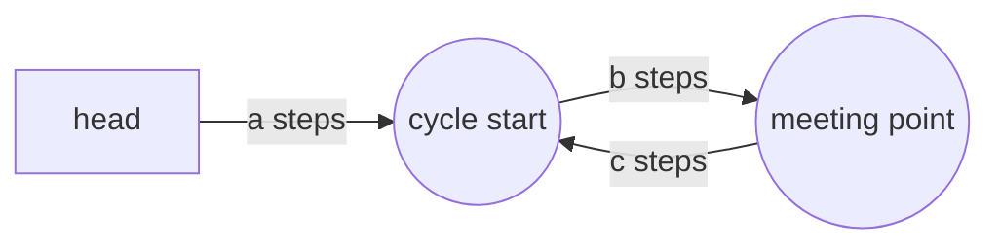

# Fast ও Slow Pointer {#ch-fast-and-slow-pointers}

> একটি pass-এ, constant বাড়তি space-এ, একটি cycle ধরুন বা মাঝখান খুঁজে বের করুন।

**এই অধ্যায়ে:** fast pointer কেন slow-কে ধরবেই · cycle detection · মাঝখান · যে সমীকরণ cycle কোথায় শুরু হয় তা খুঁজে দেয় · যে প্রশ্নগুলো আসলে ছদ্মবেশী cycle

## 💡 মূল ধারণা

দুটি pointer একই structure-এর ওপর দিয়ে ভিন্ন গতিতে হাঁটে — একটি প্রতি ধাপে এক node, অন্যটি দুই node। Structure-এর
শেষ থাকলে fast-টি আগে শেষ প্রান্ত দিয়ে পড়ে যায়। Loop থাকলে fast-টি ঘুরে পেছন থেকে এসে slow-এর ওপর পড়ে।

পুরো pattern এটুকুই। এর মূল্য হলো এটা কী সরিয়ে দেয়। Cycle খোঁজার সোজা উপায় হলো আগে দেখা প্রতিটি node-এর একটি
`Set`, যার খরচ `O(n)` memory। Two pointers-এর খরচ দুটি variable।

> Pointer দুটির মাঝের ব্যবধান প্রতি ধাপে ঠিক এক node করে কমে, কারণ fast এগোয় দুই, slow এগোয় এক। `L` দৈর্ঘ্যের একটি
> cycle-এর ভেতরে ব্যবধান বড়জোর `L`, তাই `L` ধাপের মধ্যে তারা মিলিত হয়। Slow pointer-কে টপকে যাওয়ার কোনো উপায় নেই
> — 1-এর ব্যবধান 0 হয়ে যায়।

## কীভাবে কাজ করে

### Cycle detection

```typescript
interface ListNode {
  val: number;
  next: ListNode | null;
}

function hasCycle(head: ListNode | null): boolean {
  let slow: ListNode | null = head;
  let fast: ListNode | null = head;

  // Guard fast and fast.next — fast is the one that runs off the end
  while (fast !== null && fast.next !== null) {
    slow = slow!.next;        // 1 step
    fast = fast.next.next;    // 2 steps
    if (slow === fast) return true;   // reference equality, not value equality
  }
  return false;               // fast reached null, so the list terminates
}
// Time: O(n), Space: O(1)  — the Set version is O(n) space
```

Cycle-হীন ক্ষেত্রের পুরো সঠিকতার যুক্তি loop-এর condition-এই আছে। `fast` দুই ধাপ সরে, তাই ধাপের আগে `fast` আর
`fast.next` দুটিরই থাকতে হবে। কোনোটি `null` হলে list-এর একটি শেষ আছে, আর যে list শেষ হয় সেটা loop করতে পারে না।

### মাঝখান খোঁজা

একই দুই গতি, কোনো cycle নেই। Fast শেষে পৌঁছালে slow থাকে মাঝপথে।

```typescript
function middleNode(head: ListNode | null): ListNode | null {
  let slow = head;
  let fast = head;

  while (fast !== null && fast.next !== null) {
    slow = slow!.next;
    fast = fast.next.next;
  }
  return slow;   // for even lengths this is the second of the two middles
}
// Time: O(n), Space: O(1)
```

Fast যতটা দূরত্ব যায়, slow যায় তার অর্ধেক। তাই fast `n`-টি node পেরোলে slow পেরোয় `n / 2`। দুটিকেই `head` থেকে
শুরু করলে জোড় দৈর্ঘ্যের list-এ **দ্বিতীয়** মাঝখান return হয় — `[1, 2, 3, 4]`-এর মধ্যে `3`। এর বদলে `fast`-কে
`head.next` থেকে শুরু করলে প্রথমটি পাবেন। Problem statement পড়ুন: Reorder List আর Palindrome Linked List ভিন্ন
অর্ধেক চায়।

### Cycle কোথায় শুরু হয় তা খোঁজা

এই অংশটা মুখস্থ রাখার মতো, কারণ চাপের মধ্যে এই derivation নতুন করে বের করার জিনিস নয়।



**Tail-এর দৈর্ঘ্য `a`-টি node; মিলনবিন্দু cycle-এর ভেতরে `b` দূরে, শুরুতে ফিরতে আরও `c` বাকি।**

তারা যখন মেলে, slow হেঁটেছে `a + b`, আর fast ঠিক তার দ্বিগুণ। Fast cycle-টি কোনো এক পূর্ণসংখ্যক বার ঘুরেও
এসেছে, তাই কোনো `k ≥ 1`-এর জন্য তার দূরত্ব `a + b + k(b + c)`। দুটিকে সমান ধরলে:

```text
2(a + b) = a + b + k(b + c)
     a + b = k(b + c)
         a = k(b + c) − b
         a = (k − 1)(b + c) + c
```

তাহলে `a` আর `c`-এর পার্থক্য শুধু cycle-এর পূর্ণ চক্করে। একটি pointer `head` থেকে আর একটি মিলনবিন্দু থেকে হাঁটান,
দুটিই এক ধাপ করে, আর তারা cycle-এর শুরুতে গিয়ে ধাক্কা খায়।

```typescript
function detectCycleStart(head: ListNode | null): ListNode | null {
  let slow = head;
  let fast = head;

  while (fast !== null && fast.next !== null) {
    slow = slow!.next;
    fast = fast.next.next;
    if (slow === fast) {
      // Phase 2: reset one pointer, then move both at the same speed
      let entry = head;
      while (entry !== slow) {
        entry = entry!.next;
        slow = slow!.next;
      }
      return entry;
    }
  }
  return null;
}
// Time: O(n), Space: O(1)
```

## কখন ব্যবহার করবেন

| প্রশ্নে যে সংকেত                                     | কী ব্যবহার করবেন                | কেন                                          |
| ---------------------------------------------------------- | ------------------------ | -------------------------------------------- |
| "এই linked list-এ কি cycle আছে?"                      | Fast আর slow            | সংজ্ঞাগত ক্ষেত্র                            |
| "Cycle কোথায় শুরু হয়?"                              | Fast আর slow, দুই phase | ওপরের `a = c` সমীকরণ                    |
| "মাঝখান খুঁজুন" বা "শেষ থেকে `n`th"              | Fast আর slow            | একটি pass, দৈর্ঘ্য গুনতে হয় না                    |
| `x = f(x)` দিয়ে সংজ্ঞায়িত একটি sequence — Happy Number            | Fast আর slow            | বারবার function call আসলে একটি linked list     |
| এমন array যেখানে `nums[i]` একটি valid index — LC 287         | Fast আর slow            | Array-টিই *হলো* `next` pointer             |
| Random access আছে আর memory নিয়ে চিন্তা নেই              | Index-এর হিসাব         | যুক্তি দেওয়া সহজ                       |
| প্রতিটি node ঠিক একবার, ক্রমানুসারে visit করতে হবে         | একটি মাত্র pointer         | দুটি pointer কিছুই যোগ করে না                      |

মাঝের দুটি row-ই সেই candidate-কে আলাদা করে, যে 141 মুখস্থ করেছে, তার থেকে যে এটা বুঝেছে। যে function একটি value-কে
ঠিক একটি পরের value-তে map করে, সেটা একটি অন্তর্নিহিত linked list বানায়, আর Floyd-এর algorithm অপরিবর্তিত
খাটে:

```typescript
// LC 202 — a number is "happy" if repeatedly summing the squares of its digits reaches 1
function isHappy(n: number): boolean {
  const next = (x: number): number =>
    String(x).split('').reduce((sum, d) => sum + Number(d) ** 2, 0);

  let slow = n;
  let fast = next(n);
  while (fast !== 1 && slow !== fast) {
    slow = next(slow);
    fast = next(next(fast));
  }
  return fast === 1;   // either it terminated at 1, or it cycled
}
// Time: O(log n) per step, Space: O(1)  — the Set version stores every value seen
```

## সাধারণ ভুল

**শুধু `fast`-কে guard করা:**

```typescript
// ❌ while (fast !== null) { fast = fast.next.next; }   // throws on the last node
// ✅ while (fast !== null && fast.next !== null)
```

**Reference-এর বদলে value তুলনা করা:**

```typescript
// ❌ if (slow.val === fast.val) return true;   // duplicate values are not a cycle
// ✅ if (slow === fast) return true;           // same node object
```

প্রথম version-এ cycle-হীন `[1, 1, 1]` list-ও `true` return করে।

**Pointer দুটিকে আলাদা জায়গা থেকে শুরু করে, সরানোর আগেই যাচাই করা:**

```typescript
// ❌ let slow = head, fast = head.next;
//    if (slow === fast) ...            // never true on the first check, and the phase-2 maths breaks
// ✅ start both at head, move first, compare second
```

Cycle-start-এর derivation ধরে নেয় যে দুটি pointer একসাথে `head` ছেড়েছে। এদের offset করলেও cycle ধরা পড়ে,
কিন্তু মিলনবিন্দু সরে যায়, তাই phase 2 ভুল node return করে।

**Phase 2-এর জন্য 2:1 ছাড়া অন্য কোনো গতির অনুপাত ব্যবহার করা:**

```typescript
// ❌ fast = fast.next.next.next;   // detection still works; a = c no longer holds
```

**কোন মাঝখান চাওয়া হয়েছে তা না পড়েই মাঝখান হিসেবে `slow` return করা:**

```typescript
// ❌ assuming [1,2,3,4] gives 2
// ✅ both from head gives 3 (second middle); fast from head.next gives 2
```

## অনুশীলনের জন্য Problem

| #   | Problem                          | Difficulty | যা অনুশীলন করায়                              |
| --- | -------------------------------- | ---------- | ------------------------------------------- |
| 141 | Linked List Cycle                | Easy       | Null guard আর reference equality      |
| 876 | Middle of the Linked List        | Easy       | Offset আপনাকে কোন মাঝখান দেয়           |
| 202 | Happy Number                     | Easy       | এমন cycle, যেখানে কোনো linked list চোখেই পড়ে না        |
| 142 | Linked List Cycle II             | Medium     | Phase 2, আর `a = c` সমীকরণ           |
| 234 | Palindrome Linked List           | Medium     | মাঝখান, তারপর দ্বিতীয় অর্ধেক reverse      |
| 143 | Reorder List                     | Medium     | মাঝখান, reverse, তারপর পালাক্রমে জোড়া          |
| 287 | Find the Duplicate Number        | Medium     | `nums[i]`-কে একটি `next` pointer হিসেবে দেখা      |
| 457 | Circular Array Loop              | Hard       | দিক বদলালে পাওয়া cycle বাতিল হয়  |

141 আর 142 পরপর করুন, তারপর 287। তৃতীয়টি হলো linked list সরিয়ে নেওয়া প্রথম দুটি। কোনো hint ছাড়া এটা পারলে বুঝবেন
pattern-টি মাথায় বসে গেছে।

## 🔑 মূল শিক্ষা

- 1 আর 2 গতির দুটি pointer প্রতি ধাপে তাদের ব্যবধান এক node করে কমায়, তাই একটি cycle-এ তাদের মিলতেই হবে।
- Pattern-টি `O(n)` memory-কে `O(1)`-এ নামায়, আর `Set`-এর চেয়ে একে বেছে নেওয়ার একমাত্র কারণ এটাই।
- মিলনের পর `head` থেকে একটি pointer আর মিলনবিন্দু থেকে একটি pointer cycle-এর শুরুতে গিয়ে মেলে।
- `while (fast && fast.next)`-ই guard; শুধু fast pointer-ই `null` dereference করতে পারে।
- যেকোনো `x → f(x)` sequence একটি linked list, তাই Happy Number আর Find the Duplicate Number একই problem।

## Interview-এর প্রশ্ন

**Q: Cycle-এর ভেতরে fast pointer সবসময় slow-কে কেন ধরে? এটা কি টপকে যেতে পারে?**

প্রতি ধাপে তাদের মাঝের ব্যবধান ঠিক এক করে কমে, কারণ fast দুই position এগোয় আর slow এক। তাই এক-এর ব্যবধান শূন্য
হয়ে যায় — টপকে যাওয়ার কোনো উপায় নেই। ব্যবধান শুরুতে বড়জোর cycle-এর দৈর্ঘ্য `L`, তাই দুটিই cycle-এ ঢোকার পর `L`
ধাপের মধ্যে তারা মেলে।

**Q: 3:1 নয়, 2:1 কেন?**

1:1-এর ওপরে যেকোনো অনুপাতে detection কাজ করে। কিন্তু 2:1-ই একমাত্র অনুপাত, যেখানে মিলনবিন্দুর দূরত্ব পরিষ্কারভাবে
`a = c`-তে নেমে আসে, আর এটাই cycle-এর শুরু খোঁজাকে দুই লাইনের সংযোজন বানায়। বেশি অনুপাতে, ব্যবধান গতির
পার্থক্যের গুণিতক না হলে slow pointer-কে টপকে যাওয়ার ঝুঁকিও থাকে। তাই কোনো লাভ ছাড়াই বাড়তি সতর্কতা লাগে।

**Q: কখন এর বদলে `Set` ব্যবহার করবেন?**

যখন memory সীমাবদ্ধতা নয়, আর আপনার হ্যাঁ বা না-এর চেয়ে বেশি কিছু লাগে — cycle-এর node-গুলোর set, কোন ক্রমে
visit হয়েছে, বা একটি count। `Set` version পড়াও সহজ, আর সময়ের চাপে ভুল করাও কঠিন। তাই এটা একটি বৈধ প্রথম উত্তর,
যদি আপনি `O(n)` space-এর খরচটা বলেন আর তারপর optimisation হিসেবে Floyd-এর algorithm প্রস্তাব করেন।

**Q: Find the Duplicate Number কীভাবে একটি cycle problem হয়ে যায়?**

`1…n` range-এ `n + 1`-টি value থাকলে `i → nums[i]` ধরলে প্রতিটি index-এর ঠিক একটি successor থাকে। তাই এটা একটি
linked list, যেখানে duplicate value হলো এমন একটি node, যেখানে দুটি pointer ভিন্ন জায়গা থেকে এসে পৌঁছায়। এটাই একে
cycle-এ ঢোকার node বানায়, আর phase 2 input না বদলেই `O(1)` space-এ একে খুঁজে দেয় — input বদলানোই ঠিক সেই কাজ,
যা problem নিষেধ করে।

**Q: Input যদি doubly linked list বা tree হয়, তাহলে কী ভাঙে?**

হিসাবের কিছুই ভাঙে না, কিন্তু pattern-টি তার অর্থ হারায়। Doubly linked list পেছনের দিকেও হাঁটা যায়, আর tree-র
একক কোনো `next` নেই, তাই "একই পথে দুই গতি" আর structure-টিকে বর্ণনা করে না। Pattern-টির লাগে প্রতিটি node-এর একটি
একক, নির্ধারিত successor।

## এরপর কী পড়বেন

- [Chapter ?? — In-Place Linked List Reversal](#ch-in-place-linked-list-reversal) — Palindrome Linked List আর Reorder List-এর বাকি অর্ধেক
- [Chapter ?? — Two Pointers](#ch-two-pointers) — array sorted আর index করা গেলে একই দুই-index ধারণা
- [Chapter ?? — Time ও Space Complexity](#ch-time-and-space-complexity) — একটি `O(1)` space উত্তর কেন বাড়তি ভাবনার যোগ্য
