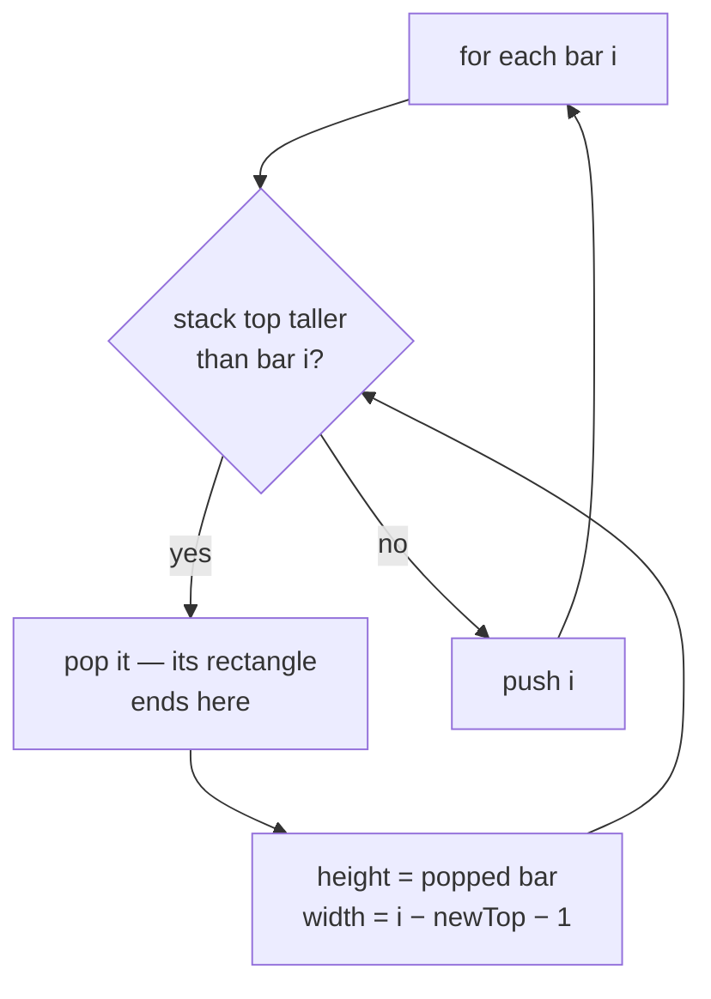

# Monotonic Stack {#ch-monotonic-stack}

> প্রতিটি element-এর "next greater" বা "next smaller" এক pass-এই বের করুন। শুধু সেই element-গুলো রাখুন, যেগুলো এখনো উত্তর হতে পারে।

**এই অধ্যায়ে:** stack-এ কী থাকে আর কেন সেটা index · template · increasing বনাম decreasing · loop-এর ভেতরে pop করেও কেন এটা `O(n)` · histogram-এর problem-গুলো, যেগুলো আসলে ছদ্মবেশে এই pattern-ই

## 💡 মূল ধারণা

টিকিট কাউন্টারের একটি লাইন ভাবুন। এইমাত্র যে লোকটি এলেন, তার চেয়ে খাটো যে কেউ আর আপনার সামনের সবচেয়ে লম্বা
মানুষ হতে পারবেন না। তাই উত্তর হিসেবে তাদের কোনো দাম নেই, তাদের বাদ দেওয়া যায়। Monotonic stack হলো একটি array-এর
ওপর এই বাদ দেওয়ার নিয়মটাই।

বাঁ থেকে ডানে চলুন। বর্তমান element push করার আগে, stack-এর যেসব element-কে বর্তমান element হারিয়ে দেয়, সবগুলো
pop করুন। প্রতিটি pop হওয়া element এইমাত্র তার উত্তর পেয়ে গেল — বর্তমান element-টিই তার "next greater"। Stack-এ
যা থেকে যায়, তা সবসময় sorted থাকে। নামটা এখান থেকেই এসেছে।

Brute force হলো একটি nested loop: প্রতিটি element-এর জন্য ডানে scan করতে থাকুন, যতক্ষণ না বড় কিছু পাওয়া যায়। সেটা
`O(n²)`। Stack version `O(n)`, কারণ যে element একবার বাদ পড়েছে, সেটাকে সে আর কখনো দ্বিতীয়বার দেখে না।

> **Value নয়, index রাখুন।** এই পরিবারের প্রায় প্রতিটি প্রশ্ন একটি দূরত্ব চায় — "গরম দিন আসতে আর কত দিন" — আর
> index থাকলে বিয়োগ করা যায়। শুধু value দরকার হলে `nums[stack[stack.length - 1]]` পড়ুন।

## কীভাবে কাজ করে

### Template

```typescript
// LC 739 — for each day, how many days until a warmer temperature
function dailyTemperatures(temps: number[]): number[] {
  const answer: number[] = new Array(temps.length).fill(0);
  const stack: number[] = [];   // indices, temperatures strictly decreasing down the stack

  for (let i = 0; i < temps.length; i++) {
    // Everything cooler than today has found its warmer day: today
    while (stack.length > 0 && temps[stack[stack.length - 1]] < temps[i]) {
      const cooler = stack.pop()!;
      answer[cooler] = i - cooler;   // the distance is why we stored indices
    }
    stack.push(i);
  }
  // Anything still on the stack never found a warmer day, and keeps its 0
  return answer;
}
// Time: O(n), Space: O(n)  — the brute force is O(n²)
```

গঠন মাত্র তিন line-এর, আর এই পরিবারের প্রতিটি problem এরই একটি রূপভেদ: monotonic শর্ত যতক্ষণ ভাঙছে ততক্ষণ pop
করুন, প্রতিটি pop হওয়া element-এর উত্তর ঠিক করুন, তারপর push করুন।

### ভেতরের `while` কেন এটাকে quadratic বানায় না

প্রতিটি index ঠিক একবার push হয় আর বড়জোর একবার pop হয়। তাই পুরো run-এ মোট pop-এর সংখ্যা বড়জোর `n`। একটি
iteration অনেকগুলো element pop করতে পারে, কিন্তু সেটা ঘটে শুধু আগের iteration-গুলো সেগুলো push করেছিল বলে, আর
সেগুলো আর কখনো ফিরে আসে না। মোট কাজ `2n`টি push আর pop, distribution যত এলোমেলোই হোক।

এটা amortised analysis, আর sliding window-এর shrink loop-এর যুক্তিও ঠিক এটাই —
[Chapter ?? — Sliding Window](#ch-sliding-window) দেখুন।

### Increasing নাকি decreasing

বদলায় শুধু তুলনার দিকটা। আর এটা উল্টো করে ফেলাই এই pattern-এর সবচেয়ে সাধারণ ভুল।

| আপনি চান                | Stack-এ থাকে (top থেকে bottom) | যতক্ষণ pop করবেন              | Resolve হওয়া element পায়      |
| ----------------------- | --------------------------- | ---------------------------- | --------------------------- |
| ডানে next **greater** | Decreasing            | `nums[top] < nums[i]`        | উত্তর হিসেবে `i`            |
| ডানে next **smaller** | Increasing            | `nums[top] > nums[i]`        | উত্তর হিসেবে `i`            |
| বাঁয়ে previous **greater** | Decreasing         | `nums[top] <= nums[i]`       | pop করার পরের নতুন `top`  |
| বাঁয়ে previous **smaller** | Increasing         | `nums[top] >= nums[i]`       | pop করার পরের নতুন `top`  |

দুই অর্ধেক একসাথে পড়া দরকার। "ডানে next X"-এর উত্তর মেলে **যখন একটি element pop হয়**। "বাঁয়ে previous X"-এর
উত্তর মেলে **যখন একটি element push হয়** — stack-এ তার নিচে যা এখনো আছে, সেটাই তার পেছনের সবচেয়ে কাছের যোগ্য
element। একই loop, কাজটা করে আলাদা line।

Duplicate-এর জন্য `<` নাকি `<=`, ভেবেচিন্তে বেছে নিন। Strict তুলনা সমান value-গুলোকে stack-এ রেখে দেয়। তাই "next
strictly greater"-এর জন্য লাগে `<`, আর "next greater or equal"-এর জন্য লাগে `<=`।

### Circular রূপভেদ

Next Greater Element II ঘুরে শুরুতে ফিরে আসে। দ্বিতীয়বার stack pass না করে, `2n`টি index ধরে চলুন আর `i % n`
নিন। Push করবেন শুধু প্রথম চক্করে:

```typescript
function nextGreaterElements(nums: number[]): number[] {
  const n = nums.length;
  const answer: number[] = new Array(n).fill(-1);
  const stack: number[] = [];

  for (let i = 0; i < 2 * n; i++) {
    const value = nums[i % n];
    while (stack.length > 0 && nums[stack[stack.length - 1]] < value) {
      answer[stack.pop()!] = value;
    }
    if (i < n) stack.push(i);   // second lap only resolves; it must not add new work
  }
  return answer;
}
// Time: O(n), Space: O(n)
```

### Histogram-এর গড়ন

Largest Rectangle in Histogram একই stack, শুধু resolve করার ধাপটা আলাদা। একটি bar pop হলে, pop হওয়া bar-এর
উচ্চতাই সীমাবদ্ধ উচ্চতা। আর তার প্রস্থ চলে নতুন stack top-এর পরের bar থেকে `i`-এর আগের bar পর্যন্ত।



**Pop করার সময়েই rectangle মাপা হয়: bar-টি `i` পেরিয়ে যেতে পারে না, আর বাঁয়ে stack-এ যা এখনো আছে তা পেরিয়েও যেতে পারে না।**

Trapping Rain Water, Maximal Rectangle আর Sum of Subarray Minimums — সবই এই একই pop-and-measure ধাপ, শুধু ভেতরের
formula আলাদা।

## কখন ব্যবহার করবেন

| প্রশ্নে যে সংকেত থাকে                                        | কী ব্যবহার করবেন         | কেন                                          |
| ------------------------------------------------------------- | ----------------- | -------------------------------------------- |
| **প্রতিটি** element-এর জন্য "next greater / smaller element"        | Monotonic stack   | সংজ্ঞা দেওয়ার মতো উদাহরণ                             |
| "আর কত দিন / কত ধাপ পর…"                                | Monotonic stack   | Index থেকে দূরত্ব পাওয়া যায়                     |
| Bar, building, skyline, histogram                         | Monotonic stack   | প্রতিটি bar-এর বিস্তার তার চেয়ে খাটো প্রতিবেশীরা সীমিত করে |
| "সবচেয়ে ছোট সংখ্যা বানাতে `k`টি digit সরান"               | Monotonic stack   | Greedy pop সরাসরি উত্তরটা গড়ে তোলে     |
| `k` size-এর প্রতিটি window-এর maximum                         | Monotonic **deque** | Window সরার সাথে সাথে সামনে থেকেও বাদ দিতে হয় |
| পুরো array-এর maximum দরকার, একবার                 | একটি সাধারণ scan     | Stack এখানে কিছুই যোগ করে না                          |
| Array sorted                                           | Two pointers বা binary search | উত্তর পাশেই আছে, তাই কিছু বাদ দেওয়ার দরকার নেই |

Sliding Window Maximum-এর row-টাতেই মানুষ আটকে যায়। দেখতে window-এর প্রশ্ন, কিন্তু আচরণ এই pattern-এর মতো।
Structure-টি একটি monotonic **deque**, কারণ window পেরিয়ে গেলে element-গুলো বাঁ দিক থেকেও মেয়াদ শেষ হয়ে বাদ পড়ে।

## সাধারণ ভুল

**উত্তর যখন দূরত্ব, তখন value রাখা:**

```typescript
// ❌ stack.push(temps[i]);        // no way to compute i - cooler
// ✅ stack.push(i);               // read the value with temps[stack[stack.length - 1]]
```

**তুলনার দিক উল্টো করে ফেলা:**

```typescript
// ❌ while (temps[stack.at(-1)!] > temps[i])   // this finds next *smaller*
// ✅ while (temps[stack.at(-1)!] < temps[i])   // next greater
```

দুটো element দিয়ে যাচাই করুন। `[1, 2]`-এ index 0-কে অবশ্যই একটি উত্তর পেতে হবে। না পেলে চিহ্নটা ভুল।

**Stack খালি কিনা দেখার আগেই stack top দেখা:**

```typescript
// ❌ while (temps[stack.at(-1)!] < temps[i] && stack.length > 0)   // reads undefined first
// ✅ while (stack.length > 0 && temps[stack.at(-1)!] < temps[i])
```

**বাকি থাকা element-গুলোর কথা ভুলে যাওয়া:**

```typescript
// ❌ assuming every index gets resolved — indices still on the stack at the end never do
// ✅ pre-fill the answer array with the "no answer" sentinel (0 or -1) before the loop
```

**Circular pass-এর দ্বিতীয় চক্করে push করা:**

```typescript
// ❌ stack.push(i % n);            // the same index enters twice and the stack never drains
// ✅ if (i < n) stack.push(i);
```

**Problem যখন strictly greater বলছে, তখন `<=` ব্যবহার করা:**

```typescript
// ❌ on [2, 2, 3], `<=` pops the first 2 at the second 2 and reports a distance of 1
// ✅ use `<` for "strictly greater", and decide this before writing the loop
```

## অনুশীলনের জন্য Problem

| #    | Problem                            | কঠিনতা | যা অনুশীলন করায়                                   |
| ---- | ---------------------------------- | ---------- | ------------------------------------------------ |
| 496  | Next Greater Element I             | Easy       | Template, সাথে একটি value থেকে উত্তরের map          |
| 739  | Daily Temperatures                 | Medium     | Index, দূরত্ব, আর বাকি থাকা zero-গুলো       |
| 503  | Next Greater Element II            | Medium     | Circular `2n` pass                            |
| 901  | Online Stock Span                  | Medium     | Previous-greater, push-এর সময় resolve হয়                |
| 402  | Remove K Digits                    | Medium     | Stack নিজেই উত্তর, খসড়া খাতা নয়         |
| 907  | Sum of Subarray Minimums           | Medium     | একটি span মাপার বদলে span গোনা           |
| 84   | Largest Rectangle in Histogram     | Hard       | Pop-and-measure প্রস্থের formula                 |
| 42   | Trapping Rain Water                | Hard       | Two-pointer আর stack, দুই ধরনের solution-ই আছে        |

739 করতে থাকুন, যতক্ষণ না template হাতে বসে যায়। তারপর 84। 84 বুঝে গেলে 85 আর 907 শুধু তার ওপর কিছু হিসাব-নিকাশ।

## 🔑 মূল শিক্ষা

- Monotonic stack সেই element-গুলো বাদ দেয়, যেগুলো আর কখনো উত্তর হতে পারবে না। এতে একটি `O(n²)` scan `O(n)` হয়ে যায়।
- Index রাখুন। এই পরিবারের প্রায় প্রতিটি প্রশ্ন একটি দূরত্ব বা প্রস্থ চায়।
- **Decreasing** stack next greater খুঁজে পায়। **Increasing** stack next smaller খুঁজে পায়।
- "ডানে next"-এর উত্তর মেলে pop-এ, "বাঁয়ে previous"-এর উত্তর মেলে push-এ — একই loop, আলাদা line।
- উত্তরের array আগে থেকেই sentinel দিয়ে ভরে রাখুন, কারণ stack-এ থেকে যাওয়া element-গুলো কখনো resolve হয় না।

## Interview-এর প্রশ্ন

**Q: `for` loop-এর ভেতরে একটি `while` loop আছে। তাহলে এটা `O(n)` কেন?**

প্রতিটি index একবার push হয় আর বড়জোর একবার pop হয়। তাই পুরো run-এ মোট pop-এর সংখ্যা `n` দিয়ে সীমিত। একটি
iteration অনেক element pop করতে পারে, কিন্তু শুধু এই কারণে যে আগের iteration-গুলো সেগুলো push করেছিল, আর সেগুলো
আর কখনো ফিরতে পারে না। মোট কাজ `2n`টি operation, যা amortised হিসেবে `O(n)`।

**Q: Value-র বদলে index কেন রাখবেন?**

কারণ উত্তরটা সাধারণত অবস্থান-নির্ভর। Daily Temperatures চায় `i - cooler`, আর Largest Rectangle চায় দুটো stack
entry-র মাঝখানে মাপা একটি প্রস্থ। Index থাকলে array থেকে value বিনা খরচে পাওয়া যায়। কিন্তু value থেকে অবস্থানে
ফেরার কোনো উপায় নেই।

**Q: Increasing আর decreasing stack-এর মধ্যে কীভাবে বেছে নেবেন?**

জিজ্ঞেস করুন, একটি element কীসের অপেক্ষায় আছে। যদি সে বড় কিছুর অপেক্ষায় থাকে, তাহলে ছোট কিছু এলে তার কোনো কাজে
আসে না — তাই ছোট element-গুলো আগেই pop হয়ে যাওয়ার কথা, মানে stack-টি decreasing। Next-smaller-এর জন্য বাক্যটা
উল্টে দিন। দুই element-এর একটি array দিয়ে যাচাই করতে পাঁচ সেকেন্ড লাগে, আর কোনো ক্ষতি হওয়ার আগেই ভুলটা ধরা পড়ে।

**Q: প্রশ্নে "maximum" থাকলেও monotonic stack কখন ভুল tool?**

যখন element-গুলোকে দুই প্রান্ত থেকেই বের হতে হয়। Sliding Window Maximum-এ window এগোনোর সাথে সাথে সামনের অংশ বাদ
দিতে হয়, তাই এর দরকার একটি deque, stack নয়। একইভাবে, array sorted হলে next greater element স্রেফ পাশের element,
কোনো structure-এরই দরকার নেই।

**Q: Largest Rectangle in Histogram এই pattern কীভাবে ব্যবহার করে?**

Stack-এ থাকে bar-গুলোর index, উচ্চতার increasing ক্রমে। একটি খাটো bar এলে stack-এর প্রতিটি লম্বা bar আর ডানে
বাড়তে পারে না। তাই সেটা pop হয় আর তার rectangle মাপা হয়: উচ্চতা pop হওয়া bar-এর, আর প্রস্থ নতুন stack top-এর ঠিক
পর থেকে বর্তমান index-এর ঠিক আগ পর্যন্ত। Input-এর শেষে 0 উচ্চতার একটি sentinel bar জুড়ে দিলে, দ্বিতীয় loop
ছাড়াই শেষে stack খালি হয়ে যায়।

## এরপর কী পড়বেন

- [Chapter ?? — Sliding Window](#ch-sliding-window) — একই amortised যুক্তি, stack-এর বদলে একটি span-এর ওপর
- [Chapter ?? — Top K Element](#ch-top-k-elements) — যখন "largest"-এর জন্য একটি বাদ দেওয়ার নিয়ম নয়, একটি ক্রম দরকার
- [Chapter ?? — Two Pointers](#ch-two-pointers) — Trapping Rain Water-এর বিকল্প solution, `O(1)` space-এ
