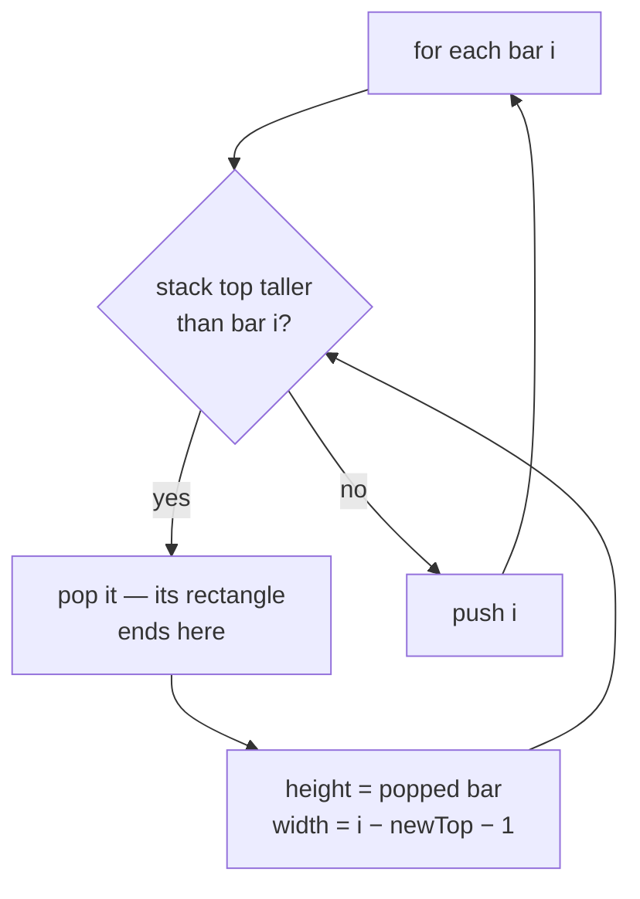

# Monotonic Stack {#ch-monotonic-stack}

> প্রতিটি element-এর "next greater" বা "next smaller" বের করুন একবারের pass-এ। কৌশলটা সোজা: যে element-গুলো এখনো উত্তর হতে পারে, শুধু সেগুলো রেখে দিন।

**এই অধ্যায়ে:** stack-এ কী থাকে, আর কেন index · template · increasing বনাম decreasing · loop-এর ভেতরে pop করলেও কেন `O(n)` থাকে · histogram-এর problem, যেগুলো আসলে ছদ্মবেশে এই pattern-ই

## 💡 মূল ধারণা

টিকিট counter-এর লাইনের কথা ভাবুন। লম্বা কেউ এসে দাঁড়ালে তার চেয়ে খাটো সবাই বাদ পড়ে যায়। আপনার সামনের সবচেয়ে
লম্বা মানুষ আর তারা কখনো হতে পারবে না, তাই উত্তর হিসেবে তাদের কোনো দাম নেই, ফেলে দেওয়া যায়। Array-এর ওপর এই
বাদ দেওয়ার নিয়মটাই হলো monotonic stack।

বাঁ থেকে ডানে হাঁটুন। বর্তমান element push করার আগে stack থেকে সেই সবকিছু pop করুন, যাদের এই element হারিয়ে দেয়।
যে element pop হলো, তার উত্তর এইমাত্র মিলে গেল: বর্তমান element-টাই তার "next greater"। Stack-এ যা থেকে যায়, তা
সবসময় sorted থাকে। নামটা এসেছে সেখান থেকেই।

Brute force হলো nested loop: প্রতিটি element-এর জন্য ডানে খুঁজতে থাকুন, যতক্ষণ না বড় কিছু পাওয়া যায়। এতে লাগে
`O(n²)`। Stack দিয়ে লাগে `O(n)`, কারণ একবার বাদ দেওয়া element-কে এটা আর কখনো দেখে না।

> **Value নয়, index রাখুন।** এই পরিবারের প্রায় সব প্রশ্নই দূরত্ব জানতে চায়, যেমন "তাপমাত্রা বাড়তে আর কত দিন বাকি"।
> Index থাকলে বিয়োগ করেই দূরত্ব পাওয়া যায়। শুধু value দরকার হলে পড়ে নিন
> `nums[stack[stack.length - 1]]`।

## কীভাবে কাজ করে

### Template

```typescript
// LC 739 — for each day, how many days until a warmer temperature
function dailyTemperatures(temps: number[]): number[] {
  const answer: number[] = new Array(temps.length).fill(0);
  const stack: number[] = [];   // indices, temperatures strictly decreasing down the stack

  for (let i = 0; i < temps.length; i++) {
    // Everything cooler than today has found its warmer day: today
    while (stack.length > 0 && temps[stack[stack.length - 1]] < temps[i]) {
      const cooler = stack.pop()!;
      answer[cooler] = i - cooler;   // the distance is why we stored indices
    }
    stack.push(i);
  }
  // Anything still on the stack never found a warmer day, and keeps its 0
  return answer;
}
// Time: O(n), Space: O(n)  — the brute force is O(n²)
```

গঠন বলতে তিনটি line। এই পরিবারের প্রতিটি problem এগুলোরই কোনো রূপ: monotonic শর্ত যতক্ষণ ভাঙছে ততক্ষণ pop করুন,
প্রতিটি pop হওয়া element-এর উত্তর বসিয়ে দিন, তারপর push করুন।

### ভেতরের `while` থাকলেও কেন quadratic হয় না

প্রতিটি index ঠিক একবার push হয়, আর pop হয় বড়জোর একবার। তাই পুরো run-এ মোট pop কখনো `n`-এর বেশি হয় না। একটি
iteration-এ অনেকগুলো element pop হতে পারে, তবে সেটা হয় শুধু আগের iteration-গুলো সেগুলো push করেছিল বলে। আর pop
হওয়া element আর ফিরে আসে না। ফলে data যেমনই ছড়ানো থাকুক, মোট কাজ `2n` push আর pop।

একে বলে amortised analysis। Sliding window-এর shrink loop-এর পেছনেও ঠিক এই যুক্তি, দেখুন
[Chapter ?? — Sliding Window](#ch-sliding-window)।

### Increasing নাকি decreasing

বদলায় শুধু তুলনার দিক। আর এই দিক উল্টে ফেলাই এই pattern-এ সবচেয়ে বেশি হওয়া ভুল।

| আপনি চান                | Stack-এ থাকে (top থেকে নিচে) | যতক্ষণ pop করবেন              | Pop হওয়া element-এর উত্তর     |
| ----------------------- | --------------------------- | ---------------------------- | --------------------------- |
| ডানে next **greater** | Decreasing            | `nums[top] < nums[i]`        | `i`             |
| ডানে next **smaller** | Increasing            | `nums[top] > nums[i]`        | `i`             |
| বাঁয়ে previous **greater** | Decreasing         | `nums[top] <= nums[i]`       | pop শেষে নতুন `top`  |
| বাঁয়ে previous **smaller** | Increasing         | `nums[top] >= nums[i]`       | pop শেষে নতুন `top`  |

টেবিলের দুই অর্ধেক পাশাপাশি পড়ুন। "ডানে next X"-এর উত্তর মেলে **element pop হওয়ার সময়**। "বাঁয়ে previous X"-এর
উত্তর মেলে **element push হওয়ার সময়**: তখনো stack-এ তার নিচে যা আছে, সেটাই পেছনে থাকা সবচেয়ে কাছের যোগ্য element।
Loop একই, শুধু কাজটা করে আলাদা line।

Duplicate থাকলে `<` আর `<=`-এর মধ্যে ভেবেচিন্তে বাছুন। Strict তুলনা সমান value-গুলোকে stack-এ রেখে দেয়। তাই
"next strictly greater"-এর জন্য লাগে `<`, আর "next greater or equal"-এর জন্য `<=`।

### Circular রূপ

Next Greater Element II-তে array শেষ হয়ে আবার শুরুতে ফিরে আসে। Stack-এর ওপর দ্বিতীয় pass না চালিয়ে `2n` index পর্যন্ত
হাঁটুন, `i % n` নিন, আর push করুন শুধু প্রথম চক্করে:

```typescript
function nextGreaterElements(nums: number[]): number[] {
  const n = nums.length;
  const answer: number[] = new Array(n).fill(-1);
  const stack: number[] = [];

  for (let i = 0; i < 2 * n; i++) {
    const value = nums[i % n];
    while (stack.length > 0 && nums[stack[stack.length - 1]] < value) {
      answer[stack.pop()!] = value;
    }
    if (i < n) stack.push(i);   // second lap only resolves; it must not add new work
  }
  return answer;
}
// Time: O(n), Space: O(n)
```

### Histogram-এর ধাঁচ

Largest Rectangle in Histogram-এ stack একই, শুধু উত্তর বসানোর ধাপটা আলাদা। কোনো bar pop হলে সেই bar-এর উচ্চতাই
সীমা। আর তার width চলে নতুন stack top-এর ঠিক পরের bar থেকে `i`-এর ঠিক আগের bar পর্যন্ত।



**Rectangle মাপা হয় pop-এর সময়: bar-টা `i` পেরিয়ে ডানে যেতে পারে না, আর stack-এ তখনো যা আছে তা পেরিয়ে বাঁয়েও যেতে পারে না।**

Trapping Rain Water, Maximal Rectangle আর Sum of Subarray Minimums, সবই এই pop করে মাপার ধাপ। শুধু ভেতরের formula
আলাদা।

## কখন ব্যবহার করবেন

| প্রশ্নে যে ইঙ্গিত থাকে                                         | কী ব্যবহার করবেন     | কেন                                          |
| ------------------------------------------------------------- | ----------------- | -------------------------------------------- |
| **প্রতিটি** element-এর "next greater / smaller element"        | Monotonic stack   | এটাই এই pattern-এর মূল ক্ষেত্র                  |
| "কত দিন / কত ধাপ পরে…"                                       | Monotonic stack   | Index থেকেই দূরত্ব পাওয়া যায়                    |
| Bar, building, skyline, histogram                         | Monotonic stack   | প্রতিটি bar কতদূর ছড়াবে, তা ঠিক করে পাশের খাটো bar |
| "`k`টি digit সরিয়ে সবচেয়ে ছোট সংখ্যা বানান"               | Monotonic stack   | Greedy-ভাবে pop করলেই সরাসরি উত্তর তৈরি হয়     |
| `k` size-এর প্রতিটি window-এর maximum                           | Monotonic **deque** | Window সরার সঙ্গে সঙ্গে সামনে থেকেও বাদ দিতে হয় |
| পুরো array-এর maximum দরকার, একবারই                 | একটি scan     | Stack এখানে কিছুই যোগ করে না                        |
| Array sorted                                           | Two pointers বা binary search | উত্তর ঠিক পাশেই, তাই কিছু বাদ দেওয়ার দরকার নেই |

Sliding Window Maximum-এর row-তেই সবাই আটকে যায়। দেখতে window-এর প্রশ্ন, কিন্তু আচরণ এই pattern-এর মতো। এখানে
structure হলো monotonic **deque**, কারণ window এগিয়ে গেলে বাঁ দিক থেকেও element-এর মেয়াদ ফুরিয়ে যায়।

## সাধারণ ভুল

**উত্তর যেখানে দূরত্ব, সেখানে value রাখা:**

```typescript
// ❌ stack.push(temps[i]);        // no way to compute i - cooler
// ✅ stack.push(i);               // read the value with temps[stack[stack.length - 1]]
```

**তুলনার দিক উল্টে ফেলা:**

```typescript
// ❌ while (temps[stack.at(-1)!] > temps[i])   // this finds next *smaller*
// ✅ while (temps[stack.at(-1)!] < temps[i])   // next greater
```

দুটি element দিয়ে যাচাই করে নিন। `[1, 2]`-এ index 0-এর উত্তর পাওয়া উচিত। না পেলে চিহ্ন ভুল।

**Stack খালি কিনা দেখার আগেই stack top দেখা:**

```typescript
// ❌ while (temps[stack.at(-1)!] < temps[i] && stack.length > 0)   // reads undefined first
// ✅ while (stack.length > 0 && temps[stack.at(-1)!] < temps[i])
```

**বাকি থেকে যাওয়া element-গুলোর কথা ভুলে যাওয়া:**

```typescript
// ❌ assuming every index gets resolved — indices still on the stack at the end never do
// ✅ pre-fill the answer array with the "no answer" sentinel (0 or -1) before the loop
```

**Circular pass-এর দ্বিতীয় চক্করেও push করা:**

```typescript
// ❌ stack.push(i % n);            // the same index enters twice and the stack never drains
// ✅ if (i < n) stack.push(i);
```

**Problem যেখানে strictly greater চায়, সেখানে `<=` লেখা:**

```typescript
// ❌ on [2, 2, 3], `<=` pops the first 2 at the second 2 and reports a distance of 1
// ✅ use `<` for "strictly greater", and decide this before writing the loop
```

## অনুশীলনের জন্য Problem

| #    | Problem                            | কঠিনতা | যা অনুশীলন করায়                                   |
| ---- | ---------------------------------- | ---------- | ------------------------------------------------ |
| 496  | Next Greater Element I             | Easy       | Template, সঙ্গে value থেকে উত্তরের একটি map          |
| 739  | Daily Temperatures                 | Medium     | Index, দূরত্ব, আর বাকি থেকে যাওয়া zero       |
| 503  | Next Greater Element II            | Medium     | Circular `2n` pass                            |
| 901  | Online Stock Span                  | Medium     | Previous-greater, push-এর সময় উত্তর         |
| 402  | Remove K Digits                    | Medium     | Stack নিজেই উত্তর, খসড়ার জায়গা নয়         |
| 907  | Sum of Subarray Minimums           | Medium     | একটি span মাপার বদলে span গোনা           |
| 84   | Largest Rectangle in Histogram     | Hard       | Pop করে মাপার width formula                 |
| 42   | Trapping Rain Water                | Hard       | Two-pointer আর stack, দুই রকম সমাধানই আছে        |

Template হাতে বসে না যাওয়া পর্যন্ত 739 করতে থাকুন, তারপর 84। 84 বুঝে গেলে 85 আর 907 তার ওপর শুধু হিসাব রাখার কাজ।

## 🔑 মূল শিক্ষা

- Monotonic stack সেই element-গুলো বাদ দেয়, যারা আর কখনো উত্তর হতে পারবে না। তাতে `O(n²)` scan নেমে আসে `O(n)`-এ।
- Index রাখুন। এই পরিবারের প্রায় সব প্রশ্নই দূরত্ব বা width চায়।
- **Decreasing** stack দেয় next greater, **increasing** stack দেয় next smaller।
- "ডানে next"-এর উত্তর মেলে pop-এ, "বাঁয়ে previous"-এর উত্তর push-এ। Loop একই, line আলাদা।
- উত্তরের array আগেই sentinel দিয়ে ভরে রাখুন, কারণ stack-এ থেকে যাওয়া element-গুলোর উত্তর কখনো বসে না।

## Interview-এর প্রশ্ন

**Q: `for` loop-এর ভেতরে একটি `while` loop আছে। তবু এটা `O(n)` কেন?**

প্রতিটি index একবার push হয়, আর pop হয় বড়জোর একবার। তাই পুরো run-এ মোট pop `n` ছাড়ায় না। একটি iteration-এ অনেক
element pop হতে পারে, কিন্তু সেটা হয় আগের iteration-গুলো সেগুলো push করেছিল বলেই, আর pop হওয়া element ফেরে না।
মোট কাজ `2n` operation, মানে amortised `O(n)`।

**Q: Value না রেখে index রাখেন কেন?**

কারণ উত্তর সাধারণত অবস্থান নিয়ে। Daily Temperatures চায় `i - cooler`, আর Largest Rectangle চায় stack-এর দুটি entry-র
মাঝের width। Index থাকলে array থেকে value এমনিই পাওয়া যায়। কিন্তু শুধু value থাকলে অবস্থানে ফেরার কোনো উপায় থাকে না।

**Q: Increasing আর decreasing stack-এর মধ্যে কীভাবে বাছবেন?**

নিজেকে জিজ্ঞেস করুন, element-টা কীসের অপেক্ষায় আছে। বড় কিছুর অপেক্ষায় থাকলে ছোট কিছু এসে তার কোনো কাজে লাগে না।
তাই ছোট element-গুলো আগেই pop হয়ে যাওয়ার কথা, মানে stack decreasing। Next-smaller-এর জন্য কথাটা উল্টে নিন। দুটি
element-এর array-তে যাচাই করতে পাঁচ সেকেন্ড লাগে, আর ভুলটা দাম দেওয়ার আগেই ধরা পড়ে।

**Q: প্রশ্নে "maximum" থাকলেও কখন monotonic stack ভুল হাতিয়ার?**

যখন element-কে দুই দিক থেকেই সরাতে হয়। Sliding Window Maximum-এ window এগোলে সামনের element বাদ দিতে হয়, তাই
সেখানে লাগে deque, stack নয়। একইভাবে array sorted হলে next greater element স্রেফ পাশের element, কোনো structure-ই
লাগে না।

**Q: Largest Rectangle in Histogram এই pattern কীভাবে কাজে লাগায়?**

Stack-এ থাকে bar-গুলোর index, উচ্চতার increasing ক্রমে। খাটো কোনো bar এলে stack-এর প্রতিটি লম্বা bar আর ডানে বাড়তে
পারে না। তাই সেগুলো pop হয়, আর তখনই প্রতিটির rectangle মাপা হয়: উচ্চতা pop হওয়া bar-এর, আর width নতুন stack top-এর
ঠিক পর থেকে বর্তমান index-এর ঠিক আগ পর্যন্ত। Input-এর শেষে 0 উচ্চতার একটি sentinel bar জুড়ে দিলে শেষে stack খালি হয়ে
যায়, দ্বিতীয় loop লাগে না।

## এরপর কী পড়বেন

- [Chapter ?? — Sliding Window](#ch-sliding-window) — একই amortised যুক্তি, তবে stack-এর বদলে একটি span-এর ওপর
- [Chapter ?? — Top K Element](#ch-top-k-elements) — "largest" বের করতে যখন বাদ দেওয়ার নিয়ম নয়, ক্রম লাগে
- [Chapter ?? — Two Pointers](#ch-two-pointers) — Trapping Rain Water-এর বিকল্প সমাধান, `O(1)` space-এ
