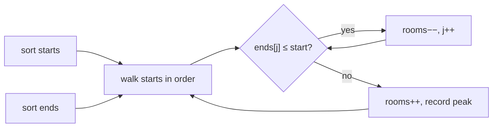

# Overlapping Interval {#ch-overlapping-intervals}

> আগে interval-গুলো sort করুন। তাহলে overlap নিয়ে প্রতিটি প্রশ্ন দুটি সংখ্যার মধ্যে একটি তুলনায় পরিণত হয়।

**এই অধ্যায়ে:** overlap-এর চার রকম গড়ন, আর সবগুলোকে ধরে এমন একটিমাত্র test · merge করা · "একসাথে কয়টি"-র জন্য sweep line · start অনুযায়ী বনাম end অনুযায়ী sort · inclusive/exclusive-এর ফাঁদ

## 💡 মূল ধারণা

একটি interval মানে একটি শুরু আর একটি শেষ: একটি meeting, একটি booking, একটি version range, একটি maintenance window।
এই পরিবারের প্রতিটি প্রশ্নের — সেগুলো merge করা, একসাথে চলা কয়টি তা গোনা, একটি insert করা, সবচেয়ে কম সংখ্যক
সরানো — উত্তর আসে একই প্রথম চাল থেকে।

**Sort করুন, তারপর প্রতিটি interval-কে শুধু তার প্রতিবেশীর সাথে তুলনা করুন।** Unsorted অবস্থায় interval `i` যেকোনো
কিছুর সাথে overlap করতে পারে, তাই আপনাকে `O(n²)`-এ সব জোড়া পরীক্ষা করতে হয়। Start অনুযায়ী sorted থাকলে একটি
interval শুধু তার ঠিক আগেরটার সাথেই overlap করতে পারে, তাই একটি pass-ই যথেষ্ট।

Calendar হলো এর দৈনন্দিন রূপ। দুটি meeting-এ সংঘাত আছে কিনা দেখতে আপনি পুরো সপ্তাহ scan করেন না। আপনি দিনটা
ক্রমানুসারে ওপর থেকে নিচে পড়েন, আর খেয়াল করেন কখন একটি row ওপরের row শেষ হওয়ার আগেই শুরু হচ্ছে।

> দুটি interval `[a, b]` আর `[c, d]`, এমনভাবে sorted যে `a ≤ c`, overlap করে যখন `c ≤ b`। ওই একটি তুলনাই
> containment, আংশিক overlap আর ছুঁয়ে থাকা endpoint — সব ধরে। চারটি ক্ষেত্র আলাদাভাবে কখনো লাগে না।

## কীভাবে কাজ করে

### Merge করা

```typescript
type Interval = [start: number, end: number];

function merge(intervals: Interval[]): Interval[] {
  if (intervals.length === 0) return [];

  // Sort by start. Everything below relies on it.
  const sorted = [...intervals].sort((a, b) => a[0] - b[0]);
  const merged: Interval[] = [sorted[0]];

  for (let i = 1; i < sorted.length; i++) {
    const last = merged[merged.length - 1];
    const [start, end] = sorted[i];

    if (start <= last[1]) {
      // Overlap — extend. Math.max matters: the current interval may sit entirely inside the last one
      last[1] = Math.max(last[1], end);
    } else {
      merged.push([start, end]);
    }
  }
  return merged;
}
// Time: O(n log n) for the sort, O(n) for the pass. Space: O(n) for the output
```

`Math.max(last[1], end)` সেই line, যেটা containment সামলায়। `[[1, 10], [2, 3]]`-এ সাধারণ একটি
`last[1] = end` merge হওয়া interval-কে ছোট করে `[1, 3]` বানিয়ে দেয়, আর চুপচাপ coverage হারায়।

খরচের সিংহভাগ sort-এর। তাই এই pattern-এর সর্বনিম্ন খরচ `O(n log n)`, যদি না input sorted অবস্থায় আসে — এটা
জিজ্ঞেস করা দরকার, কারণ তাতে উত্তর নেমে `O(n)` হয়।

### একসাথে কয়টি চলছে গোনা — sweep line

"কয়টি meeting room লাগবে" merge নয়। Merge আপনাকে বলে meeting *কোথায়* হচ্ছে। এই প্রশ্ন জানতে চায় *একসাথে কয়টি*।
এটা আলাদা প্রশ্ন, আর এর জন্য আলাদাভাবে ভাঙতে হয়।

প্রতিটি interval-কে দুটি event-এ ভাগ করুন, আর সময়ের ক্রমে process করুন। একটি start এক যোগ করে, একটি end এক
বিয়োগ করে। Counter কখনো যে সর্বোচ্চ মানে পৌঁছায়, সেটাই উত্তর।

```typescript
function minMeetingRooms(intervals: Interval[]): number {
  const starts = intervals.map(([s]) => s).sort((a, b) => a - b);
  const ends = intervals.map(([, e]) => e).sort((a, b) => a - b);

  let rooms = 0;
  let peak = 0;
  let endIndex = 0;

  for (const start of starts) {
    // Free every room whose meeting finished at or before this start
    while (endIndex < ends.length && ends[endIndex] <= start) {
      rooms--;
      endIndex++;
    }
    rooms++;
    peak = Math.max(peak, rooms);
  }
  return peak;
}
// Time: O(n log n), Space: O(n)
```

মনে রাখার মতো কৌশল হলো start-গুলোকে end-গুলো থেকে আলাদা করা। দুটি array আলাদাভাবে sort হয়, কারণ খালি হওয়া
room-টি কোন meeting-এর ছিল তাতে কিছু যায় আসে না — শুধু এটুকু জানলেই চলে যে একটি খালি।



**প্রতিটি start একটি room দখল করে। ইতিমধ্যে পেরিয়ে যাওয়া প্রতিটি end একটি room ছেড়ে দেয়। সর্বোচ্চ বিন্দুটিই উত্তর।**

End time-এর একটি min-heap একই complexity-তে একই problem solve করে। প্রতিটি meeting *কোন* room পেল তাও যখন জানা
দরকার, তখন এই version-টাই ব্যবহার করুন — [Chapter ?? — Top K Element](#ch-top-k-elements) দেখুন।

### কোন key দিয়ে sort করবেন

এই pattern-এ আসল সিদ্ধান্ত হলো sort key, আর সেটা সবসময় start নয়।

| প্রশ্ন                                        | Sort করুন | তারপর                                              |
| ----------------------------------------------- | ------- | ------------------------------------------------- |
| Overlap করা interval merge করা                     | Start   | শেষ merge হওয়া interval বাড়ান, বা নতুন একটি push করুন |
| একটি sorted list-এ একটি interval insert করা          | Start   | শুধু নতুনটার সাথে overlap করা অংশটুকু merge করুন       |
| একজন মানুষ কি সব meeting-এ থাকতে পারবেন?             | Start   | যেকোনো `start < previousEnd` মানেই সংঘাত               |
| সর্বনিম্ন room / সর্বোচ্চ concurrency             | দুটিই, আলাদাভাবে | Start-গুলোকে end-গুলোর বিপরীতে sweep করুন            |
| রাখার মতো **সর্বোচ্চ** সংখ্যক non-overlapping interval   | **End** | Greedy-ভাবে প্রতিটি interval রাখুন, যেটা শেষ রাখা interval শেষ হওয়ার পরে শুরু হয় |
| সব balloon ফাটাতে সবচেয়ে কম arrow             | **End** | একই greedy — প্রতিটি রাখা interval-এর end-এ ছুঁড়ুন     |

শেষ দুটি row-ই মুখস্থ করা solution আর বুঝে করা solution-কে আলাদা করে। **End** অনুযায়ী sort কাজ করে, কারণ সবচেয়ে
আগে শেষ হলে পরের সবকিছুর জন্য সবচেয়ে বেশি জায়গা থাকে। Interval scheduling-এর এটাই প্রচলিত exchange argument।
Start অনুযায়ী sort করে greedy-ভাবে সবচেয়ে আগের start রাখা প্রমাণিতভাবে ভুল: শূন্যে শুরু হওয়া খুব লম্বা একটি
interval সবকিছু আটকে দেয়।

## কখন ব্যবহার করবেন

| প্রশ্নে যে সংকেত থাকে                                       | কী ব্যবহার করবেন              | কেন                                    |
| ------------------------------------------------------------ | ---------------------- | -------------------------------------- |
| Input হলো `[start, end]` জোড়ার একটি list                  | Sort, তারপর এক pass    | সংজ্ঞা দেওয়ার মতো গড়ন                      |
| "Merge", "overlap", "conflict", "clash"                      | Start অনুযায়ী sort          | প্রতিবেশীর সাথে তুলনাই যথেষ্ট          |
| "সর্বনিম্ন room", "সর্বোচ্চ concurrent", "সবচেয়ে ব্যস্ত মুহূর্ত"      | Sweep line বা heap     | আপনার দরকার একটি সংখ্যা, একটি span নয়            |
| "সর্বোচ্চ কয়টি non-overlapping…" বা "সবচেয়ে কম কয়টি সরাতে হবে"   | End অনুযায়ী sort, greedy    | সবচেয়ে আগে শেষ হলে সবচেয়ে বেশি জায়গা থাকে |
| Interval একটি একটি করে আসে আর সাথে সাথে query করতে হয়      | একটি interval tree বা একটি ordered map | প্রতিটি insert-এ নতুন করে sort মানে প্রতিবার `O(n log n)` |
| একটি নির্দিষ্ট interval set-এর ওপর অনেক query                | একটি timeline-এর ওপর prefix sum | প্রতি query-তে একবার sort করা কাজের অপচয় |

⚠️ Endpoint-গুলো **inclusive** কিনা দেখে নিন। `[1, 2]` আর `[2, 3]` overlap হিসেবে গণ্য হলে test হলো
`start <= last.end`। ছুঁয়ে থাকা চললে সেটা `start < last.end`। Meeting Rooms ছুঁয়ে থাকাকে ঠিক বলে ধরে — 2-এ শেষ
হওয়া একটি meeting 2-এ শুরু হওয়া আরেকটির সাথে সংঘাত করে না। অথচ Merge Intervals `[1, 4]` আর `[4, 5]`-কে
merge-যোগ্য ধরে। জিজ্ঞেস করুন, অথবা আপনার অনুমানটা মুখে বলুন।

## সাধারণ ভুল

**Sort না করা:**

```typescript
// ❌ iterating the input as given — neighbour comparison is only valid on sorted input
// ✅ sort by start (or end) first, and say the O(n log n) cost out loud
```

**Maximum নেওয়ার বদলে end overwrite করা:**

```typescript
// ❌ last[1] = end;                        // [[1,10],[2,3]] merges to [1,3]
// ✅ last[1] = Math.max(last[1], end);
```

**Input array-কে in place sort করা:**

```typescript
// ❌ intervals.sort(...)                   // mutates the caller's array
// ✅ [...intervals].sort(...)              // unless the problem says in-place is fine
```

**সংখ্যার ওপর default comparator ব্যবহার করা:**

```typescript
// ❌ starts.sort();                        // lexicographic — [10, 9] stays [10, 9]
// ✅ starts.sort((a, b) => a - b);
```

**Merge করে Meeting Rooms II solve করা:**

```typescript
// ❌ merge, then count the merged intervals — this counts busy blocks, not concurrency
// ✅ sweep starts against ends, or use a min-heap of end times
```

**"সবচেয়ে বেশি interval রাখো" greedy-তে start অনুযায়ী sort করা:**

```typescript
// ❌ sort by start and keep greedily — one long interval starting at 0 blocks everything after it
// ✅ sort by end; earliest finish leaves the most room
```

## অনুশীলনের জন্য Problem

| #   | Problem                                       | কঠিনতা | যা অনুশীলন করায়                                    |
| --- | --------------------------------------------- | ---------- | ------------------------------------------------- |
| 252 | Meeting Rooms                                 | Easy       | Overlap test, আর inclusive endpoint          |
| 56  | Merge Intervals                               | Medium     | `Math.max` দিয়ে বাড়ানো                           |
| 57  | Insert Interval                               | Medium     | নতুন করে sort না করে একটি অংশ merge করা                 |
| 253 | Meeting Rooms II                              | Medium     | Sweep line, বা end time-এর একটি heap                 |
| 435 | Non-overlapping Intervals                     | Medium     | End অনুযায়ী sort-এর greedy, আর কেন সেটা optimal       |
| 452 | Minimum Number of Arrows to Burst Balloons    | Medium     | ছদ্মবেশে একই greedy                  |
| 986 | Interval List Intersections                   | Medium     | দুটি sorted list, আর union-এর বদলে intersection |
| 759 | Employee Free Time                            | Hard       | `k`টি list জুড়ে merge, তারপর ফাঁকগুলো পড়া          |

56 আর 253 পরপর করুন — input-এর গড়ন একই, ভাঙার পদ্ধতি আলাদা। তারপর 435 আর 452, যেগুলো আসলে একই problem, শুধু
ভাষা আলাদা।

## 🔑 মূল শিক্ষা

- আগে sort করাটাই pattern। এটা সব জোড়ার `O(n²)` পরীক্ষাকে প্রতিবেশীদের একটিমাত্র `O(n)` pass-এ পরিণত করে।
- `a ≤ c` হিসেবে sorted থাকলে, `[a, b]` আর `[c, d]` overlap করে যখন `c ≤ b` — একটি test, চারটি গড়নই।
- Merge হওয়া interval `Math.max` দিয়ে বাড়ান, নইলে ভেতরে থাকা একটি interval চুপচাপ সেটাকে ছোট করে দেয়।
- Merge উত্তর দেয় "কোথায়", sweep line উত্তর দেয় "একসাথে কয়টি"। এগুলো আলাদা প্রশ্ন।
- "সবচেয়ে বেশি non-overlapping interval রাখো" **end** অনুযায়ী sort করে, কারণ সবচেয়ে আগে শেষ হলে সবচেয়ে বেশি জায়গা থাকে।

## Interview-এর প্রশ্ন

**Q: Sort করা কেন প্রথম চাল, আর এতে আপনার খরচ কত?**

Unsorted অবস্থায় যেকোনো interval অন্য যেকোনোটার সাথে overlap করতে পারে, তাই সঠিক হতে হলে সব `n²` জোড়া পরীক্ষা
করতে হয়। Start অনুযায়ী sorted থাকলে একটি interval শুধু আগে শুরু হওয়া একটির সাথেই overlap করতে পারে। তাই আগের
merge হওয়া interval-এর সাথে তুলনাই যথেষ্ট। খরচ `O(n log n)`, আর সেটাই পুরো solution-এর খরচ ঠিক করে দেয় — তাই
জিজ্ঞেস করা দরকার input আগে থেকেই sorted কিনা, কারণ তাতে খরচ নেমে `O(n)` হয়।

**Q: Overlap-এর শর্তটা বলুন, আর কেন চারটি diagram-এর ক্ষেত্র অপ্রয়োজনীয়, তা ব্যাখ্যা করুন।**

Sort `a ≤ c` নিশ্চিত করলে, `[a, b]` আর `[c, d]` overlap করে ঠিক তখনই, যখন `c ≤ b`। Containment, আংশিক overlap
আর ছুঁয়ে থাকা — সবই এই শর্ত মানে, আর ব্যর্থ হওয়ার একমাত্র উপায় হলো মাঝখানে একটি ফাঁক। চার ক্ষেত্রের তালিকা
শেখানোর একটি উপকরণ, code-এ লেখার মতো কিছু নয়।

**Q: Interval-গুলো merge করে কেন Meeting Rooms II solve করা যায় না?**

Merge overlap করা interval-গুলোকে ব্যস্ত block-এ গুটিয়ে আনে। তাই এটা বলে কখন অন্তত একটি meeting চলছে। কিন্তু
আপনার যে তথ্যটা দরকার — overlap-এর গভীরতা — সেটা এটা ফেলে দেয়। 9 থেকে 10 পর্যন্ত চলা তিনটি meeting merge হয়ে
এমন একটি interval হয়, যেটা 9 থেকে 10 পর্যন্ত একটি meeting-এর মতোই। কিন্তু দরকার একটির বদলে তিনটি room।

**Q: "সর্বোচ্চ সংখ্যক non-overlapping interval রাখো" greedy কেন end time অনুযায়ী sort করে?**

যে interval সবচেয়ে আগে শেষ হয়, সেটা বাছলে পরের সবকিছুর জন্য সম্ভাব্য সবচেয়ে বড় timeline বাকি থাকে। আর একটি
exchange argument দেখায় যে যেকোনো optimal solution-কে খারাপ না করেই এই বাছাই দিয়ে শুরু হওয়ার মতো করে আবার লেখা
যায়। Start অনুযায়ী sort ব্যর্থ হয় `[[0, 10], [1, 2], [3, 4]]`-এর মতো ছোট একটি counterexample-এই — সবচেয়ে আগের
start এমন দুটি interval আটকে দেয়, যেগুলো দুটিই এঁটে যেত।

**Q: যে interval-গুলো অনবরত আসে আর সাথে সাথে query করতে হয়, সেগুলো কীভাবে সামলাবেন?**

প্রতিটি insert-এ নতুন করে sort মানে প্রতিবার `O(n log n)`, তাই গড়নটা বদলায়: interval-গুলোকে start অনুযায়ী
সাজানো একটি structure-এ রাখুন — একটি balanced tree বা একটি ordered map। Insert-এর সময় দুই পাশের প্রতিবেশী খুঁজে
দেখুন merge করতে হবে কিনা। তাতে insert হয় `O(log n)`। Query যখন "এই range-এর সাথে overlap করা সবকিছু", তখন
interval tree হলো এর বিশেষায়িত version।

## এরপর কী পড়বেন

- [Chapter ?? — Top K Element](#ch-top-k-elements) — sweep line-এর min-heap বিকল্প
- [Chapter ?? — Prefix Sum](#ch-prefix-sum) — একটি নির্দিষ্ট timeline-এর ওপর অনেক range query-র tool
- [Chapter ?? — Modified Binary Search](#ch-modified-binary-search) — Insert Interval কীভাবে `O(log n)`-এ তার জায়গা খুঁজে পায়
