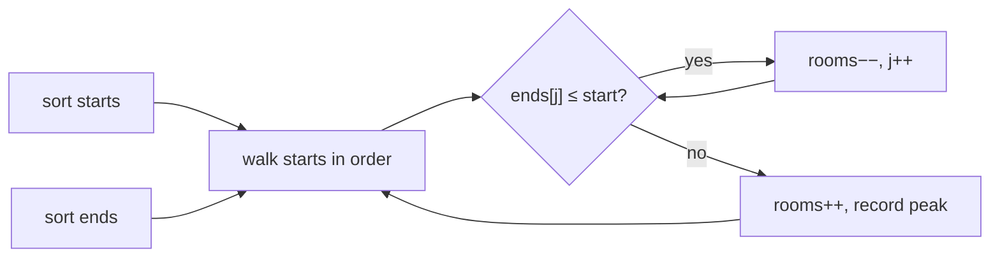

# Overlapping Interval {#ch-overlapping-intervals}

> আগে interval-গুলো sort করুন। তাহলে overlap নিয়ে প্রতিটি প্রশ্ন দুটি সংখ্যার তুলনায় নেমে আসে।

**এই অধ্যায়ে:** overlap-এর চার রকম চেহারা, আর সবগুলো ধরার একটিমাত্র test · merge করা · "একসঙ্গে কতগুলো"-র জন্য sweep line · start ধরে sort বনাম end ধরে sort · inclusive/exclusive-এর ফাঁদ

## 💡 মূল ধারণা

Interval মানে একটি শুরু আর একটি শেষ: meeting, booking, version range, maintenance window। এই পরিবারের প্রতিটি প্রশ্ন,
merge করা হোক, একসঙ্গে চলা interval গোনা হোক, নতুন একটি ঢোকানো হোক বা সবচেয়ে কমগুলো সরানো, শুরু হয় একই চাল দিয়ে।

**Sort করুন, তারপর প্রতিটি interval-কে শুধু তার পাশেরটার সঙ্গে মেলান।** Sort না করলে interval `i` যেকোনোটার সঙ্গে
overlap করতে পারে, তাই সব জোড়া যাচাই করতে হয়, লাগে `O(n²)`। Start ধরে sort করা থাকলে একটি interval overlap করতে পারে শুধু
ঠিক আগেরটার সঙ্গে, তাই এক pass-ই যথেষ্ট।

রোজকার উদাহরণ হলো calendar। দুটি meeting-এ সংঘাত আছে কিনা দেখতে আপনি পুরো সপ্তাহ ঘাঁটেন না। দিনটা ওপর থেকে নিচে
ক্রমানুসারে পড়েন, আর খেয়াল করেন কোন row ওপরের row শেষ হওয়ার আগেই শুরু হচ্ছে।

> দুটি interval `[a, b]` আর `[c, d]`, sort করা যাতে `a ≤ c`। এরা overlap করে যখন `c ≤ b`। এই একটি তুলনাই ধরে ফেলে একটির
> ভেতরে আরেকটি থাকা, আংশিক overlap আর প্রান্ত ছুঁয়ে যাওয়া। চারটি case আলাদা করে কখনো লাগে না।

## কীভাবে কাজ করে

### Merge করা

```typescript
type Interval = [start: number, end: number];

function merge(intervals: Interval[]): Interval[] {
  if (intervals.length === 0) return [];

  // Sort by start. Everything below relies on it.
  const sorted = [...intervals].sort((a, b) => a[0] - b[0]);
  const merged: Interval[] = [sorted[0]];

  for (let i = 1; i < sorted.length; i++) {
    const last = merged[merged.length - 1];
    const [start, end] = sorted[i];

    if (start <= last[1]) {
      // Overlap — extend. Math.max matters: the current interval may sit entirely inside the last one
      last[1] = Math.max(last[1], end);
    } else {
      merged.push([start, end]);
    }
  }
  return merged;
}
// Time: O(n log n) for the sort, O(n) for the pass. Space: O(n) for the output
```

`Math.max(last[1], end)` line-টাই সামলায় একটির ভেতরে আরেকটি থাকার case। `[[1, 10], [2, 3]]`-এ শুধু
`last[1] = end` লিখলে merged interval ছোট হয়ে `[1, 3]` হয়ে যায়, আর কোনো warning ছাড়াই কিছু অংশ হারিয়ে যায়।

খরচের বড় অংশই sort-এর। তাই এই pattern-এ `O(n log n)`-এর নিচে নামা যায় না, যদি না input আগে থেকেই sorted আসে। এটা
জিজ্ঞেস করে নেওয়ার মতো, কারণ তাহলে উত্তর নেমে আসে `O(n)`-এ।

### একসঙ্গে কতগুলো চলছে গোনা: sweep line

"কতগুলো meeting room লাগবে" merge-এর প্রশ্ন নয়। Merge বলে meeting *কোথায়* হচ্ছে। এই প্রশ্ন জানতে চায় *একসঙ্গে কতগুলো*
চলছে। প্রশ্নটা আলাদা, তাই ভাঙতেও হয় আলাদাভাবে।

প্রতিটি interval-কে দুটি event-এ ভাগ করুন, আর সময়ের ক্রমে চালান। Start এলে counter এক বাড়ে, end এলে এক কমে। Counter
সবচেয়ে বেশি যত উঠেছে, সেটাই উত্তর।

```typescript
function minMeetingRooms(intervals: Interval[]): number {
  const starts = intervals.map(([s]) => s).sort((a, b) => a - b);
  const ends = intervals.map(([, e]) => e).sort((a, b) => a - b);

  let rooms = 0;
  let peak = 0;
  let endIndex = 0;

  for (const start of starts) {
    // Free every room whose meeting finished at or before this start
    while (endIndex < ends.length && ends[endIndex] <= start) {
      rooms--;
      endIndex++;
    }
    rooms++;
    peak = Math.max(peak, rooms);
  }
  return peak;
}
// Time: O(n log n), Space: O(n)
```

মনে রাখার মতো কৌশল হলো start আর end-কে আলাদা করে ফেলা। দুটি array আলাদাভাবে sort হয়, কারণ খালি হওয়া room-টা কোন
meeting-এর ছিল, তাতে কিছু যায় আসে না। শুধু জানা দরকার যে একটি room খালি হয়েছে।



**প্রতিটি start একটি room দখল করে। আর যে end ইতিমধ্যে পেরিয়ে গেছে, সেটা একটি room ছেড়ে দেয়। সর্বোচ্চ সংখ্যাটাই উত্তর।**

End time-এর min-heap দিয়েও একই complexity-তে এই problem মেটে। প্রতিটি meeting *কোন* room পেল, সেটাও জানতে হলে এই
রূপটাই ব্যবহার করুন। দেখুন [Chapter ?? — Top K Element](#ch-top-k-elements)।

### কোন key ধরে sort করবেন

এই pattern-এ আসল সিদ্ধান্ত হলো sort key, আর সেটা সবসময় start নয়।

| প্রশ্ন                                        | Sort করুন | তারপর                                              |
| ----------------------------------------------- | ------- | ------------------------------------------------- |
| Overlap করা interval merge করুন                     | Start   | শেষ merged interval-টা বাড়ান, নয়তো নতুন একটি push করুন |
| Sorted list-এ একটি interval ঢোকান          | Start   | শুধু নতুনটার সঙ্গে overlap করা অংশটুকু merge করুন       |
| একজন মানুষ কি সব meeting-এ যেতে পারবেন?             | Start   | কোথাও `start < previousEnd` হলেই সংঘাত               |
| সবচেয়ে কম room / সর্বোচ্চ concurrency             | দুটিই, আলাদাভাবে | Start-গুলোকে end-গুলোর বিপরীতে sweep করুন            |
| **সর্বোচ্চ** কতগুলো non-overlapping interval রাখা যায়   | **End** | Greedy-ভাবে সেই interval রাখুন, যেটা শেষ রাখা interval শেষ হওয়ার পরে শুরু হয় |
| সব balloon ফাটাতে সবচেয়ে কম কয়টি arrow             | **End** | একই greedy: প্রতিটি রাখা interval-এর end-এ তীর ছুড়ুন     |

শেষ দুটি row-ই আলাদা করে দেয় মুখস্থ করা সমাধান আর বোঝা সমাধানকে। **End** ধরে sort কাজ করে, কারণ যেটা সবার আগে শেষ
হয় সেটা পরের সবকিছুর জন্য সবচেয়ে বেশি জায়গা ছেড়ে দেয়। Interval scheduling-এর জন্য এটাই প্রচলিত exchange argument।
Start ধরে sort করে greedy-ভাবে সবচেয়ে আগের start রাখা প্রমাণিতভাবে ভুল: শূন্য থেকে শুরু হওয়া একটি খুব লম্বা interval
বাকি সবকিছু আটকে দেয়।

## কখন ব্যবহার করবেন

| প্রশ্নে যে ইঙ্গিত থাকে                                       | কী ব্যবহার করবেন              | কেন                                    |
| ------------------------------------------------------------ | ---------------------- | -------------------------------------- |
| Input হলো `[start, end]` জোড়ার list                  | Sort, তারপর এক pass    | এটাই এই pattern-এর মূল চেহারা                      |
| "Merge", "overlap", "conflict", "clash"                      | Start ধরে sort          | পাশেরটার সঙ্গে তুলনাই যথেষ্ট          |
| "সবচেয়ে কম room", "সর্বোচ্চ কতগুলো একসঙ্গে", "সবচেয়ে ব্যস্ত মুহূর্ত"      | Sweep line বা heap     | দরকার একটি সংখ্যা, span নয়            |
| "সর্বোচ্চ কতগুলো non-overlapping…" বা "সবচেয়ে কম কয়টি সরাতে হবে"   | End ধরে sort, greedy    | সবার আগে শেষ হলে সবচেয়ে বেশি জায়গা থাকে |
| Interval একটি একটি করে আসে, আর সঙ্গে সঙ্গে query করতে হয়      | Interval tree বা ordered map | প্রতিবার insert-এ নতুন করে sort করলে প্রতিবারই `O(n log n)` |
| নির্দিষ্ট একটি interval set-এর ওপর অনেক query                | Timeline-এর ওপর prefix sum | প্রতিটি query-তে একবার করে sort মানে কাজের অপচয় |

⚠️ দেখে নিন প্রান্তগুলো **inclusive** কিনা। `[1, 2]` আর `[2, 3]`-কে overlap ধরলে test হলো
`start <= last.end`। ছুঁয়ে যাওয়া চললে test হলো `start < last.end`। Meeting Rooms ছুঁয়ে যাওয়াকে সমস্যা ধরে না: 2-টায় শেষ
হওয়া meeting-এর সঙ্গে 2-টায় শুরু হওয়া meeting-এর সংঘাত নেই। অথচ Merge Intervals
`[1, 4]` আর `[4, 5]`-কে merge করার যোগ্য ধরে। জিজ্ঞেস করে নিন, নয়তো আপনার ধরে নেওয়াটা মুখে বলুন।

## সাধারণ ভুল

**Sort না করা:**

```typescript
// ❌ iterating the input as given — neighbour comparison is only valid on sorted input
// ✅ sort by start (or end) first, and say the O(n log n) cost out loud
```

**Maximum না নিয়ে end overwrite করা:**

```typescript
// ❌ last[1] = end;                        // [[1,10],[2,3]] merges to [1,3]
// ✅ last[1] = Math.max(last[1], end);
```

**Input array-টাকেই in place sort করা:**

```typescript
// ❌ intervals.sort(...)                   // mutates the caller's array
// ✅ [...intervals].sort(...)              // unless the problem says in-place is fine
```

**সংখ্যার ওপর default comparator ব্যবহার করা:**

```typescript
// ❌ starts.sort();                        // lexicographic — [10, 9] stays [10, 9]
// ✅ starts.sort((a, b) => a - b);
```

**Merge করে Meeting Rooms II মেটানোর চেষ্টা:**

```typescript
// ❌ merge, then count the merged intervals — this counts busy blocks, not concurrency
// ✅ sweep starts against ends, or use a min-heap of end times
```

**"সবচেয়ে বেশি interval রাখুন" greedy-তে start ধরে sort করা:**

```typescript
// ❌ sort by start and keep greedily — one long interval starting at 0 blocks everything after it
// ✅ sort by end; earliest finish leaves the most room
```

## অনুশীলনের জন্য Problem

| #   | Problem                                       | কঠিনতা | যা অনুশীলন করায়                                    |
| --- | --------------------------------------------- | ---------- | ------------------------------------------------- |
| 252 | Meeting Rooms                                 | Easy       | Overlap test, আর inclusive প্রান্ত          |
| 56  | Merge Intervals                               | Medium     | `Math.max` দিয়ে বাড়ানো                           |
| 57  | Insert Interval                               | Medium     | নতুন করে sort না করে একটি অংশ merge করা                 |
| 253 | Meeting Rooms II                              | Medium     | Sweep line, বা end time-এর heap                 |
| 435 | Non-overlapping Intervals                     | Medium     | End ধরে sort-এর greedy, আর কেন সেটা optimal       |
| 452 | Minimum Number of Arrows to Burst Balloons    | Medium     | একই greedy, শুধু ছদ্মবেশে                  |
| 986 | Interval List Intersections                   | Medium     | দুটি sorted list, আর union-এর বদলে intersection |
| 759 | Employee Free Time                            | Hard       | `k`টি list জুড়ে merge, তারপর ফাঁকগুলো পড়া          |

56 আর 253 পরপর করুন: input-এর চেহারা একই, কিন্তু ভাঙার ধরন আলাদা। তারপর 435 আর 452, যেগুলো আসলে একই problem, শুধু
ভাষা আলাদা।

## 🔑 মূল শিক্ষা

- আগে sort করাটাই এই pattern। তাতে সব জোড়ার `O(n²)` যাচাই বদলে হয়ে যায় পাশেরটার সঙ্গে একটিমাত্র `O(n)` pass।
- `a ≤ c` হিসেবে sort করা থাকলে `[a, b]` আর `[c, d]` overlap করে যখন `c ≤ b`। একটি test-এই চারটি চেহারা ধরা পড়ে।
- Merged interval বাড়ান `Math.max` দিয়ে। নইলে ভেতরে থাকা interval চুপচাপ সেটাকে ছোট করে দেয়।
- Merge উত্তর দেয় "কোথায়", sweep line উত্তর দেয় "একসঙ্গে কতগুলো"। প্রশ্ন দুটি আলাদা।
- "সবচেয়ে বেশি non-overlapping interval রাখুন"-এ sort হয় **end** ধরে, কারণ সবার আগে শেষ হলে সবচেয়ে বেশি জায়গা থাকে।

## Interview-এর প্রশ্ন

**Q: প্রথম চাল কেন sort করা, আর এর জন্য কী দাম দিতে হয়?**

Sort না করলে যেকোনো interval যেকোনোটার সঙ্গে overlap করতে পারে, তাই সঠিক উত্তরের জন্য সব `n²` জোড়া যাচাই করতে হয়।
Start ধরে sort করা থাকলে একটি interval overlap করতে পারে শুধু আগে শুরু হওয়াগুলোর সঙ্গে, তাই আগের merged interval-এর
সঙ্গে তুলনাই যথেষ্ট। দাম `O(n log n)`, আর পুরো সমাধানে এটাই সবচেয়ে বড় খরচ। তাই জিজ্ঞেস করে নিন input আগে থেকেই sorted
কিনা, কারণ তাহলে খরচ নেমে আসে `O(n)`-এ।

**Q: Overlap-এর শর্তটা বলুন, আর চার case-এর diagram কেন অদরকারি, সেটাও বলুন।**

Sort-এর কারণে `a ≤ c` নিশ্চিত থাকলে `[a, b]` আর `[c, d]` ঠিক তখনই overlap করে, যখন `c ≤ b`। একটির ভেতরে আরেকটি থাকা,
আংশিক overlap আর ছুঁয়ে যাওয়া, তিনটিই এই শর্ত মেনে চলে। শর্তটা ভাঙে শুধু মাঝে ফাঁক থাকলে। চার case-এর তালিকা বোঝানোর
জন্য, code-এ লেখার জন্য নয়।

**Q: Interval merge করে Meeting Rooms II কেন মেটানো যায় না?**

Merge overlap করা interval-গুলোকে ব্যস্ত block-এ গুটিয়ে আনে। তাই এটা বলে কখন অন্তত একটি meeting চলছে। কিন্তু যে তথ্যটা
দরকার, overlap কতটা গভীর, সেটাই এতে হারিয়ে যায়। 9টা থেকে 10টা পর্যন্ত তিনটি meeting merge হয়ে ঠিক 9টা থেকে 10টার একটি
meeting-এর মতো একটিমাত্র interval হয়। অথচ room লাগে তিনটি, একটি নয়।

**Q: "সর্বোচ্চ কতগুলো non-overlapping interval রাখা যায়" greedy কেন end time ধরে sort করে?**

যে interval সবার আগে শেষ হয় সেটা বাছলে পরের সবকিছুর জন্য সবচেয়ে বেশি timeline বাকি থাকে। আর exchange argument দেখায়,
যেকোনো optimal সমাধানকে এই বাছাই দিয়ে শুরু করে নতুন করে লেখা যায়, তাতে উত্তর খারাপ হয় না। Start ধরে sort করলে ভুল ধরা
পড়ে এত ছোট উদাহরণেই: `[[0, 10], [1, 2], [3, 4]]`। সবচেয়ে আগের start-টা এমন দুটি interval আটকে দেয়, যেগুলো দুটিই এঁটে
যেত।

**Q: Interval যদি একটানা আসতে থাকে আর সঙ্গে সঙ্গে query করতে হয়, কীভাবে সামলাবেন?**

প্রতিটি insert-এ নতুন করে sort করলে প্রতিবার `O(n log n)` লাগে, তাই কাঠামোটাই বদলাতে হয়। Interval-গুলো রাখুন start
ধরে সাজানো কোনো structure-এ, যেমন balanced tree বা ordered map। Insert-এর সময় দুই পাশের প্রতিবেশী খুঁজে দেখুন merge
করতে হবে কিনা। তাতে insert হয় `O(log n)`-এ। Query যদি হয় "এই range-এর সঙ্গে overlap করা সবকিছু", তাহলে এর বিশেষ রূপ
হলো interval tree।

## এরপর কী পড়বেন

- [Chapter ?? — Top K Element](#ch-top-k-elements) — sweep line-এর বিকল্প হিসেবে min-heap
- [Chapter ?? — Prefix Sum](#ch-prefix-sum) — একটি নির্দিষ্ট timeline-এর ওপর অনেক range query-র হাতিয়ার
- [Chapter ?? — Modified Binary Search](#ch-modified-binary-search) — Insert Interval কীভাবে `O(log n)`-এ নিজের জায়গা খুঁজে পায়
