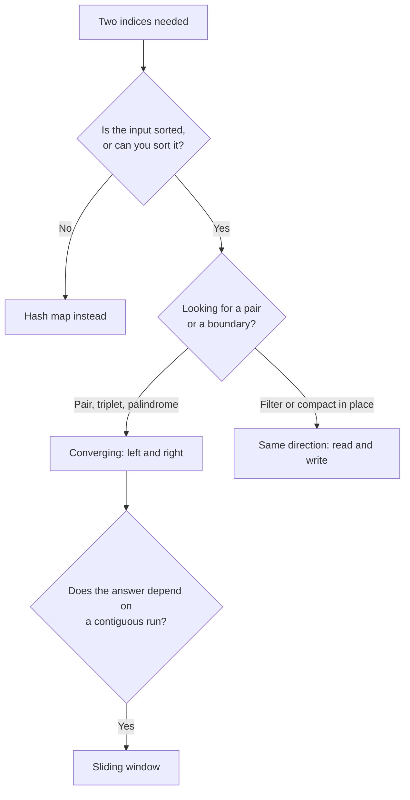

# Two Pointers {#ch-two-pointers}

> একটি nested loop-এর জায়গায় এমন দুটি index ব্যবহার করুন, যারা শুধু সামনের দিকে চলে — আর প্রমাণ করুন কেন কিছুই বাদ পড়ে না।

**এই অধ্যায়ে:** converging আর same-direction pointer · যে greedy যুক্তি এদের সঠিক করে · read/write গড়ন · duplicate · sliding window থেকে এর পার্থক্য কোথায়

## 💡 মূল ধারণা

একটি nested loop প্রতিটি pair যাচাই করে। Two pointers যাচাই করে তার মধ্যে `n`-টি, আর একই উত্তর পায়। কারণ
প্রতিটি ধাপে input বলে দেয় কোন pointer-টি সরাতে হবে, আর অন্যটি সরিয়ে কোনোভাবেই লাভ হতো না।

শেষ অংশটাই pattern। Code চার লাইনের; interview হয় যুক্তি নিয়ে। `left` এগোলে কেন শুধু সেই pair-গুলোই বাদ পড়ে,
যেগুলো আপনি আগেই বাতিল করেছেন, এটা বলতে না পারলে আপনি একটি algorithm নয়, একটি আন্দাজ লিখেছেন।

> Two pointers-এর লাগে **order**। Sorted value, অথবা "width শুধু কমে"-র মতো একটি monotonic বৈশিষ্ট্য। Order সরিয়ে
> নিলে যুক্তি ভেঙে পড়ে। এ কারণেই প্রথম প্রশ্ন হলো: input কি sorted, আর আপনি কি এটা sort করতে পারবেন?

## কীভাবে কাজ করে

### প্রথম গড়ন: converging

দুটি index দুই প্রান্ত থেকে শুরু করে একে অপরের দিকে হাঁটে। মোট পদক্ষেপ: `n`।

```typescript
// Two Sum II — the array is sorted, find the pair adding to target
function twoSum(numbers: number[], target: number): [number, number] {
  let left = 0;
  let right = numbers.length - 1;

  while (left < right) {
    const sum = numbers[left] + numbers[right];
    if (sum === target) return [left + 1, right + 1];  // 1-indexed, per the problem
    sum < target ? left++ : right--;                    // too small → raise it; too big → lower it
  }
  return [-1, -1];
}
// Time: O(n), Space: O(1)
```

**কেন কিছুই বাদ পড়ে না।** যখন `sum < target`, তখন `numbers[left]` এত ছোট যে range-এ বাকি থাকা কারো সাথেই
এর জোড়া মেলে না। বাকি প্রতিটি সঙ্গী `numbers[right]` বা তার চেয়ে ছোট, তাই `left`-যুক্ত কোনো pair target-এ
পৌঁছাতে পারে না। `left` বাদ দিলে শুধু সেই pair-গুলোই বাদ পড়ে, যেগুলো আগেই অসম্ভব প্রমাণিত। `right`-এর
ক্ষেত্রেও উল্টো দিক থেকে একই যুক্তি খাটে।

### দ্বিতীয় গড়ন: same direction

দুটিই সামনে থেকে শুরু করে আর ভিন্ন গতিতে চলে। একটি পড়ে, একটি লেখে।

```typescript
// Remove duplicates from a sorted array, in place. Returns the new length.
function removeDuplicates(nums: number[]): number {
  if (nums.length === 0) return 0;
  let write = 1;                                  // next slot to fill

  for (let read = 1; read < nums.length; read++) { // scans every element once
    if (nums[read] !== nums[write - 1]) {
      nums[write] = nums[read];
      write++;
    }
  }
  return write;
}
// Time: O(n), Space: O(1)
```

`write` কখনো `read`-কে ছাড়িয়ে যায় না, তাই না-পড়া কিছু কখনো overwrite হয় না। এই invariant-ই in-place edit-কে
নিরাপদ করে, আর এই বাক্যটাই মুখে বলতে হয়।

### Greedy version

Container With Most Water হলো সেই প্রশ্ন, যা template মুখস্থ করা মানুষদের আলাদা করে বোঝা মানুষদের থেকে।

```typescript
function maxArea(height: number[]): number {
  let left = 0;
  let right = height.length - 1;
  let best = 0;

  while (left < right) {
    // The shorter wall caps the water, whatever the taller one does.
    best = Math.max(best, (right - left) * Math.min(height[left], height[right]));
    height[left] < height[right] ? left++ : right--;   // always move the shorter wall
  }
  return best;
}
// Time: O(n), Space: O(1)
```

**ছোট দেয়াল সরানো কেন নিরাপদ।** যে pointer-ই এগোন, প্রতিটি পদক্ষেপে width কমে। **উঁচু** দেয়াল সরালে height
তখনও ছোটটা দিয়েই সীমিত থাকে, তাই area শুধু খারাপই হতে পারে — আপনি যে pair-গুলো বাদ দিলেন, সেগুলোকে আপনার এইমাত্র
মাপা pair আগেই হারিয়ে দিয়েছে। **ছোট** দেয়াল সরালে সীমা বাড়তে পারে, তাই উন্নতি অন্তত সম্ভব। ছোট দেয়াল বাদ দিলে
শুধু সেই pair-গুলোই বাদ পড়ে, যেগুলো নিশ্চিতভাবে ছোট ছিল।

### গড়ন বেছে নেওয়া



**Two-pointer গড়নগুলো কীভাবে সম্পর্কিত, আর কোথায় sliding window দায়িত্ব নেয়।**

## কখন ব্যবহার করবেন

| প্রশ্নে যে সংকেত                          | গড়ন             | Complexity                 |
| ----------------------------------------------- | ----------------- | -------------------------- |
| Sorted array, target-এ যোগফল হওয়া একটি pair খুঁজুন    | Converging        | `O(n)`                     |
| Palindrome যাচাই                                 | Converging        | `O(n)`                     |
| Target-এ যোগফল হওয়া triplet (3Sum)               | Loop + converging | একটি `O(n log n)` sort-এর পর `O(n²)` |
| In place-এ remove, compact বা partition           | Read / write      | `O(n)`, `O(1)` space       |
| দুটি sorted array merge                          | প্রতিটিতে একটি index    | `O(n + m)`                 |
| Unsorted, আর sort করলে index নষ্ট হবে  | Hash map, এটা নয় | `O(n)` time, `O(n)` space  |

শেষ row-টিই সৎ বিকল্প। ক্লাসিক Two Sum একটি unsorted array থেকে মূল index return করে, তাই sort করলে উত্তরই
হারিয়ে যায় — ওই problem আসলে এই pattern-এর পোশাক পরা একটি hash map।

⚠️ Two pointers চালানোর জন্য sort করলে খরচ `O(n log n)`, আর সেটাই পুরো solution-এর সীমা ঠিক করে। Array আগে থেকেই
sorted হলে সেটা বলুন, কারণ `O(n)` আর `O(n log n)`-এর পার্থক্য এখানেই।

## সাধারণ ভুল

**Unsorted input-এ pattern-টি ব্যবহার করা:**

```typescript
// ❌ [3, 1, 4] with target 5 — sum is 7, so right--, and the pair (1, 4) is never seen
// ✅ Sort first, or use a hash map when the original indices are the answer
```

**Match পেলে দুটি pointer-ই সরানো:**

```typescript
// ❌ if (sum < target) { left++; right--; }   // skips left..right pairs that were still live
// ✅ if (sum < target) left++; else right--;  // one move per comparison
```

**ভুল জায়গায় duplicate skip করা:**

```typescript
// 3Sum: after recording a triplet, both pointers must clear their runs
function skipDuplicates(nums: number[], left: number, right: number): [number, number] {
  while (left < right && nums[left] === nums[left + 1]) left++;
  while (left < right && nums[right] === nums[right - 1]) right--;
  return [left + 1, right - 1];
}
// ❌ Advancing only one of them emits the same triplet again on the next pass.
```

বাইরের loop-এরও একই guard লাগে — `if (i > 0 && nums[i] === nums[i - 1]) continue;` — নইলে duplicate এক ধাপ
ওপরে দেখা দেয়।

**Loop-এর boundary ভুল করা:**

```typescript
// ❌ while (left <= right)   → pairs an element with itself when the pointers meet
// ✅ while (left < right)    → for pair problems
// A palindrome check is the exception: left < right is still correct, the middle needs no partner.
```

## অনুশীলনের জন্য Problem

| #   | Problem                              | Difficulty | যা অনুশীলন করায়                       |
| --- | ------------------------------------ | ---------- | ------------------------------------ |
| 167 | Two Sum II — Input Array Is Sorted   | Easy       | Converging template              |
| 125 | Valid Palindrome                     | Easy       | Character filter সহ converging   |
| 283 | Move Zeroes                          | Easy       | Read/write invariant             |
| 26  | Remove Duplicates from Sorted Array  | Easy       | In-place compaction                  |
| 11  | Container With Most Water            | Medium     | Greedy যুক্তি                  |
| 15  | 3Sum                                 | Medium     | Sort, একটি স্থির রাখুন, converge — সাথে duplicate |
| 75  | Sort Colors                          | Medium     | Three-way partition (Dutch flag)     |
| 42  | Trapping Rain Water                  | Hard       | দুটি maximum track করতে করতে converging |

11 আর 42 পরপর করুন। দুটিই একই কারণে একই চলার নিয়ম ব্যবহার করে, আর সেটা দুবার দেখলেই যুক্তিটা মনে গেঁথে যায়।

## 🔑 মূল শিক্ষা

- Two pointers একটি `O(n²)` pair scan-কে একটি `O(n)` pass আর `O(1)` বাড়তি space-এ নামিয়ে আনে।
- এটা শুধু তখনই সঠিক, যখন input-এ এমন একটি order আছে যা প্রমাণ করে বাদ দেওয়া pair-গুলো জিততে পারত না।
- Converging pointer pair আর palindrome প্রশ্ন solve করে; একটি read/write জোড়া in place-এ compact করে।
- প্রতিটি তুলনায় ঠিক একটি pointer সরান, আর সেটাই সরান যার value ফলাফলকে সীমিত করছে।
- Unsorted array-তে মূল index-ই যদি উত্তর হয়, তবে hash map ব্যবহার করুন।

## Interview-এর প্রশ্ন

**Q: Sum খুব ছোট হলে একটি element বাদ দেওয়া কেন নিরাপদ?**

কারণ array sorted, তাই এই মুহূর্তে `numbers[left]` সবচেয়ে ছোট available value আর `numbers[right]` সবচেয়ে বড়।
এদের যোগফল target-এর নিচে হলে `left`-এর বাকি কোনো সঙ্গীই `right`-এর চেয়ে বড় নয়, তাই `left`-যুক্ত কোনো pair
target-এ পৌঁছাতে পারে না। একে বাদ দিলে শুধু সেই pair-গুলোই বাদ পড়ে, যেগুলো আগেই অসম্ভব প্রমাণিত।

**Q: Container With Most Water-এ ছোট দেয়ালটা কেন সরাবেন?**

Area হলো `width × min(left, right)`, আর প্রতিটি পদক্ষেপে width কমে। উঁচু দেয়াল সরালে সীমা একই থাকে কিন্তু
width কমে, তাই ফলাফল শুধু খারাপই হতে পারে। ছোট দেয়াল সরানোই একমাত্র পদক্ষেপ যাতে সীমা বাড়তে পারে, তাই এটাই
একমাত্র পদক্ষেপ যা উত্তরকে ভালো করতে পারে।

**Q: Two pointers আর sliding window-এর পার্থক্য কী?**

Sliding window হলো একটি two-pointer কৌশল, যেখানে pointer-গুলো একই দিকে চলে আর তাদের মাঝের অংশটার অর্থ আছে —
এটা একটি contiguous subarray, যা আপনি ধরে রাখছেন। সাধারণ two pointers সাধারণত converge করে, আর তাদের মাঝের
জায়গায় কোনো state থাকে না। Contiguity-ই চেনার উপায়।

**Q: Sorted array-তেও কখন two pointers ব্যবহার করবেন না?**

যখন প্রশ্ন এমন কিছু চায় যাতে ordering সাহায্য করে না। যেমন, value negative হতে পারে এমন অবস্থায় একটি নির্দিষ্ট
sum-এর subarray গোনা — order কোন দিকে সরতে হবে তা বলে না। আর যখন sort করা যাবে না, কারণ output-কে মূল
position উল্লেখ করতে হবে।

**Q: `Set` ছাড়া 3Sum-এ duplicate triplet কীভাবে এড়াবেন?**

আগে sort করুন, তারপর তিন স্তরেই পুনরাবৃত্ত value skip করুন। বাইরের loop-এ পুনরাবৃত্ত anchor পেরিয়ে `continue`
করুন। আর একটি triplet রেকর্ড করার পর `left`-কে এগিয়ে আর `right`-কে পিছিয়ে তাদের run পার করুন। Stringify করা
triplet-এর একটি `Set` কাজ করে, কিন্তু খরচ `O(n)` বাড়তি space, আর এটা বোঝায় যে invariant নিয়ে ভাবা হয়নি।

## এরপর কী পড়বেন

- [Chapter ?? — Sliding Window](#ch-sliding-window) — একই দুটি index, যখন তাদের মাঝের অংশটাই উত্তর
- [Chapter ?? — Fast ও Slow Pointer](#ch-fast-and-slow-pointers) — ভিন্ন গতির দুটি pointer, cycle আর মাঝখান খোঁজার জন্য
- [Chapter ?? — Prefix Sum](#ch-prefix-sum) — value negative হতে পারলে কী ব্যবহার করবেন
