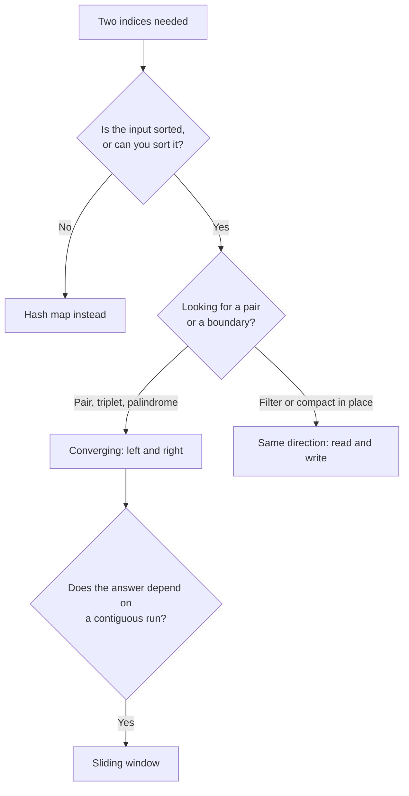

# Two Pointers {#ch-two-pointers}

> Nested loop-এর জায়গায় এমন দুটি index বসান, যেগুলো শুধু সামনে এগোয়। আর ব্যাখ্যা করুন, কেন কিছুই বাদ পড়ে না।

**এই অধ্যায়ে:** মুখোমুখি এগোনো আর একই দিকে চলা pointer · যে greedy যুক্তি এদের সঠিক করে · read/write ধাঁচ · duplicate · sliding window থেকে এর পার্থক্য কোথায়

## 💡 মূল ধারণা

Nested loop প্রতিটি জোড়া পরীক্ষা করে। Two pointers পরীক্ষা করে মাত্র `n`-টি, আর উত্তর একই আসে। কারণ প্রতিটি
ধাপে input নিজেই বলে দেয় কোন pointer সরাতে হবে, আর অন্যটা সরিয়ে কোনো লাভ হতো না।

শেষ কথাটাই আসল pattern। Code মাত্র চার line, interview-টা হয় যুক্তি নিয়ে। `left` এগোলে কেন শুধু সেই জোড়াগুলোই
বাদ পড়ে যেগুলো আপনি আগেই বাতিল করেছেন, এটা বলতে না পারলে আপনি algorithm লেখেননি। লিখেছেন আন্দাজের নিয়ম।

> Two pointers-এর জন্য **ক্রম** লাগে। হয় sorted value, নয়তো "width শুধু কমে" জাতীয় কোনো monotonic
> বৈশিষ্ট্য। ক্রম না থাকলে যুক্তিটাই ভেঙে পড়ে। তাই প্রথম প্রশ্ন হলো: input কি sorted, আর sort করার অনুমতি আছে কি?

## কীভাবে কাজ করে

### প্রথম ধাঁচ: মুখোমুখি এগোনো

দুটি index দুই প্রান্ত থেকে শুরু করে একে অপরের দিকে হাঁটে। মোট পদক্ষেপ: `n`।

```typescript
// Two Sum II — the array is sorted, find the pair adding to target
function twoSum(numbers: number[], target: number): [number, number] {
  let left = 0;
  let right = numbers.length - 1;

  while (left < right) {
    const sum = numbers[left] + numbers[right];
    if (sum === target) return [left + 1, right + 1];  // 1-indexed, per the problem
    sum < target ? left++ : right--;                    // too small → raise it; too big → lower it
  }
  return [-1, -1];
}
// Time: O(n), Space: O(1)
```

**কেন কিছুই বাদ পড়ে না।** `sum < target` হলে `numbers[left]` এত ছোট যে range-এ বাকি কোনো value-র সঙ্গেই এর জোড়া
মেলে না। বাকি প্রতিটি সঙ্গী `numbers[right]` বা তার চেয়ে ছোট, তাই `left`-কে নিয়ে কোনো জোড়াই target-এ পৌঁছাতে
পারে না। `left` বাদ দিলে শুধু সেই জোড়াগুলোই বাদ যায়, যেগুলো আগেই অসম্ভব প্রমাণিত। `right`-এর বেলায়ও ঠিক
উল্টো যুক্তি খাটে।

### দ্বিতীয় ধাঁচ: একই দিকে

দুটিই শুরু হয় সামনে থেকে, আর চলে আলাদা গতিতে। একটি পড়ে, অন্যটি লেখে।

```typescript
// Remove duplicates from a sorted array, in place. Returns the new length.
function removeDuplicates(nums: number[]): number {
  if (nums.length === 0) return 0;
  let write = 1;                                  // next slot to fill

  for (let read = 1; read < nums.length; read++) { // scans every element once
    if (nums[read] !== nums[write - 1]) {
      nums[write] = nums[read];
      write++;
    }
  }
  return write;
}
// Time: O(n), Space: O(1)
```

`write` কখনো `read`-কে ছাড়িয়ে যায় না, তাই না-পড়া কিছু কখনো overwrite হয় না। এই invariant-এর জন্যই in-place
edit নিরাপদ। আর interview-এ এই বাক্যটাই মুখে বলতে হবে।

### Greedy version

Container With Most Water হলো সেই প্রশ্ন, যেটা দিয়ে বোঝা যায় কে template মুখস্থ করেছে আর কে সত্যিই বুঝেছে।

```typescript
function maxArea(height: number[]): number {
  let left = 0;
  let right = height.length - 1;
  let best = 0;

  while (left < right) {
    // The shorter wall caps the water, whatever the taller one does.
    best = Math.max(best, (right - left) * Math.min(height[left], height[right]));
    height[left] < height[right] ? left++ : right--;   // always move the shorter wall
  }
  return best;
}
// Time: O(n), Space: O(1)
```

**ছোট দেয়ালটা সরানো কেন নিরাপদ।** যে pointer-ই সরান, প্রতিবার width কমে। **লম্বা** দেয়াল সরালে height তখনও
ছোট দেয়ালেই আটকে থাকে, তাই area শুধু খারাপই হতে পারে। মানে যে জোড়াগুলো বাদ দিলেন, এইমাত্র মাপা জোড়াটা
সেগুলোকে আগেই হারিয়ে দিয়েছে। **ছোট** দেয়াল সরালে উচ্চতার সীমা বাড়তে পারে, তাই উন্নতির অন্তত সম্ভাবনা থাকে।
ছোট দেয়াল বাদ দিলে শুধু সেই জোড়াগুলোই বাদ যায়, যেগুলো নিশ্চিতভাবে ছোট ছিল।

### ধাঁচ বেছে নেওয়া



**Two-pointer-এর ধাঁচগুলো একে অপরের সঙ্গে কীভাবে যুক্ত, আর কোথায় sliding window দায়িত্ব নেয়।**

## কখন ব্যবহার করবেন

| প্রশ্নে যে সংকেত                          | ধাঁচ             | Complexity                 |
| ----------------------------------------------- | ----------------- | -------------------------- |
| Sorted array, target-এর সমান sum-ওয়ালা জোড়া খোঁজা    | মুখোমুখি        | `O(n)`                     |
| Palindrome যাচাই                                 | মুখোমুখি        | `O(n)`                     |
| Target-এর সমান sum-ওয়ালা তিনটি সংখ্যা (3Sum)               | Loop + মুখোমুখি | `O(n log n)` sort-এর পর `O(n²)` |
| In place-এ remove, compact বা partition           | Read / write      | `O(n)`, `O(1)` space       |
| দুটি sorted array merge করা                          | প্রতিটির জন্য একটি index    | `O(n + m)`                 |
| Unsorted, আর sort করলে index হারিয়ে যায়  | এটা নয়, hash map | `O(n)` time, `O(n)` space  |

শেষ row-টাই সৎ বিকল্প। Classic Two Sum unsorted array থেকে আসল index ফেরত চায়, তাই sort করলে উত্তরটাই হারিয়ে
যায়। ওই problem আসলে hash map, শুধু এই pattern-এর পোশাক পরে আছে।

⚠️ Two pointers চালাতে sort করলে খরচ `O(n log n)`, আর পুরো solution-এর খরচ তার নিচে নামে না। Array আগে থেকেই
sorted হলে সেটা বলুন, কারণ `O(n)` আর `O(n log n)`-এর পার্থক্য ঠিক এখানেই।

## সাধারণ ভুল

**Unsorted input-এ pattern চালানো:**

```typescript
// ❌ [3, 1, 4] with target 5 — sum is 7, so right--, and the pair (1, 4) is never seen
// ✅ Sort first, or use a hash map when the original indices are the answer
```

**মিল পেলে দুটি pointer-ই সরানো:**

```typescript
// ❌ if (sum < target) { left++; right--; }   // skips left..right pairs that were still live
// ✅ if (sum < target) left++; else right--;  // one move per comparison
```

**ভুল জায়গায় duplicate বাদ দেওয়া:**

```typescript
// 3Sum: after recording a triplet, both pointers must clear their runs
function skipDuplicates(nums: number[], left: number, right: number): [number, number] {
  while (left < right && nums[left] === nums[left + 1]) left++;
  while (left < right && nums[right] === nums[right - 1]) right--;
  return [left + 1, right - 1];
}
// ❌ Advancing only one of them emits the same triplet again on the next pass.
```

বাইরের loop-এও একই পাহারা লাগে, `if (i > 0 && nums[i] === nums[i - 1]) continue;`। নইলে duplicate এক স্তর
ওপরে গিয়ে দেখা দেয়।

**Loop-এর সীমা ভুল করা:**

```typescript
// ❌ while (left <= right)   → pairs an element with itself when the pointers meet
// ✅ while (left < right)    → for pair problems
// A palindrome check is the exception: left < right is still correct, the middle needs no partner.
```

## অনুশীলনের জন্য Problem

| #   | Problem                              | কঠিনতা | কী অনুশীলন হয়                       |
| --- | ------------------------------------ | ---------- | ------------------------------------ |
| 167 | Two Sum II — Input Array Is Sorted   | Easy       | মুখোমুখি এগোনোর template              |
| 125 | Valid Palindrome                     | Easy       | Character filter সহ মুখোমুখি এগোনো   |
| 283 | Move Zeroes                          | Easy       | Read/write invariant             |
| 26  | Remove Duplicates from Sorted Array  | Easy       | In-place compaction                  |
| 11  | Container With Most Water            | Medium     | Greedy যুক্তি                  |
| 15  | 3Sum                                 | Medium     | Sort, একটি স্থির রাখা, বাকি দুটি মুখোমুখি — সঙ্গে duplicate |
| 75  | Sort Colors                          | Medium     | তিন ভাগে partition (Dutch flag)     |
| 42  | Trapping Rain Water                  | Hard       | দুটি maximum হিসাবে রেখে মুখোমুখি এগোনো |

11 আর 42 পরপর করুন। দুটিতেই একই কারণে একই নিয়মে pointer সরে। দুবার এটা দেখলেই যুক্তিটা মাথায় গেঁথে যায়।

## 🔑 মূল শিক্ষা

- Two pointers `O(n²)` জোড়া-scan-এর জায়গায় দেয় `O(n)` pass, আর বাড়তি space মাত্র `O(1)`।
- এটা তখনই সঠিক, যখন input-এর এমন ক্রম আছে যা প্রমাণ করে বাদ দেওয়া জোড়াগুলো জিততে পারত না।
- মুখোমুখি pointer জোড়া আর palindrome-এর প্রশ্ন সমাধান করে। Read/write জোড়া in place-এ compact করে।
- প্রতিটি তুলনায় ঠিক একটি pointer সরান, আর সেটাই সরান যার value ফলকে আটকে রাখছে।
- Unsorted array-এ উত্তর যদি আসল index হয়, তাহলে hash map ব্যবহার করুন।

## Interview-এর প্রশ্ন

**Q: Sum খুব ছোট হলে একটি element বাদ দেওয়া নিরাপদ কেন?**

কারণ array sorted, তাই এই মুহূর্তে `numbers[left]` সবচেয়ে ছোট value আর
`numbers[right]` সবচেয়ে বড়। এদের যোগফল target-এর নিচে হলে `left`-এর জন্য বাকি কোনো সঙ্গীই
`right`-এর চেয়ে বড় নয়। তাই `left` আছে এমন কোনো জোড়া target-এ পৌঁছাতে পারে না। ওটা বাদ দিলে শুধু আগেই
অসম্ভব প্রমাণিত জোড়াগুলো বাদ যায়।

**Q: Container With Most Water-এ ছোট দেয়ালটা কেন সরাবেন?**

Area হলো `width × min(left, right)`, আর প্রতিটি পদক্ষেপে width কমে। লম্বা দেয়াল সরালে উচ্চতার সীমা একই থাকে,
অথচ width কমে যায়, তাই ফল শুধু খারাপই হতে পারে। একমাত্র ছোট দেয়াল সরালেই সীমা বাড়তে পারে। তাই উত্তর উন্নত
করার সুযোগ আছে শুধু ওই পদক্ষেপে।

**Q: Two pointers আর sliding window-এর পার্থক্য কী?**

Sliding window আসলে two-pointer-এরই এক ধরনের কৌশল, যেখানে pointer দুটি একই দিকে চলে আর মাঝের অংশটার অর্থ আছে।
ওটা contiguous subarray, যেটা আপনি হিসাবে রাখছেন। সাধারণ two pointers বেশিরভাগ সময় মুখোমুখি এগোয়, আর
মাঝের জায়গায় কোনো state থাকে না। Contiguity-ই চেনার উপায়।

**Q: Sorted array পেয়েও কখন two pointers ধরবেন না?**

যখন প্রশ্নটা এমন কিছু চায়, যেখানে ক্রম কোনো কাজে আসে না। যেমন নির্দিষ্ট sum-ওয়ালা subarray গোনা, যেখানে value
negative হতে পারে। তখন ক্রম দেখে বোঝা যায় না কোন দিকে সরতে হবে। আর output-এ যদি আসল position লাগে, তাহলে sort
করার অনুমতিই নেই, তখনও না।

**Q: `Set` ছাড়া 3Sum-এ duplicate triplet কীভাবে এড়াবেন?**

আগে sort করুন, তারপর তিন স্তরেই একই value-র পুনরাবৃত্তি এড়িয়ে যান। বাইরের loop-এ একই anchor আবার এলে `continue`
করুন। আর কোনো triplet লিখে রাখার পর `left`-কে সামনে আর `right`-কে পেছনে সরান, যতক্ষণ একই value চলছে। Triplet-কে
string বানিয়ে `Set`-এ রাখলেও কাজ হয়, কিন্তু তাতে `O(n)` বাড়তি space লাগে। আর বোঝা যায় invariant-টা ভেবে দেখা হয়নি।

## এরপর কী পড়বেন

- [Chapter ?? — Sliding Window](#ch-sliding-window) — একই দুটি index, যখন মাঝের অংশটাই উত্তর
- [Chapter ?? — Fast ও Slow Pointer](#ch-fast-and-slow-pointers) — আলাদা গতির দুটি pointer, cycle আর মাঝের বিন্দুর জন্য
- [Chapter ?? — Prefix Sum](#ch-prefix-sum) — value negative হতে পারলে কী ব্যবহার করবেন
