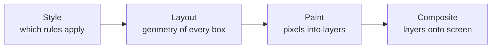

# Animation ও View Transition {#ch-animation-and-view-transitions}

> জেনে রাখুন browser কোন property বিনা খরচে animate করতে পারে, আর পাতার দুটি state-এর মধ্যে কীভাবে animate করবেন দুটিকেই নিজে ধরে না রেখে।

**এই অধ্যায়ে:** rendering-এর চারটি ধাপ · শুধু compositor-এর property · Web Animations API · View Transitions API · বাধ্যবাধকতা হিসেবে reduced motion · jank-এর checklist

## 💡 মূল ধারণা

প্রতিটি animation-এর খরচ তিনটি মাপের একটি, আর কোনটা হবে তা ঠিক করে আপনার বেছে নেওয়া property। Browser render করে
চারটি ধাপে: style, layout, paint আর composite। কোনো property animate করলে প্রতিটি frame-এ সেই property-র ধাপ আর
তার পরের প্রতিটি ধাপ আবার চলে।

`transform` আর `opacity` এমন দুটি property, যা compositor (browser-এর যে অংশ screen-এ layer-গুলো জোড়া লাগায়) একাই
বদলাতে পারে। বাকি সবকিছু layout বা paint-কে আবার frame-এর budget-এ টেনে আনে। 60fps-এ পুরো budget মাত্র 16.7
millisecond, আগে থেকে চলা JavaScript-সহ।

> "এটা আটকে আটকে চলে কেন"-র senior উত্তর "`will-change` দিন" নয়। উত্তর হলো "আপনি এমন property animate করেছেন,
> যা সেকেন্ডে ষাটবার layout করায়"।

## কীভাবে কাজ করে

### চারটি ধাপ, আর প্রতিটি property-র খরচ



**কোনো property animate করলে তার ধাপ আর তার ডানের প্রতিটি ধাপ আবার চলে।**

| যা animate করছেন | যা চালু হয় | প্রতি frame-এর খরচ |
| --------- | -------- | -------------- |
| `width`, `height`, `top`, `margin` | Layout → paint → composite | পুরো pipeline, element-টার জন্য আর সাধারণত তার পাশেরগুলোর জন্যও |
| `background-color`, `box-shadow`, `border-radius` | Paint → composite | প্রভাবিত layer-টা আবার paint |
| `transform`, `opacity` | শুধু composite | কার্যত বিনা খরচে — GPU আগে থেকে থাকা একটা layer সরায় |
| `filter` | Composite, তবে একটা শর্তসহ | নিজে সস্তা, কিন্তু প্রতি frame-এ নতুন layer বানাতে বাধ্য করলে দামি |

কাজের নিয়ম: **`transform` আর `opacity` animate করুন, আর বাকি সবকিছু এদের দিয়েই প্রকাশ করুন।** Element সরাতে
`translate`, `left` নয়। বড় করতে `scale`, `width` নয়।

### Motion declare করা

State বদল সামলায় CSS transition, আর ধারাবাহিক ধাপ সামলায় keyframe। যে কাজ code দিয়ে চালাতে হয়, তা সামলায় Web
Animations API:

```typescript
// Same model as CSS keyframes, with a promise and a handle on the animation.
const drawer: Element = document.querySelector(".drawer")!;

const animation: Animation = drawer.animate(
  [{ transform: "translateX(100%)" }, { transform: "translateX(0)" }],
  { duration: 220, easing: "cubic-bezier(0.2, 0, 0, 1)", fill: "forwards" },
);

await animation.finished;
```

এই API-র গুরুত্ব মাঝপথে থামানোর বেলায়। CSS transition মাঝপথে উল্টে দিলে লাফ দেয়। `Animation` object-কে উল্টানো,
থামানো বা বাতিল করা যায়, আর সেজন্যই drawer-কে মনে হয় টেনে নেওয়া আঙুলের সঙ্গে লেগে আছে।

### View transition

View transition যে সমস্যা মেটায়, তা হলো মালিকানা। পাতার এক state থেকে আরেক state-এ animate করতে দুটি state-কেই
একসঙ্গে DOM-এ রাখতে হয়। মানে পুরনো list আর নতুন list, বা ছোট image আর বড়টা। প্রতিটি framework এর জন্য নিজের
কলকবজা বানিয়েছিল।

এখন browser কাজটা করতে পারে। `startViewTransition` পাতার একটা snapshot নেয়, DOM update চালায়, আবার snapshot নেয়,
তারপর দুটির মধ্যে cross-fade করে:

```typescript
// The callback does the ordinary DOM update. The browser animates the difference.
function update(next: () => void): void {
  if (!document.startViewTransition) {
    next(); // No support: the update still happens, just without the animation.
    return;
  }
  document.startViewTransition(next);
}
```

কোনো element-কে নাম দিলে সে cross-fade-এর অংশ হিসেবে নয়, নিজে হিসেবে animate হয়:

```css
/* The same name on both pages means "this is the same thing, move it". */
.hero-image {
  view-transition-name: hero;
}
```

Cross-document transition একই ধারণা খাটায় সাধারণ navigation-এ, একদম JavaScript ছাড়াই:

```css
@view-transition {
  navigation: auto;
}
```

> ⚠️ **যা বদলাতে থাকে:** same-document API Chromium-এ এসেছে 2023-এ, আর Safari 18-এ। Cross-document এসেছে পরে,
> Firefox আরও পরে, তাই ভরসা করার আগে এখনকার support দেখে নিন। টেকসই নীতি হলো, API-টা design অনুযায়ীই একটা
> progressive enhancement। Feature detect করুন, না থাকলে সাধারণ update চালান, তাহলে দুই ক্ষেত্রেই পাতা ঠিক থাকে।

## কখন ব্যবহার করবেন

| পরিস্থিতি | কী ব্যবহার করবেন | কেন |
| --------- | --------- | --- |
| একটি element-এ hover, focus, খোলা/বন্ধ | CSS transition | Declarative, মাঝপথে থামানো যায়, JavaScript লাগে না |
| বারবার চলা বা কয়েক ধাপের sequence | CSS keyframe | Sequence-এর জায়গা stylesheet-এ |
| Gesture বা code-এর state দিয়ে চালানো motion | Web Animations API | উল্টানো, থামানো আর বাতিল করা লাগে |
| List, route বা detail view-এর দুটি state | View transition | দুটি state browser ধরে রাখে, আপনাকে রাখতে হয় না |
| কয়েকটির বেশি element নড়ছে এমন যেকোনো কিছু | শুধু `transform` আর `opacity` | Compositor-এ থেকে যায় শুধু এই জোড়াটাই |

### Reduced motion বাড়তি সুবিধা নয়

`prefers-reduced-motion` একটা শারীরিক সমস্যার জন্য user-এর setting। Vestibular disorder (কানের ভেতরের ভারসাম্যের
সমস্যা) আছে এমন মানুষ বড় motion থেকে সত্যিই বমি-বমি ভাব বোধ করেন। User বন্ধ করতে পারেন না এমন motion-কে WCAG 2.2
ব্যর্থতা হিসেবে ধরে। তাই এটা Part II-এর বাকি accessibility আলোচনার মতোই আইনের এলাকা।

**সরিয়ে দেবেন না, কমিয়ে দিন:**

```css
@media (prefers-reduced-motion: reduce) {
  /* Keep the state change legible — replace movement with a fade, do not delete feedback. */
  *,
  ::before,
  ::after {
    animation-duration: 0.01ms !important;
    transition-duration: 0.01ms !important;
  }
}
```

View transition-ও setting-টা একইভাবে মানে: call-টা মুড়ে দিন, বা media query-র ভেতরে নাম দেওয়া transition বন্ধ করুন।

## সাধারণ ভুল

**❌ সবকিছুতে `will-change`।** এটা element-কে স্থায়ীভাবে নিজস্ব compositor layer-এ তুলে দেয়। তাতে memory খরচ
হয়, আর জিনিস আরও ধীরও হতে পারে। Animation শুরুর ঠিক আগে দিন, শেষে সরিয়ে দিন। অথবা দেবেনই না, কারণ যা দরকার,
browser নিজেই তা তুলে নেয়।

**❌ `height: auto` animate করা।** Animate করে পৌঁছানোর মতো কোনো নির্দিষ্ট value নেই, তাই এটা animate হয়ই না।
`grid-template-rows` animate করুন `0fr` থেকে `1fr`-এ, বা একটা wrapper-কে `scale` করুন, বা মেপে নিয়ে pixel value-তে
animate করুন।

**❌ View transition-কে পুরো পাতার effect ভাবা।** টিকে থাকা element-গুলোতে `view-transition-name` না দিলে সবকিছুই
cross-fade হয়। সেটা দেখায় একটা ঝলকানির মতো, কোনো সম্পর্কের মতো নয়। API-র আসল মূল্য হলো browser-কে বলে দেওয়া, কোন
দুটি element একই জিনিস।

## 🔑 মূল শিক্ষা

- Browser render করে চারটি ধাপে, আর কোনো property animate করলে প্রতি frame-এ তার ধাপ আর তার পরের সবকিছু আবার চলে।
- `transform` আর `opacity`-ই একমাত্র দুটি property, যা compositor একা animate করতে পারে। Motion এদের দিয়েই প্রকাশ
  করুন।
- Web Animations API আছে এমন motion-এর জন্য, যা উল্টাতে, থামাতে বা বাতিল করতে হয়। বাকি সবকিছুর জন্য CSS ভালো।
- View transition থাকলে পাতার পুরনো আর নতুন state browser ধরে রাখে। আগে প্রতিটি framework এই কলকবজা নিজেই বানাত।
- `prefers-reduced-motion` accessibility-র বাধ্যবাধকতা, পছন্দের ব্যাপার নয়। Motion কমান, কিন্তু feedback রাখুন।

## Interview-এর প্রশ্ন

**Q: এক engineer জানালেন, মাঝারি মানের Android-এ slide-in panel আটকে আটকে চলে। কোথা থেকে শুরু করবেন?**

জিজ্ঞেস করব কী animate হচ্ছে। যদি `left`, `width` বা `margin` হয়, তাহলে প্রতিটি frame-এ panel-এর জন্য, আর সাধারণত
তার পাশেরগুলোর জন্যও, layout আবার চলে। যত `will-change`-ই দিন, তাতে এটা বদলায় না। এটাকে আবার লিখুন
`transform: translateX()` দিয়ে, যা compositor layout বা paint না ছুঁয়েই সামলায়। তারপরই কেবল দেখার মানে আছে,
animation-এর সময় main thread-এ আর কী চলছে। Property যা-ই হোক, long task থাকলে frame পড়ে যাবেই।

**Q: View Transitions API আসলে আপনার জন্য কী করে?**

দুটি state ধরে রাখে। পাতার দুটি version-এর মধ্যে animate করতে সাধারণত নতুন DOM render হওয়ার সময় পুরনো DOM-কে বাঁচিয়ে
রাখতে হয়। কঠিন অংশটা এটাই, আর এজন্যই animation library-গুলো এত বড়। Browser আপনার update-এর আগে আর পরে snapshot
নেয়, আর পার্থক্যটা animate করে। `view-transition-name` তাকে বলে দেয় দুটি snapshot-এর কোন element-গুলো একই object,
যাতে সে সেগুলোকে fade না করে সরিয়ে নিতে পারে।

**Q: Interface-কে বিভ্রান্তিকর না করে `prefers-reduced-motion` কীভাবে সামলাবেন?**

কমাবেন, মুছবেন না। কোনো panel slide করে ঢোকে, আর আপনি animation পুরোপুরি সরিয়ে দিলেন, তাহলে user কোনো সংকেতই পান
না যে কিছু বদলেছে। নড়াচড়ার বদলে opacity বদল দিন। একই তথ্য পৌঁছায়, vestibular খরচ একটুও ছাড়া। একটা চেনা ভুল হলো
এক নিয়মে সব animation বন্ধ করে দেওয়া। তার মধ্যে loading spinner-ও পড়ে, অথচ app যে কাজ করছে তার একমাত্র প্রমাণ
ছিল সেটাই।

**Q: কখন platform-এর বদলে JavaScript animation library ব্যবহার করবেন?**

যখন motion সময় ধরে নয়, পদার্থবিদ্যা ধরে চলে। যেমন spring-এর গতিবিদ্যা, যে gesture velocity হাতবদল করে, আর ক্রম বদলানো
list জুড়ে layout animation। Platform-এর timing model হলো duration আর easing। Cubic bézier দিয়ে বানানো নকল spring
user মাঝপথে থামালেই আর বিশ্বাসযোগ্য থাকে না। বাকি সবকিছুর জন্য platform ছোট, আর user-এর কাছে কোনো runtime পাঠায় না।

## এরপর কী পড়বেন

- [Chapter ?? — Container Query ও Cascade Layer](#ch-container-queries-and-layers) — workaround-এর জায়গা নেওয়া বাকি দুটি feature
- [Chapter ?? — Core Web Vitals](#ch-core-web-vitals) — পড়ে যাওয়া frame যেখানে এমন একটা সংখ্যা হয়ে দেখা দেয়, যার দায় কারও ঘাড়ে
- [Chapter ?? — Accessibility কেন, আর আইন কী বলে](#ch-accessibility-and-the-law) — reduced motion কেন সৌজন্য নয়, বাধ্যবাধকতা
