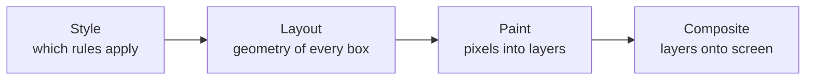

# Animation ও View Transition {#ch-animation-and-view-transitions}

> জানুন কোন property-গুলো browser বিনা খরচে animate করতে পারে, আর একটি page-এর দুটো state-ই নিজে না ধরে রেখে কীভাবে একটি থেকে অন্যটিতে animate করবেন।

**এই অধ্যায়ে:** rendering-এর চারটি ধাপ · শুধু compositor-এর property · Web Animations API · View Transitions API · reduced motion একটি requirement · jank-এর checklist

## 💡 মূল ধারণা

প্রতিটি animation-এর খরচ তিনটি মাপের একটি, আর আপনি কোন property বেছে নিয়েছেন সেটাই ঠিক করে কোনটি।
Browser চারটি ধাপে render করে: style, layout, paint আর composite। একটি property animate করলে প্রতিটি frame-এ সেই
property-র ধাপ আর তার পরের প্রতিটি ধাপ আবার চলে।

`transform` আর `opacity` হলো সেই দুটো property, যেগুলো compositor (browser-এর যে অংশ screen-এ layer-গুলো জোড়া
দেয়) নিজে নিজেই বদলাতে পারে। বাকি সবকিছু layout বা paint-কে আবার frame budget-এর ভেতরে টেনে আনে। 60fps-এ পুরো
budget হলো 16.7 millisecond, আগে থেকে চলা যেকোনো JavaScript সহ।

> "এটা jank করছে কেন"-র senior উত্তর "`will-change` যোগ করুন" নয়। উত্তর হলো "আপনি এমন একটি property animate
> করেছেন, যেটা সেকেন্ডে ষাটবার layout চালাতে বাধ্য করে"।

## কীভাবে কাজ করে

### চারটি ধাপ, আর প্রতিটি property-র খরচ



**একটি property animate করলে তার ধাপ আর তার ডানের প্রতিটি ধাপ আবার চলে।**

| যা animate করছেন | যা trigger হয় | প্রতি frame-এ খরচ |
| --------- | -------- | -------------- |
| `width`, `height`, `top`, `margin` | Layout → paint → composite | পুরো pipeline, element-টির জন্য আর সাধারণত তার sibling-দের জন্যও |
| `background-color`, `box-shadow`, `border-radius` | Paint → composite | প্রভাবিত layer-এর repaint |
| `transform`, `opacity` | শুধু composite | কার্যত বিনা খরচে — GPU একটি আগে থেকে থাকা layer সরায় |
| `filter` | Composite, একটি শর্তসহ | নিজে সস্তা, কিন্তু প্রতি frame-এ নতুন layer বাধ্য করলে দামি |

ব্যবহারিক নিয়ম: **`transform` আর `opacity` animate করুন, আর বাকি সবকিছু এই দুটো দিয়ে প্রকাশ করুন।**
একটি element সরানো মানে `translate`, `left` নয়। বড় করা মানে `scale`, `width` নয়।

### Motion declare করা

CSS transition state-এর পরিবর্তন সামলায়, আর keyframe সামলায় sequence। Code-কে যা চালাতে হয়, তার সবকিছু সামলায়
Web Animations API:

```typescript
// Same model as CSS keyframes, with a promise and a handle on the animation.
const drawer: Element = document.querySelector(".drawer")!;

const animation: Animation = drawer.animate(
  [{ transform: "translateX(100%)" }, { transform: "translateX(0)" }],
  { duration: 220, easing: "cubic-bezier(0.2, 0, 0, 1)", fill: "forwards" },
);

await animation.finished;
```

Interruption-এর জন্য এই API গুরুত্বপূর্ণ। মাঝপথে উল্টে দেওয়া একটি CSS transition লাফ দেয়। একটি `Animation`
object আপনি উল্টাতে, pause করতে বা cancel করতে পারেন। এ কারণেই একটি drawer মনে হয় টেনে নেওয়া আঙুলের সঙ্গে
লেগে আছে।

### View transition

View transition যে সমস্যার সমাধান করে, সেটা ownership-এর। একটি page-এর এক state থেকে অন্য state-এ animate করতে
হলে দুটো state-ই একসঙ্গে DOM-এ রাখতে হয়। মানে পুরোনো list আর নতুন list, বা ছোট image আর বড়টি। প্রতিটি framework
এর জন্য নিজস্ব যন্ত্রপাতি বানিয়েছে।

এর বদলে browser কাজটা করতে পারে। `startViewTransition` page-এর একটি snapshot নেয়, DOM update চালায়, আবার
snapshot নেয়, আর দুটোর মধ্যে cross-fade করে:

```typescript
// The callback does the ordinary DOM update. The browser animates the difference.
function update(next: () => void): void {
  if (!document.startViewTransition) {
    next(); // No support: the update still happens, just without the animation.
    return;
  }
  document.startViewTransition(next);
}
```

একটি element-কে নাম দিলে সেটা cross-fade-এর অংশ হিসেবে নয়, নিজে হিসেবেই animate হয়:

```css
/* The same name on both pages means "this is the same thing, move it". */
.hero-image {
  view-transition-name: hero;
}
```

Cross-document transition একই ধারণা একটি সাধারণ navigation-এ প্রয়োগ করে, কোনো JavaScript ছাড়াই:

```css
@view-transition {
  navigation: auto;
}
```

> ⚠️ **যা বদলাতে থাকে:** same-document API Chromium-এ 2023 সালে আর Safari 18-এ এসেছে।
> Cross-document এসেছে পরে, আর Firefox আরও পরে। তাই এর ওপর নির্ভর করার আগে বর্তমান support দেখে নিন। টেকসই
> নীতি হলো, এই API design অনুযায়ীই একটি progressive enhancement। এটা feature-detect করুন, না থাকলে সাধারণ update
> চালান, তাহলে page দুই ক্ষেত্রেই ঠিক থাকে।

## কখন ব্যবহার করবেন

| পরিস্থিতি | কী নেবেন | কেন |
| --------- | --------- | --- |
| একটি element-এ hover, focus, open/close | একটি CSS transition | Declarative, interrupt করা যায়, JavaScript লাগে না |
| Loop করা বা একাধিক ধাপের একটি sequence | CSS keyframe | Sequence-টি stylesheet-এরই অংশ |
| Gesture বা code-এর state দিয়ে চালিত motion | Web Animations API | আপনাকে উল্টাতে, pause আর cancel করতে হয় |
| একটি list, একটি route বা একটি detail view-এর দুটো state | View transition | Browser দুটো state ধরে রাখে, তাই আপনাকে রাখতে হয় না |
| কয়েকটির বেশি element সরানো যেকোনো কিছু | শুধু `transform` আর `opacity` | একমাত্র এই জুটিই compositor-এ থাকে |

### Reduced motion কোনো ঐচ্ছিক বাড়তি জিনিস নয়

`prefers-reduced-motion` একটি শারীরিক সমস্যার জন্য user-এর একটি setting। Vestibular disorder (ভেতরের কানের
ভারসাম্যের সমস্যা) থাকা মানুষ বড় motion থেকে সত্যিকারের বমিভাব অনুভব করেন। User বন্ধ করতে পারেন না এমন motion-কে
WCAG 2.2 একটি failure হিসেবে ধরে। তাই এটা Part II-এর বাকি accessibility অংশের মতো একই আইনি এলাকা।

**সরিয়ে ফেলবেন না, কমিয়ে দিন:**

```css
@media (prefers-reduced-motion: reduce) {
  /* Keep the state change legible — replace movement with a fade, do not delete feedback. */
  *,
  ::before,
  ::after {
    animation-duration: 0.01ms !important;
    transition-duration: 0.01ms !important;
  }
}
```

View transition-ও একইভাবে setting-টি মানে: call-টি wrap করুন, অথবা media query-র ভেতরে নামধারী transition-গুলো
বন্ধ করে দিন।

## সাধারণ ভুল

**❌ সবকিছুতে `will-change`।** এটা element-কে স্থায়ীভাবে তার নিজস্ব compositor layer-এ তুলে দেয়।
এতে memory খরচ হয়, আর জিনিস ধীরও হতে পারে। Animation শুরুর ঠিক আগে এটা দিন, আর শেষে সরিয়ে দিন। অথবা বাদই দিন,
কারণ browser যা দরকার তা আগে থেকেই তুলে দেয়।

**❌ `height: auto` animate করা।** Animate করে পৌঁছানোর মতো কোনো নির্দিষ্ট value নেই, তাই এটা animate-ই হয় না।
`grid-template-rows` `0fr` থেকে `1fr`-এ animate করুন, অথবা একটি wrapper-কে `scale` করুন, অথবা মেপে একটি pixel
value-তে animate করুন।

**❌ একটি view transition-কে page-level effect হিসেবে দেখা।** যে element-গুলো থেকে যায়, সেগুলোতে
`view-transition-name` না দিলে সবকিছু cross-fade হয়। সেটা একটি সম্পর্ক নয়, একটি ঝলকানি মনে হয়। এই API-এর আসল
মূল্য হলো browser-কে বলে দেওয়া কোন দুটো element একই জিনিস।

## 🔑 মূল শিক্ষা

- Browser চারটি ধাপে render করে, আর একটি property animate করলে প্রতিটি frame-এ তার ধাপ আর তার পরের সবকিছু আবার
  চলে।
- `transform` আর `opacity` হলো একমাত্র দুটো property, যেগুলো compositor নিজে animate করতে পারে। Motion এই দুটো
  দিয়েই প্রকাশ করুন।
- Web Animations API আছে এমন motion-এর জন্য, যেটাকে উল্টাতে, pause বা cancel করতে হয়। বাকি সবকিছুর জন্য CSS
  ভালো।
- View transition browser-কে একটি page-এর পুরোনো আর নতুন state ধরে রাখতে দেয়। আগে প্রতিটি framework এই
  যন্ত্রপাতি নিজেই বানাত।
- `prefers-reduced-motion` একটি accessibility requirement, পছন্দের বিষয় নয়। Motion কমান, কিন্তু feedback রাখুন।

## Interview-এর প্রশ্ন

**Q: একজন engineer জানালেন, মাঝারি মানের Android-এ একটি slide-in panel আটকে আটকে চলে। আপনি কোথা থেকে শুরু করবেন?**

জিজ্ঞেস করুন কী animate হচ্ছে। যদি সেটা `left`, `width` বা `margin` হয়, প্রতিটি frame panel-এর জন্য, আর সাধারণত তার
sibling-দের জন্যও, layout আবার চালায়। যত `will-change`-ই দিন, এটা বদলায় না। এটাকে
`transform: translateX()` হিসেবে নতুন করে লিখুন, যেটা compositor layout বা paint না ছুঁয়েই সামলায়। শুধু তারপরই
দেখার মানে হয়, animation চলার সময় main thread-এ আর কী চলছে। Property যা-ই হোক, একটি long task frame drop করায়।

**Q: View Transitions API আসলে আপনার জন্য কী করে?**

এটা দুটো state-ই ধরে রাখে। একটি page-এর দুটো সংস্করণের মধ্যে animate করা মানে সাধারণত নতুন DOM render হওয়ার সময়
পুরোনো DOM বাঁচিয়ে রাখা। এটাই কঠিন অংশ, আর এ কারণেই animation library-গুলো বড়। Browser আপনার update-এর আগে আর
পরে snapshot নেয়, আর পার্থক্যটা animate করে। `view-transition-name` তাকে বলে দেয় দুটো snapshot-এর কোন element-গুলো
একই object, যাতে সে সেগুলোকে fade না করে সরাতে পারে।

**Q: Interface-কে বিভ্রান্তিকর না করে আপনি `prefers-reduced-motion` কীভাবে সামলান?**

কমান, মুছে ফেলবেন না। একটি panel slide করে ঢুকলে আপনি যদি animation পুরোপুরি সরিয়ে দেন, user কোনো সংকেতই পান না
যে কিছু বদলেছে। এর বদলে নড়াচড়াকে একটি opacity পরিবর্তন দিয়ে বদলে দিন। এটা একই তথ্য বহন করে, vestibular খরচ
ছাড়াই। একটি সাধারণ ব্যর্থতা হলো ঢালাও একটি rule, যেটা সব animation বন্ধ করে দেয়। তার মধ্যে সেই loading spinner-ও
পড়ে, যেটা ছিল app কাজ করছে তার একমাত্র প্রমাণ।

**Q: কখন আপনি platform-এর বদলে একটি JavaScript animation library ব্যবহার করবেন?**

যখন motion সময়-নির্ভর নয়, ভৌত। যেমন spring dynamics, যে gesture velocity হস্তান্তর করে, আর reorder হওয়া একটি
list জুড়ে layout animation। Platform-এর timing model হলো duration আর easing। Cubic bézier দিয়ে নকল করা একটি spring,
user interrupt করামাত্রই আর বিশ্বাসযোগ্য থাকে না। বাকি সবকিছুর জন্য platform ছোট, আর এটা user-এর কাছে কোনো
runtime পাঠায় না।

## এরপর কী পড়বেন

- [Chapter ?? — Container Query ও Cascade Layer](#ch-container-queries-and-layers) — বাকি দুটো feature, যেগুলো একটি workaround-এর জায়গা নিয়েছে
- [Chapter ?? — Core Web Vitals](#ch-core-web-vitals) — যেখানে drop হওয়া frame একটি সংখ্যা হয়ে দেখা দেয়, যার দায় কারও ঘাড়ে পড়ে
- [Chapter ?? — Accessibility কেন, আর আইন কী বলে](#ch-accessibility-and-the-law) — কেন reduced motion সৌজন্য নয়, একটি requirement
