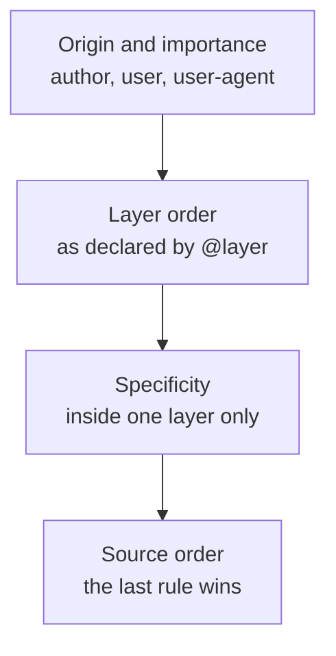

# Container Query ও Cascade Layer {#ch-container-queries-and-layers}

> Component-কে style দিন window-এর মাপ দেখে নয়, তাকে যে জায়গা দেওয়া হয়েছে তা দেখে। আর `!important` ছাড়াই specificity-র লড়াই জিতুন।

**এই অধ্যায়ে:** viewport কেন সবসময়ই ভুল input ছিল · container query · container unit · cascade layer · third-party CSS-এর ক্রম ঠিক করা · দুটি ভুল

## 💡 মূল ধারণা

2023-এ দুটি feature এসেছে, আর প্রত্যেকে একটা পুরনো workaround-এর জায়গা নিয়েছে। দুটি একই ধরনের কাজ করে। নিচের
প্রতিটি rule-এ কোনো কথা বারবার রক্ষা না করে, সেটা একবার, ওপরে বলে দেওয়া যায়।

**Container query** বদলে দেয় component কীসে সাড়া দেবে। Media query window-এর কথা জিজ্ঞেস করে, কিন্তু component
window-এ থাকে না। থাকে sidebar-এ, modal-এ বা grid-এর কোনো cell-এ। **Cascade layer** বদলে দেয় browser সংঘাত কীভাবে
মেটায়। এটা না থাকলে যে লম্বা selector লিখেছে সে জেতে, তাই team-গুলো ক্রমাগত বাড়াতেই থাকে। এটা থাকলে stylesheet-এর
ক্রম একবার declare করে দেন। Specificity (selector-এর ওজন) তখন শুধু একটা layer-এর *ভেতরের* লড়াই মেটায়।

> দুটি feature-ই আলাদা আলাদা rule থেকে সিদ্ধান্ত সরিয়ে stylesheet-এর মাথায় একটি declaration-এ নিয়ে আসে। এজন্যই
> এগুলো syntax নয়, architecture।

## কীভাবে কাজ করে

### Container query

Component যে element-এর ভেতরে বসে, সেই element নিজেকে container ঘোষণা করলে component তাকে query করতে পারে।

**Container declare করা আর query করা:**

```css
/* The parent opts in. `inline-size` means "measure the width only". */
.card-slot {
  container-type: inline-size;
  container-name: card;
}

/* The card now responds to its slot, not to the window. */
@container card (min-width: 30rem) {
  .card {
    display: grid;
    grid-template-columns: 8rem 1fr;
  }
}
```

একই card এখন একই পাতায় 900px-এর main column-এ আর 280px-এর sidebar-এ বসতে পারে, দুই জায়গাতেই ঠিকঠাক। কোনো prop
লাগে না, JavaScript দিয়ে মাপতে হয় না, আর component কোথায় বসানো হয়েছে জানে এমন page-level breakpoint-ও লাগে না।

**Container query unit** মাপে viewport-এর বদলে container-এর সঙ্গে তুলনা করে:

| Unit | Container-এর কীসের 1% | কীসের জায়গা নেয় |
| ---- | ------------------------ | -------- |
| `cqw` / `cqh` | width / height | Component-এর ভেতরে `vw` / `vh` |
| `cqi` / `cqb` | inline size / block size | Writing mode বদলালেও নিরাপদ রূপ, আর এটাই নেওয়া উচিত |
| `cqmin` / `cqmax` | দুটির মধ্যে ছোটটা / বড়টা | Viewport unit দিয়ে বানানো clamp |

> ⚠️ **Container নিজেকে query করতে পারে না।** `container-type: inline-size` একটা element-কে তার descendant-দের
> জন্য query-র target বানায়, তার নিজের rule-এর জন্য নয়। এটা containment-ও তৈরি করে। Contain করা অক্ষে element
> আর তার content দেখে নিজের মাপ ঠিক করে না। তাই স্পষ্ট height ছাড়া `container-type: size` দেওয়া element চুপসে যায়।

### Cascade layer

`@layer` এমন একটা ক্রম দেয়, যা specificity-কে হারায়। পরের layer-এর rule আগের layer-এর rule-কে হারায়, **দুটির
specificity যা-ই হোক**।

**ক্রমটা একবার, ওপরে declare করা:**

```css
/* Everything after this is resolved in this order, whatever the file order is. */
@layer reset, vendor, base, components, utilities;

@layer components {
  /* A specificity of 0,2,0 … */
  .card .title { font-size: 1.25rem; }
}

@layer utilities {
  /* … loses to a specificity of 0,1,0, because utilities is the later layer. */
  .text-sm { font-size: 0.875rem; }
}
```

এজন্যই `!important` ছাড়াই utility class-এর ওপর ভরসা করা যায়। Utility layer সবশেষে declare করেন, তাই এক class-এর
utility অবস্থানের জোরেই তিন class-এর component rule-কে হারায়।

**Layer-সহ cascade, browser যে ক্রমে মেটায়:**



**Cascade-এ layer-এর জায়গা: specificity-র ওপরে, importance-এর নিচে।**

Layer ছাড়া style প্রতিটি layer-কে হারায়। এটা ইচ্ছাকৃত। এর মানে, পুরনো codebase-এ layer যোগ করলে আগে থেকে থাকা
layer-ছাড়া CSS ভাঙতে পারে না। আবার এই নিয়মটাই লোককে অবাক করে।

## কখন ব্যবহার করবেন

| পরিস্থিতি | কী ব্যবহার করবেন | কেন |
| --------- | --------- | --- |
| নানা চওড়া জায়গায় ব্যবহার হওয়া component | Container query | Component-কে আর জানতে হয় না সে কোথায় বসানো |
| পাতার layout: এক column নাকি দুই | Media query | এখানে viewport-ই সত্যিকারের input |
| এমন third-party stylesheet import করা, যা বদলাতে পারবেন না | Import-এ `@layer` | তার specificity আর আপনারটার সঙ্গে পাল্লা দেয় না |
| এমন utility class, যাকে সবসময় জিততে হবে | সবশেষে declare করা utilities layer | `!important`-এর তর্ক চিরতরে মিটে যায় |
| অন্য team-রা ব্যবহার করে এমন design system | দুটিই, সঙ্গে custom property | কে কাকে override করবে, তার চুক্তি হলো layer-এর ক্রম |

**নিয়ন্ত্রণে নেই এমন import-কে layer-এ রাখা:**

```css
/* Everything in the file lands in the `vendor` layer, whatever its own specificity. */
@import url("some-widget.css") layer(vendor);
```

## সাধারণ ভুল

**❌ প্রতিটি wrapper-কে container বানানো।** `container-type` containment তৈরি করে, আর containment-এর খরচ আছে, আচরণও
বদলায়। এটা declare করুন অল্প কয়েকটি element-এ, যেগুলো সত্যিকারের layout slot, যেমন grid cell, sidebar আর modal-এর
body। নিচে নামার পথে প্রতিটি `div`-এ দেবেন না।

**❌ `container-type: size` নেওয়া।** এটা দুটি অক্ষই contain করে। Element তার height নেয় content থেকে নয়, নিজের
rule থেকে, তাই content বাড়লে চুপচাপ overflow হয়।
প্রায় সবসময় যেটা চান, সেটা `inline-size`।

**❌ যে file layer ব্যবহার করে, সেখানেই layer declare করা।** `@layer`-এর ক্রমের statement যদি কোনো component file-এ
থাকে, তাহলে ক্রম নির্ভর করে bundler কোন file আগে বসিয়েছে তার ওপর। Layer আছেই ঠিক এই এলোমেলোভাব দূর করতে। পুরো ক্রম
একবার declare করুন entry stylesheet-এ, সবকিছুর আগে।

**❌ ধরে নেওয়া যে layer `!important`-কে হারায়।** Browser layer-এর ক্রমের আগে importance মেটায়। `!important`
declaration-এর বেলায় layer-এর ক্রম *উল্টে যায়*, তাই সবচেয়ে আগের layer জেতে। Reset layer-এ `!important` থাকলে সেটা
important utility-কে হারিয়ে দেবে, আর এটা প্রায় কেউই আশা করেন না।

## 🔑 মূল শিক্ষা

- Media query জিজ্ঞেস করে window-এর কথা। Container query জিজ্ঞেস করে component-কে আসলে যে জায়গা দেওয়া হয়েছে তার
  কথা, আর reusable component-এর দরকার সেটাই।
- নিরাপদ default হলো `container-type: inline-size`। `size` দুটি অক্ষই contain করে, আর content অনুযায়ী height
  ভেঙে দেয়।
- Cascade layer সংঘাত মেটায় declare করা ক্রম দিয়ে, specificity-র ওপরে। তাই এক class-এর utility তিন class-এর
  component rule-কে হারাতে পারে design-এর জোরে, `!important` দিয়ে নয়।
- Layer ছাড়া CSS প্রতিটি layer-কে হারায়, আর সেজন্যই পুরনো codebase-এ layer চালু করা নিরাপদ।
- দুটি feature-ই আলাদা আলাদা rule থেকে সিদ্ধান্ত সরিয়ে stylesheet-এর মাথায় একটি declaration-এ নিয়ে আসে।

## Interview-এর প্রশ্ন

**Q: একটা card component sidebar-এ ভুল দেখায়, কিন্তু main column-এ ঠিক। কীভাবে ঠিক করবেন?**

Card-এর সাড়া দেওয়ার কথা তার slot-এ, অথচ সে সাড়া দিচ্ছে viewport-এ। Slot-কে `container-type: inline-size` দিন, আর
card-এর breakpoint-গুলো `@container` query হিসেবে আবার লিখুন। লোকে আরও দুটি উত্তর দেয়: একটা `variant="compact"`
prop, বা এমন page-level media query, যা জানে sidebar আছে। দুটিই layout-এর জ্ঞান component-এ বা পাতায় ঠেলে দেয়। আর
পরের বার কেউ card-টা নতুন কোথাও বসালেই দুটিই অচল হয়ে যায়।

**Q: BEM যে সমস্যা মেটায়নি, cascade layer তার কোনটা মেটায়?**

BEM specificity সমান রাখে শুধু সবার সম্মতিতে। কেউ এটা বাধ্য করে না, আর যে CSS আপনি লেখেননি, তার ব্যাপারে BEM কিছুই
করে না। Layer ক্রমটাকে এমন একটা declaration বানায়, যা browser নিজে মানায়। `vendor` layer-এ import করা third-party
stylesheet আপনার component-কে ছাড়িয়ে যেতে পারে না, তার selector যত নির্দিষ্টই হোক। BEM নামের ব্যাপারে একটা রীতি,
আর layer অগ্রাধিকারের ব্যাপারে একটা ব্যবস্থা। বেশিরভাগ codebase-এর দুটিই দরকার।

**Q: Specificity আর `!important`-এর তুলনায় cascade layer কোথায় বসে?**

আগে origin আর importance, তারপর layer-এর ক্রম, তারপর layer-এর ভেতরে specificity, তারপর source order। তাই পরের
layer আগেরটাকে হারায়, specificity যা-ই হোক, আর layer ছাড়া style সব layer-কে হারায়। ফাঁদটা হলো, `!important`
layer-এর ক্রম উল্টে দেয়, তাই *প্রথম* layer-এর important declaration জেতে। এজন্যই reset layer-এর ভেতরে
`!important` একটা ফাঁদ।

**Q: কখন container query ভুল জিনিস?**

যখন যাকে style দিচ্ছেন, সেটা সত্যিই viewport-এর ওপর নির্ভর করে। যেমন পাতা এক column হবে নাকি দুই, ছোট screen-এ
বদলে যাওয়া fixed header, বা এমন কিছু, যা ফাঁকা জায়গা নয়, device-এর ক্ষমতা দেখে চলে। তা ছাড়া container query
container-এর boundary পেরিয়ে ওপরের দিকে তাকাতে পারে না। তাই যে rule-কে পুরো পাতার কথা জানতে হয়, তার জায়গা এখনো
media query-তেই।

## এরপর কী পড়বেন

- [Chapter ?? — Advanced CSS](#ch-advanced-css) — custom property, `:has()` আর subgrid, 2023-এর পর আসা বাকিগুলো
- [Chapter ?? — Styling Strategy](#ch-styling-strategy) — কোন styling পদ্ধতি এই feature-গুলো বয়ে নেয়, আর runtime library-র খরচ কত
- [Chapter ?? — Design System, Dependency ও Upgrade](#ch-design-systems-at-scale) — যেখানে layer-এর ক্রম team-দের মধ্যে চুক্তি হয়ে যায়
