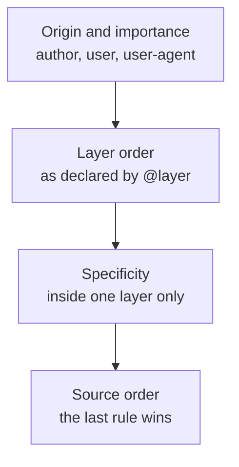

# Container Query ও Cascade Layer {#ch-container-queries-and-layers}

> একটি component-কে style করুন তাকে যতটুকু জায়গা দেওয়া হয়েছে সেই অনুযায়ী, window-এর size অনুযায়ী নয়। আর `!important` ছাড়াই specificity-র লড়াই জিতুন।

**এই অধ্যায়ে:** viewport কেন সবসময় ভুল input ছিল · container query · container unit · cascade layer · third-party CSS-এর ক্রম ঠিক করা · দুটি ভুল

## 💡 মূল ধারণা

2023 সালে দুটি feature এসেছে, আর প্রতিটি একটি পুরোনো workaround-এর জায়গা নিয়েছে। দুটিই একই ধরনের কাজ করে। এরা
আপনাকে একটি কথা একবার, ওপরে বলতে দেয়। নিচের প্রতিটি rule-এ সেটা আর রক্ষা করতে হয় না।

**Container query** বদলে দেয় একটি component কীসের ওপর সাড়া দেয়। Media query window সম্পর্কে প্রশ্ন করে, কিন্তু
component window-এ থাকে না। সে থাকে একটি sidebar, একটি modal বা একটি grid cell-এ। **Cascade layer** বদলে দেয়
browser কীভাবে conflict মেটায়। এগুলো ছাড়া যে লম্বা selector লিখেছে, সে-ই জেতে। তাই team-গুলো ক্রমাগত selector
বাড়াতে থাকে। Layer থাকলে আপনি stylesheet-গুলোর ক্রম একবার declare করেন। তখন specificity (একটি selector-এর ওজন)
শুধু একটি layer-এর *ভেতরের* লড়াই ঠিক করে।

> দুটি feature-ই একটি সিদ্ধান্তকে আলাদা আলাদা rule থেকে সরিয়ে stylesheet-এর ওপরে একটি declaration-এ নিয়ে যায়।
> সেজন্যই এরা syntax নয়, architecture।

## কীভাবে কাজ করে

### Container query

একটি component যে element-এর ভেতরে বসে আছে, সেটাকে query করে। শর্ত একটিই: সেই element-কে নিজেকে container
হিসেবে declare করতে হবে।

**একটি container declare করা আর সেটাকে query করা:**

```css
/* The parent opts in. `inline-size` means "measure the width only". */
.card-slot {
  container-type: inline-size;
  container-name: card;
}

/* The card now responds to its slot, not to the window. */
@container card (min-width: 30rem) {
  .card {
    display: grid;
    grid-template-columns: 8rem 1fr;
  }
}
```

এখন একই card একই page-এ একটি 900px main column-এ আর একটি 280px sidebar-এ বসতে পারে। দুই জায়গাতেই সে ঠিক
দেখায়। কোনো prop লাগে না, JavaScript দিয়ে মাপতে হয় না, আর এমন কোনো page-level breakpoint লাগে না যেটা জানে
component-টি কোথায় বসানো হয়েছে।

**Container query unit** viewport-এর বদলে container-এর সাপেক্ষে মাপে:

| Unit | Container-এর কীসের 1% | কীসের জায়গা নেয় |
| ---- | ------------------------ | -------- |
| `cqw` / `cqh` | width / height | Component-এর ভেতরে `vw` / `vh` |
| `cqi` / `cqb` | inline size / block size | Writing-mode-এর জন্য নিরাপদ সংস্করণ, আর এটাই বেছে নেওয়া উচিত |
| `cqmin` / `cqmax` | দুটির মধ্যে ছোটটি / বড়টি | Viewport unit দিয়ে বানানো একটি clamp |

> ⚠️ **একটি container নিজেকে query করতে পারে না।** `container-type: inline-size` একটি element-কে তার
> descendant-দের জন্য query target বানায়, তার নিজের rule-এর জন্য নয়। এটা containment-ও তৈরি করে। Contained axis-এ
> element আর তার content থেকে নিজের size ঠিক করে না। তাই explicit height ছাড়া একটি `container-type: size`
> element collapse করে যায়।

### Cascade layer

`@layer` আপনাকে এমন একটি ক্রম দেয়, যেটা specificity-কে হারায়। পরের layer-এর একটি rule আগের layer-এর rule-কে
হারায়, **দুটির যেটাই যত specific হোক না কেন**।

**ক্রমটা একবার, ওপরে declare করা:**

```css
/* Everything after this is resolved in this order, whatever the file order is. */
@layer reset, vendor, base, components, utilities;

@layer components {
  /* A specificity of 0,2,0 … */
  .card .title { font-size: 1.25rem; }
}

@layer utilities {
  /* … loses to a specificity of 0,1,0, because utilities is the later layer. */
  .text-sm { font-size: 0.875rem; }
}
```

এ কারণেই `!important` ছাড়াই একটি utility class নির্ভরযোগ্য হয়। আপনি utility layer সবার শেষে declare করেন। তাই
এক class-এর একটি utility তিন class-এর একটি component rule-কে অবস্থানের জোরে হারায়।

**Layer-সহ cascade, browser যে ক্রমে মেটায়:**



**Cascade-এ layer-এর জায়গা: specificity-র ওপরে, importance-এর নিচে।**

Layer-এর বাইরের style প্রতিটি layer-কে হারায়। এটা ইচ্ছাকৃত। এর মানে, একটি পুরোনো codebase-এ layer যোগ করলে
আগে থেকে থাকা layer-ছাড়া CSS ভাঙতে পারে না। আবার এই rule-টাই মানুষকে অবাক করে।

## কখন ব্যবহার করবেন

| পরিস্থিতি | কী নেবেন | কেন |
| --------- | --------- | --- |
| বিভিন্ন width-এর slot-এ ব্যবহৃত একটি component | Container query | Component-কে আর জানতে হয় না সে কোথায় বসানো হয়েছে |
| Page-level layout: এক column না দুই | একটি media query | এখানে viewport-ই আসলে input |
| এমন একটি third-party stylesheet import করা, যেটা আপনি edit করতে পারেন না | Import-এর ওপর `@layer` | এর specificity আর আপনার সঙ্গে প্রতিযোগিতা করে না |
| এমন একটি utility class, যেটাকে সবসময় জিততে হবে | সবার শেষে declare করা একটি utilities layer | `!important`-এর তর্ক চিরতরে শেষ হয় |
| অন্য team-রা ব্যবহার করে এমন একটি design system | দুটিই, সঙ্গে custom property | কে কাকে override করবে, layer-এর ক্রমই তার চুক্তি |

**এমন একটি import-কে layer-এ রাখা, যেটা আপনার নিয়ন্ত্রণে নেই:**

```css
/* Everything in the file lands in the `vendor` layer, whatever its own specificity. */
@import url("some-widget.css") layer(vendor);
```

## সাধারণ ভুল

**❌ প্রতিটি wrapper-কে container বানানো।** `container-type` containment তৈরি করে। Containment-এর খরচ আছে, আর
এটা behaviour বদলায়। এটা declare করুন অল্প কয়েকটি element-এ, যেগুলো আসল layout slot। যেমন grid cell,
sidebar আর modal body। নিচে নামার পথে প্রতিটি `div`-এ declare করবেন না।

**❌ `container-type: size` বেছে নেওয়া।** এটা দুটি axis-ই contain করে। Element তার height নেয় নিজের rule থেকে,
content থেকে নয়। তাই content বাড়লে সেটা চুপচাপ overflow করে।
প্রায় সবসময় আপনার দরকার `inline-size`।

**❌ যে file layer ব্যবহার করে, সেখানেই layer declare করা।** যদি `@layer` ক্রমের statement একটি component file-এ
থাকে, তাহলে ক্রম নির্ভর করে bundler কোন file আগে বসিয়েছে তার ওপর। Layer ঠিক এই এলোমেলো ভাবটাই দূর করতে এসেছে।
পুরো ক্রম একবার declare করুন, entry stylesheet-এ, অন্য সবকিছুর আগে।

**❌ ধরে নেওয়া যে layer `!important`-কে হারায়।** Browser layer-এর ক্রমের আগে importance মেটায়।
`!important` declaration-এর ক্ষেত্রে layer-এর ক্রম *উল্টে* যায়, তাই সবচেয়ে আগের layer জেতে। `!important` ব্যবহার
করা একটি reset layer একটি important utility-কে হারাবে। প্রায় কেউই এটা আশা করে না।

## 🔑 মূল শিক্ষা

- একটি media query window সম্পর্কে প্রশ্ন করে। একটি container query প্রশ্ন করে component-কে আসলে যে জায়গা
  দেওয়া হয়েছে তা নিয়ে। একটি reusable component-এর ঠিক এটাই দরকার।
- `container-type: inline-size` হলো নিরাপদ default। `size` দুটি axis-ই contain করে আর content-নির্ভর height
  ভেঙে দেয়।
- Cascade layer declare করা ক্রম দিয়ে conflict মেটায়, specificity-র ওপরে। তাই এক class-এর একটি utility তিন
  class-এর একটি component rule-কে হারাতে পারে design অনুযায়ী, `!important` দিয়ে নয়।
- Layer-এর বাইরের CSS প্রতিটি layer-কে হারায়। এ কারণেই একটি পুরোনো codebase-এ layer চালু করা নিরাপদ।
- দুটি feature-ই একটি সিদ্ধান্তকে আলাদা আলাদা rule থেকে সরিয়ে stylesheet-এর ওপরে একটি declaration-এ নিয়ে যায়।

## Interview-এর প্রশ্ন

**Q: একটি card component sidebar-এ ভুল দেখায়, কিন্তু main column-এ ঠিক দেখায়। আপনি কীভাবে ঠিক করবেন?**

Card-টি viewport-এর ওপর সাড়া দিচ্ছে, যেখানে তার উচিত নিজের slot-এর ওপর সাড়া দেওয়া। Slot-টিকে
`container-type: inline-size` দিন, আর card-এর breakpoint-গুলো `@container` query হিসেবে নতুন করে লিখুন। মানুষ আরও
দুটি উত্তর দেয়: একটি `variant="compact"` prop, অথবা এমন একটি page-level media query যেটা জানে sidebar আছে। দুটিই
layout-এর জ্ঞান component-এর ভেতরে বা page-এর ভেতরে ঠেলে দেয়। আর পরের বার কেউ card-টি নতুন কোথাও বসালেই দুটিই
কাজ করা বন্ধ করে দেয়।

**Q: Cascade layer এমন কোন সমস্যার সমাধান করে, যেটা BEM করেনি?**

BEM সমঝোতার মাধ্যমে specificity সমান রাখে। কিছুই এটা বাধ্য করে না, আর আপনার নিজের না লেখা CSS-এর ব্যাপারে এটা
কিছুই করে না। Layer ক্রমটাকে একটি declaration-এ পরিণত করে, যেটা browser বাধ্য করে। একটি `vendor` layer-এ import
করা third-party stylesheet আপনার component-দের ছাড়িয়ে যেতে পারে না, তার selector যত specific-ই হোক। BEM হলো নাম
নিয়ে একটি convention, আর layer হলো precedence নিয়ে একটি mechanism। বেশিরভাগ codebase দুটিই চায়।

**Q: Specificity আর `!important`-এর তুলনায় cascade layer কোথায় বসে?**

প্রথমে origin আর importance, তারপর layer-এর ক্রম, তারপর একটি layer-এর ভেতরে specificity, তারপর source order।
তাই পরের layer আগের layer-কে হারায়, specificity যা-ই হোক, আর layer-এর বাইরের style সব layer-কে হারায়। ফাঁদটা হলো,
`!important` layer-এর ক্রম উল্টে দেয়, তাই *প্রথম* layer-এর একটি important declaration জেতে। এ কারণেই একটি reset
layer-এর ভেতরে `!important` একটি ফাঁদ।

**Q: কখন container query ভুল tool?**

যখন আপনি যা style করছেন সেটা সত্যিই viewport-এর ওপর নির্ভর করে। যেমন page-level-এ এক column না দুই column-এর
সিদ্ধান্ত, ছোট screen-এ বদলে যাওয়া একটি fixed header, বা এমন কিছু যেটা খালি জায়গার বদলে device-এর সক্ষমতার ওপর
নির্ভর করে। Container query একটি container-এর সীমানা পেরিয়ে ওপরের দিকেও দেখতে পারে না। তাই যে rule-কে পুরো page
সম্পর্কে জানতে হয়, সেটা এখনো একটি media query-তেই থাকা উচিত।

## এরপর কী পড়বেন

- [Chapter ?? — Advanced CSS](#ch-advanced-css) — custom property, `:has()` আর subgrid, 2023 থেকে আসা বাকি সবকিছু
- [Chapter ?? — Styling Strategy](#ch-styling-strategy) — কোন styling পদ্ধতি এই feature-গুলো বহন করে, আর একটি runtime library-র খরচ কত
- [Chapter ?? — Design System, Dependency ও Upgrade](#ch-design-systems-at-scale) — যেখানে layer-এর ক্রম team-দের মধ্যে একটি চুক্তি হয়ে ওঠে
