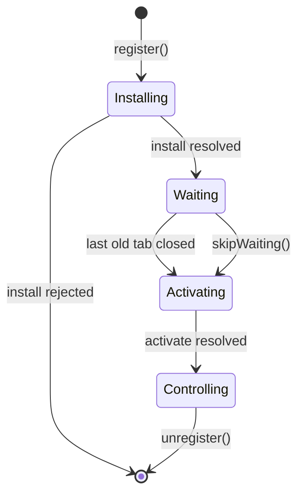

# Service Worker, Caching ও Offline {#ch-service-workers}

> এমন service worker ship করুন, যেটা update করা যায়। প্রতিটি request-এর জন্য আলাদা caching strategy বেছে নিন, আর নতুন version ঠিক কখন দায়িত্ব নেবে, সেটা স্পষ্ট করে বলে দিন।

**এই অধ্যায়ে:** lifecycle · scope আর `fetch` · পাঁচটি caching strategy · কোনো tab আটকে না ফেলে update ship করা · kill switch

## 💡 মূল ধারণা

Service worker এমন একটি script, যেটা browser আপনার page-এর বাইরে রেখে দেয়। App আর network-এর মাঝখানে এটা
বসে থাকে, অনেকটা নিজের হাতে লেখা একটি proxy-র মতো। সব tab বন্ধ হয়ে গেলেও এটা টিকে থাকে, আর প্রতিটি request
কী ফেরত পাবে, তা এটাই ঠিক করে।

এই শেষ ক্ষমতাটাই একে একসঙ্গে কাজের আর বিপজ্জনক করে তোলে। Worker একবার install হয়ে গেলে browser আগে তাকেই
জিজ্ঞেস করে। ফলে খারাপ একটি worker user-কে ভাঙা build দেখাতে পারে, আর user-এর হাতে সেটা মোছার কোনো উপায় থাকে না।

> Service worker এমন code, যা একবার deploy করলে সহজে ফিরিয়ে নেওয়া যায় না। Caching design করার আগে update-এর
> পথটা design করুন।

> ⚠️ **যা বদলাতে থাকে:** platform-এর চেয়ে tooling অনেক দ্রুত বদলায়। Workbox major version বদলালেই তার
> strategy-গুলোর নাম বদলায়, আর framework plugin-গুলো যে worker তৈরি করে, সেটাও বদলে যায়। টেকসই নীতি হলো নিচের
> lifecycle: install, wait, activate। আর worker যে-ই তৈরি করুক, update-এর পথের দায় আপনার।

## কীভাবে কাজ করে

Page worker-কে register করে। এরপর worker চলে নিজের global scope-এ। সেখানে DOM নেই, `window` নেই, synchronous
storage-ও নেই।

**Register করা, শুধু যেখানে কাজ করতে পারে:**

```typescript
// Service workers need HTTPS. localhost is exempt, so development still works.
if ("serviceWorker" in navigator) {
  // Registration competes with page start-up for bandwidth, so wait for load.
  window.addEventListener("load", (): void => {
    void navigator.serviceWorker.register("/sw.js", { scope: "/" });
  });
}
```

একটি worker চারটি ধাপ পার হয়। Production-এর বেশিরভাগ ঝামেলা হয় দ্বিতীয় ধাপে।

| ধাপ | Event | এই ধাপে আপনি কী করেন |
| --- | ----- | ------------------- |
| Installing | `install` | App shell precache করুন। Handler reject করলে worker-টা বাতিল হয়ে যায় |
| Waiting | — | কিছুই না। পুরনো worker-এর অধীনে কোনো tab খোলা থাকলে নতুনটা অপেক্ষা করে |
| Activating | `activate` | আগের version-গুলোর cache মুছে ফেলুন |
| Controlling | `fetch`, `message`, `push` | Request-এর জবাব দিন |



**Lifecycle, সঙ্গে `waiting` থেকে বেরোনোর দুটি পথ।**

**Install আর activate, যে চেহারায় এরা সবসময় লেখা হয়:**

```typescript
declare const self: ServiceWorkerGlobalScope;

const CACHE = "shell-v3"; // Change this on every deploy that changes the shell.

self.addEventListener("install", (event: ExtendableEvent): void => {
  // waitUntil keeps the worker alive. Without it the browser may stop it mid-cache.
  event.waitUntil(caches.open(CACHE).then((c: Cache) => c.addAll(["/", "/offline.html", "/app.css"])));
});

self.addEventListener("activate", (event: ExtendableEvent): void => {
  event.waitUntil(
    caches
      .keys()
      .then((names: string[]) => Promise.all(names.filter((n) => n !== CACHE).map((n) => caches.delete(n))))
      .then((): Promise<void> => self.clients.claim()),
  );
});
```

### Scope ঠিক করে কী intercept করা যাবে

Worker যে directory থেকে serve হয়, সেটা আর তার নিচের সবকিছু তার নিয়ন্ত্রণে থাকে। `/js/sw.js` নিয়ন্ত্রণ করে
`/js/*`, তার বাইরে কিছু নয়। Service worker "কাজ করছে না" অভিযোগের সবচেয়ে সাধারণ কারণ এটাই। হয় worker-টা origin-এর
root থেকে serve করুন, নয়তো scope বড় করতে `Service-Worker-Allowed: /` পাঠান।

### পাঁচটি caching strategy

`fetch`-এর ভেতরে `event.respondWith` call করলে একটি response দেওয়ার দায় আপনার। Call না করলে request কোনো
হাত না পড়েই network-এ চলে যায়। যে request নিয়ে আপনার কোনো মতামত নেই, তার জন্য এটাই ঠিক default।

প্রতিটি strategy গতির বদলে কিছুটা পুরনো data মেনে নেয়। কোনো একটি strategy সবসময় ঠিক নয়। ঠিক হলো প্রতিটি
request-এর সঙ্গে মানানসই strategy জোড়া দেওয়া।

| Strategy | কোথা থেকে পড়ে | Offline-এ দেখায় | কিসের জন্য |
| -------- | ------------- | --------------- | --------- |
| **Cache first** | Cache থেকে, না পেলে তবেই network | হ্যাঁ | Hash করা asset, font, version দেওয়া image |
| **Network first** | Network থেকে, ব্যর্থ হলে cache | শেষ ভালো copy | HTML document, যা কিছু সবসময় হালনাগাদ থাকতে হবে |
| **Stale-while-revalidate** | এখনই cache থেকে, পেছনে চুপচাপ refresh | হ্যাঁ | Avatar, thumbnail, feed, কম গুরুত্বপূর্ণ read |
| **Cache only** | শুধু cache, কখনো network নয় | হ্যাঁ | Precache করা offline page |
| **Network only** | শুধু network, কোনো cache নেই | না | Analytics, payment, side effect আছে এমন যেকোনো কিছু |

**Stale-while-revalidate — এটা মুখস্থ রাখার মতো:**

```typescript
async function staleWhileRevalidate(request: Request, cacheName: string): Promise<Response> {
  const cache: Cache = await caches.open(cacheName);
  const cached: Response | undefined = await cache.match(request);

  // Start the refresh but do not wait for it. The point is to answer now.
  const refresh: Promise<Response> = fetch(request).then(async (fresh: Response) => {
    // A body can be read once, so the cache gets the clone.
    if (fresh.ok) await cache.put(request, fresh.clone());
    return fresh;
  });

  return cached ?? refresh;
}
```

Network first-এর জন্য timeout লাগে। ত্রিশ second ঝুলে থাকা request-এর চেয়ে পাঁচ মিনিট পুরনো copy অনেক ভালো।
এখানে `navigator.onLine` কোনো কাজে আসে না: এটা শুধু বলে network interface আছে কি না, request সফল হচ্ছে কি না
সেটা নয়। `fetch`-এ `AbortSignal.timeout(3000)` দিন, আর error throw হলে cache-এ ফিরে যান।

**Response রাখুন Cache API-তে, record রাখুন IndexedDB-তে।** Cache API URL দিয়ে `Request`/`Response` জোড়া রাখে।
Application data, আর offline অবস্থায় করা write-এর যেকোনো queue, তার জন্য লাগে IndexedDB-র transaction আর index।
Offline write queue নিজেই একটি design-এর প্রশ্ন, যেখানে ক্রম মেনে replay আর idempotency key লাগে। Part VI
বিষয়টাকে সেভাবেই দেখে।

## কখন ব্যবহার করবেন

| পরিস্থিতি | কী বেছে নেবেন | কেন |
| --------- | ------------ | --- |
| `/assets/app.a91f3c.js` | Cache first, কখনো expire নয় | Content বদলালে নামের hash-ও বদলায় |
| যেকোনো navigation request | Network first, 3s timeout, offline page | পুরনো document user-কে পুরনো build-এ আটকে রাখে |
| `GET /api/dashboard` | Stale-while-revalidate, সঙ্গে "শেষ update" label | কিছু একটা দেখান, আর সেটা কত পুরনো তা সৎভাবে বলুন |
| `POST /api/orders` | Network only | Payment চুপচাপ আবার চেষ্টা করা মানেই defect |
| আজকের মধ্যেই update user-এর কাছে পৌঁছাতে হবে | `skipWaiting()`, সঙ্গে reload | Tab বন্ধ হওয়ার অপেক্ষা না করেই নতুন worker activate হয় |
| শুধু পড়ার content site | কোনো service worker নয় | ঠিক cache header দেওয়া CDN-ই কাজটা করে, update-এর কোনো ঝুঁকি ছাড়া |

> ⚠️ `skipWaiting()` নতুন worker activate করে এমন page-এর নিচে, যেটা তখনো পুরনো JavaScript চালাচ্ছে। নতুন worker
> যদি নতুন asset manifest serve করে, পুরনো page যে lazy chunk চাইবে, সেটা হয়তো আর নেই। তাই এর সঙ্গে reload দিন,
> নয়তো user-কে জিজ্ঞেস করুন।

**আগে জিজ্ঞেস, তারপর reload — এই update-ই নিরাপদ default:**

```typescript
const reg: ServiceWorkerRegistration = await navigator.serviceWorker.register("/sw.js");

reg.addEventListener("updatefound", (): void => {
  reg.installing?.addEventListener("statechange", (): void => {
    // A waiting worker while another one controls the page means an update is ready.
    if (reg.waiting && navigator.serviceWorker.controller) showUpdateBanner();
  });
});

function applyUpdate(): void {
  reg.waiting?.postMessage({ type: "SKIP_WAITING" });
}

// One reload, not a loop. controllerchange fires once per takeover.
let reloading = false;
navigator.serviceWorker.addEventListener("controllerchange", (): void => {
  if (reloading) return;
  reloading = true;
  window.location.reload();
});
```

## সাধারণ ভুল

**❌ ভুল — document-এর জন্য cache first:**

```typescript
// Every navigation now returns whichever build was live on the first visit.
event.respondWith(caches.match(event.request).then((c) => c ?? fetch(event.request)));
```

**✅ ঠিক — navigation-এর জন্য network first:**

```typescript
if (event.request.mode === "navigate") {
  event.respondWith(fetch(event.request).catch(async () => (await caches.match("/offline.html"))!));
}
```

Document সেই file, যা বাকি সব file-এর নাম বলে দেয়। সেটা cache থেকে দিলে পুরো app পুরনো version-এ আটকে যায়।

**❌ ভুল — বেরোনোর কোনো পথ নেই।** Unregister করার পথ না থাকলে caching-এর bug ঠিক করার একমাত্র উপায় হলো প্রত্যেক
user-এর নিজে site data মুছে ফেলা। Deploy করা যায় এমন একটি kill switch রাখুন। এটা এমন একটি worker, যার `install`
handler `self.registration.unregister()` call করে, সব cache মুছে দেয়, আর তার client-গুলো reload করে। Interviewer
জিজ্ঞেস করার আগেই এর কথা বললে senior হিসেবে জোরালো ছাপ পড়ে।

**❌ ভুল — সীমাহীন cache।** Eviction ছাড়া প্রতিটি `cache.put`-এ cache বাড়তেই থাকে, যতক্ষণ না browser পুরো
origin-টাই evict করে দেয়। প্রতিটি cache-এর entry সংখ্যা বা বয়সের একটি সীমা দিন।

## 🔑 মূল শিক্ষা

- Service worker আপনার deploy করা একটি proxy। আপনি ইচ্ছে করে বদলে না দেওয়া পর্যন্ত এটা পুরনো version-ই দিতে থাকে।
- পুরনো worker-এর অধীনে থাকা সব tab বন্ধ না হওয়া পর্যন্ত নতুন worker অপেক্ষা করে। এজন্যই মনে হতে পারে fix ship হয়নি।
- Worker file যে directory থেকে serve হয়, সেটাই তার scope। তাই `/js/`-এর নিচের worker শুধু `/js/` নিয়ন্ত্রণ করে।
- প্রতিটি request-এর জন্য আলাদা caching strategy বেছে নিন। Cache first শুধু সেখানে, যেখানে content বদলালে URL-ও বদলায়। Document-এর জন্য network first।
- Production-এর প্রতিটি service worker-এর এমন একটি unregister পথ লাগে, যা এক commit-এই deploy করা যায়।

## Interview-এর প্রশ্ন

**Q: এক ঘণ্টা আগে fix ship করেছেন, অথচ user-রা এখনো bug-টা পাচ্ছেন। কী হয়েছে?**

তাঁদের tab এখনো আগের worker-এর নিয়ন্ত্রণে, তাই নতুনটা `waiting`-এ আটকে আছে। নিয়ন্ত্রণে থাকা সব tab বন্ধ না হওয়া
পর্যন্ত activation অপেক্ষা করে, আর pin করা tab কখনো বন্ধই হয় না। সমাধান হলো একটি update prompt, যা অপেক্ষায় থাকা
worker-কে `SKIP_WAITING` পাঠায় আর `controllerchange` হলে reload করে।

**Q: `skipWaiting()` আর `clients.claim()`-এর পার্থক্য কী?**

`skipWaiting()` নতুন worker-কে আগেভাগেই `waiting` থেকে বের করে আনে। `clients.claim()` একটি active worker-কে
এখন খোলা page-গুলোর নিয়ন্ত্রণ নিতে বলে। সাধারণত দুটিই লাগে, তারপর একটি reload। কারণ claim করা page-গুলো তখনো আগের
build-এর JavaScript চালাচ্ছে।

**Q: একটি dashboard-এর প্রতিটি request-এর জন্য কোন strategy বাছবেন, বুঝিয়ে বলুন।**

Hash করা JavaScript আর CSS পাবে cache first, কোনো expiry ছাড়া। Document পাবে network first, ছোট timeout আর precache
করা একটি offline page সহ। Widget-এর data পাবে stale-while-revalidate, সঙ্গে timestamp দেখানো। কারণ spinner-এর চেয়ে
একটু পুরনো সংখ্যাও ভালো। Mutation সরাসরি network-এ যাবে।

**Q: কখন আপনি service worker একদমই ব্যবহার করবেন না?**

যখন offline বা install-এর কোনো দরকার নেই। Service worker এমন একটি deploy পথ যোগ করে, যা frontend-এর অন্য যেকোনো
কিছুর চেয়ে rollback করা কঠিন। CDN-এ HTTP caching দিয়েই গতির বেশিরভাগটা পাওয়া যায়, পুরনো data-র ঝুঁকি ছাড়াই। আর
সেটা invalidate করাও অনেক সহজ।

## এরপর কী পড়বেন

- [Chapter ?? — Offline-First Architecture](#ch-offline-first-architecture) — write queue, conflict সামলানো আর sync, design-এর প্রশ্ন হিসেবে
- [Chapter ?? — Web Storage ও IndexedDB](#ch-storage-apis) — quota, eviction, আর যে store-এ write queue থাকে
