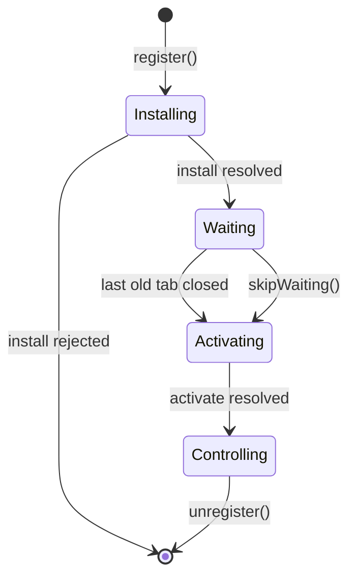

# Service Worker, Caching ও Offline {#ch-service-workers}

> এমন একটি service worker ship করুন, যেটা আপনি update করতে পারেন। প্রতিটি request-এর জন্য একটি caching strategy বেছে নিন, আর ঠিক করে বলুন কখন একটি নতুন version দায়িত্ব নেয়।

**এই অধ্যায়ে:** lifecycle · scope আর `fetch` · পাঁচটি caching strategy · কোনো tab আটকে না ফেলে update ship করা · kill switch

## 💡 মূল ধারণা

Service worker হলো একটি script, যেটা browser আপনার page-এর বাইরে রাখে। এটা app আর network-এর মাঝখানে বসে, আপনার
নিজের লেখা একটি proxy-র মতো। প্রতিটি tab বন্ধ হয়ে গেলেও এটা টিকে থাকে, আর প্রতিটি request কী ফেরত দেবে তা এটাই
ঠিক করে।

এই শেষ ক্ষমতাটাই এটাকে কাজের আর বিপজ্জনক, দুটোই করে তোলে। একবার একটি worker install হলে browser আগে তাকেই
জিজ্ঞেস করে। তাই একটি খারাপ worker এমন একজন user-কে ভাঙা build দিতে পারে, যাঁর সেটা মোছার কোনো উপায় নেই।

> Service worker এমন code, যেটা আপনি একবার deploy করেন আর সহজে ফেরত নিতে পারেন না। Caching design করার আগে
> update-এর পথ design করুন।

> ⚠️ **যা বদলাতে থাকে:** platform-এর চেয়ে tooling অনেক দ্রুত বদলায়। Workbox major version-এর সঙ্গে তার
> strategy-গুলোর নাম বদলায়, আর framework plugin-গুলো তাদের তৈরি করা worker বদলায়। টেকসই নীতি হলো নিচের
> lifecycle: install, wait, activate। আর worker যে-ই তৈরি করুক, update-এর পথ আপনার দায়িত্ব।

## কীভাবে কাজ করে

Page worker-কে register করে। তারপর worker নিজের global scope-এ চলে, কোনো DOM, কোনো
`window` আর কোনো synchronous storage ছাড়া।

**Register করা, শুধু যেখানে এটা কাজ করতে পারে:**

```typescript
// Service workers need HTTPS. localhost is exempt, so development still works.
if ("serviceWorker" in navigator) {
  // Registration competes with page start-up for bandwidth, so wait for load.
  window.addEventListener("load", (): void => {
    void navigator.serviceWorker.register("/sw.js", { scope: "/" });
  });
}
```

একটি worker চারটি ধাপের মধ্য দিয়ে যায়। দ্বিতীয়টিতেই বেশিরভাগ production incident ঘটে।

| ধাপ | Event | এতে আপনি কী করেন |
| ----- | ----- | ----------------- |
| Installing | `install` | App shell precache করুন। Handler reject করলে worker বাতিল হয়ে যায় |
| Waiting | — | কিছুই না। যতক্ষণ কোনো tab পুরোনো worker-এর নিয়ন্ত্রণে আছে, worker অপেক্ষা করে |
| Activating | `activate` | আগের version-গুলোর cache মুছে দিন |
| Controlling | `fetch`, `message`, `push` | Request-এর উত্তর দিন |



**Lifecycle, `waiting` থেকে বেরোনোর দুটো পথসহ।**

**Install আর activate, যে রূপে এরা সবসময় থাকে:**

```typescript
declare const self: ServiceWorkerGlobalScope;

const CACHE = "shell-v3"; // Change this on every deploy that changes the shell.

self.addEventListener("install", (event: ExtendableEvent): void => {
  // waitUntil keeps the worker alive. Without it the browser may stop it mid-cache.
  event.waitUntil(caches.open(CACHE).then((c: Cache) => c.addAll(["/", "/offline.html", "/app.css"])));
});

self.addEventListener("activate", (event: ExtendableEvent): void => {
  event.waitUntil(
    caches
      .keys()
      .then((names: string[]) => Promise.all(names.filter((n) => n !== CACHE).map((n) => caches.delete(n))))
      .then((): Promise<void> => self.clients.claim()),
  );
});
```

### Scope ঠিক করে এটা কী intercept করতে পারে

একটি worker সেই directory আর তার নিচের সবকিছু নিয়ন্ত্রণ করে, যেখান থেকে তাকে serve করা হয়েছে। `/js/sw.js` নিয়ন্ত্রণ
করে `/js/*`, আর কিছু নয়। একটি service worker "কাজ করে না"-র সবচেয়ে সাধারণ কারণ এটাই। এটাকে origin root থেকে serve
করুন, অথবা scope বড় করতে `Service-Worker-Allowed: /` পাঠান।

### পাঁচটি caching strategy

`fetch`-এর ভেতরে `event.respondWith` আপনাকে একটি response তৈরি করতে বাধ্য করে। এটা call না করলে request অক্ষত
অবস্থায় network-এ যায়। যে request নিয়ে আপনার কোনো মত নেই, তার জন্য এটাই সঠিক default।

প্রতিটি strategy গতির বিনিময়ে পুরোনো data মেনে নেয়। কোনো সঠিক strategy নেই, আছে শুধু request-এর সঙ্গে strategy-র
সঠিক জোড়া।

| Strategy | কোথা থেকে পড়ে | Offline-এ serve করে | কীসের জন্য |
| -------- | ----- | -------------- | ------- |
| **Cache first** | Cache, miss হলে তবেই network | হ্যাঁ | Hash করা asset, font, versioned image |
| **Network first** | Network, ব্যর্থ হলে cache | শেষ ভালো copy | HTML document, যা কিছু হালনাগাদ থাকতেই হবে |
| **Stale-while-revalidate** | এখনই cache, পেছনে refresh | হ্যাঁ | Avatar, thumbnail, feed, অগুরুত্বপূর্ণ read |
| **Cache only** | Cache, কখনো network নয় | হ্যাঁ | Precache করা offline page |
| **Network only** | Network, কোনো cache নয় | না | Analytics, payment, side effect আছে এমন যেকোনো কিছু |

**Stale-while-revalidate — যেটা মুখস্থ জানা দরকার:**

```typescript
async function staleWhileRevalidate(request: Request, cacheName: string): Promise<Response> {
  const cache: Cache = await caches.open(cacheName);
  const cached: Response | undefined = await cache.match(request);

  // Start the refresh but do not wait for it. The point is to answer now.
  const refresh: Promise<Response> = fetch(request).then(async (fresh: Response) => {
    // A body can be read once, so the cache gets the clone.
    if (fresh.ok) await cache.put(request, fresh.clone());
    return fresh;
  });

  return cached ?? refresh;
}
```

Network first-এর একটি timeout লাগে। ত্রিশ সেকেন্ড ঝুলে থাকা একটি request পাঁচ মিনিট পুরোনো একটি copy-র চেয়ে খারাপ।
`navigator.onLine` এখানে সাহায্য করে না: এটা জানায় একটি network interface আছে কি না, request সফল হচ্ছে কি না তা নয়।
`fetch`-এ `AbortSignal.timeout(3000)` পাস করুন, আর throw করলে cache-এ ফিরে যান।

**Response যায় Cache API-তে, record যায় IndexedDB-তে।** Cache API URL দিয়ে key করা `Request`/`Response`
জোড়া রাখে। Application data, আর offline-এ করা write-এর যেকোনো queue-র জন্য IndexedDB-র transaction আর index
লাগে। Offline write queue নিজেই একটি design-এর প্রশ্ন, যেখানে ক্রমানুসারে replay আর idempotency key আছে। Part VI
এটাকে সেভাবেই দেখে।

## কখন ব্যবহার করবেন

| পরিস্থিতি | বেছে নিন | কেন |
| -------- | ------ | --- |
| `/assets/app.a91f3c.js` | Cache first, কখনো expire নয় | Content বদলালে নামের hash বদলায় |
| যেকোনো navigation request | Network first, 3s timeout, offline page | একটি পুরোনো document user-দের একটি পুরোনো build-এ আটকে রাখে |
| `GET /api/dashboard` | Stale-while-revalidate, সঙ্গে একটি "last updated" label | কিছু একটা দেখান, আর তার বয়স নিয়ে সৎ থাকুন |
| `POST /api/orders` | Network only | Payment-এ চুপচাপ retry একটি defect |
| একটি update আজই user-দের কাছে পৌঁছাতে হবে | `skipWaiting()`, সঙ্গে একটি reload | Tab বন্ধ হওয়ার অপেক্ষা না করেই নতুন worker activate হয় |
| শুধু পড়ার জন্য content site | কোনো service worker নয় | সঠিক cache header-সহ একটি CDN কাজটা করে, update-এর কোনো ঝুঁকি ছাড়াই |

> ⚠️ `skipWaiting()` এমন একটি page-এর নিচে নতুন worker activate করে, যেটা এখনো পুরোনো JavaScript চালাচ্ছে। নতুন
> worker যদি একটি নতুন asset manifest serve করে, পুরোনো page যে lazy chunk চায় সেটা হয়তো আর নেই। এর সঙ্গে একটি
> reload জুড়ে দিন, অথবা এর বদলে user-কে prompt করুন।

**আগে prompt, তারপর reload — এই update-ই নিরাপদ default:**

```typescript
const reg: ServiceWorkerRegistration = await navigator.serviceWorker.register("/sw.js");

reg.addEventListener("updatefound", (): void => {
  reg.installing?.addEventListener("statechange", (): void => {
    // A waiting worker while another one controls the page means an update is ready.
    if (reg.waiting && navigator.serviceWorker.controller) showUpdateBanner();
  });
});

function applyUpdate(): void {
  reg.waiting?.postMessage({ type: "SKIP_WAITING" });
}

// One reload, not a loop. controllerchange fires once per takeover.
let reloading = false;
navigator.serviceWorker.addEventListener("controllerchange", (): void => {
  if (reloading) return;
  reloading = true;
  window.location.reload();
});
```

## সাধারণ ভুল

**❌ ভুল — document-এর জন্য cache first:**

```typescript
// Every navigation now returns whichever build was live on the first visit.
event.respondWith(caches.match(event.request).then((c) => c ?? fetch(event.request)));
```

**✅ সঠিক — navigation-এর জন্য network first:**

```typescript
if (event.request.mode === "navigate") {
  event.respondWith(fetch(event.request).catch(async () => (await caches.match("/offline.html"))!));
}
```

Document হলো সেই file, যেটা বাকি প্রতিটি file-এর নাম বলে। এটাকে cache থেকে serve করলে পুরো app একটি পুরোনো
version-এ আটকে যায়।

**❌ ভুল — বেরোনোর কোনো পথ নেই।** Unregister-এর পথ না থাকলে একটি caching bug ঠিক করার একমাত্র উপায় হলো প্রত্যেক user-এর
site data মুছে ফেলা। Deploy করা যায় এমন একটি kill switch রাখুন। এটা এমন একটি worker, যার `install` handler
`self.registration.unregister()` call করে, প্রতিটি cache মুছে দেয় আর তার client-দের reload করে। Interviewer জিজ্ঞেস
করার আগেই এর কথা বলা একটি শক্তিশালী senior সংকেত।

**❌ ভুল — সীমাহীন একটি cache।** Eviction ছাড়া প্রতিটি `cache.put` বাড়তেই থাকে, যতক্ষণ না browser পুরো origin-কে
evict করে। প্রতিটি cache-কে entry-র সংখ্যা বা বয়স দিয়ে সীমিত করুন।

## 🔑 মূল শিক্ষা

- Service worker হলো আপনার deploy করা একটি proxy, আর আপনি ইচ্ছা করে বদলে না দেওয়া পর্যন্ত এটা পুরোনো version-ই serve করতে থাকে।
- পুরোনো worker-এর নিয়ন্ত্রণে থাকা প্রতিটি tab বন্ধ না হওয়া পর্যন্ত নতুন worker অপেক্ষা করে। এ কারণেই মনে হতে পারে একটি fix ship হয়নি।
- Scope হলো সেই directory, যেখান থেকে worker file serve করা হয়। তাই `/js/`-এর নিচের একটি worker শুধু `/js/` নিয়ন্ত্রণ করে।
- প্রতিটি request-এর জন্য একটি caching strategy বেছে নিন। Cache first শুধু সেখানে, যেখানে content-এর সঙ্গে URL বদলায়, আর document-এর জন্য network first।
- প্রতিটি production service worker-এর এমন একটি unregister-এর পথ দরকার, যেটা আপনি এক commit-এ deploy করতে পারেন।

## Interview-এর প্রশ্ন

**Q: আপনি এক ঘণ্টা আগে একটি fix ship করেছেন, তবু user-রা এখনো bug-টির কথা জানাচ্ছেন। কী হয়েছে?**

তাঁদের tab এখনো আগের worker-এর নিয়ন্ত্রণে, তাই নতুনটি `waiting`-এ আটকে আছে। Activation নিয়ন্ত্রণে থাকা প্রতিটি tab
বন্ধ হওয়ার জন্য অপেক্ষা করে, আর একটি pinned tab কখনো বন্ধ হয় না। সমাধান হলো একটি update prompt, যেটা waiting worker-কে
`SKIP_WAITING` post করে আর `controllerchange`-এ reload করে।

**Q: `skipWaiting()` আর `clients.claim()`-এর পার্থক্য কী?**

`skipWaiting()` একটি নতুন worker-কে আগেভাগেই `waiting` থেকে বের করে আনে। `clients.claim()` একটি active worker-কে
এখন খোলা page-গুলোর নিয়ন্ত্রণ নিতে বাধ্য করে। সাধারণত আপনি দুটোই চান, তারপর একটি reload। Claim করা page-গুলো
এখনো আগের build-এর JavaScript চালাচ্ছে।

**Q: একটি dashboard-এর প্রতিটি request-এর জন্য আপনি কোন strategy বেছে নেবেন, ধাপে ধাপে বলুন।**

Hash করা JavaScript আর CSS পায় cache first, কোনো expiry ছাড়া। Document পায় network first, একটি ছোট timeout আর
একটি precache করা offline page-সহ। Widget data পায় stale-while-revalidate, তার timestamp দেখিয়ে, কারণ সামান্য পুরোনো
সংখ্যা একটি spinner-এর চেয়ে ভালো। Mutation সরাসরি network-এ যায়।

**Q: কখন আপনি service worker একেবারেই ব্যবহার করবেন না?**

যখন offline বা install-এর কোনো প্রয়োজন নেই। Service worker এমন একটি deploy-এর পথ যোগ করে, যেটা frontend-এর অন্য
যেকোনো কিছুর চেয়ে roll back করা কঠিন। CDN-এ HTTP caching বেশিরভাগ গতি দেয়, পুরোনো data-র কোনো ঝুঁকি ছাড়াই। এটা
invalidate করাও অনেক সহজ।

## এরপর কী পড়বেন

- [Chapter ?? — Offline-First Architecture](#ch-offline-first-architecture) — write queue, conflict সামলানো আর sync, একটি design-এর প্রশ্ন হিসেবে
- [Chapter ?? — Web Storage ও IndexedDB](#ch-storage-apis) — quota, eviction আর সেই store, যেখানে write queue থাকে
