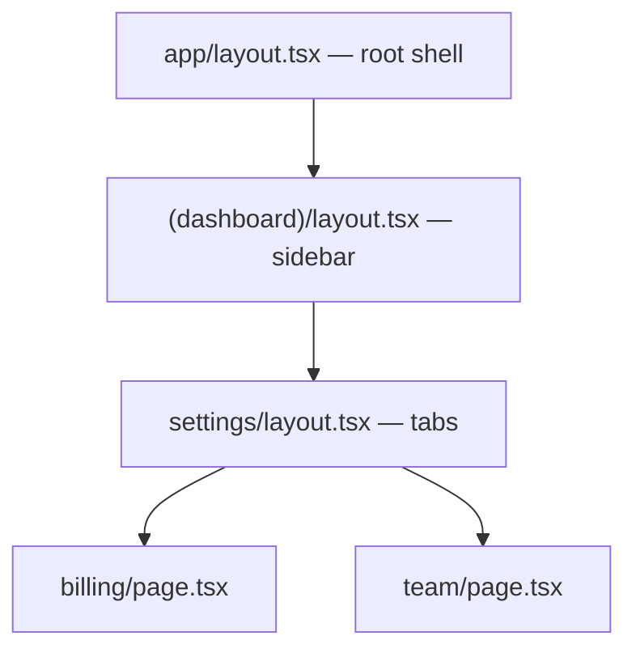

# App Router-এর Mental Model {#ch-app-router-mental-model}

> File tree দেখেই URL পড়ে ফেলুন, জানুন navigation-এর পরে screen-এর কোন অংশ টিকে থাকে, আর back button না ভেঙে modal বসান।

**এই অধ্যায়ে:** route হিসেবে file · layout বনাম template · route group · dynamic segment · parallel আর intercepting route

## 💡 মূল ধারণা

App Router-এ file system শুধু একটি routing table নয়। এটাই **component tree**। একটি URL হলো folder-এর ভেতর দিয়ে
নিচে নামার একটি পথ, আর সেই পথের প্রতিটি `layout.tsx` তার নিচের সবকিছুকে মুড়ে রাখে। `/dashboard/settings/billing`
render করা মানে চারটি component জোড়া লাগানো, যাদের কোথাও কখনো import করা হয়নি।

মানুষ যে আচরণে সবচেয়ে বেশি অবাক হয়, তার বেশিরভাগই এই একটি কথায় বোঝা যায়। Navigation-এর পরেও layout টিকে থাকে,
কারণ tree-তে সেটা একই node। Route বদলালেও layout-এর state টিকে থাকে, ঠিক যে কারণে child re-render হলে parent-এর
state টিকে থাকে। বিশেষ কিছু ঘটছে না। এটা React composition-ই, শুধু import-এর জায়গায় folder।

> "আমি কোন page-এ আছি" জিজ্ঞেস করা বন্ধ করুন। জিজ্ঞেস করুন "এই path-এ কোন কোন segment আছে"। Navigation শুধু
> আলাদা segment-গুলো বদলায়, বাকিগুলো mounted থাকে।

## কীভাবে কাজ করে

### যে file-গুলোর মানে আছে

`app/`-এর ভেতরের filename-ই API। File বিশেষ হয় শুধু তখনই, যখন তার নাম হুবহু ঠিক।

| File               | কী এটা                                                             |
| ------------------ | ------------------------------------------------------------------ |
| `page.tsx`         | Route-এর নিজের UI। যে folder-এ এটা নেই, সেটা route নয়               |
| `layout.tsx`       | এই segment আর তার নিচের সবকিছু মুড়ে রাখে — navigation-এ টিকে থাকে |
| `template.tsx`     | Layout-এর মতো, কিন্তু প্রতিটি navigation-এ নতুন করে mount হয়        |
| `loading.tsx`      | Segment-এর চারপাশে নিজে থেকেই বসানো Suspense fallback              |
| `error.tsx`        | Segment-এর error boundary                                         |
| `not-found.tsx`    | `notFound()` আর না মেলা path-এর UI                                |
| `route.ts`         | UI-এর বদলে একটি HTTP endpoint — `page.tsx`-এর পাশে বসতে পারে না    |
| `default.tsx`      | Parallel route slot-এর fallback, যখন কিছু মেলে না                  |

`layout` আর `template` নিয়ে নিখুঁত থাকুন। Layout তার ভেতরের navigation-এ নিজের state, scroll position আর effect
ধরে রাখে। Template প্রতিবার নতুন instance পায়। এটা ব্যবহার করুন যখন enter animation আবার চালাতে হবে, বা প্রতিটি
route বদলে কোনো effect আবার চালাতে হবে। Default উত্তর `layout`। `template` ব্যতিক্রম, আর তার জন্য কারণ লাগে।

### Path আসলে একটি tree



**`/settings/billing` থেকে `/settings/team`-এ গেলে একটিমাত্র node বদলায়।** Root, sidebar আর tab mounted থাকে,
নিজেদের state ধরে রাখে, আর কখনো আবার fetch হয় না।

### Route group: routing ছাড়াই গোছানো

বন্ধনীর ভেতরের folder, যেমন `(marketing)`, URL-এ দেখা যায় না। এটা একগুচ্ছ route-কে একটি shared layout দেয়, অথবা
একটি team-এর route-গুলো এক জায়গায় রাখে।

```text
app/
  (marketing)/layout.tsx    →  wraps /about and /pricing
  (marketing)/about/page.tsx    →  /about
  (shop)/layout.tsx         →  wraps /cart
  (shop)/cart/page.tsx          →  /cart
```

এর সঙ্গে দুটি নিয়ম আসে। আলাদা group-এর route একই URL-এ resolve হতে পারবে না, তাই `(marketing)/about` আর
`(shop)/about` থাকলে build error হয়। আর দুটি **root** layout-এর মধ্যে যাতায়াত করলে client navigation হয় না, পুরো
page load হয়, কারণ diff করার মতো কোনো shared tree নেই।

### Dynamic segment

| Folder            | কী মেলে                            | `params`                    |
| ----------------- | ---------------------------------- | --------------------------- |
| `[id]`            | `/posts/1`                          | `{ id: '1' }`               |
| `[...slug]`       | `/docs/a/b/c` — এক বা একাধিক        | `{ slug: ['a','b','c'] }`   |
| `[[...slug]]`     | `/docs` আর `/docs/a` — শূন্য বা একাধিক | `{ slug: undefined }` অথবা একটি array |

```tsx
export default async function Page({ params }: { params: Promise<{ slug: string }> }) {
  const { slug } = await params; // a Promise since Next.js 15; synchronous access removed in 16
  return <Article slug={slug} />;
}
```

`params` আর `searchParams` হলো promise। এটা সাজসজ্জা নয়। এর ফলে request data আসার আগেই Next.js route-এর static
অংশগুলো render করা শুরু করতে পারে, আর
[Chapter ?? — Next.js-এ Rendering](#ch-rendering-in-nextjs)-এর পুরো ভিত্তি এটাই।

### Parallel route আর intercepting route

**Parallel route** হলো দ্বিতীয় একটি `children` slot। একটি folder-এর নাম দিন `@modal`, তাহলে layout সেটা `children`-এর
পাশাপাশি prop হিসেবে পায়। ফলে দুটি স্বাধীন subtree একই screen-এ render হয়।

```tsx
// app/layout.tsx
export default function RootLayout({
  children,
  modal,
}: {
  children: React.ReactNode;
  modal: React.ReactNode;
}) {
  return <body>{children}{modal}</body>;
}
```

প্রতিটি slot-এ `null` return করা একটি `default.tsx` লাগে। না থাকলে hard refresh করলে 404 হয়, কারণ দেখার মতো কোনো
navigation history না থাকলে Next.js বুঝতে পারে না slot-এ কী বসবে।

**Intercepting route** একই URL-এর জন্য আলাদা component render করে, user কোথা থেকে এসেছে তার ওপর নির্ভর করে। `(.)`
একই segment level-এ intercept করে, `(..)` এক level ওপরে, আর `(...)` root থেকে। এগুলো folder নয়, segment গোনে,
আর মানুষ ভুলটা ঠিক এখানেই করে।

দুটি মিলে photo-modal pattern তৈরি হয়। Thumbnail-এ click করলে `/photos/3` gallery-র ওপর modal হিসেবে খোলে। একই URL
paste করলে পুরো page render হয়। পুরো ভারটা একটি সতর্কতার ওপর: **modal বন্ধ করুন `router.back()` দিয়ে**,
`router.push()` দিয়ে কখনো নয়। Push করলে history-তে একটি entry যোগ হয়, ফলে user যে modal এইমাত্র বন্ধ করল, back
button সেটাই আবার খুলে দেয়।

### Navigation-এ আসলে কী ঘটে

Client server-এর কাছে শুধু বদলে যাওয়া segment-গুলো চায়। সেগুলোর জন্য ফেরত পায় একটি RSC payload (serialise করা
Server Component output)। যে layout বদলায়নি, সেটা কখনো আবার render বা fetch হয় না। তাই "প্রতিটি navigation-এ আমার
sidebar আবার fetch করছে কেন" প্রায় সবসময় একই bug। Fetch-টা আছে এমন কোনো `page.tsx`-এ, যেটা বদলে যাচ্ছে, অথবা এমন
`template.tsx`-এ, যা নকশা অনুযায়ীই নতুন করে mount হয়।

> ⚠️ **যা বদলাতে থাকে:** Next.js 16 `params`, `searchParams`, `cookies()` আর `headers()`-এ synchronous access
> তুলে দিয়েছে, আর `middleware.ts`-এর নাম বদলে `proxy.ts` রেখেছে। টেকসই নীতি: route তৈরি হয় nested segment দিয়ে, আর
> request data আসে asynchronous-ভাবে। Filename-গুলো বদলাতে থাকে।

## কখন ব্যবহার করবেন

| আপনি চান                                        | কী ব্যবহার করবেন                             |
| ---------------------------------------------- | ------------------------------------------- |
| এমন shell, যা navigation-এর পরেও টিকে থাকে     | `layout.tsx`                                |
| প্রতিটি route-এ আবার চলা animation বা effect     | `template.tsx`                              |
| আলাদা chrome-এর দুটি section, একই রকম URL       | Route group                                 |
| এমন modal, যা একটি আসল, share করার মতো URL-ও   | Parallel slot, সঙ্গে intercepting route      |
| ধীর segment-এর জন্য streaming skeleton         | `loading.tsx`                               |
| Page নয়, একটি HTTP endpoint                     | নিজস্ব folder-এ `route.ts`                   |
| Routing-এ কোনো প্রভাব ছাড়া file গোছানো          | `app/`-এর বাইরের folder, অথবা route group     |

## সাধারণ ভুল

**❌ `default.tsx` ছাড়া parallel slot।** কেউ page refresh না করা পর্যন্ত সব ঠিকঠাক চলে, তারপর route 404 দেয়, আর
log-এ ব্যাখ্যা করার মতো কিছুই থাকে না।

**❌ `router.push('/')` বা `<Link>` দিয়ে modal বন্ধ করা।** এতে intercept হওয়া route history-তে থেকে যায়। ফলে back
button modal-টা আবার খোলে, আর tab বন্ধ না করে user বেরোতেই পারে না।

**❌ Root layout-এ `'use client'`।** তখন application-এর প্রতিটি route একটি Client Component tree হয়ে যায়। এক line-এ
server rendering-এর পুরো সুবিধা ফেলে দেওয়া। Directive-টা interactive leaf পর্যন্ত নামিয়ে দিন — দেখুন
[Chapter ?? — Server Component ও Client Component](#ch-server-components-vs-client-components)।

**❌ "শুনতে layout-এর মতো লাগল" বলে `template.tsx` ব্যবহার করা।** এটা নতুন করে mount হয়, তাই প্রতিটি navigation-এ
state reset হয়, effect আবার চলে, আর যেকোনো দামি child আবার render হয়।

**❌ Shared data `page.tsx`-এ fetch করা।** Section-এর ভেতরে প্রতিটি navigation-এ এটা আবার fetch করে। Data যদি shell-এর
হয়, তাহলে shell যে layout-এর, সেখানেই fetch করুন।

## 🔑 মূল শিক্ষা

- Folder path-ই component tree: page-এর ওপরের প্রতিটি `layout.tsx` তাকে মুড়ে রাখে।
- Layout navigation-এর পরেও টিকে থাকে আর state ধরে রাখে; template প্রতিবার নতুন করে mount হয়।
- Route group URL না ছুঁয়েই file গোছায়, আর দুটি root layout-এর মধ্যে যাতায়াত মানে পুরো page load।
- প্রতিটি parallel slot-এ `default.tsx` লাগে, আর intercept হওয়া modal বন্ধ করতে হবে `router.back()` দিয়ে।
- Next.js 16-এ `params`, `searchParams`, `cookies()` আর `headers()` সবই asynchronous।

## Interview-এর প্রশ্ন

**Q: `layout.tsx` আর `template.tsx`-এর পার্থক্য কী?**

দুটিই নিচের segment-কে মুড়ে রাখে। Layout একটিই instance, যা তার ভেতরের navigation-এ টিকে থাকে, তাই state, scroll
position আর effect সবই থেকে যায়। Template প্রতিটি navigation-এ নতুন করে mount হয়। Default হলো layout। Template
শুধু সেই অল্প কিছু ক্ষেত্রে, যেখানে নতুন করে mount হওয়াটাই উদ্দেশ্য, যেমন enter animation আবার চালানো বা প্রতিটি
route-এ effect আবার চালানো।

**Q: এমন modal কীভাবে বানাবেন, যা একই সঙ্গে share করার মতো URL?**

Modal-এর জন্য একটি parallel route slot নিন, তার ভেতরে একটি intercepting route। Application-এর ভেতরে link click
করলে intercepting route মেলে, আর modal বর্তমান page-এর ওপর render হয়। সরাসরি URL-এ গেলে বা refresh করলে interception
হয় না, পুরো page render হয়। Refresh-এ 404 যাতে না হয়, তার জন্য slot-এ `default.tsx` লাগে। আর history ঠিক রাখতে
modal বন্ধ করতে হবে `router.back()` দিয়ে।

**Q: একটি sidebar প্রতিটি navigation-এ তার data আবার fetch করে। সমস্যা কোথায়?**

Fetch-টা এমন জায়গায় আছে, যা বদলে যাচ্ছে। হয় সেটা আছে `page.tsx`-এ, আর navigation ঠিক সেটাই বদলায়। নয়তো shell-টা
একটি `template.tsx`, আর নতুন করে mount হয়ে সেটা নিজের কাজই করছে। Fetch-টা sidebar যে layout-এর, সেখানে সরিয়ে নিন।
তখন সেটা একবার render হয়, আর mounted থাকে।

**Q: কখন route group ব্যবহার করবেন না?**

যখন দুটি group একই URL তৈরি করবে, কারণ সেটা build error। যখন শুধু এমন route-গুলোর জন্য shared layout চান, যারা
আগে থেকেই nested, কারণ nesting সেটা এমনিতেই দেয়। Route group কাজে আসে যখন সম্পর্কহীন URL path-এর একই chrome
লাগে। আর তখনও, যখন কোনো section-এর নিজস্ব root layout দরকার, আর boundary-তে পুরো page load মেনে নিচ্ছেন।

## এরপর কী পড়বেন

- [Chapter ?? — Data Fetching ও Caching](#ch-nextjs-data-and-caching) — এই segment-গুলোর data কোথা থেকে আসে
- [Chapter ?? — Next.js-এ Rendering](#ch-rendering-in-nextjs) — কোন segment static, cached নাকি dynamic, তা কীসে ঠিক হয়
- [Chapter ?? — Server Component ও Client Component](#ch-server-components-vs-client-components) — প্রতিটি layout যে boundary-র ওপর বসে
