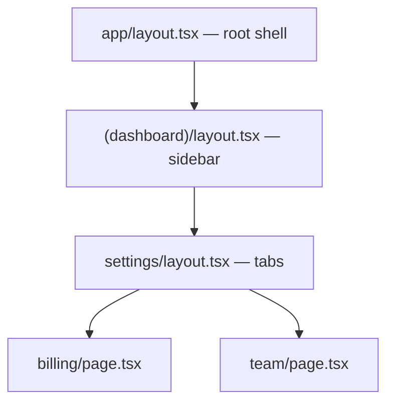

# App Router-এর Mental Model {#ch-app-router-mental-model}

> File tree দেখে একটি URL পড়ুন, জানুন navigation-এর পর screen-এর কোন অংশ টিকে থাকে, আর back button না ভেঙে একটি modal বসান।

**এই অধ্যায়ে:** file হিসেবে route · layout বনাম template · route group · dynamic segment · parallel আর intercepting route

## 💡 মূল ধারণা

App Router-এ file system শুধু একটি routing table নয়। এটাই **component tree**। একটি URL হলো folder-এর ভেতর দিয়ে
নিচে নামা একটি path, আর সেই path-এর প্রতিটি `layout.tsx` তার নিচের সবকিছুকে মুড়ে রাখে।
`/dashboard/settings/billing` render করা মানে চারটি component জোড়া লাগানো, যেগুলো কোথাও import করা হয়নি।

এই একটি তথ্যই মানুষ যে আচরণে অবাক হয়, তার বেশিরভাগ ব্যাখ্যা করে। Navigation-এর পরেও layout টিকে থাকে, কারণ
tree-তে সেগুলো একই node। Layout-এর state route বদলের পরেও টিকে থাকে, ঠিক যে কারণে child re-render হলে parent-এর
state টিকে থাকে। বিশেষ কিছু ঘটছে না। এটা React composition, শুধু import-এর বদলে folder।

> "আমি কোন page-এ আছি" জিজ্ঞেস করা বন্ধ করুন, জিজ্ঞেস করুন "এই path-এ কোন segment-গুলো আছে"। একটি navigation
> যে segment-গুলো আলাদা সেগুলো বদলায়, বাকিগুলো mounted রেখে দেয়।

## কীভাবে কাজ করে

### যে file-গুলোর অর্থ আছে

`app/`-এর ভেতরের filename-ই API। একটি file বিশেষ হয় শুধু তখনই, যখন তার নাম হুবহু ঠিক থাকে।

| File               | এটা কী                                                        |
| ------------------ | ------------------------------------------------------------------ |
| `page.tsx`         | Route-এর নিজস্ব UI। এটা ছাড়া একটি folder route নয়             |
| `layout.tsx`       | এই segment আর তার নিচের সবকিছু মুড়ে রাখে — navigation-এ টিকে থাকে |
| `template.tsx`     | Layout-এর মতো, কিন্তু প্রতিটি navigation-এ নতুন করে mount হয়                    |
| `loading.tsx`      | Segment-এর চারপাশে আপনা-আপনি জড়ানো একটি Suspense fallback        |
| `error.tsx`        | Segment-এর জন্য একটি error boundary                                   |
| `not-found.tsx`    | `notFound()` আর মেলেনি এমন path-এর UI                         |
| `route.ts`         | UI-এর বদলে একটি HTTP endpoint — `page.tsx`-এর পাশে বসতে পারে না     |
| `default.tsx`      | মেলেনি এমন parallel route slot-এর fallback            |

`layout` আর `template` নিয়ে নির্ভুল থাকুন। একটি layout তার ভেতরের navigation-গুলোর মধ্যে নিজের state, scroll position
আর effect ধরে রাখে। একটি template প্রতিবার নতুন instance পায়। এটা ব্যবহার করুন যখন একটি enter animation আবার
চালাতে হবে, বা প্রতিটি route বদলে একটি effect আবার চালাতে হবে। Default উত্তর `layout`।
`template` ব্যতিক্রম, আর এর জন্য কারণ লাগে।

### একটি path একটি tree



**`/settings/billing` থেকে `/settings/team`-এ গেলে একটি node বদলায়।** Root, sidebar আর tab-গুলো mounted থাকে,
নিজেদের state রাখে, আর কখনো re-fetch হয় না।

### Route group routing ছাড়াই সাজায়

বন্ধনীর ভেতরের একটি folder, যেমন `(marketing)`, URL-এ দেখা যায় না। এটা একগুচ্ছ route-কে একটি shared layout দেয়,
বা একটি team-এর route-গুলো একসাথে রাখে।

```text
app/
  (marketing)/layout.tsx    →  wraps /about and /pricing
  (marketing)/about/page.tsx    →  /about
  (shop)/layout.tsx         →  wraps /cart
  (shop)/cart/page.tsx          →  /cart
```

এর সাথে দুটি নিয়ম আসে। আলাদা group-এর route একই URL-এ resolve হতে পারবে না, তাই
`(marketing)/about` আর `(shop)/about` একটি build error। আর দুটি **root** layout-এর মধ্যে যাওয়া client navigation নয়,
পুরো page load ঘটায়, কারণ diff করার মতো কোনো shared tree নেই।

### Dynamic segment

| Folder            | যা মেলে                            | `params`                    |
| ----------------- | ---------------------------------- | --------------------------- |
| `[id]`            | `/posts/1`                          | `{ id: '1' }`               |
| `[...slug]`       | `/docs/a/b/c` — এক বা একাধিক         | `{ slug: ['a','b','c'] }`   |
| `[[...slug]]`     | `/docs` আর `/docs/a` — শূন্য বা একাধিক | `{ slug: undefined }` বা একটি array |

```tsx
export default async function Page({ params }: { params: Promise<{ slug: string }> }) {
  const { slug } = await params; // a Promise since Next.js 15; synchronous access removed in 16
  return <Article slug={slug} />;
}
```

`params` আর `searchParams` হলো promise। এটা সাজসজ্জা নয়। এর ফলে request data আসার আগেই Next.js একটি route-এর
static অংশ render শুরু করতে পারে, আর সেটাই
[Chapter ?? — Next.js-এ Rendering](#ch-rendering-in-nextjs)-এর পুরো ভিত্তি।

### Parallel route আর intercepting route

একটি **parallel route** হলো দ্বিতীয় একটি `children` slot। একটি folder-এর নাম `@modal` দিন, layout সেটাকে
`children`-এর পাশাপাশি একটি prop হিসেবে পায়। ফলে দুটি স্বাধীন subtree একটি screen-এ render হয়।

```tsx
// app/layout.tsx
export default function RootLayout({
  children,
  modal,
}: {
  children: React.ReactNode;
  modal: React.ReactNode;
}) {
  return <body>{children}{modal}</body>;
}
```

প্রতিটি slot-এর একটি `default.tsx` দরকার, যেটা `null` return করে। এটা না থাকলে hard refresh-এ 404 হয়, কারণ দেখার
মতো কোনো navigation history না থাকলে Next.js বুঝতে পারে না slot-এ কী থাকা উচিত।

একটি **intercepting route** একই URL-এর জন্য আলাদা component render করে, user কোথা থেকে এসেছেন তার ওপর ভিত্তি করে।
`(.)` একই segment স্তরে intercept করে, `(..)` এক স্তর ওপরে, আর `(...)` root থেকে। এগুলো folder নয়, segment গোনে,
আর মানুষ ঠিক এই জায়গাতেই ভুল করে।

দুটি মিলে photo-modal pattern তৈরি হয়। একটি thumbnail-এ click করলে gallery-র ওপর `/photos/3` একটি modal হিসেবে
খোলে। একই URL paste করলে পুরো page render হয়। একটি সতর্কতাই সব ভার বহন করে: **modal বন্ধ করুন `router.back()`
দিয়ে**, কখনো `router.push()` দিয়ে নয়। Push একটি history entry যোগ করে, তাই back button সেই modal আবার খোলে,
যেটা user এইমাত্র বন্ধ করেছেন।

### Navigation-এ আসলে কী ঘটে

Client server-এর কাছে শুধু বদলে যাওয়া segment-গুলো চায়। সেগুলোর জন্য সে একটি RSC payload (serialise করা Server
Component output) ফেরত পায়। অপরিবর্তিত layout কখনো re-render বা re-fetch হয় না। তাই
"প্রতিটি navigation-এ আমার sidebar re-fetch করছে কেন" প্রায় সবসময় একই bug। Fetch-টি এমন একটি
`page.tsx`-এ আছে, যেটা বদলে যাচ্ছে, বা এমন একটি `template.tsx`-এ, যেটা design অনুযায়ীই remount হয়।

> ⚠️ **যা বদলাতে থাকে:** Next.js 16 `params`, `searchParams`, `cookies()`
> আর `headers()`-এ synchronous access সরিয়ে দিয়েছে, আর `middleware.ts`-এর নাম বদলে `proxy.ts` করেছে। স্থায়ী নীতি: একটি route
> nested segment দিয়ে তৈরি, আর request data asynchronous-ভাবে আসে। Filename-গুলো বদলায়।

## কখন ব্যবহার করবেন

| আপনি চান                                       | যা ব্যবহার করবেন                                   |
| ---------------------------------------------- | ------------------------------------------- |
| এমন একটি shell, যা navigation-এর পরেও টিকে থাকে                | `layout.tsx`                                |
| প্রতি route-এ আবার চলে এমন একটি animation বা effect   | `template.tsx`                              |
| আলাদা chrome-এর দুটি section, একই রকম URL   | Route group                                |
| এমন একটি modal, যা আসল, share করার মতো URL-ও      | একটি parallel slot আর একটি intercepting route  |
| ধীর একটি segment-এর জন্য streaming skeleton         | `loading.tsx`                               |
| Page-এর বদলে একটি HTTP endpoint             | নিজস্ব folder-এ `route.ts`                |
| Routing-এ কোনো প্রভাব ছাড়া file সাজানো         | `app/`-এর বাইরের একটি folder, বা একটি route group   |

## সাধারণ ভুল

**❌ `default.tsx` ছাড়া একটি parallel slot।** কেউ page refresh না করা পর্যন্ত সব ঠিকঠাক চলে। তারপর route 404 দেয়,
আর log-এ ব্যাখ্যা করার মতো কিছুই থাকে না।

**❌ `router.push('/')` বা একটি `<Link>` দিয়ে modal বন্ধ করা।** এতে intercept করা route history-তে থেকে যায়।
ফলে back button modal আবার খোলে, আর tab বন্ধ না করে user বেরোতে পারেন না।

**❌ Root layout-এ `'use client'`।** Application-এর প্রতিটি route একটি Client Component tree হয়ে যায়।
একটি line server rendering-এর সুবিধা ফেলে দেয়। Directive-টি নিচে interactive leaf-এ নামিয়ে দিন —
[Chapter ?? — Server Component ও Client Component](#ch-server-components-vs-client-components) দেখুন।

**❌ "শুনতে layout-এর মতো লাগল" বলে `template.tsx` ব্যবহার করা।** এটা remount হয়, তাই প্রতিটি navigation-এ
state reset হয়, effect আবার চলে, আর যেকোনো ব্যয়বহুল child re-render হয়।

**❌ `page.tsx`-এ shared data fetch করা।** Section-এর ভেতরের প্রতিটি navigation-এ এটা আবার fetch করে। Data যদি
shell-এর হয়, তাহলে সেটা fetch করুন সেই layout-এ, যার মালিকানায় shell আছে।

## 🔑 মূল শিক্ষা

- Folder path-*ই* component tree: একটি page-এর ওপরের প্রতিটি `layout.tsx` সেটাকে মুড়ে রাখে।
- Layout navigation-এর পরেও টিকে থাকে আর state রাখে; template প্রতিবার remount হয়।
- Route group URL না ছুঁয়েই file সাজায়, আর দুটি root layout মানে এদের মধ্যে পুরো page load।
- প্রতিটি parallel slot-এর একটি `default.tsx` দরকার, আর intercept করা modal `router.back()` দিয়ে বন্ধ করতে হবে।
- Next.js 16-এ `params`, `searchParams`, `cookies()` আর `headers()` সবই asynchronous।

## Interview-এর প্রশ্ন

**Q: `layout.tsx` আর `template.tsx`-এর পার্থক্য কী?**

দুটিই নিচের segment-কে মুড়ে রাখে। একটি layout একটিই instance, যা তার ভেতরের navigation-গুলোর মধ্যে টিকে থাকে।
ফলে state, scroll position আর effect সবই টিকে থাকে। একটি template প্রতিটি navigation-এ remount হয়। Layout হলো
default। Template সেই সংকীর্ণ ক্ষেত্রগুলোর জন্য, যেখানে remount হওয়াটাই উদ্দেশ্য, যেমন একটি enter animation আবার
চালানো বা প্রতি route-এ একটি effect আবার চালানো।

**Q: এমন একটি modal কীভাবে বানাবেন, যা একটি share করার মতো URL-ও?**

Modal-এর জন্য একটি parallel route slot ব্যবহার করুন, আর তার ভেতরে একটি intercepting route। Application-এর ভেতরে
একটি link click intercepting route-এর সাথে মেলে, আর বর্তমান page-এর ওপর modal render করে। সরাসরি visit বা refresh
interception এড়িয়ে যায় আর পুরো page render করে। Slot-এর একটি `default.tsx` লাগে, যাতে refresh-এ 404 না হয়, আর
modal `router.back()` দিয়ে বন্ধ করতে হবে, যাতে history ঠিক থাকে।

**Q: একটি sidebar প্রতিটি navigation-এ তার data আবার fetch করে। সমস্যা কী?**

Fetch-টি এমন কোথাও আছে, যা বদলে যাচ্ছে। হয় এটা একটি `page.tsx`-এ আছে, যেটা ঠিক সেই জিনিস, যা navigation বদলে
দেয়। নয়তো shell-টি একটি `template.tsx`, আর remount হওয়া তার কাজই করছে। Fetch-টি সেই layout-এ সরিয়ে নিন, যার
মালিকানায় sidebar আছে। তখন এটা একবার render হয়, আর mounted থাকে।

**Q: কখন আপনি route group ব্যবহার করবেন না?**

যখন দুটি group একই URL তৈরি করবে, কারণ সেটা একটি build error। যখন আপনি শুধু এমন route-গুলোর জন্য একটি shared
layout চান, যেগুলো আগে থেকেই nested, কারণ nesting সেটা বিনা খরচে দেয়। Route group কাজে আসে যখন সম্পর্কহীন URL
path-গুলোর একই chrome দরকার। এটা তখনও মানানসই, যখন একটি section-এর নিজস্ব root layout দরকার, আর আপনি সীমানায়
পুরো page load মেনে নেন।

## এরপর কী পড়বেন

- [Chapter ?? — Data Fetching ও Caching](#ch-nextjs-data-and-caching) — এই segment-গুলোর data কোথা থেকে আসে
- [Chapter ?? — Next.js-এ Rendering](#ch-rendering-in-nextjs) — কী একটি segment-কে static, cached বা dynamic করে
- [Chapter ?? — Server Component ও Client Component](#ch-server-components-vs-client-components) — সেই boundary, যার ওপর প্রতিটি layout বসে থাকে
