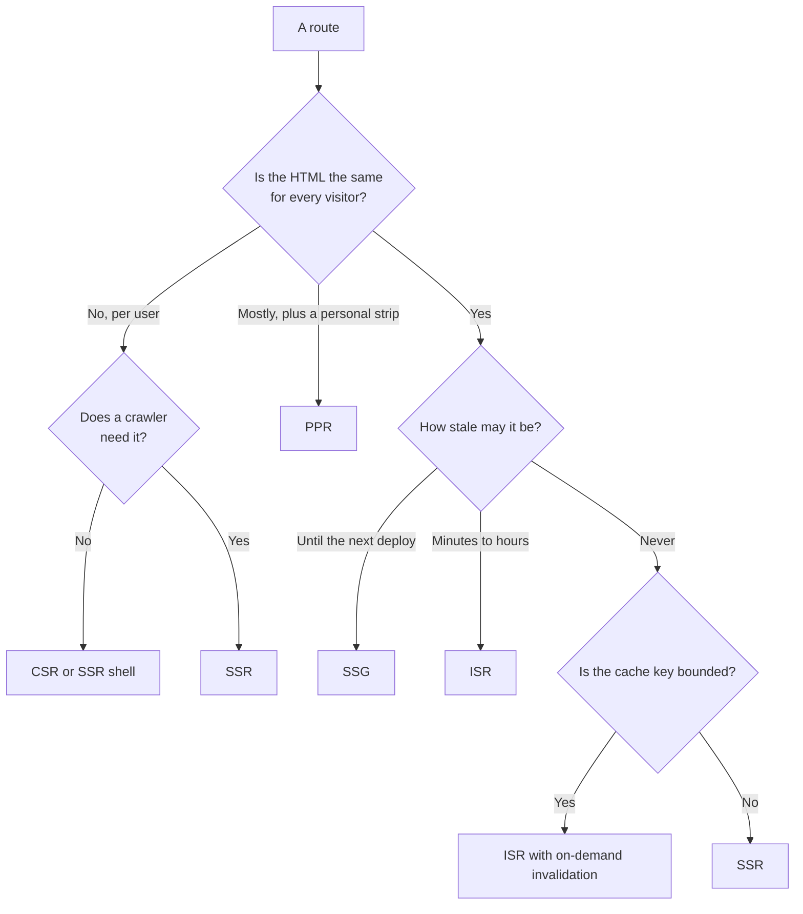

# প্রতিটি Route-এর জন্য Rendering Strategy বাছাই, SEO সহ {#ch-choosing-per-route}

> একটি route inventory বানান, প্রতিটি row-কে তার বৈশিষ্ট্য আর crawler দেখে একটি strategy দিন, আর প্রতিটি row-এর পক্ষে যুক্তি দিতে পারুন।

**এই অধ্যায়ে:** চারটি প্রশ্ন · একটি crawler আসলে কী পড়ে · route inventory · status code, metadata আর canonical · একটি route-কে ভুল strategy দেওয়া হয়েছে কি না, কীভাবে বুঝবেন

## 💡 মূল ধারণা

"এটা কি server-rendered app, নাকি client-rendered app?" — এই প্রশ্নের একক-টাই ভুল। Application-এর কোনো
rendering strategy থাকে না। **থাকে route-এর।**

একটি enterprise product-এ একটি marketing page আছে, একটি docs site, একটি search page, একটি dashboard আর একটি
checkout। পাঁচটির ঠিক উত্তর পাঁচ রকম। ওপরে একবার বেছে নিলে চারটিই ভুল হবে। আর সাধারণত সেই ভুলের দাম অনেক।
কারণ যে একটি strategy সব route-এ খাটে, সেটাই সবচেয়ে দামি।

Search আর social crawler এই সিদ্ধান্তের একটি input, আলাদা কোনো বিষয় নয়। প্রশ্নটা এই নয় যে "একটি crawler কি
আমার JavaScript চালাতে পারে?" প্রশ্নটা হলো: **এই URL-এর raw HTML-এ কী আছে, আর সেটা কি যথেষ্ট?**

Senior উত্তর হলো একটি **পদ্ধতি**: route-গুলোর list করুন, প্রতিটিকে চারটি প্রশ্ন করুন, উত্তর থেকে strategy পড়ে নিন।

> ⚠️ **যা বদলাতে থাকে:** crawler-এর আচরণ কোনো নোটিশ ছাড়াই বদলায়। 2023-এর পর crawler-এর তালিকা যতটা বদলেছে,
> তার আগের দশ বছরেও ততটা বদলায়নি। কোনো bot কী render করে, সে বিষয়ে যেকোনো দাবি দ্রুত পুরোনো হয়ে যায়।
> যে নীতি টিকে থাকে: প্রথম response-এর HTML নির্ভরযোগ্যভাবে index হয়। বাকি সবকিছু index হয় অন্য কারও
> সময়সূচিতে।

## কীভাবে কাজ করে

### চারটি প্রশ্ন

**চারটি বৈশিষ্ট্য strategy ঠিক করে; মতামতের কোনো জায়গা নেই।**

1. **HTML-টি কার জন্য?** সবার জন্য, একটি segment-এর জন্য, নাকি একজন মানুষের জন্য। Shared HTML cache করা যায়।
   Personal HTML যায় না। আর যায় এমন ভান করলেই cache এক user-এর data আরেক user-এর কাছে leak করে।
2. **এটা কতটা stale হতে পারে?** এটা কত ঘন ঘন বদলায় তা নয়, বরং কতটা দেরি *মেনে নেওয়া যায়*। একটি price আর একটি
   blog post হয়তো একই হারে বদলায়, কিন্তু দেরি মেনে নেওয়ার মাত্রা একেবারে আলাদা।
3. **কোন crawler-এর এটা দরকার?** কিছুই যদি এটাকে index বা preview না করে, তাহলে server rendering শুধু first paint
   এনে দেয়। দামটা সেভাবেই হিসাব করুন।
4. **Cache key কি সীমিত?** Slug দিয়ে key করা একটি route-এর হাজার হাজার variant থাকে। একটি free-text search-এর
   variant অসীম। তাই তার hit rate প্রায় শূন্য, আর সেখানে caching নিছক লোক-দেখানো।

### একটি crawler আসলে কী পড়ে

বড় search engine-গুলো JavaScript চালায় ঠিকই, কিন্তু একটি **দ্বিতীয় ধাপে**। তারা HTML fetch করে, যা দেখতে পায়
তা index করে, আর page-টিকে পরে একটি headless render-এর জন্য queue-তে রাখে। পরে মানে কয়েক মিনিট বা কয়েক দিন,
তাদের নিজেদের সময়সূচিতে।

এর থেকে দুটো জিনিস আসে। যে link শুধু JavaScript চলার পরে থাকে, সেগুলো দেরিতে খুঁজে পাওয়া যায়। তাই একটি
client-rendered category page তার নিচের প্রতিটি product-কে পিছিয়ে দেয়। যে content শুধু JavaScript চলার পরে
থাকে, সেটা দেরিতে index হয়। একটি খবর, একটি চাকরির post বা একটি live price-এর জন্য এটা মারাত্মক।

| ব্যবহারকারী | JavaScript চালায়? | Raw HTML-এ তার কী দরকার |
| -------- | ---------------- | ----------------------------- |
| বড় search engine | হ্যাঁ, দ্বিতীয় ধাপে | সময়মতো index-এর জন্য content আর link |
| ছোট search engine | সাধারণত না | সবকিছু |
| Social আর chat preview scraper | না | `<head>`-এ title, description আর image tag |
| AI answer-engine crawler | সাধারণত না | Article-এর body, text হিসেবে |

যে page-এর `<head>` JavaScript দিয়ে set হয়, সেটা প্রতিটি chat app-এ একটি ফাঁকা preview card পায়। কারণ scraper
কখনো script-টি চালায় না। যে docs শুধু hydration-এর পরে দেখা দেয়, সেগুলো answer engine-এ থাকে না।

| Strategy | প্রথম response-এ | Index হওয়া route-এর জন্য রায় |
| -------- | --------------------- | -------------------------- |
| **SSG** | সব content আর link | আদর্শ |
| **ISR** | সব content আর link | আদর্শ; প্রশ্ন শুধু staleness নিয়ে |
| **SSR** | সব content আর link | ঠিক আছে, তবে ওপরের দুটোর চেয়ে দামি |
| **PPR** | Shell, তারপর stream হওয়া অংশ | ঠিক আছে, যদি index-যোগ্য text shell-এ থাকে |
| **CSR** | একটি ফাঁকা shell | শুধু সেই route-এর জন্য, যা কিছুই index করবে না |

Index হওয়া content-এর জন্য, যে সবচেয়ে সস্তা strategy text-কে response-এ রাখে, সেটাই জেতে। প্রায় সবসময় সেটা
static বা ISR। **Static build-এ কাজ চলে গেলেও "SEO-র জন্য" SSR বেছে নেওয়াই সবচেয়ে সাধারণ অপচয়।**

### Route inventory

যা তৈরি হয় তা একটি table। এটা একবার বানান, repository-তে রাখুন, আর latency বা hosting bill নড়লে review
করুন।

| Route | Audience | কতটা staleness চলে | Crawler | Cache key | Strategy |
| ----- | -------- | ----------------- | -------- | --------- | -------- |
| `/` | সবাই | Deploy পর্যন্ত | Search, social | একটি | **SSG** |
| `/docs/[slug]` | সবাই | Deploy পর্যন্ত | Search, AI | সীমিত, ~400 | **SSG** |
| `/products/[id]` | সবাই + একটি "recently viewed" strip | 10 মিনিট | Search, social | সীমিত, ~40k | **PPR** |
| `/search?q=` | প্রতিটি query-র জন্য আলাদা | একদম না | ইচ্ছা করে বাদ | অসীম | **SSR**, cache ছাড়া |
| `/dashboard` | প্রতিটি user-এর জন্য আলাদা | একদম না | নেই | প্রতিটি user-এর জন্য | Auth-এর পেছনে **CSR** |
| `/reports/[id]` | প্রতিটি tenant-এর জন্য আলাদা | একদম না | নেই | প্রতিটি tenant-এর জন্য | **SSR** |
| `/status` | সবাই | 30 সেকেন্ড | নেই | একটি | **ISR**, 30 s |

Interviewer-রা দুটো row ধরে টানেন। `/search` একেবারেই cache হয় না। Key অসীম হলে প্রতিটি request miss করে, তাই
cache কোনো লাভ ছাড়াই খরচ বাড়ায়। `/dashboard` *ইচ্ছা করে* client-rendered। কোনো crawler নেই, কোনো shared HTML
নেই। সেখানে SSR প্রতিটি view-এ একটি function call-এর খরচ নেয়, এমন একটি page-এর জন্য যেটা কখনো আবার ব্যবহার
করা যাবে না।

### Body-র বাইরে crawler-এর যা দরকার

**একটি আসল status code।** Crawler body-র আগে status পড়ে। একটি client-rendered app প্রতিটি URL-এর জন্য `200`
return করে, এমনকি সেগুলোর জন্যও যেগুলো এক সেকেন্ড পরে "Page not found" দেখায়। একে বলে **soft 404**। Search
engine একটি প্রায় ফাঁকা page index করে, আর site-এ হাজার হাজার নিম্নমানের URL জমতে থাকে।

> ⚠️ Status ঠিক করতে হবে **প্রথম byte flush হওয়ার আগে**, যেমনটা
> [Chapter ?? — Streaming HTML](#ch-streaming-html) ব্যাখ্যা করে। একটি stream হওয়া অংশের ভেতরে `notFound()`
> call আগেই পাঠানো status বদলাতে পারে না।

**Flush-এর আগে metadata।** `<head>` থাকে প্রথম chunk-এ। যে title বা preview image data-র ওপর নির্ভর করে, সেটা
shell বেরিয়ে যাওয়ার আগেই resolve হতে হবে। Framework-গুলো metadata function-কে আলাদাভাবে await করে, তাই এটা
শুধু head-কে আটকায়। **Metadata query ছোট রাখুন, আর page query থেকে আলাদা রাখুন।** যে title-এর জন্য পুরো
product aggregate লাগে, সেটা একটি streaming route-কে আবার buffered route বানিয়ে ফেলে।

**একটি canonical URL।** শেষের slash, locale prefix, tracking parameter আর experiment path — সবই variant তৈরি
করে। এর প্রতিটি যদি `200` return করে, তাহলে আলাদাভাবে index হতে পারে, আর ranking signal ভাগ হয়ে যায়।
Canonical link server-rendered head-এ set করুন, route-এর নিজের definition থেকে। Client-এ
`window.location` থেকে set করলে কাজ হয় না, কারণ যে crawler-টি গুরুত্বপূর্ণ ছিল, সে এটা কখনো পড়েনি।

### মেশানোর আসল খরচ

প্রতিটি route-এর জন্য আলাদা strategy বিনামূল্যে আসে না। আসে বলে ভান করাই এই উত্তরের দুর্বল সংস্করণ।

- **এক codebase-এ data fetch-এর দুই রকম গড়ন।** Static route build-এর সময় fetch করে। Dynamic route প্রতিটি
  request-এ fetch করে। Shared component-কে দুটোতেই চলতে হয়, তাই data সাধারণত props হিসেবে আসে, hook থেকে নয়।
- **Cache-এর সঠিকতা review-এর একটি বিষয় হয়ে যায়।** যে bug আসলে গুরুত্বপূর্ণ, সেটা হলো একটি personalised value
  একটি cache করা page-এ leak করা। যা কিছু cookie, header বা session পড়ে, সেটাকে dynamic অংশের ভেতরে থাকতে হবে।

কোনোটাই বিকল্পের চেয়ে ভারী নয়। কিন্তু এগুলোর নাম বলা "সব জায়গায় PPR ব্যবহার করুন"-এর চেয়ে ভালো।

### Production থেকে route inventory আবার পড়া

একটি strategy বরাদ্দ একটি অনুমান মাত্র। এই signal-গুলো বলে দেয় যে একটি row ভুল:

| Signal | সম্ভাব্য ভুল বরাদ্দ |
| ------ | --------------------- |
| যে route-কে static বলেছেন, তাতে miss rate বেশি | Key আপনার ধারণার চেয়ে চওড়া: flag, locale বা একটি cookie |
| Rebuild-এর সংখ্যা request-এর সংখ্যার কাছাকাছি | Revalidation window traffic-এর চেয়ে ছোট; on-demand-এ যান |
| এমন route-এ SSR, যেখানে crawler নেই, shared HTML-ও নেই | তার বদলে CSR-এর দাম দিন |
| ফাঁকা preview card, বা search-এ page নেই | Content বা head tag শুধু JavaScript চলার পরে থাকে |
| কম traffic-এর route-এ stale নিয়ে অভিযোগ | সময়-ভিত্তিক revalidation কখনো চালু হয় না; write-এর সময় invalidation দরকার |

> ⚠️ Stale-while-revalidate rebuild করে *পরের request-এ*। দিনে দুবার visit হওয়া একটি page, 60-সেকেন্ডের window
> সহ, সবসময় কয়েক ঘণ্টা stale থাকে। কম traffic-এ দরকার write-এর সময় invalidation, ছোট timer নয়।

## কখন ব্যবহার করবেন

| আপনি যদি… | তাহলে এটা করুন |
| -------- | ------- |
| একটি নতুন application শুরু করেন | প্রথম route-এর আগেই inventory লিখুন। বিশ মিনিট লাগে |
| পুরোপুরি server-rendered একটি app হাতে পান | Inventory বানান, তারপর traffic অনুযায়ী ওপরের তিনটি route বদলান |
| System design round-এ এটা জিজ্ঞেস করা হয় | Table-টি আঁকুন। এটাই উত্তর, আর এটা whiteboard-এ এঁটে যায় |
| Traffic-এর চেয়ে দ্রুত বাড়া hosting bill-এর মুখোমুখি হন | প্রতিটি request-এ চলা এমন route খুঁজুন, যেগুলো cache করা যেত |
| শোনেন "SEO-র জন্য আমাদের SSR লাগবে" | জিজ্ঞেস করুন কোন route index হয়, তারপর দেখুন একটি static build সেগুলো সামলায় কি না |

## সাধারণ ভুল

**❌ "Data কত ঘন ঘন বদলায়" দেখে বাছাই করা।**
✅ Business কতটা দেরি মেনে নেয়, তা দেখে বাছাই করুন। একটি stock level-এর জন্য হয়তো দশ সেকেন্ডের দেরি চলে। বছরে
একবার বদলানো একটি regulatory notice-এর জন্য হয়তো একটুও চলে না।

**❌ যে route-কে static ঘোষণা করেছেন, তার ভেতরে একটি cookie পড়া।**
✅ প্রতিটি framework-এ, প্রতিটি request-এর একটি input ছুঁলেই route dynamic হয়ে যায়, সাধারণত কোনো warning ছাড়াই।
Label-কে বিশ্বাস না করে boundary-টি audit করুন।

**❌ এমন page cache করা, যার key-তে search query আছে।**
✅ তার বদলে *data* cache করুন। Query-টিই দামি অংশ। একটি স্বল্পমেয়াদি shared data cache সেটা করে, যা একটি page
cache পারে না।

**❌ Title আর preview tag একটি client effect থেকে set করা।**
✅ Scraper এগুলো কখনো দেখে না। Metadata server-rendered head-এ রাখুন, flush-এর আগে resolve করে।

**❌ Index-যোগ্য body text একটি stream হওয়া dynamic hole-এর ভেতরে রাখা।**
✅ Crawler পড়া থামানোর পরে সেটা আসতে পারে। Article-টি shell-এ রাখুন, আর recommendation-গুলো stream করুন।

## 🔑 মূল শিক্ষা

- Rendering strategy একটি route-এর বৈশিষ্ট্য, application-এর নয়।
- চারটি প্রশ্ন এটা ঠিক করে: audience, কতটা staleness চলে, কোন crawler এটা পড়ে, আর cache key সীমিত কি না।
- Search engine নিজেদের queue-তে JavaScript render করে, কিন্তু social scraper আর AI crawler সাধারণত একেবারেই render করে না।
- Index হওয়া route-এর জন্য, যে সবচেয়ে সস্তা strategy text, status আর metadata প্রথম response-এ রাখে, সেটাই জেতে — সাধারণত static বা ISR।
- Cache key অসীম হলে caching কোনো সাহায্য করতে পারে না। আর কম traffic-এর route-এ দরকার write-এর সময় invalidation, ছোট timer নয়।

## Interview-এর প্রশ্ন

**Q: একটি e-commerce site-এর জন্য আপনি কীভাবে rendering strategy বাছবেন, ধাপে ধাপে বলুন।**

আগে route-গুলোর inventory বানান। Home আর category page shared, আর কয়েক মিনিটের দেরি সয়, তাই ISR। Product page
shared, সঙ্গে একটি personal strip, তাই একটি dynamic hole সহ static shell। Search free text দিয়ে key করা, তাই SSR,
cache ছাড়া। Cart আর account প্রতিটি user-এর জন্য আলাদা, আর index হয় না, তাই authentication-এর পেছনে CSR। তারপর
প্রতিটি row-এর পক্ষে audience, staleness, crawler আর cache key দিয়ে যুক্তি দিন।

**Q: Client-side rendering কি SEO-র জন্য খারাপ?**

Index হওয়া content-এর জন্য হ্যাঁ, কিন্তু crawler JavaScript চালাতে পারে না বলে নয়। Search engine পারে, একটি
পিছিয়ে দেওয়া দ্বিতীয় ধাপে, তাই content আর link দেরিতে খুঁজে পাওয়া যায়। Social scraper আর AI crawler এটা কখনো
চালায় না। যে route কিছুই index করে না, সেখানে client rendering-এর কোনো SEO খরচ নেই।

**Q: 2027-এ আপনি কখন ইচ্ছা করে client-side rendering বেছে নেবেন?**

এমন একটি authenticated surface-এর জন্য, যেখানে crawler নেই আর shared HTML নেই: একটি dashboard, একটি admin tool,
একটি editor। সেখানে SSR এমন একটি page দেয়, যেটা কখনো cache করা যায় না। এটা প্রতিটি view-এ একটি function call-এর
খরচ নেয়, আর একই bundle পাঠায়। ব্যতিক্রম হলো, যখন ধীর device-এ first paint এতটাই গুরুত্বপূর্ণ যে একটি server
shell-এর দাম দেওয়া যায়।

**Q: একটি product page rank করে, কিন্তু তার social preview card ফাঁকা। সমস্যা কোথায়?**

Preview tag-গুলো client-এ set হচ্ছে। Scraper URL-টি একবার fetch করে, আর script না চালিয়ে raw HTML পড়ে, তাই
tag-গুলো সে কখনো দেখে না। এগুলো server-rendered head-এ সরিয়ে নিন। Ranking ঠিক আছে, কারণ search crawler তার
দ্বিতীয় ধাপ সেরে নিয়েছে।

**Q: একটি page static ঘোষণা করা, কিন্তু platform বলছে এটা প্রতিটি request-এ dynamic। কোথায় খুঁজবেন?**

Render-এর কোনো কিছু প্রতিটি request-এর একটি input পড়ছে: একটি cookie, একটি header, একটি search parameter, বা বর্তমান
সময়। বেশিরভাগ framework এর একটি ছুঁলেই route-কে static rendering থেকে বের করে দেয়, এমনকি কয়েক level নিচের একটি
shared component থেকে ছুঁলেও। Route যে পুরো component tree টেনে আনে, সেটা খুঁজুন, শুধু route file নয়।

**Q: একটি streaming route-এর metadata একটি ধীর query-র ওপর নির্ভর করে। কী করবেন?**

Query-টি ভাগ করুন। Metadata function-এ শুধু head-এর যা দরকার, তা fetch করুন, যেমন title, description আর image।
Body-কে stream হতে দিন। Head যদি পুরো aggregate-এর জন্য await করে, তাহলে পুরো response buffer হয়। একটি title
tag-এর জন্য আপনি streaming হারান।

## এরপর কী পড়বেন

- [Chapter ?? — Rendering Spectrum ও Hydration-এর খরচ](#ch-rendering-spectrum) — এই অধ্যায় যে definition-গুলো বরাদ্দ করে
- [Chapter ?? — Edge বনাম Origin Rendering](#ch-edge-vs-origin-rendering) — strategy বাছাইয়ের পরে, সিদ্ধান্তের দ্বিতীয় অর্ধেক
