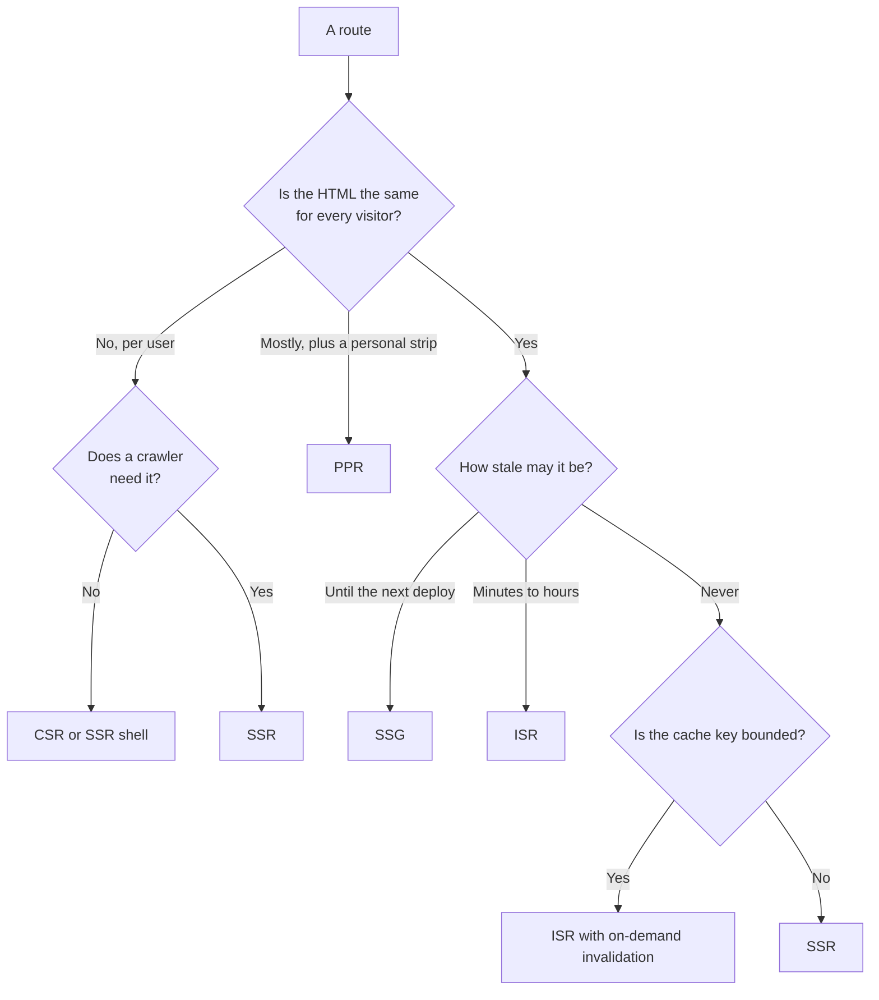

# প্রতিটি Route-এর জন্য Rendering Strategy বাছাই, SEO সহ {#ch-choosing-per-route}

> Route-গুলোর একটি তালিকা বানান। প্রতিটি সারির strategy ঠিক করুন তার বৈশিষ্ট্য আর crawler দেখে, তারপর প্রতিটি সারির পক্ষে যুক্তি দিন।

**এই অধ্যায়ে:** চারটি প্রশ্ন · crawler আসলে কী পড়ে · route inventory · status code, metadata আর canonical · কীভাবে বুঝবেন কোনো route-এ ভুল strategy বসেছে

## 💡 মূল ধারণা

"এটা server-rendered app, নাকি client-rendered app?" প্রশ্নটাই ভুল জায়গায় দাঁড়িয়ে। Application-এর কোনো
rendering strategy থাকে না। **থাকে route-এর।**

একটি enterprise product-এ থাকতে পারে marketing page, docs site, search page, dashboard আর checkout। পাঁচটির
জন্য ঠিক উত্তর পাঁচ রকম। ওপরে বসে একবারে একটি strategy বেছে নিলে চারটিতেই ভুল হবে। আর ভুলটা সাধারণত দামি,
কারণ যে একটি strategy সব route-এ খাটে, সেটাই সবচেয়ে খরুচে।

Search আর social crawler এই সিদ্ধান্তের একটি input, আলাদা কোনো বিষয় নয়। প্রশ্নটা "crawler কি আমার
JavaScript চালাতে পারে?" নয়। আসল প্রশ্ন: **এই URL-এর raw HTML-এ কী আছে, আর সেটুকু কি যথেষ্ট?**

Senior-দের উত্তর একটি **পদ্ধতি**: route-গুলোর তালিকা করুন, প্রতিটিকে চারটি প্রশ্ন করুন, উত্তর থেকেই strategy
বেরিয়ে আসবে।

> ⚠️ **যা বদলাতে থাকে:** crawler-এর আচরণ কোনো ঘোষণা ছাড়াই বদলায়। 2023-এর পর থেকে crawler-এর তালিকা যতটা
> বদলেছে, আগের পুরো দশকেও ততটা বদলায়নি। কোনো bot কী render করে, সে বিষয়ে যেকোনো দাবি দ্রুত পুরনো হয়ে যায়।
> টেকসই নীতি হলো: প্রথম response-এর HTML নির্ভরযোগ্যভাবে index হয়। বাকি সব index হয় অন্য কারও সময়সূচি মেনে।

## কীভাবে কাজ করে

### চারটি প্রশ্ন

**Strategy ঠিক করে চারটি বৈশিষ্ট্য। মতামতের এখানে কোনো জায়গা নেই।**

1. **HTML-টা কার জন্য?** সবার জন্য, একটি অংশের জন্য, নাকি একজনের জন্য। Shared HTML cache করা যায়।
   ব্যক্তিগত HTML করা যায় না, আর জোর করে করতে গেলেই এক user-এর data আরেকজনের কাছে cache থেকে ফাঁস হয়।
2. **কতটা পুরনো হলে চলে?** কত ঘন ঘন বদলায় সেটা নয়, কতটা দেরি *মেনে নেওয়া যায়* সেটা। Price আর blog post একই
   হারে বদলাতে পারে, কিন্তু দেরি সহ্য করার ক্ষমতা দুটির একেবারে আলাদা।
3. **কোন crawler-এর এটা দরকার?** কেউ index বা preview না করলে server rendering-এ লাভ শুধু first paint।
   খরচও সেভাবেই হিসাব করুন।
4. **Cache key কি সীমিত?** Slug দিয়ে চেনা route-এর variant হাজার হাজার। Free-text search-এর variant অসীম,
   তাই hit rate প্রায় শূন্য, আর সেখানে caching শুধু লোক দেখানো।

### Crawler আসলে কী পড়ে

বড় search engine-গুলো JavaScript চালায় ঠিকই, কিন্তু **দ্বিতীয় দফায়**। আগে HTML আনে, যা দেখতে পায় তা index
করে, আর page-টা পরে headless render-এর জন্য queue-তে রেখে দেয়। "পরে" মানে কয়েক মিনিট থেকে কয়েক দিন, তাদের
সময়সূচি অনুযায়ী।

এর দুটি ফল আছে। যে link শুধু JavaScript চলার পরে তৈরি হয়, সেটা দেরিতে খুঁজে পাওয়া যায়। ফলে client-rendered
category page তার নিচের প্রতিটি product-কে পিছিয়ে দেয়। আর যে content শুধু JavaScript চলার পরে আসে, সেটা
index হয় দেরিতে। News, job post বা live price-এর জন্য এটা মারাত্মক।

| কে পড়ে | JavaScript চালায়? | Raw HTML-এ কী লাগে |
| ------ | ----------------- | ------------------ |
| বড় search engine | হ্যাঁ, দ্বিতীয় দফায় | সময়মতো index-এর জন্য content আর link |
| ছোট search engine | সাধারণত না | সবকিছু |
| Social আর chat-এর preview scraper | না | `<head>`-এ title, description আর image tag |
| AI answer-engine crawler | সাধারণত না | Article-এর body, text হিসেবে |

যে page-এর `<head>` JavaScript দিয়ে বসানো, প্রতিটি chat app-এ তার preview card ফাঁকা আসে, কারণ scraper কখনো
script চালায় না। যে docs শুধু hydration-এর পরে দেখা যায়, answer engine-এ সেগুলো থাকেই না।

| Strategy | প্রথম response-এ কী থাকে | Index হওয়া route-এর জন্য রায় |
| -------- | ----------------------- | ---------------------------- |
| **SSG** | সব content আর link | আদর্শ |
| **ISR** | সব content আর link | আদর্শ; প্রশ্ন শুধু কতটা পুরনো হবে |
| **SSR** | সব content আর link | চলে, তবে ওপরের দুটির চেয়ে খরচ বেশি |
| **PPR** | Shell, তারপর stream হওয়া region | চলে, যদি index হওয়ার মতো text shell-এ থাকে |
| **CSR** | ফাঁকা shell | শুধু সেই route-এর জন্য, যা কেউ index করবে না |

Index হওয়া content-এর জন্য জেতে সেই strategy, যেটা সবচেয়ে কম খরচে text-টা response-এ রাখে। প্রায় সবসময়ই
সেটা static বা ISR। **Static build-এ কাজ চলে যেত, অথচ "SEO-র জন্য" SSR বেছে নেওয়া, এটাই সবচেয়ে বেশি দেখা
অপচয়।**

### Route inventory

যে জিনিসটা বানাবেন, সেটা একটি table। একবার বানান, repository-তে রাখুন, আর latency বা hosting-এর bill বদলালে
আবার দেখুন।

| Route | কার জন্য | কতটা পুরনো চলে | Crawler | Cache key | Strategy |
| ----- | -------- | -------------- | ------- | --------- | -------- |
| `/` | সবার | পরের deploy পর্যন্ত | Search, social | একটি | **SSG** |
| `/docs/[slug]` | সবার | পরের deploy পর্যন্ত | Search, AI | সীমিত, ~400 | **SSG** |
| `/products/[id]` | সবার, সঙ্গে "recently viewed" strip | 10 মিনিট | Search, social | সীমিত, ~40k | **PPR** |
| `/search?q=` | প্রতিটি query-র আলাদা | একটুও না | ইচ্ছে করেই বাদ | অসীম | **SSR**, cache ছাড়া |
| `/dashboard` | প্রতিটি user-এর আলাদা | একটুও না | নেই | প্রতিটি user-এর আলাদা | Auth-এর পেছনে **CSR** |
| `/reports/[id]` | প্রতিটি tenant-এর আলাদা | একটুও না | নেই | প্রতিটি tenant-এর আলাদা | **SSR** |
| `/status` | সবার | 30 সেকেন্ড | নেই | একটি | **ISR**, 30 s |

Interviewer-রা দুটি সারি নিয়ে টানাটানি করেন। `/search` একেবারেই cache হয় না। Key অসীম হলে প্রতিটি request
miss করে, তাই cache শুধু খরচ বাড়ায়, লাভ কিছু দেয় না। `/dashboard` *ইচ্ছে করেই* client-rendered। Crawler নেই,
shared HTML-ও নেই। সেখানে SSR মানে প্রতিটি view-এ একটি function call, এমন page-এর জন্য যা কখনো আবার ব্যবহার
করা যাবে না।

### Body ছাড়াও crawler-এর যা লাগে

**আসল status code।** Crawler body-র আগে status পড়ে। Client-rendered app প্রতিটি URL-এ `200` দেয়, এমনকি যেগুলো
এক সেকেন্ড পরে "Page not found" দেখায় সেগুলোতেও। একে বলে **soft 404**। Search engine প্রায় ফাঁকা page index
করে, আর site-এ হাজার হাজার নিম্নমানের URL জমতে থাকে।

> ⚠️ Status ঠিক করতে হবে **প্রথম byte flush হওয়ার আগেই**, যেমনটা
> [Chapter ?? — Streaming HTML](#ch-streaming-html)-এ বলা আছে। Streamed region-এর ভেতরে `notFound()` call করলে
> আগেই পাঠানো status আর বদলায় না।

**Flush-এর আগে metadata।** `<head>` থাকে প্রথম chunk-এ। Title বা preview image যদি data-র ওপর নির্ভর করে, shell
বেরোনোর আগেই সেটা resolve হতে হবে। Framework-গুলো metadata function আলাদাভাবে await করে, তাই সেটা শুধু head-টাই
আটকায়। **Metadata query ছোট রাখুন, আর page query থেকে আলাদা রাখুন।** Title-এর জন্য যদি পুরো product aggregate
লাগে, streaming route আবার buffered হয়ে যায়।

**Canonical URL।** শেষের slash, locale prefix, tracking parameter আর experiment path, সবই আলাদা আলাদা variant
তৈরি করে। এদের যেটাই `200` দেয়, সেটা আলাদাভাবে index হতে পারে, আর ranking signal ভাগ হয়ে যায়। Canonical link
বসান server-rendered head-এ, route-এর নিজের definition থেকে। Client-এ `window.location` থেকে বসালে কাজ হয় না,
কারণ যে crawler-এর জন্য এত কিছু, ওটা তার চোখেই পড়ে না।

### মিশিয়ে ব্যবহারের আসল খরচ

Route অনুযায়ী আলাদা strategy বিনা খরচে আসে না। খরচ নেই বলে ভান করাটাই এই উত্তরের দুর্বল সংস্করণ।

- **একই codebase-এ data আনার দুই রকম ধরন।** Static route data আনে build-এর সময়। Dynamic route আনে প্রতিটি
  request-এ। Shared component-কে দুই জায়গাতেই চলতে হয়, তাই data সাধারণত আসে props হিসেবে, hook থেকে নয়।
- **Cache ঠিক আছে কি না, সেটা review-এর অংশ হয়ে যায়।** যে bug সত্যিই ক্ষতি করে, সেটা হলো ব্যক্তিগত কোনো value
  cache করা page-এ ঢুকে পড়া। Cookie, header বা session পড়ে এমন সবকিছু dynamic region-এর ভেতরে রাখতে হবে।

কোনোটাই বিকল্পের চেয়ে ভারী নয়। তবু এগুলো নাম ধরে বলতে পারা "সব জায়গায় PPR দিলেই হয়"-এর চেয়ে অনেক ভালো।

### Production থেকে route inventory মিলিয়ে দেখা

কোন route-এ কোন strategy, সেটা আসলে একটি অনুমান। এই signal-গুলো বলে দেয় কোনো সারি ভুল:

| Signal | সম্ভাব্য ভুল |
| ------ | ----------- |
| যে route-কে static বলেছিলেন, তাতে miss rate বেশি | Key যতটা ভেবেছিলেন তার চেয়ে চওড়া: flag, locale বা একটি cookie |
| Rebuild-এর সংখ্যা প্রায় request-এর সমান | Revalidation window traffic-এর চেয়ে ছোট; on-demand-এ যান |
| Crawler নেই, shared HTML নেই, তবু SSR | তার বদলে CSR নিন |
| Preview card ফাঁকা, বা search-এ page নেই | Content বা head tag শুধু JavaScript চলার পরে আসে |
| কম traffic-এর route-এ পুরনো data নিয়ে অভিযোগ | সময়ভিত্তিক revalidation কখনো চলেই না; write-এর সময় invalidation দরকার |

> ⚠️ Stale-while-revalidate rebuild করে *পরের request-এ*। দিনে দুবার visit হওয়া page-এ 60 সেকেন্ডের window
> দিলে page সবসময় কয়েক ঘণ্টা পুরনো থাকে। কম traffic-এ দরকার write-এর সময় invalidation, ছোট timer নয়।

## কখন ব্যবহার করবেন

| আপনার অবস্থা… | যা করবেন |
| ------------- | -------- |
| নতুন application শুরু করছেন | প্রথম route-এর আগেই inventory লিখুন। কুড়ি মিনিট লাগে |
| পুরোপুরি server-rendered একটি app হাতে পেয়েছেন | Inventory করুন, তারপর traffic অনুযায়ী ওপরের তিনটি route বদলান |
| System design round-এ এই প্রশ্ন এসেছে | Table-টা আঁকুন। ওটাই উত্তর, আর whiteboard-এ ধরে যায় |
| Hosting-এর bill traffic-এর চেয়ে দ্রুত বাড়ছে | প্রতি request-এ চলা যে route-গুলো cache করা যেত, সেগুলো খুঁজুন |
| শুনছেন "SEO-র জন্য আমাদের SSR লাগবে" | জিজ্ঞেস করুন কোন route-গুলো index হয়, তারপর দেখুন static build-এ সেগুলো চলে কি না |

## সাধারণ ভুল

**❌ "Data কত ঘন ঘন বদলায়" দেখে বাছাই করা।**
✅ বাছাই করুন business কতটা দেরি মেনে নেয় তা দেখে। Stock level-এ হয়তো দশ সেকেন্ডের দেরি চলে। আর বছরে একবার
বদলানো regulatory notice-এ হয়তো একটুও দেরি চলে না।

**❌ যে route-কে static বলেছেন, তার ভেতরে cookie পড়া।**
✅ সব framework-এই প্রতি request-এর কোনো input ছুঁলেই route dynamic হয়ে যায়, সাধারণত কোনো warning ছাড়াই।
Label-এর ওপর ভরসা না করে boundary-টা যাচাই করুন।

**❌ এমন page cache করা, যার key-তে search query আছে।**
✅ তার বদলে *data* cache করুন। খরচের অংশটা query-ই, আর অল্প সময়ের shared data cache সেটাই করে, যা page cache
পারে না।

**❌ Client effect থেকে title আর preview tag বসানো।**
✅ Scraper এগুলো কখনো দেখে না। Metadata রাখুন server-rendered head-এ, flush-এর আগেই resolve করে।

**❌ Index হওয়ার মতো body text stream হওয়া dynamic hole-এর ভেতরে রাখা।**
✅ Crawler পড়া থামানোর পরে সেটা পৌঁছাতে পারে। Article রাখুন shell-এ, আর recommendation-গুলো stream করুন।

## 🔑 মূল শিক্ষা

- Rendering strategy route-এর বৈশিষ্ট্য, application-এর নয়।
- চারটি প্রশ্ন এটা ঠিক করে: কার জন্য, কতটা পুরনো চলে, কোন crawler পড়ে, আর cache key সীমিত কি না।
- Search engine JavaScript render করে নিজেদের queue মেনে। Social scraper আর AI crawler সাধারণত render-ই করে না।
- Index হওয়া route-এ জেতে সেই strategy, যেটা সবচেয়ে কম খরচে text, status আর metadata প্রথম response-এ রাখে। সাধারণত সেটা static বা ISR।
- Cache key অসীম হলে caching কোনো কাজে আসে না। আর কম traffic-এর route-এ দরকার write-এর সময় invalidation, ছোট timer নয়।

## Interview-এর প্রশ্ন

**Q: একটি e-commerce site-এর জন্য rendering strategy কীভাবে বাছবেন, ধাপে ধাপে বলুন।**

আগে route-গুলোর তালিকা করুন। Home আর category page সবার জন্য একই, আর কয়েক মিনিটের দেরি চলে, তাই ISR।
Product page সবার জন্য একই, সঙ্গে একটি ব্যক্তিগত strip, তাই static shell আর তার ভেতরে একটি dynamic hole।
Search-এর key free text, তাই SSR, cache ছাড়া। Cart আর account প্রতিটি user-এর আলাদা, index-ও হয় না, তাই
authentication-এর পেছনে CSR। তারপর প্রতিটি সারির পক্ষে যুক্তি দিন: কার জন্য, কতটা পুরনো চলে, কোন crawler,
আর cache key।

**Q: Client-side rendering কি SEO-র জন্য খারাপ?**

Index হওয়া content-এর জন্য হ্যাঁ, তবে crawler JavaScript চালাতে পারে না বলে নয়। Search engine পারে, কিন্তু
পিছিয়ে রাখা দ্বিতীয় দফায়, তাই content আর link দেরিতে খুঁজে পায়। Social scraper আর AI crawler কখনোই চালায়
না। আর যে route কেউ index করে না, সেখানে client rendering-এ SEO-র কোনো খরচই নেই।

**Q: 2027-এ কখন জেনে-বুঝে client-side rendering বেছে নেবেন?**

Authentication-এর পেছনের এমন জায়গায়, যেখানে crawler নেই আর shared HTML-ও নেই: dashboard, admin tool, editor।
সেখানে SSR দিলে এমন page পাবেন, যা কখনো cache হবে না। প্রতিটি view-এ একটি function call-এর খরচ, আর bundle-ও
একই যায়। ব্যতিক্রম শুধু তখন, যখন ধীর device-এ first paint এতটাই জরুরি যে server shell-এর খরচ দেওয়া চলে।

**Q: একটি product page rank করছে, কিন্তু তার social preview card ফাঁকা। সমস্যা কোথায়?**

Preview tag-গুলো বসানো হচ্ছে client-এ। Scraper URL-টা একবার আনে আর script না চালিয়েই raw HTML পড়ে, তাই tag-গুলো
কখনো দেখে না। এগুলো server-rendered head-এ সরিয়ে দিন। Ranking ঠিক আছে, কারণ search crawler তার দ্বিতীয় দফা
সেরে ফেলেছে।

**Q: একটি page static বলে declare করা, অথচ platform বলছে প্রতিটি request-এ এটা dynamic। কোথায় খুঁজবেন?**

Render-এর ভেতরে কিছু একটা প্রতি request-এর input পড়ছে: cookie, header, search parameter, বা বর্তমান সময়।
বেশিরভাগ framework এর একটি ছুঁলেই route-কে static rendering থেকে বের করে দেয়, কয়েক স্তর নিচের shared
component থেকে ছুঁলেও। শুধু route file নয়, route যে পুরো component tree টেনে আনে, সেটা খুঁজে দেখুন।

**Q: Streaming route-এর metadata একটি ধীর query-র ওপর নির্ভর করে। কী করবেন?**

Query-টা ভাগ করুন। Metadata function-এ শুধু head-এর যা লাগে, যেমন title, description আর image, সেটুকুই আনুন।
Body-কে stream হতে দিন। Head যদি পুরো aggregate-এর জন্য await করে, পুরো response buffer হয়ে যায়। একটি title
tag-এর জন্য streaming হারান।

## এরপর কী পড়বেন

- [Chapter ?? — Rendering Spectrum ও Hydration-এর খরচ](#ch-rendering-spectrum) — এই অধ্যায় যে strategy-গুলো বসায়, তাদের সংজ্ঞা
- [Chapter ?? — Edge বনাম Origin Rendering](#ch-edge-vs-origin-rendering) — strategy ঠিক হওয়ার পরে সিদ্ধান্তের বাকি অর্ধেক
