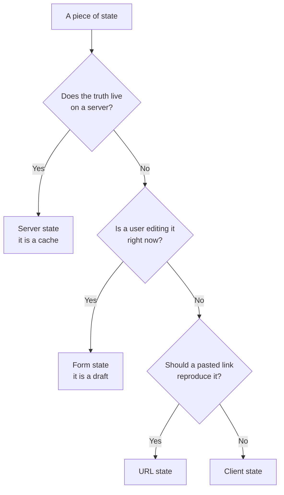

# চার ধরনের State {#ch-four-kinds-of-state}

> কোনো tool বাছার আগে যেকোনো state-কে আগে চিহ্নিত করুন: server, client, form নাকি URL।

**এই অধ্যায়ে:** library-র প্রশ্নটা কেন ভুল প্রশ্ন · চারটি ধরন · কোন পরীক্ষায় এদের আলাদা করা যায় · ভুল করলে কী হয় · সিদ্ধান্তের table

## 💡 মূল ধারণা

"কোন state library ব্যবহার করব?" প্রশ্নটা ধরে নেয় state একই রকম। আসলে state চার রকম, আর এদের মধ্যে মিল প্রায় নেই
বললেই চলে।

**Server state** অন্য কোথাও থাকা data-র একটি copy। এটা পুরনো হতে পারে, load হতে ব্যর্থ হতে পারে, আর আপনি কিছু না
করলেও বদলে যেতে পারে।

**Client state** এমন data, যার পুরো মালিক আপনার application। Sidebar খোলা। Theme dark। পৃথিবীর আর কারও এ নিয়ে
কোনো মত নেই।

**Form state** একটি খসড়া। বেশিরভাগ সময়ই এটা invalid থাকে, আর সেটা ইচ্ছে করেই, কারণ user তখনও লিখছেন।

**URL state** এমন state, যার কথা আপনি একটি link-কে দিয়ে রেখেছেন — একটি filter, একটি page number, একটি বাছাই করা
tab। Refresh-এর পরেও, আর chat window-এ paste করার পরেও এটাকে টিকে থাকতে হয়।

পুরনো হওয়া, valid থাকা, share হওয়া আর টিকে থাকা নিয়ে প্রতিটি ধরনের নিয়ম আলাদা। **একটির জন্য বানানো tool বাকিগুলো
খারাপভাবে সামলায়।** এজন্যই "আমরা একটি store-এ standardise করেছি" বললে এমন codebase পাবেন, যা নিজের সঙ্গেই লড়াই করে।

## কীভাবে কাজ করে

### এদের আলাদা করে চেনা



**তিনটি প্রশ্ন, এই ক্রমে করলে প্রায় সবকিছুরই ধরন বেরিয়ে আসে।**

প্রথম প্রশ্নটাই সবচেয়ে গুরুত্বপূর্ণ, আর এর একটি ধারালো রূপ আছে: **browser-এর দুটি tab যদি আলাদা কথা বলে, কোনটা
ভুল?** উত্তর যদি হয় "যেটা পুরনো হয়ে গেছে", তাহলে এর মালিক server। আপনি আসলে একটি cache ধরে আছেন। উত্তর যদি হয়
"কোনোটাই না, দুটি স্বাধীন", তাহলে এটা client state।

### প্রতিটি ধরনের যা লাগে

| | Server state | Client state | Form state | URL state |
| --- | --- | --- | --- | --- |
| **সত্যের উৎস** | API | Application | Input element | Address bar |
| **পুরনো হতে পারে** | সবসময় | কখনো না | প্রযোজ্য নয় | কখনো না |
| **Invalid হতে পারে** | না | না | **হ্যাঁ, ইচ্ছে করেই** | হ্যাঁ — user URL বদলান |
| **Loading আর error state লাগে** | হ্যাঁ | না | Submit-এর সময় | না |
| **Refresh-এর পরে টেকে** | আবার fetch হয় | শুধু persist করলে | না | হ্যাঁ |
| **Tab-এ tab-এ share হয়** | একসময় | না | না | শুধু link share করলে |
| **সাধারণ tool** | TanStack Query | Zustand, Jotai, `useState` | React Hook Form | Search params |

Architecture ঠিক করে দেয় "পুরনো হতে পারে" সারিটা। আপনি নাম দিন বা না দিন, server state একটি cache। Cache-এর লাগে
staleness policy, deduplication, invalidation, retry আর background refresh। Server-এর data general-purpose store-এ
রাখলে এই সবকিছু নিজে হাতে লেখার দায়িত্ব আপনি নিয়ে ফেললেন।

### এই কাঠামো যে ভুল আটকায়

একটি সাধারণ store দিয়ে সমস্যাটা দেখতে এমন:

**❌ Client store-এ server-এর data — যে cache লেখার ইচ্ছে আপনার ছিল না:**

```typescript
interface UserStore {
  users: User[];
  loading: boolean;
  error: string | null;
  fetchUsers: () => Promise<void>;
}
```

চারটি field, আর প্রতিটি একেকটি সিদ্ধান্ত, যেটা আপনি খারাপভাবে নিয়ে ফেলেছেন। কোনো staleness policy নেই, তাই code
হয় প্রতিটি mount-এ data আবার আনে, নয়তো কখনোই আনে না। Request deduplication নেই, তাই একসঙ্গে mount হওয়া তিনটি
component তিনটি request পাঠায়। Invalidation নেই, তাই অন্য কোথাও mutation হলে এটা পুরনো থেকে যায়। Retry নেই,
cancellation-ও নেই।

**✅ একই জিনিস, তার আসল পরিচয়ে — একটি cache:**

```typescript
const { data: users, isPending, error } = useQuery({
  queryKey: ['users'],
  queryFn: fetchUsers,
  staleTime: 30_000, // an explicit, reviewable staleness policy
});
```

কথাটা library নিয়ে নয়। কথা হলো, ধরনটার নাম দেওয়াতেই হারিয়ে যাওয়া policy-গুলো চোখে পড়ল।

### প্রতিটি কোথায় ভুল হয়

| ধরন | ভুল জায়গায় রাখলে | কী ভাঙে |
| --- | ---------------- | ------ |
| Server state → global store | নিজে হাতে বানানো cache | পুরনো data পড়া, একই request বারবার, invalidation নেই |
| Client state → server | Menu খুলতে একটি round trip | Latency, আর অকারণে API-র আয়তন বাড়ে |
| Form state → global store | প্রতিটি keystroke-এ পুরো app re-render | Input-এ দেরি, আর undo অসম্ভব হয়ে যায় |
| URL state → component state | এমন dashboard, যার link কেউ দিতে পারে না | Back button ভাঙে, link দিয়ে একই view ফেরে না |
| Server state → URL | পুরো result set query string-এ | URL-এর length-এর সীমা, আর পুরনো link |

চতুর্থ ধরনটা শেখার পরে মানুষ শেষ সারিতে হোঁচট খায়। URL রাখে *input*: filter, sort, page। Result রাখে না।

### Server state-এর এখন দ্বিতীয় একটি ঠিকানা আছে

React 19-এর Server Components আর server-side data loading প্রথম ধরনের হিসাব বদলে দিয়েছে। কোনো route যদি server-এ
fetch করে result render করে, তাহলে কিছু server state কখনো client state-ই হয় না।

এতে ধরনটা মুছে যায় না। মুছে যায় তার একটি অংশের *cache*। যা কিছু আবার fetch হয়, mutate হয়, poll হয় বা optimistic
ভাবে update হয়, তার জন্য এখনও client cache লাগে। সীমারেখাটা কোথায়, তা আছে
[Chapter ?? — TanStack Query দিয়ে Server State](#ch-server-state)-এ।

## কখন ব্যবহার করবেন

| State-টা যদি হয়… | ধরন | কী ব্যবহার করবেন |
| ---------------- | --- | --------------- |
| API থেকে আসা record-এর list | Server | Query cache — [Chapter ?? — TanStack Query দিয়ে Server State](#ch-server-state) |
| Theme, sidebar toggle, wizard-এর ধাপ | Client | আগে `useState`, তারপর store — [Chapter ?? — Client State ও Signal](#ch-client-state) |
| অর্ধেক লেখা form | Form | Form library — [Chapter ?? — Form State](#ch-form-state) |
| Filter, sort, page number, খোলা tab | URL | Search params — [Chapter ?? — State হিসেবে URL](#ch-url-as-state) |
| ওপরের যেকোনোটা থেকে বের করা | কোনোটাই নয় | হিসাব করে নিন। Store করবেন না |

শেষ সারিটা নিয়ে আলাদা করে বলা দরকার। **Derived value state নয়।** ধরুন filter করা list, একটি total, বা "unsaved
change আছে" flag। প্রতিটিই state-এর একটি function, অথচ মানুষ এগুলোকে state হিসেবে রাখে। প্রতিটি copy মানে
একবার করে out of sync হওয়ার সুযোগ।

## সাধারণ ভুল

**❌ আগে library বেছে নেওয়া।**
✅ আগে state-এর ধরন চিনুন, তারপর বাছুন। "আমরা Redux ব্যবহার করি" এমন প্রশ্নের উত্তর, যা কেউ করেনি। "এটা server
state, তাই এর invalidation policy-সহ cache লাগবে", এটাই আসল প্রশ্নের উত্তর।

**❌ চারটি ধরনকে চারটি library ভাবা।**
✅ এগুলো চারটি *সমস্যা*। ছোট application হয়তো client, form আর URL state React আর platform দিয়েই সামলে নেয়। Library
হয়তো লাগে শুধু server state-এর জন্য।

**❌ Edit করার জন্য server-এর data local state-এ copy করা।**
✅ কোনো কিছু query-টা invalidate করলেই সেই copy পুরনো হয়ে যায়। Cache করা value-কেই সত্য হিসেবে রাখুন, local-এ রাখুন
শুধু *edit*-গুলো, তারপর mutate আর invalidate করুন।

**❌ URL state-এর চল আছে বলে সবকিছু URL-এ রাখা।**
✅ Address bar-এ scroll position বা hover state শুধু আবর্জনা, আর এটা browser history নোংরা করে। পরীক্ষা হলো: paste
করা link-এ কি এটা আবার ফিরে আসা উচিত?

**❌ "Performance-এর জন্য" derived value store করা।**
✅ আবার হিসাব করা সস্তা, আর নির্ভুল। Store করা derivation মানে সত্যের দ্বিতীয় একটি উৎস, যাকে ঠিক রাখার কোনো policy নেই।

## 🔑 মূল শিক্ষা

- Server, client, form আর URL state চারটি আলাদা সমস্যা, চার রকম নিয়ম।
- Server state একটি cache। General-purpose store-এ রাখলে আপনি নিজে হাতে একটি খারাপ cache লিখে ফেলেছেন।
- Form state ইচ্ছে করেই invalid থাকে, তাই application state-এ এর জায়গা নয়।
- URL state রাখে একটি view-এর input, result কখনো নয়।
- Derived value state নয় — হিসাব করে নিন।

## Interview-এর প্রশ্ন

**Q: কোনো state কোথায় থাকবে, সেটা কীভাবে ঠিক করেন?**

জিজ্ঞেস করুন, সত্যটা কি server-এ থাকে। থাকলে এটা cache, আর এর লাগবে staleness, deduplication আর invalidation। না
থাকলে জিজ্ঞেস করুন, user কি এটা edit করছেন। তাহলে এটা form state, আর ইচ্ছে করেই invalid। তাও না হলে জিজ্ঞেস করুন,
paste করা link-এ কি এটা আবার ফিরে আসা উচিত। তাহলে এটা URL state। বাকি যা থাকে, সেটা client state, আর তার বেশিরভাগই
একটি component-এর ভেতরে সীমিত।

**Q: API-র data Redux বা Zustand-এ রাখলে আসলে সমস্যা কোথায়?**

Syntax-এ কোনো সমস্যা নেই। সমস্যা হলো এরপর আপনাকে যা বানাতে হবে। Server-এর data-র লাগে staleness policy, request
deduplication, mutation-এর পরে cache invalidation, retry, cancellation আর background refetching। General-purpose store
এর কোনোটাই দেয় না। ফলে এগুলো আপনি নিজে হাতে লেখেন, প্রতিটি slice-এ আলাদা করে, আর সময়ের সঙ্গে সেগুলো একটি আরেকটি
থেকে সরে যায়।

**Q: কোন state URL-এ থাকা উচিত, আর কীভাবে ঠিক করেন?**

User যা share করতে, bookmark করতে বা back button দিয়ে ফিরে পেতে চাইবেন বলে আশা করা যায়, সবই: filter, sort order,
pagination, বাছাই করা tab, table-এর খোলা row। পরীক্ষা হলো, link-টা কোনো message-এ paste করলে যিনি পাঠিয়েছেন তিনি
যা দেখছিলেন, সেটাই কি ফিরে আসা উচিত। Hover, scroll বা খোলা menu-র মতো অল্পক্ষণের জিনিস সেখানে থাকা উচিত নয়।

**Q: Framework যখন server-এ fetch করে, তখনও কি চার ধরনের এই model কাজের?**

হ্যাঁ, তবে প্রথম ধরনটা ছোট হয়ে আসে। Server-এ fetch করে render করা data কখনো client cache-ই হয় না। বাকি থাকে যা কিছু
আবার fetch হয়, poll হয়, mutate হয় বা optimistic ভাবে update হয়। সেগুলোর এখনও পুরো cache policy লাগে, তাই ভাগটা
এখনও কাজ করে।

## এরপর কী পড়বেন

- [Chapter ?? — TanStack Query দিয়ে Server State](#ch-server-state) — চারটি ধরনের মধ্যে সবচেয়ে বড়টি
- [Chapter ?? — State হিসেবে URL](#ch-url-as-state) — যে ধরনটার অস্তিত্বই বেশিরভাগ team ভুলে যায়
- [Chapter ?? — Frontend Architecture Pattern](#ch-frontend-architecture-patterns) — বড় কাঠামোর মধ্যে এই সিদ্ধান্তগুলোর জায়গা
