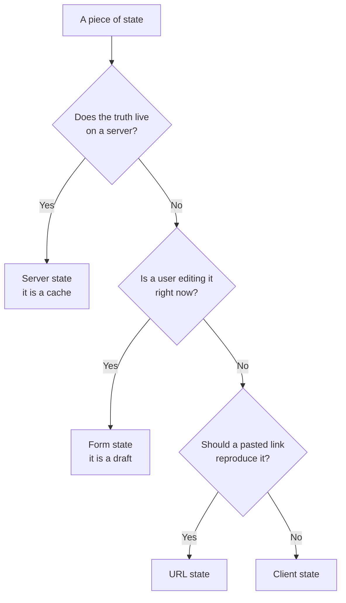

# চার ধরনের State {#ch-four-kinds-of-state}

> কোনো state-এর জন্য tool বেছে নেওয়ার আগে সেটাকে server, client, form নাকি URL state — এই চারটির একটিতে ফেলুন।

**এই অধ্যায়ে:** library-র প্রশ্নটা কেন ভুল প্রশ্ন · চারটি category · যে পরীক্ষা এদের আলাদা করে · ভুল করলে কী হয় · সিদ্ধান্তের table

## 💡 মূল ধারণা

"কোন state library ব্যবহার করব?" — এই প্রশ্ন ধরে নেয় যে state একরকমই। আসলে চার রকম, আর তাদের মধ্যে প্রায়
কোনো মিল নেই।

**Server state** হলো এমন data-র একটি copy, যেটা অন্য কোথাও থাকে। এটা stale হতে পারে, load হতে ব্যর্থ হতে পারে,
আর আপনি কিছু না করলেও বদলে যেতে পারে।

**Client state** হলো এমন data, যার পুরো মালিক আপনার application। Sidebar খোলা। Theme dark। দুনিয়ার আর
কারো এ নিয়ে কোনো মত নেই।

**Form state** একটি খসড়া। বেশিরভাগ সময় এটা invalid থাকে, ইচ্ছা করেই, কারণ user তখনো লিখছেন।

**URL state** হলো এমন state, যেটা আপনি একটি link-কে কথা দিয়েছেন — একটি filter, একটি page number, একটি বাছাই
করা tab। Refresh-এর পরেও এটাকে টিকে থাকতে হবে, chat window-এ paste করার পরেও।

প্রতিটি category-র staleness, validity, sharing আর persistence নিয়ে আলাদা নিয়ম আছে। **একটির জন্য বানানো tool
বাকিগুলোকে খারাপভাবে সামলায়।** এ কারণেই "আমরা একটি store-এ standardise করেছি" এমন একটি codebase দেয়, যেটা নিজের
সঙ্গেই লড়াই করে।

## কীভাবে কাজ করে

### এদের আলাদা করে চেনা



**তিনটি প্রশ্ন, এই ক্রমে, প্রায় সবকিছুকে ভাগ করে ফেলে।**

প্রথম প্রশ্নটাই সবচেয়ে গুরুত্বপূর্ণ, আর এর একটি ধারালো রূপ আছে: **দুটি browser tab যদি একমত না হয়, কোনটা
ভুল?** উত্তর যদি হয় "যেটা পুরোনো হয়ে গেছে", তাহলে মালিক server। আপনি একটি cache ধরে আছেন। উত্তর যদি হয়
"কোনোটাই না, ওরা স্বাধীন", তাহলে এটা client state।

### প্রতিটি category কী চায়

| | Server state | Client state | Form state | URL state |
| --- | --- | --- | --- | --- |
| **Source of truth** | API | Application | Input element-গুলো | Address bar |
| **Stale হতে পারে** | সবসময় | কখনো না | প্রযোজ্য নয় | কখনো না |
| **Invalid হতে পারে** | না | না | **হ্যাঁ, ইচ্ছা করেই** | হ্যাঁ — user-রা URL edit করেন |
| **Loading আর error state লাগে** | হ্যাঁ | না | Submit-এর সময় | না |
| **Refresh-এর পরে টিকে থাকে** | আবার fetch হয় | শুধু persist করলে | না | হ্যাঁ |
| **Tab-গুলোর মধ্যে shared** | একসময় | না | না | শুধু link share করলে |
| **সাধারণ tool** | TanStack Query | Zustand, Jotai, `useState` | React Hook Form | Search params |

যে row architecture ঠিক করে, সেটা হলো "stale হতে পারে"। Server state একটি cache, আপনি একে cache বলুন বা না বলুন।
Cache-এর লাগে staleness policy, deduplication, invalidation, retry আর background refresh। Server data-কে একটি
general-purpose store-এ রাখলে, এই সবকিছু হাতে লেখার দায় আপনি নিয়ে ফেললেন।

### এই দৃষ্টিভঙ্গি যে ভুল ঠেকায়

একটি সাধারণ store দিয়ে সমস্যার চেহারাটা এরকম:

**❌ Client store-এ server data — যে cache আপনি লিখতে চাননি:**

```typescript
interface UserStore {
  users: User[];
  loading: boolean;
  error: string | null;
  fetchUsers: () => Promise<void>;
}
```

চারটি field, আর প্রতিটি এমন একটি সিদ্ধান্ত, যেটা আপনি এখন খারাপভাবে নিয়েছেন। কোনো staleness policy নেই, তাই
code প্রতিটি mount-এ data আবার fetch করে, নয়তো কখনোই করে না। কোনো request deduplication নেই, তাই একসঙ্গে mount
হওয়া তিনটি component তিনটি request পাঠায়। কোনো invalidation নেই, তাই অন্য কোথাও একটি mutation এটাকে stale রেখে
দেয়। কোনো retry নেই, cancellation-ও নেই।

**✅ একই জিনিস, যেটা আসলে যা — একটি cache:**

```typescript
const { data: users, isPending, error } = useQuery({
  queryKey: ['users'],
  queryFn: fetchUsers,
  staleTime: 30_000, // an explicit, reviewable staleness policy
});
```

মূল কথা library নয়। মূল কথা হলো, category-র নাম দেওয়াতেই হারিয়ে যাওয়া policy-গুলো চোখে পড়ল।

### প্রতিটি কোথায় ভুল হয়

| Category | ভুল জায়গায় রাখলে | কী ভাঙে |
| -------- | ---------------------- | ----------- |
| Server state → একটি global store | হাতে বানানো একটি cache | Stale read, duplicate request, invalidation নেই |
| Client state → server | একটি menu খুলতে একটি round trip | Latency আর অকারণ API surface |
| Form state → একটি global store | প্রতিটি keystroke-এ পুরো app re-render হয় | Input lag, আর undo অসম্ভব হয়ে যায় |
| URL state → component state | এমন dashboard, যার link কেউ দিতে পারে না | Back button ভাঙে, link একই view ফিরিয়ে আনে না |
| Server state → URL | পুরো result set একটি query string-এ | URL length-এর সীমা, আর stale link |

চতুর্থ category শেখার পরে মানুষ শেষ row-তে হোঁচট খায়। URL রাখে *input*-গুলো: filter, sort, page। Result
রাখে না।

### Server state-এর এখন একটি দ্বিতীয় ঠিকানা আছে

React 19-এর Server Components আর server-side data loading প্রথম category-র হিসাব বদলে দেয়। একটি route যদি server-এ
fetch করে result render করে, তাহলে কিছু server state কখনো client state হয়ই না।

এতে category-টি চলে যায় না। এর একটি অংশের জন্য *cache*-টি চলে যায়। যা কিছু আবার fetch হয়, mutate হয়, poll হয়
বা optimistically update হয়, তার জন্য এখনো একটি client cache লাগে।
[Chapter ?? — TanStack Query দিয়ে Server State](#ch-server-state) দেখায় সীমারেখাটা কোথায় পড়ে।

## কখন ব্যবহার করবেন

| State-টি হলো… | Category | যা ব্যবহার করবেন |
| ------------- | -------- | --------- |
| একটি API থেকে আসা record-এর list | Server | একটি query cache — [Chapter ?? — TanStack Query দিয়ে Server State](#ch-server-state) |
| একটি theme, একটি sidebar toggle, একটি wizard step | Client | `useState`, তারপর একটি store — [Chapter ?? — Client State ও Signal](#ch-client-state) |
| অর্ধেক লেখা একটি form | Form | একটি form library — [Chapter ?? — Form State](#ch-form-state) |
| একটি filter, একটি sort, একটি page number, একটি খোলা tab | URL | Search params — [Chapter ?? — State হিসেবে URL](#ch-url-as-state) |
| ওপরের যেকোনোটা থেকে derive করা | কোনোটাই না | হিসাব করে নিন। Store করবেন না |

শেষ row-টি আলাদা একটি বাক্যের দাবি রাখে। **Derived value state নয়।** ধরুন একটি filter করা list, একটি total, বা
একটি "save না করা পরিবর্তন আছে" flag। প্রতিটি state-এর একটি function, যেটা মানুষ state হিসেবে store করে।
প্রতিটি copy out of sync হয়ে যাওয়ার একটি সুযোগ।

## সাধারণ ভুল

**❌ আগে library বেছে নেওয়া।**
✅ আগে state-কে category-তে ফেলুন, তারপর বাছুন। "আমরা Redux ব্যবহার করি" এমন একটি প্রশ্নের উত্তর, যেটা কেউ করেনি।
"এটা server state, তাই এর একটি invalidation policy-সহ cache লাগবে" — এটা আসল প্রশ্নের উত্তর।

**❌ চারটি category-কে চারটি library মনে করা।**
✅ এগুলো চারটি *সমস্যা*। একটি ছোট application client, form আর URL state React আর platform দিয়েই সামলাতে পারে।
হয়তো শুধু server state-এর জন্য একটি library লাগবে।

**❌ Edit করার জন্য server data-কে local state-এ copy করা।**
✅ যে মুহূর্তে কিছু query-টাকে invalidate করে, সেই fork stale হয়ে যায়। Cache করা value-কেই সত্য হিসেবে রাখুন,
local-এ শুধু *edit*-গুলো রাখুন, তারপর mutate আর invalidate করুন।

**❌ URL state-এর চল আছে বলে সবকিছু URL-এ রাখা।**
✅ Address bar-এ scroll position বা hover state শুধু গোলমাল, আর এটা browser history নোংরা করে। পরীক্ষা হলো,
paste করা একটি link সেটা ফিরিয়ে আনবে কি না।

**❌ "Performance-এর জন্য" derived value store করা।**
✅ আবার হিসাব করা সস্তা আর সঠিক। Store করা একটি derivation হলো source of truth-এর দ্বিতীয় একটি উৎস, যাকে সৎ
রাখার কোনো policy নেই।

## 🔑 মূল শিক্ষা

- Server, client, form আর URL state চারটি আলাদা সমস্যা, চারটি আলাদা নিয়মে চলে।
- Server state একটি cache। একে general-purpose store-এ রাখলে আপনি হাতে একটি খারাপ cache লিখলেন।
- Form state ইচ্ছা করেই invalid, এ কারণেই এটা application state-এ মানায় না।
- URL state একটি view-এর input রাখে, result কখনো নয়।
- Derived value state নয় — হিসাব করে নিন।

## Interview-এর প্রশ্ন

**Q: একটি state কোথায় থাকবে, সেটা আপনি কীভাবে ঠিক করেন?**

জিজ্ঞেস করুন, সত্যটা কি server-এ থাকে। থাকলে এটা একটি cache, আর এর staleness, deduplication আর invalidation লাগে।
না থাকলে জিজ্ঞেস করুন, একজন user কি এটা edit করছেন। সেটা form state, আর এটা ইচ্ছা করেই invalid। তা-ও না হলে
জিজ্ঞেস করুন, paste করা একটি link কি এটা ফিরিয়ে আনবে। সেটা URL state। যা বাকি থাকে, তা client state, আর তার
বেশিরভাগই একটি component-এর local।

**Q: API data-কে Redux বা Zustand-এ রাখায় আসলে ভুলটা কী?**

Syntax-এ কিছু ভুল নেই। সমস্যা হলো এরপর আপনাকে কী বানাতে হবে। Server data-র লাগে staleness policy, request
deduplication, mutation-এর পরে cache invalidation, retry, cancellation আর background refetching। একটি
general-purpose store এর কোনোটাই দেয় না। তাই আপনি এগুলো হাতে লেখেন, প্রতিটি slice-এর জন্য আলাদা করে, আর
সময়ের সঙ্গে সেগুলো একে অপরের থেকে সরে যায়।

**Q: কোন state URL-এ থাকা উচিত, আর আপনি কীভাবে ঠিক করেন?**

যা কিছু একজন user যুক্তিসংগতভাবে share, bookmark বা back button দিয়ে ফিরে পাওয়ার আশা করবেন: filter, sort
order, pagination, বাছাই করা tab, একটি table-এর খোলা row। পরীক্ষা হলো, link-টি একটি message-এ paste করলে
পাঠানো মানুষটি যা দেখছেন তা ফিরে আসবে কি না। Hover, scroll বা খোলা একটি menu-র মতো ক্ষণস্থায়ী জিনিস সেখানে থাকা
উচিত নয়।

**Q: Framework যখন server-এ fetch করে, তখনো কি চার category-র model কাজে লাগে?**

হ্যাঁ, তবে প্রথম category ছোট হয়ে যায়। Server-এ fetch আর render করা data কখনো client cache হয়ই না। যা বাকি থাকে,
তা হলো যা কিছু আবার fetch হয়, poll হয়, mutate হয় বা optimistically update হয়। তার জন্য এখনো cache policy-র পুরো
set লাগে, তাই পার্থক্যটা এখনো কাজ করে।

## এরপর কী পড়বেন

- [Chapter ?? — TanStack Query দিয়ে Server State](#ch-server-state) — চারটি category-র মধ্যে সবচেয়ে বড়টি
- [Chapter ?? — State হিসেবে URL](#ch-url-as-state) — যে category-র অস্তিত্ব বেশিরভাগ team ভুলে যায়
- [Chapter ?? — Frontend Architecture Pattern](#ch-frontend-architecture-patterns) — বড় একটি কাঠামোর মধ্যে এই সিদ্ধান্তগুলো কোথায় বসে
