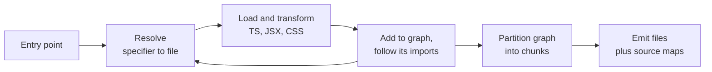

# Module ও Bundling {#ch-modules-and-bundling}

> Bundler কী করে তা চার ধাপে বলুন, আর ব্যাখ্যা করুন একটি import কেন অর্ধেক library টেনে আনল।

**এই অধ্যায়ে:** চারটি ধাপ · resolution আর bare specifier · module graph · graph ভাগ করাই chunking · ESM কেন এটা সম্ভব করল · source map

## 💡 মূল ধারণা

Bundler ক্রমানুসারে চারটি কাজ করে:

**Resolve** — প্রতিটি import specifier-কে disk-এর একটি file-এ মিলিয়ে দেয়। **Load আর transform** — প্রতিটি file পড়ে
এমন কিছুতে বদলায়, যা browser বোঝে। **Graph তৈরি** — import ধরে ধরে এগোয়, যতক্ষণ না নতুন কিছু পৌঁছানোর বাকি থাকে।
**Chunk emit** — সেই graph-কে কয়েকটি file-এ ভাগ করে লিখে ফেলে।

Bundler-এর প্রায় সব সমস্যাই এই চার ধাপের কোনো একটির ব্যর্থতা। অনেক সময় error message অন্য ধাপের নাম বলে। "Module
not found" হলো resolution। "Unexpected token" হলো transformation। "এটা আমার bundle-এ কেন?" হলো graph। "চল্লিশটি
chunk কেন?" হলো emission।

আগে ধাপটার নাম ঠিক করুন। তাহলে দুই ঘণ্টার build তদন্ত দশ মিনিটে শেষ হয়।

## কীভাবে কাজ করে

### চারটি ধাপ



**Graph বন্ধ না হওয়া পর্যন্ত resolution আর loading বারবার ঘোরে; emission হয় একবারই।**

### Resolution, আর bare specifier কেন কঠিন

`./utils` একটি relative path। Resolver একের পর এক extension জুড়ে দেখে, যতক্ষণ না file পায়। `react` হলো
**bare specifier**, আর browser-এর কাছে এর কোনো নিয়ম নেই। Bundler-কে directory tree বেয়ে ওপরে উঠে
`node_modules`-এ খুঁজতে হয়। তারপর সেই package-এর `package.json` পড়ে ঠিক করতে হয়, আসলে কোন file-এর কথা বলা হচ্ছে।

Resolution-এর বেশিরভাগ চমক আসে এই শেষ অংশ থেকে। কারণ একটি package একই import-এর জন্য কয়েকটি entry point ঘোষণা করতে পারে:

| Field | কখন বাছা হয় |
| ----- | ----------- |
| `exports` | আধুনিক resolver-এ, আর এটা **বাকি সবকিছুকে override করে** |
| `main` | পুরনো fallback, সাধারণত CommonJS |
| `module` | ESM build-এর জন্য পুরনো রীতি |
| `browser` | Browser-এর জন্য আলাদা বদলি |
| `exports`-এর ভেতরের condition | `import` / `require` / `node` / `browser` / `development` |

`exports` map একটি **দেয়াল**ও বটে: এতে যে file-এর নাম নেই, সেটা import করা যায় না। তাই গত বছর যে deep import চলত,
dependency upgrade-এর পরে সেটা ব্যর্থ হতে পারে। এটা আপনার build-এর bug নয়। Package-এর author এমন একটি দরজা বন্ধ
করেছেন, যেটা খোলা রাখার ইচ্ছে তাঁর কখনো ছিল না।

### কী ship হবে, তা ঠিক করে graph

Resolution সফল হলে bundler import ধরে ধরে transitively এগোয়। Entry point থেকে যা কিছুতে পৌঁছানো যায়, সবই bundle-এ
ঢোকে। **পৌঁছানো যায় মানেই ব্যবহার হয় না।** দুটি আলাদা জিনিস, আর bundle-এর ওজন আসে এই পার্থক্য থেকেই।

সাধারণত দোষী হয় barrel file (এমন একটি `index.ts`, যেটা পুরো folder re-export করে):

```typescript
// components/index.ts — re-exports forty components
export * from './Button';
export * from './DataGrid'; // pulls in a charting dependency
// ...

// Somewhere else — this reaches the whole barrel before anything is eliminated.
import { Button } from '../components';
```

যা পৌঁছানো যায় কিন্তু ব্যবহার হয় না, তা বাদ দেওয়াই tree shaking। এটা কাজ করতে static import আর সৎ side-effect
metadata লাগে। খুঁটিনাটি আছে
[Chapter ?? — Loading, Code Splitting ও Bundle Budget](#ch-loading-and-code-splitting)-এ। এখানে যেটা জরুরি: bundler আগে graph তৈরি করে, পরে
ছাঁটাই করে। Graph যদি বেশি দূর পর্যন্ত পৌঁছে যায়, তাহলে ছাঁটাই করে খুব বেশি লাভ হয় না।

### ESM কেন সম্ভাবনার সীমা বদলে দিল

CommonJS resolve হয় runtime-এ। `require()` একটি function call, তার argument হিসাব করে বের করা যায়, আর program চলার
সময় export নতুন করে assign করা যায়। ফলে CommonJS module চালিয়ে না দেখে bundler জানতে পারে না সেটা কী export করে।

ES module **statically analyse করা যায়**। Import আর export হলো নির্দিষ্ট নামের hoist হওয়া declaration, যেগুলো কোনো
code চলার আগেই resolve হয়। এ কারণেই tree shaking, নিরাপদে এক module-এর code আরেকটিতে inline করা, আর নির্ভরযোগ্য
chunking আদৌ সম্ভব হয়। এই অংশের প্রতিটি tool ESM ধরে নেয়, আর CommonJS-কে দেখে compatibility-র ব্যাপার হিসেবে,
সেটাও এই কারণে।

### Graph ভাগ করাই chunking

প্রতি module-এ একটি করে file emit করলে request হয় শত শত। আবার একটিমাত্র file emit করলে login page দেখতেই পুরো
application download করতে হয়। Chunking এই দুইয়ের মাঝামাঝি একটি আপস। এটা সত্যিকারের optimisation সমস্যা, যেখানে
তিনটি লক্ষ্য একে অপরের বিরুদ্ধে টানে:

| লক্ষ্য | কোন দিকে টানে |
| ---- | ------------- |
| কম request | বড় chunk |
| প্রতি route-এ কম অব্যবহৃত code | ছোট chunk |
| Deploy-এর পরেও cache ভালোভাবে কাজে লাগা | কম বদলানো আর ঘন ঘন বদলানো code-এর মধ্যে স্থির boundary |

তৃতীয় লক্ষ্যটা মানুষ ভুলে যায়। ধরুন একটি shared chunk-এ আপনার dependency আর application code দুটিই আছে। তাহলে
প্রতিটি deploy dependency-গুলোকেও invalidate করে, আর ফিরে আসা user-রা এমন library আবার download করে, যেটা
একটুও বদলায়নি।

দুটি chunk boundary আপনি না চাইলেও থাকে। **Dynamic import**, যেমন `import('./Editor')`, সবসময় split point, কারণ
call হওয়ার আগে তার target-এর দরকার পড়ে না। আর ওপরের caching-এর কারণে বেশিরভাগ bundler source থেকে
`node_modules` আলাদা রাখে। এর বাইরে সবকিছু configuration, যেটা performance technique হিসেবে আলোচনা করা হয়েছে
[Chapter ?? — Loading, Code Splitting ও Bundle Budget](#ch-loading-and-code-splitting)-এ।

### Source map, আর তার খরচ

Source map emit হওয়া file-এর অবস্থানগুলোকে আপনার source-এর সঙ্গে মিলিয়ে দেয়। এটা না থাকলে production-এর stack trace
দেখায় `main-a3f9.js`-এর column 41,209।

সিদ্ধান্তটা এগুলো তৈরি করবেন কি না, তা নয়। সিদ্ধান্ত হলো এগুলো কোথায় থাকবে:

| বিকল্প | Production-এ debug করা যায় | User-রা source দেখতে পায় |
| ------ | ------------------------ | ----------------------- |
| Bundle-এর ভেতরেই inline | হ্যাঁ | **হ্যাঁ** — আর bundle অনেক বড় হয়ে যায় |
| আলাদা file, public-ভাবে serve করা | হ্যাঁ | **হ্যাঁ**, যে খুঁজবে তার কাছেই |
| আলাদা file, শুধু error tracking-এ upload করা | হ্যাঁ, error tool-এ | না |
| কিছুই না | না | না |

বেশিরভাগ product-এর উত্তর তৃতীয় row: map তৈরি করুন, build-এর সময় error reporter-এ upload করুন, আর CDN-এ deploy
করবেন না।

## কখন ব্যবহার করবেন

Bundle করবেন কি না, সেই প্রশ্ন আর নেই। প্রতিটি framework-এর সঙ্গেই bundler আসে। আপনি যা বাছাই করেন:

| সিদ্ধান্ত | পরামর্শ |
| -------- | -------- |
| Application code-এ barrel file | এড়িয়ে চলুন। জিনিসটা যে module-এ define করা, সেখান থেকে import করুন |
| Publish করা package-এ barrel file | শুধু `sideEffects: false` আর প্রতি file-এর export থাকলে |
| হাতে chunk configuration | শুধু bundle report পড়ার পরে। Default এখন ভালো |
| নিজের publish করা library bundle করা | ESM ship করুন, `exports` আর `sideEffects` ঘোষণা করুন, dependency bundle করবেন না |
| Source map | সবসময় তৈরি করুন; error tracking-এ upload করুন, public-ভাবে serve করবেন না |

## সাধারণ ভুল

**❌ Import-এর line গোছানো রাখতে barrel থেকে import করা।**
✅ এতে পুরো barrel-এ পৌঁছে যায়। যে module-এ define করা, সেখান থেকে import করুন।

**❌ ধরে নেওয়া যে অব্যবহৃত import-এর কোনো খরচ নেই।**
✅ খরচ নেই কেবল তখন, যখন module-এর কোনো side effect নেই আর package নিজে সেটা বলে দেয়। নইলে সেটা ship হয়।

**❌ Package-এর ভেতরের অংশে deep import করা।**
✅ `exports` map একটি patch release-এই সেই path সরিয়ে দিতে পারে। Public entry point ব্যবহার করুন।

**❌ Bundle-এর মোট size দেখে থেমে যাওয়া।**
✅ মোট সংখ্যা বলে না কোন route কীসের দাম দিচ্ছে। Chunk ধরে report পড়ুন, আর সবচেয়ে বড় chunk-এর ভেতরে কোন module
কতটা জায়গা নিয়েছে তা দেখুন।

**❌ Build তৈরি করেছে বলেই source map CDN-এ publish করা।**
✅ তাতে আপনার source-ই publish হয়ে যায়। এর বদলে error tracker-এ upload করুন।

## 🔑 মূল শিক্ষা

- Bundler resolve করে, transform করে, graph তৈরি করে, আর chunk emit করে। এর error সাধারণত ভুল ধাপের নাম বলে।
- Import আসলে কোন file বোঝায়, তা ঠিক করে package-এর `exports` map, আর তালিকার বাইরে সবকিছু নিষেধ করে।
- Entry point থেকে যা কিছুতে পৌঁছানো যায়, সবই ship হয়। পৌঁছানো যাওয়া আর ব্যবহার হওয়া এক জিনিস নয়।
- ES module statically analyse করা যায়, আর সে কারণেই tree shaking আর নির্ভরযোগ্য chunking সম্ভব হয়।
- Chunking-এ request-এর সংখ্যা, অব্যবহৃত code আর deploy-এর পরে cache-এর পুনর্ব্যবহারের মধ্যে ভারসাম্য রাখতে হয়।

## Interview-এর প্রশ্ন

**Q: Bundler আসলে কী করে?**

চারটি ধাপ। প্রতিটি import specifier-কে একটি file-এ resolve করে, bare specifier হলে package-এর `exports` condition
মেনে। প্রতিটি file load করে transform করে: TypeScript, JSX, CSS। Import ধরে ধরে একটি module graph তৈরি করে। তারপর
সেই graph-কে chunk-এ ভাগ করে source map সহ emit করে। বেশিরভাগ build failure এই চার ধাপের কোনো একটিতে হয়, আর error
message প্রায়ই অন্য ধাপের নাম বলে।

**Q: একটিমাত্র import bundle-এ 300 KB যোগ করেছে। কারণ কীভাবে খুঁজবেন?**

যে chunk বড় হয়েছে, bundle report-এ তার ভেতরে কোন module কতটা নিয়েছে তা দেখুন, আর import path ধরে পিছিয়ে আপনার
source পর্যন্ত যান। সাধারণত উত্তর একটি barrel file। চল্লিশটি component re-export করা index থেকে একটি component
import করলেই চল্লিশটিতেই পৌঁছে যান। Package যে module-গুলোকে side-effect-free ঘোষণা করেনি, tree shaking সেগুলো বাদ
দিতে পারে না। সমাধান হলো যে module-এ define করা, সেখান থেকেই import করা।

**Q: Tree shaking কেবল ES module আসার পরেই কেন কাজের হলো?**

CommonJS resolve হয় runtime-এ। `require()` যেকোনো expression নেয়, আর code export নতুন করে assign করতে পারে। তাই
module না চালিয়ে bundler জানতে পারে না সেটা কী export করে। ESM-এর import আর export হলো নির্দিষ্ট নামের static
declaration, যেগুলো code চলার আগেই resolve হয়। ফলে tool প্রমাণ করতে পারে যে একটি binding কখনো পড়া হয় না, আর
সেটা মুছে ফেলতে পারে।

**Q: Chunk কোথায় ভাগ করবেন, তা কীভাবে ঠিক করবেন?**

Default থেকে শুরু করুন: dynamic import আর vendor split। তারপর দেখুন deploy-এর পরে ফিরে আসা user কী কী আবার
download করে। Application code আর dependency একই chunk-এ থাকলে প্রতিটি release দুটিকেই invalidate করে। Code ভাগ
করুন কত ঘন ঘন বদলায় তা দেখে, feature দেখে নয়। আরও tune করুন কেবল সামনে bundle report রেখে।

## এরপর কী পড়বেন

- [Chapter ?? — Vite, Rust Bundler ও Dev Loop](#ch-vite-and-the-dev-loop) — development-এ এই চারটি ধাপ কীভাবে অন্যরকম আচরণ করে
- [Chapter ?? — Loading, Code Splitting ও Bundle Budget](#ch-loading-and-code-splitting) — tree shaking, minification আর compression বিস্তারিত
