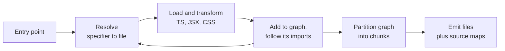

# Module ও Bundling {#ch-modules-and-bundling}

> একটি bundler কী করে, তা চারটি ধাপে বর্ণনা করুন। আর ব্যাখ্যা করুন, একটিমাত্র import কেন একটি library-র অর্ধেক টেনে আনল।

**এই অধ্যায়ে:** চারটি ধাপ · resolution আর bare specifier · module graph · graph partitioning হিসেবে chunking · ESM কেন এটা সম্ভব করল · source map

## 💡 মূল ধারণা

একটি bundler চারটি কাজ করে, এই ক্রমে:

**Resolve** — প্রতিটি import specifier-কে disk-এর একটি file-এ পরিণত করা। **Load আর transform** — প্রতিটি file পড়া,
আর browser বোঝে এমন কিছুতে রূপান্তর করা। **Graph তৈরি** — import-গুলো অনুসরণ করা, যতক্ষণ না নতুন কিছু আর নাগালে
আসে। **Chunk emit** — সেই graph-কে কয়েকটি file-এ ভাগ করে লিখে ফেলা।

Bundler-এর প্রায় প্রতিটি সমস্যাই এই চারটি ধাপের কোনো একটির ব্যর্থতা। প্রায়ই error message অন্য একটি ধাপের নাম
বলে। "Module not found" হলো resolution। "Unexpected token" হলো transformation। "এটা আমার bundle-এ কেন?" হলো
graph। "চল্লিশটা chunk কেন?" হলো emission।

আগে ধাপটির নাম ঠিক করুন। তাহলে দুই ঘণ্টার build তদন্ত দশ মিনিটের কাজ হয়ে যায়।

## কীভাবে কাজ করে

### চারটি ধাপ



**Graph বন্ধ না হওয়া পর্যন্ত resolution আর loading ঘুরতে থাকে। Emission হয় একবারই।**

### Resolution, আর bare specifier কেন কঠিন

`./utils` একটি relative path। Resolver একটির পর একটি extension জুড়ে দেখে, যতক্ষণ না একটি file পায়। `react` হলো
একটি **bare specifier**, আর browser-এর কাছে এর জন্য কোনো নিয়ম নেই। Bundler-কে directory tree ধরে ওপরে উঠতে হয়,
`node_modules`-এ খুঁজতে খুঁজতে। তারপর সে ওই package-এর `package.json` পড়ে ঠিক করে, আসলে কোন file বোঝানো হয়েছে।

শেষের এই অংশটাই resolution-এর বেশিরভাগ চমকের কারণ। কারণ একটি package একটি import-এর জন্য কয়েকটি entry point
declare করতে পারে:

| Field | কখন বেছে নেওয়া হয় |
| ----- | ----------- |
| `exports` | আধুনিক resolver-এ, আর এটা **বাকি সবকিছুকে override করে** |
| `main` | পুরোনো fallback, সাধারণত CommonJS |
| `module` | ESM build-এর জন্য পুরোনো একটি convention |
| `browser` | Browser-এর জন্য নির্দিষ্ট একটি বদল |
| `exports`-এর ভেতরের condition | `import` / `require` / `node` / `browser` / `development` |

একটি `exports` map একটি **দেয়ালও**: এটা যে file-এর তালিকা দেয় না, সেটা আপনি import করতে পারবেন না। তাই যে deep
import গত বছর কাজ করত, একটি dependency upgrade-এর পর সেটা ভেঙে যেতে পারে। এটা আপনার build-এর bug নয়। Package-এর
লেখক এমন একটি দরজা বন্ধ করেছেন, যেটা তিনি কখনো খোলা রাখতে চাননি।

### Graph ঠিক করে কী ship হবে

Resolution সফল হলে bundler import-গুলো transitively অনুসরণ করে। একটি entry point থেকে যা কিছু নাগালে পাওয়া যায়,
সবই bundle-এ থাকে। **নাগালে পাওয়া, ব্যবহৃত নয়**: এ দুটো আলাদা, আর bundle-এর ওজন আসে এই পার্থক্য থেকেই।

একটি barrel file (একটি `index.ts`, যেটা একটি folder-কে re-export করে) সাধারণত দোষী:

```typescript
// components/index.ts — re-exports forty components
export * from './Button';
export * from './DataGrid'; // pulls in a charting dependency
// ...

// Somewhere else — this reaches the whole barrel before anything is eliminated.
import { Button } from '../components';
```

যা নাগালে আছে কিন্তু ব্যবহৃত নয়, সেটা সরিয়ে ফেলাই tree shaking। এটা কাজ করতে static import আর সৎ side-effect
metadata লাগে। এর খুঁটিনাটি আছে
[Chapter ?? — Loading, Code Splitting ও Bundle Budget](#ch-loading-and-code-splitting)-এ। এখানে যেটা জরুরি: bundler
আগে graph তৈরি করে, পরে ছাঁটাই করে। যে graph অনেক দূর পর্যন্ত পৌঁছায়, সেখানে ছাঁটাই খুব বেশি সাহায্য করতে পারে না।

### ESM কেন সম্ভাবনার সীমা বদলে দিল

CommonJS resolve হয় runtime-এ। `require()` একটি function call, এর argument হিসাব করে বের করা যায়, আর program
চলার সময় export-গুলো আবার assign করা যায়। একটি CommonJS module কী export করে, তা চালিয়ে না দেখে bundler জানতে
পারে না।

ES module **statically analysable**। Import আর export হলো নির্দিষ্ট নামের hoisted declaration, যেগুলো কোনো code
চলার আগেই resolve হয়। এটাই tree shaking, নিরাপদ cross-module inlining আর নির্ভরযোগ্য chunking-কে আদৌ সম্ভব করে।
এ কারণেই এই section-এর প্রতিটি tool ESM ধরে নেয়, আর CommonJS-কে একটি compatibility-র বিষয় হিসেবে দেখে।

### Chunking মানে graph partitioning

প্রতিটি module-এর জন্য একটি করে file emit করলে শত শত request হয়। একটিমাত্র file emit করলে login page দেখতেই পুরো
application download করতে হয়। Chunking হলো এর মাঝামাঝি সমাধান। এটা একটি সত্যিকারের optimisation সমস্যা, যার তিনটি
পরস্পরবিরোধী লক্ষ্য:

| লক্ষ্য | যেদিকে টানে |
| ---- | ------------- |
| কম request | বড় chunk |
| প্রতিটি route-এ কম অব্যবহৃত code | ছোট chunk |
| Deploy-এর পরেও ভালো cache reuse | কম বদলায় আর ঘন ঘন বদলায় এমন code-এর মধ্যে স্থির সীমানা |

মানুষ তৃতীয় লক্ষ্যটা ভুলে যায়। ধরুন একটি shared chunk-এ আপনার dependency আর application code দুটোই আছে। তাহলে
প্রতিটি deploy dependency-গুলোকেও invalidate করে। আর ফিরে আসা user-রা এমন একটি library আবার download করেন, যেটা
বদলায়নি।

দুটো chunk সীমানা আপনি না চাইলেও থাকে। একটি **dynamic import**, যেমন `import('./Editor')`, সবসময় একটি split
point, কারণ call হওয়ার আগে এর target কারও লাগে না। আর বেশিরভাগ bundler `node_modules`-কে source থেকে আলাদা করে,
ওপরের caching-এর কারণে। এর বাইরে সবকিছুই configuration, যা একটি performance কৌশল হিসেবে আলোচনা করা হয়েছে
[Chapter ?? — Loading, Code Splitting ও Bundle Budget](#ch-loading-and-code-splitting)-এ।

### Source map, আর এর খরচ

একটি source map emit করা file-এর অবস্থানগুলোকে আপনার source-এ ফিরিয়ে map করে। এটা না থাকলে production-এর একটি
stack trace দেখায় `main-a3f9.js`-এর column 41,209।

সিদ্ধান্তটা এগুলো তৈরি করবেন কি না তা নয়, বরং এগুলো কোথায় থাকবে:

| বিকল্প | Production-এ debug করা যায় | User-রা source দেখতে পান |
| ------ | ------------------------ | ----------------------- |
| Bundle-এর ভেতরে inline | হ্যাঁ | **হ্যাঁ** — আর bundle অনেক বড় হয় |
| আলাদা file, public-ভাবে serve করা | হ্যাঁ | **হ্যাঁ**, যে-ই দেখতে চায় |
| আলাদা file, শুধু error tracking-এ upload করা | হ্যাঁ, error tool-এ | না |
| কিছুই না | না | না |

বেশিরভাগ product-এর জন্য উত্তর তৃতীয় সারিটি: map তৈরি করুন, build-এর সময় error reporter-এ upload করুন, আর CDN-এ
deploy করবেন না।

## কখন ব্যবহার করবেন

Bundle করবেন কি না, সেটা আর আপনার বেছে নেওয়ার বিষয় নয়। প্রতিটি framework-এর সাথেই একটি bundler আসে। আপনি যা বেছে
নেন:

| সিদ্ধান্ত | পরামর্শ |
| -------- | -------- |
| Application code-এ barrel file | এড়িয়ে চলুন। যে module জিনিসটা define করে, সেখান থেকে import করুন |
| Publish করা package-এ barrel file | শুধু `sideEffects: false` আর প্রতি file-এর export থাকলে |
| হাতে chunk configuration | শুধু একটি bundle report পড়ার পরে। Default-গুলো এখন ভালো |
| নিজের publish করা library bundle করা | ESM ship করুন, `exports` আর `sideEffects` declare করুন, dependency bundle করবেন না |
| Source map | সবসময় তৈরি করুন। Error tracking-এ upload করুন, public-ভাবে serve করবেন না |

## সাধারণ ভুল

**❌ Import line পরিপাটি রাখতে barrel থেকে import করা।**
✅ এটা পুরো barrel-এ পৌঁছায়। যে module define করে, সেখান থেকে import করুন।

**❌ ধরে নেওয়া যে একটি অব্যবহৃত import বিনা খরচের।**
✅ এটা বিনা খরচের শুধু তখনই, যখন module-এর কোনো side effect নেই আর package সেটা ঘোষণা করে। নইলে এটা ship হয়।

**❌ একটি package-এর ভেতরের অংশে deep import করা।**
✅ একটি `exports` map একটি patch release-এই সেই path সরিয়ে দিতে পারে। Public entry point ব্যবহার করুন।

**❌ Bundle size-এর মোট সংখ্যা পড়ে থেমে যাওয়া।**
✅ মোট সংখ্যা বলে না কোন route কীসের খরচ দেয়। প্রতি chunk-এর report পড়ুন, আর সবচেয়ে বড় chunk-এর ভেতরের module
attribution দেখুন।

**❌ Build তৈরি করেছে বলেই source map CDN-এ publish করা।**
✅ এতে আপনার source publish হয়ে যায়। বদলে এগুলো error tracker-এ upload করুন।

## 🔑 মূল শিক্ষা

- একটি bundler resolve করে, transform করে, graph তৈরি করে, আর chunk emit করে। এর error সাধারণত ভুল ধাপের নাম বলে।
- একটি package-এর `exports` map ঠিক করে একটি import কোন file বোঝায়, আর যা তালিকায় নেই তা নিষিদ্ধ করে।
- একটি entry point থেকে যা কিছু নাগালে পাওয়া যায়, সবই ship হয়। নাগালে পাওয়া আর ব্যবহৃত হওয়া এক জিনিস নয়।
- ES module statically analysable। এটাই tree shaking আর নির্ভরযোগ্য chunking সম্ভব করে।
- Chunking-এ request-এর সংখ্যা, অব্যবহৃত code আর deploy-এর পরের cache reuse — এই তিনটির মধ্যে আপস করতে হয়।

## Interview-এর প্রশ্ন

**Q: একটি bundler আসলে কী করে?**

চারটি ধাপ। প্রতিটি import specifier-কে একটি file-এ resolve করে, bare specifier-এর জন্য package-এর `exports`
condition প্রয়োগ করে। প্রতিটি file load আর transform করে: TypeScript, JSX, CSS। Import অনুসরণ করে একটি module graph
তৈরি করে। তারপর সেই graph-কে chunk-এ ভাগ করে source map-সহ emit করে। বেশিরভাগ build failure এই চারটির কোনো একটি
ধাপ, আর error message প্রায়ই অন্য একটির নাম বলে।

**Q: একটিমাত্র import bundle-এ 300 KB যোগ করেছে। কেন, সেটা কীভাবে খুঁজে বের করবেন?**

যে chunk বড় হয়েছে, তার ভেতরের module attribution-এর জন্য bundle report পড়ুন, আর import path ধরে পেছনে আপনার source
পর্যন্ত যান। সাধারণ উত্তর একটি barrel file। চল্লিশটা component re-export করে এমন একটি index থেকে একটি component
import করুন, আর আপনি চল্লিশটাতেই পৌঁছে যাবেন। Package যে module-গুলোকে side-effect-free ঘোষণা করেনি, tree shaking
সেগুলো সরাতে পারে না। সমাধান হলো যে module define করে, সেখান থেকে import করা।

**Q: Tree shaking কেন শুধু ES module আসার পরেই কার্যকর হলো?**

CommonJS runtime-এ resolve হয়। `require()` যেকোনো expression নেয়, আর code export আবার assign করতে পারে। তাই একটি
module কী export করে, তা চালিয়ে না দেখে bundler জানতে পারে না। ESM-এর import আর export হলো নির্দিষ্ট নামের static
declaration, যা execution-এর আগেই resolve হয়। তাই tool প্রমাণ করতে পারে যে একটি binding কখনো পড়া হয় না, আর সেটা
মুছে দিতে পারে।

**Q: কোথায় chunk split করবেন, সেটা কীভাবে ঠিক করবেন?**

Default থেকে শুরু করুন: dynamic import আর একটি vendor split। তারপর দেখুন, একটি deploy-এর পর ফিরে আসা একজন user কী
আবার download করেন। Application code আর dependency একই chunk-এ থাকলে প্রতিটি release দুটোকেই invalidate করে। Code
আলাদা করুন কত ঘন ঘন বদলায় তা দিয়ে, feature দিয়ে নয়। এর বেশি tune করুন শুধু সামনে একটি bundle report রেখে।

## এরপর কী পড়বেন

- [Chapter ?? — Vite, Rust Bundler ও Dev Loop](#ch-vite-and-the-dev-loop) — development-এ এই চারটি ধাপ কীভাবে আলাদা আচরণ করে
- [Chapter ?? — Loading, Code Splitting ও Bundle Budget](#ch-loading-and-code-splitting) — tree shaking, minification আর compression বিস্তারিত
