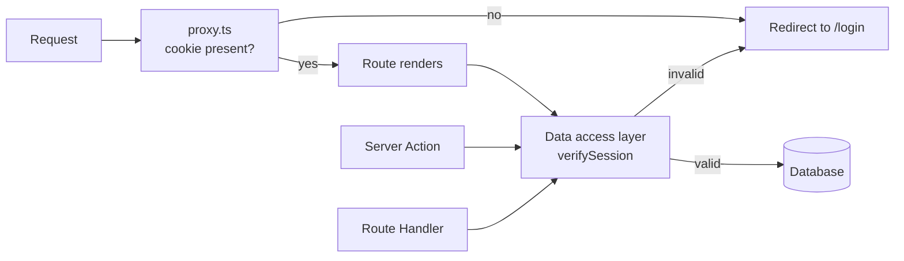

# Auth Pattern {#ch-nextjs-auth-patterns}

> আসল check-টি data-র ঠিক পাশে রাখুন। তার সামনে যা কিছু আছে, সেগুলোকে শুধু সুবিধা হিসেবে দেখুন।

**এই অধ্যায়ে:** তিনটি layer · session বনাম token · যে cookie এটা বহন করে · data access layer · `cookies()` আপনাকে যা করতে দেবে না

## 💡 মূল ধারণা

একটি App Router application-এর সদর দরজা অনেকগুলো। একটি page render, একটি Server Action, একটি Route Handler আর
একটি client fetch — সবাই database-এর একই row-তে পৌঁছাতে পারে। অথচ এরা একই request pipeline শেয়ার করে না। তাই
একটি check নিশ্চিতভাবে চলবে, এমন জায়গা একটিই: **যে code row-টি পড়ে**।

ফলে authentication তিনটি layer-এ ভাগ হয়ে যায়, আর তিনটির কাজ আলাদা। Proxy layer তাদের redirect করে, যাদের এখানে
থাকার কথা স্পষ্টতই নয়। Render layer ঠিক করে কী দেখানো হবে। Data layer ঠিক করে কী করা যাবে — প্রতিবার, কোনো
ব্যতিক্রম ছাড়া। শুধু শেষেরটিই security। প্রথম দুটি user experience।



**তিনটি entry point একটি check-এ এসে মেলে। Proxy একটি অপচয়ী render এড়ানোর shortcut, কোনো gate নয়।**

> ⚠️ **যা বদলাতে থাকে:** Next.js 15 থেকে `cookies()` আর `headers()` asynchronous, আর 16 synchronous রূপগুলো
> সরিয়ে দিয়েছে। `middleware.ts` এখন `proxy.ts`। `unauthorized()` আর `forbidden()`-এর জন্য এখনো `next.config.ts`-এ
> `experimental.authInterrupts` লাগে। তিনটি পরিবর্তনের পরেও স্থায়ী নীতিটা টিকে আছে: আসল check-এর জায়গা query-র
> পাশে।

## কীভাবে কাজ করে

### Session নাকি token

দুটিই শেষ পর্যন্ত একটি `httpOnly` cookie হয়। পার্থক্য হলো, server তার সিদ্ধান্ত বদলাতে পারে কি না।

| | Database session | Signed token (JWT) |
| --- | --- | --- |
| Cookie-তে থাকে | একটি opaque session id | Claim-গুলো নিজেই |
| যাচাইয়ের খরচ | প্রতি request-এ একটি lookup | একটি signature check, কোনো I/O নেই |
| Revoke করা | Row delete করুন — সঙ্গে সঙ্গে | Expiry-র আগে সম্ভব নয় |
| Claim বদলালে | পরের request-ই দেখে | পরের refresh-এ দেখে |
| Scale হয় যা দিয়ে | আপনার session store | Scale করার কিছু নেই |

Senior উত্তরটা "JWT, কারণ stateless" নয়। উত্তর হলো: **চুরি হওয়া একটি credential তার পুরো lifetime ধরে valid
থাকলে আপনি কি সেটা সামলাতে পারবেন?** 15 মিনিটের token-ওয়ালা একটি public content site-এর জন্য সাধারণত হ্যাঁ। একটি
internal admin tool-এর জন্য, যেখানে চলে যাওয়া কোনো employee-র access এখনই বন্ধ হওয়া দরকার, উত্তর না। একটি প্রচলিত
মাঝামাঝি পথ হলো session database-এ রাখা আর lookup-টি cache করা। Revocation থাকে, আর তার দাম কদাচিৎ দিতে হয়।

Token-এর খুঁটিনাটি (password hash করা, signing, rotation, refresh) আছে
[Chapter ?? — Credential, Session, CORS ও CSRF](#ch-credentials-and-sessions)-এ। কে কী করতে পারবে, সেটা আছে
[Chapter ?? — OAuth, OIDC ও Authorisation](#ch-oauth)-এ। এই অধ্যায়ের বিষয় হলো, একটি App Router application-এর
কোথায় এই check-গুলো চলে।

### Cookie

```typescript
// lib/session.ts
import "server-only";
import { cookies } from "next/headers";

export async function createSession(sessionId: string, expiresAt: Date): Promise<void> {
  const store = await cookies(); // asynchronous since Next.js 15
  store.set("session", await encrypt({ sessionId, expiresAt }), {
    httpOnly: true, // JavaScript cannot read it, so XSS cannot steal it
    secure: true, // HTTPS only
    sameSite: "lax", // survives top-level navigation, blocks cross-site POSTs
    path: "/",
    expires: expiresAt,
  });
}
```

আসল line হলো `httpOnly`। Page-এ ঢুকে পড়া যেকোনো script `localStorage`-এর token পড়তে পারে। App Router আপনাকে
সেখানে token রাখার কোনো কারণ দেয় না। Server render-এর সময় cookie পড়তে পারে। আর যে client component-এর user-এর
নাম দরকার, তাকে সেটা prop হিসেবে পাঠিয়ে দিতে পারে।

### Cookie কোথায় set করা যায়, কোথায় যায় না

**`cookies().set()` শুধু সেখানেই কাজ করে, যেখানে একটি response তৈরি হচ্ছে:** একটি Server Action বা একটি Route
Handler। Server Component render করার সময় এটা call করলে error throw হয়, কারণ header-গুলো ততক্ষণে চলে গেছে। তাই
render-এর সময় প্রতিটি page view-এ session বাড়ানো যায় না। কাজটা proxy-তে করুন, অথবা যে action user এমনিতেই চালাচ্ছে
তার ভেতরে।

### Data access layer

প্রতিটি read একটি module-এর পেছনে রাখুন, আর check-টি তার ভেতরে বসান। `import "server-only"` থাকলে সেই file কোনো
client bundle-এ পৌঁছালে build error হয়।

```typescript
// lib/dal.ts
import "server-only";
import { cache } from "react";
import { cookies } from "next/headers";
import { redirect } from "next/navigation";

export const verifySession = cache(async (): Promise<{ userId: string; role: string }> => {
  const token = (await cookies()).get("session")?.value;
  const session = token ? await decrypt(token) : null;
  if (!session) redirect("/login");
  return { userId: session.userId, role: session.role };
});

export async function getInvoice(id: string) {
  const { userId } = await verifySession();
  // Ownership is part of the query, not a check after it
  return db.invoice.findFirst({ where: { id, ownerId: userId } });
}
```

এখানে দুটি জিনিস কাজ করে। React-এর `cache()` **একটি request-এর ভেতরে** `verifySession`-কে deduplicate করে। ফলে
একটি layout, তিনটি component আর একটি action মিলে চারবার নয়, একবার verify করে। আর ownership-এর শর্তটি থাকে
`where` clause-এ। যে query অন্য কারও row return করতেই পারে না, সেখানে ভুলে যাওয়ার মতো কোনো check থাকে না।

### Render থামানো

```tsx
// app/admin/page.tsx
import { verifySession } from "@/lib/dal";
import { forbidden } from "next/navigation";

export default async function AdminPage() {
  const { role } = await verifySession();
  if (role !== "admin") forbidden(); // renders app/forbidden.tsx with a 403
  return <AdminDashboard />;
}
```

`unauthorized()` (401) আর `forbidden()` (403) `unauthorized.tsx` আর `forbidden.tsx` render করে, ঠিক যেভাবে
`notFound()` `not-found.tsx` render করে। `redirect()`-এর মতো এরাও throw করে কাজ করে। তাই **এদের কখনো এমন `try`
block-এর ভেতরে call করবেন না**, যেটা আপনি error handling-এর জন্যও ব্যবহার করছেন। Catch navigation-টি গিলে ফেলে।

## কখন ব্যবহার করবেন

| প্রশ্ন                                              | কোথায় উত্তর মেলে                                |
| ------------------------------------------------- | --------------------------------------------- |
| আদৌ কোনো session cookie আছে কি?                    | `proxy.ts` — সস্তায় redirect                    |
| এই nav item কি দেখা যাবে?                          | Layout বা page-এ, `verifySession()` থেকে         |
| এই user কি এই record পড়তে পারবে?                   | Data access layer-এ, query-র ভেতরে              |
| এই user কি এই mutation করতে পারবে?                 | Server Action-এ, write করার আগে                |
| Client Component-এ user কে?                       | Server Component থেকে পাঠানো একটি prop         |
| এই user-এর access কি এইমাত্র revoke হয়েছে?          | শুধু একটি session lookup-ই এর উত্তর দিতে পারে      |

## সাধারণ ভুল

**❌ Route শুধু proxy-তে রক্ষা করা।** আপনার data-য় পৌঁছানো প্রতিটি path-এর জন্য এটা চলে না। আর cookie থাকা মানেই
valid session নয়।
[Chapter ?? — Middleware, Runtime ও Deployment](#ch-nextjs-middleware-and-the-edge) দেখুন।

**❌ Layout-এ auth check করে ধরে নেওয়া যে children নিরাপদ।** Children-দের মধ্যে প্রতিটি navigation-এ layout আবার
render হয় না। আর Server Action বা Route Handler-এর জন্য layout কখনো চলেই না।

**❌ Row fetch করে তারপর component-এ `row.ownerId` মেলানো।** আজ ঠিক আছে, কিন্তু একটি refactor-এর পরেই এটা বাদ পড়ে
যেতে পারে। Ownership `where` clause-এ রাখুন।

**❌ Client যাতে পড়তে পারে, সেজন্য token `localStorage`-এ রাখা।** ঠিক এটাই XSS (cross-site scripting)-কে exploit
করার মতো লোভনীয় করে তোলে। একটি `httpOnly` cookie ব্যবহার করুন, আর দেখানোর data prop হিসেবে নিচে পাঠান।

**❌ Render-এর সময় `cookies().set()` call করা।** Response header-গুলো চলে গেছে। Cookie set করুন একটি action, একটি
Route Handler বা proxy-তে।

**❌ `redirect()` বা `forbidden()`-কে `try`/`catch`-এ মোড়ানো।** এরা throw করে signal দেয়। Catch করলে একটি redirect
নিঃশব্দ error-এ পরিণত হয়।

## 🔑 মূল শিক্ষা

- একটি page, একটি Server Action আর একটি Route Handler আলাদা আলাদা entry point। তাই আসল check থাকতে হবে সেখানে, যেখানে data পড়া হয়।
- Session সঙ্গে সঙ্গে revoke করা যায়, token করা যায় না — statelessness নয়, এই tradeoff-ই ঠিক করে কোনটা ব্যবহার করবেন।
- Credential একটি `httpOnly` cookie-তে রাখুন, আর client component-কে token-এর বদলে data দিন।
- Session verification React-এর `cache()`-এ মুড়ে দিন, যাতে একটি request একবারই verify করে।
- `cookies().set()`-এর জন্য তৈরি হতে থাকা একটি response লাগে। তাই এর জায়গা একটি action, একটি Route Handler বা proxy।

## Interview-এর প্রশ্ন

**Q: একটি App Router application-এ authentication check কোথায় রাখবেন, আর middleware-এ কেন নয়?**

Data access layer-এ, যার মধ্য দিয়ে প্রতিটি read আর mutation যায়। আর সেটা `cache()`-এ মোড়া, যাতে প্রতি request-এ
একবার চলে। Middleware (Next.js 16-এ `proxy.ts`) দেখে যে একটি cookie আছে, সেটা valid কি না তা দেখে না। তাছাড়া
একই data-য় পৌঁছানো Server Action আর Route Handler-এর জন্য এটা না-ও চলতে পারে। সস্তা redirect-এর জন্য এটা ঠিক
জায়গা, সিদ্ধান্তের জন্য ভুল জায়গা।

**Q: নতুন একটি internal dashboard-এর জন্য session নাকি JWT?**

প্রায় সবসময় session। নির্ণায়ক প্রশ্ন হলো revocation। একটি internal tool-এ চলে যাওয়া user-এর account-এর access
সঙ্গে সঙ্গে বন্ধ হওয়া দরকার। একটি signed token expire না হওয়া পর্যন্ত valid থাকে, server যা-ই ভাবুক। সাধারণ
আপত্তি হলো প্রতি request-এর lookup। Session store-এর সামনে একটি cache সেটা সামলে নেয়, আর revocation ভুল করার
খরচের তুলনায় তা অতি সামান্য।

**Q: `secure` বা `sameSite` নয়, `httpOnly`-ই কেন গুরুত্বপূর্ণ flag?**

যে attack আপনি পুরোপুরি ঠেকাতে পারবেন না, এটা সেটাকে ব্যর্থ করে। `secure` network-এ interception থামায়, আর
`sameSite` cross-site request-কে দুর্বল করে। কিন্তু আপনার page-এ কোনো script চললে, যেমন একটি dependency বা inject
করা একটি string, JavaScript যা কিছুতে পৌঁছাতে পারে তা আগেই হাতছাড়া। `httpOnly` credential-কে এমন জায়গায় রাখে,
যেখানে page সেটা পড়তেই পারে না। এজন্যই App Router-এর server-side session model-এর ছোট অসুবিধাটুকু মেনে নেওয়ার মতো।

**Q: একটি layout session check করে redirect করে। নিচের page কি সুরক্ষিত?**

না। Children-দের মধ্যে navigation-এর সময় layout টিকে থাকে, তাই check আবার না-ও চলতে পারে। Server Action বা Route
Handler-এর জন্য layout একেবারেই চলে না। ওই check-কে navigation UI ঠিক করতে দিন, আর আসল check query-র পাশে রাখুন।

## এরপর কী পড়বেন

- [Chapter ?? — Server Action](#ch-server-actions) — একই নিয়মের mutation-এর দিক
- [Chapter ?? — Middleware, Runtime ও Deployment](#ch-nextjs-middleware-and-the-edge) — optimistic check কেন যেখানে থামে সেখানেই থামে
- [Chapter ?? — OAuth, OIDC ও Authorisation](#ch-oauth) — role, permission, আর কে কী করতে পারবে তার modelling
