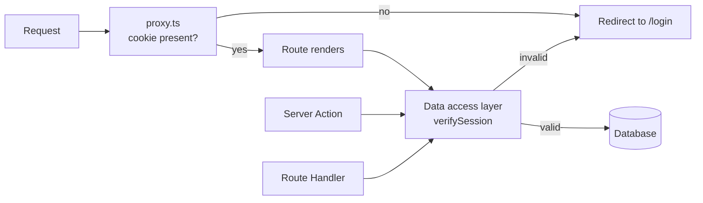

# Auth Pattern {#ch-nextjs-auth-patterns}

> আসল check রাখুন data-র ঠিক পাশে। তার সামনে যা আছে, সবই শুধু সুবিধার জন্য।

**এই অধ্যায়ে:** তিনটি layer · session বনাম token · যে cookie এটা বয়ে নেয় · data access layer · `cookies()` দিয়ে যা করা যায় না

## 💡 মূল ধারণা

App Router application-এ ঢোকার দরজা অনেক। Page render, Server Action, Route Handler আর client fetch, সবাই একই
database row-এ পৌঁছাতে পারে, অথচ তাদের request pipeline এক নয়। তাই check যে চলবেই, এমন জায়গা একটিই: **যে code
row-টা পড়ে**।

ফলে authentication ভাগ হয়ে যায় তিনটি layer-এ, তিনটির কাজ আলাদা। Proxy layer তাদের redirect করে, যাদের স্পষ্টতই
এখানে থাকার কথা নয়। Render layer ঠিক করে কী দেখানো হবে। আর data layer ঠিক করে কী করা যাবে, প্রতিবার, কোনো
ব্যতিক্রম ছাড়া। Security শুধু শেষেরটা। প্রথম দুটি user experience।



**তিনটি entry point এসে মেলে একটি check-এ। Proxy কোনো gate নয়, শুধু একটি অকারণ render এড়ানোর shortcut।**

> ⚠️ **যা বদলাতে থাকে:** Next.js 15 থেকে `cookies()` আর `headers()` asynchronous, আর 16-এ synchronous রূপগুলো
> বাদ পড়েছে। `middleware.ts` এখন `proxy.ts`। `unauthorized()` আর `forbidden()`-এর জন্য এখনো
> `next.config.ts`-এ `experimental.authInterrupts` লাগে। টেকসই নীতি এই তিন বদলের পরেও টিকে থাকে: আসল check
> থাকবে query-র পাশে।

## কীভাবে কাজ করে

### Session নাকি token

দুটিই শেষ পর্যন্ত একটি `httpOnly` cookie। পার্থক্য হলো, server পরে মত বদলাতে পারে কি না।

| | Database session | Signed token (JWT) |
| --- | --- | --- |
| Cookie-তে থাকে | একটি opaque session id | Claim-গুলো নিজেই |
| Verify করার খরচ | প্রতি request-এ একটি lookup | Signature check, কোনো I/O নেই |
| Revoke করা | Row মুছে দিন — সঙ্গে সঙ্গে | Expiry-র আগে সম্ভব নয় |
| Claim বদলালে | পরের request-ই দেখে | পরের refresh-এ দেখে |
| Scale হয় | আপনার session store দিয়ে | Scale করার কিছু নেই |

Senior উত্তর "JWT, কারণ stateless" নয়। আসল প্রশ্ন হলো: **চুরি যাওয়া credential পুরো মেয়াদ জুড়ে valid থাকলে
কি আপনার চলবে?** 15 মিনিটের token-ওয়ালা public content site-এর জন্য সাধারণত চলে। কিন্তু internal admin tool-এ,
যেখানে চলে যাওয়া কর্মীর access এখনই বন্ধ করতে হবে, চলে না। মাঝামাঝি একটি পথ বেশ প্রচলিত: session থাকে database-এ,
আর lookup-টা cache করা হয়। Revocation-ও থাকে, আর তার দাম দিতে হয় কালেভদ্রে।

Token-এর খুঁটিনাটি (password hash করা, sign করা, rotation, refresh) আছে
[Chapter ?? — Credential, Session, CORS ও CSRF](#ch-credentials-and-sessions)-এ। কে কী করতে পারবে, তা আছে
[Chapter ?? — OAuth, OIDC ও Authorisation](#ch-oauth)-এ। এই অধ্যায়ের বিষয় হলো, App Router application-এর কোথায়
এই check-গুলো চলে।

### Cookie

```typescript
// lib/session.ts
import "server-only";
import { cookies } from "next/headers";

export async function createSession(sessionId: string, expiresAt: Date): Promise<void> {
  const store = await cookies(); // asynchronous since Next.js 15
  store.set("session", await encrypt({ sessionId, expiresAt }), {
    httpOnly: true, // JavaScript cannot read it, so XSS cannot steal it
    secure: true, // HTTPS only
    sameSite: "lax", // survives top-level navigation, blocks cross-site POSTs
    path: "/",
    expires: expiresAt,
  });
}
```

আসল line হলো `httpOnly`। Page-এ কোনোভাবে ঢুকে পড়া যেকোনো script `localStorage`-এর token পড়তে পারে। App Router-এ
token সেখানে রাখার কোনো কারণই নেই। Server render-এর সময় cookie পড়তে পারে, আর যে client component-এর user-এর নাম
দরকার, তাকে সেটা prop হিসেবে দিয়ে দিতে পারে।

### Cookie কোথায় set করা যায়, কোথায় যায় না

**`cookies().set()` কাজ করে শুধু সেখানে, যেখানে response তৈরি হচ্ছে:** Server Action বা Route Handler-এ। Server
Component render করার সময় call করলে error throw হয়, কারণ header ততক্ষণে চলে গেছে। তাই render-এর সময় প্রতিটি
page view-এ session-এর মেয়াদ বাড়ানো যায় না। সেটা করুন proxy-তে, অথবা যে action user এমনিতেই চালাচ্ছেন, তার ভেতরে।

### Data access layer

প্রতিটি read রাখুন একটি module-এর পেছনে, আর check রাখুন সেই module-এর ভেতরে। `import "server-only"` দিলে ওই file
কোনো client bundle-এ ঢুকলেই build error হয়।

```typescript
// lib/dal.ts
import "server-only";
import { cache } from "react";
import { cookies } from "next/headers";
import { redirect } from "next/navigation";

export const verifySession = cache(async (): Promise<{ userId: string; role: string }> => {
  const token = (await cookies()).get("session")?.value;
  const session = token ? await decrypt(token) : null;
  if (!session) redirect("/login");
  return { userId: session.userId, role: session.role };
});

export async function getInvoice(id: string) {
  const { userId } = await verifySession();
  // Ownership is part of the query, not a check after it
  return db.invoice.findFirst({ where: { id, ownerId: userId } });
}
```

এখানে কাজ করছে দুটি জিনিস। React-এর `cache()` **একটি request-এর ভেতরে** `verifySession`-কে deduplicate করে। ফলে
একটি layout, তিনটি component আর একটি action মিলে verify হয় একবার, চারবার নয়। আর ownership-এর শর্তটা থাকে `where`
clause-এর ভেতরে। যে query অন্যের row ফেরত দিতেই পারে না, সেখানে ভুলে যাওয়ার মতো কোনো check বাকি থাকে না।

### Render মাঝপথে থামানো

```tsx
// app/admin/page.tsx
import { verifySession } from "@/lib/dal";
import { forbidden } from "next/navigation";

export default async function AdminPage() {
  const { role } = await verifySession();
  if (role !== "admin") forbidden(); // renders app/forbidden.tsx with a 403
  return <AdminDashboard />;
}
```

`unauthorized()` (401) আর `forbidden()` (403) render করে `unauthorized.tsx` আর `forbidden.tsx`, ঠিক যেভাবে
`notFound()` render করে `not-found.tsx`। `redirect()`-এর মতো এরাও কাজ করে throw করে। তাই error handling-এর জন্য যে
`try` block ব্যবহার করছেন, **তার ভেতরে কখনো এদের call করবেন না**। Catch তখন navigation-টাই গিলে ফেলে।

## কখন ব্যবহার করবেন

| প্রশ্ন                                               | উত্তর হয় কোথায়                                  |
| ------------------------------------------------- | --------------------------------------------- |
| Session cookie আদৌ আছে কি?                         | `proxy.ts` — সস্তায় redirect                     |
| এই nav item কি দেখানো উচিত?                         | Layout বা page-এ, `verifySession()` থেকে          |
| এই user কি এই record পড়তে পারবেন?                  | Data access layer-এ, query-র ভেতরে               |
| এই user কি এই mutation করতে পারবেন?                | Server Action-এ, write করার আগে                 |
| Client Component-এ user কে?                       | Server Component থেকে পাঠানো একটি prop          |
| এই user-এর access কি এইমাত্র revoke হয়েছে?         | এর উত্তর দিতে পারে শুধু session lookup          |

## সাধারণ ভুল

**❌ Route শুধু proxy-তে protect করা।** আপনার data-য় পৌঁছানোর প্রতিটি পথে proxy চলে না, আর cookie থাকা মানেই
session valid নয়। দেখুন [Chapter ?? — Middleware, Runtime ও Deployment](#ch-nextjs-middleware-and-the-edge)।

**❌ Layout-এ auth check করে ধরে নেওয়া যে children নিরাপদ।** Children-এর মধ্যে navigation হলে layout প্রতিবার আবার
render হয় না। আর Server Action বা Route Handler-এর জন্য layout কখনো চলেই না।

**❌ Row fetch করে তারপর component-এ `row.ownerId` মেলানো।** আজ এটা ঠিক আছে, কিন্তু একটি refactor-এই check-টা
বাদ পড়ে যেতে পারে। Ownership রাখুন `where` clause-এ।

**❌ Client পড়তে পারবে বলে token `localStorage`-এ রাখা।** ঠিক এটাই XSS (cross-site scripting)-কে কাজে লাগানোর মতো
করে তোলে। `httpOnly` cookie ব্যবহার করুন, আর দেখানোর data props হিসেবে নিচে পাঠান।

**❌ Render-এর সময় `cookies().set()` call করা।** Response header ততক্ষণে চলে গেছে। Cookie set করুন action-এ, Route
Handler-এ, কিংবা proxy-তে।

**❌ `redirect()` বা `forbidden()`-কে `try`/`catch`-এ মোড়ানো।** এরা signal দেয় throw করে। Catch করলে redirect হয়ে যায়
একটি নীরব error।

## 🔑 মূল শিক্ষা

- Page, Server Action আর Route Handler আলাদা আলাদা entry point, তাই আসল check থাকতে হবে যেখানে data পড়া হয় সেখানে।
- Session সঙ্গে সঙ্গে revoke করা যায়, token যায় না। কোনটা নেবেন তা ঠিক করে এই tradeoff, statelessness নয়।
- Credential রাখুন `httpOnly` cookie-তে, আর client component-কে token নয়, data দিন।
- Session verification React-এর `cache()`-এ মুড়ে রাখুন, যাতে একটি request-এ verify হয় একবারই।
- `cookies().set()`-এর জন্য তৈরি হতে থাকা response লাগে, তাই এর জায়গা action, Route Handler বা proxy।

## Interview-এর প্রশ্ন

**Q: App Router application-এ authentication check কোথায় রাখবেন, আর middleware-এ কেন নয়?**

Data access layer-এ, যার ভেতর দিয়ে প্রতিটি read আর mutation যায়। সঙ্গে `cache()`-এ মুড়ে রাখি, যাতে প্রতি request-এ
একবার চলে। Middleware (Next.js 16-এ `proxy.ts`) শুধু দেখে cookie আছে কি না, valid কি না তা দেখে না। আর একই
data-য় পৌঁছানো Server Action বা Route Handler-এর জন্য এটা না-ও চলতে পারে। সস্তা redirect-এর জন্য এটা ঠিক জায়গা,
কিন্তু সিদ্ধান্ত নেওয়ার জন্য ভুল জায়গা।

**Q: নতুন internal dashboard-এর জন্য session নাকি JWT?**

প্রায় সবসময় session। আসল প্রশ্ন revocation। Internal tool-এ কেউ চলে গেলে তার account-এর access সঙ্গে সঙ্গে বন্ধ
হওয়া দরকার। Signed token মেয়াদ শেষ না হওয়া পর্যন্ত valid থাকে, server যা-ই ভাবুক। সাধারণ আপত্তি হলো প্রতি
request-এ lookup। Session store-এর সামনে একটি cache সেটা সামলে নেয়, আর revocation ভুল হওয়ার খরচের তুলনায় সেটা
সামান্য।

**Q: `secure` বা `sameSite` নয়, `httpOnly`-ই কেন জরুরি flag?**

কারণ এটা সেই attack ঠেকায়, যেটা পুরোপুরি আটকানো যায় না। `secure` network-এ আড়ি পাতা বন্ধ করে, আর `sameSite`
cross-site request-কে দুর্বল করে। কিন্তু আপনার page-এ কোনো script চললে, যেমন কোনো dependency বা inject হওয়া কোনো
string, তখন JavaScript যা ছুঁতে পারে সবই হাতছাড়া। `httpOnly` credential এমন জায়গায় রাখে, যেখান থেকে page সেটা
পড়তেই পারে না। এজন্যই App Router-এর server-side session model-এর সামান্য ঝামেলাটুকু পোষায়।

**Q: একটি layout session check করে redirect করে। নিচের page কি protected?**

না। Children-এর মধ্যে navigation হলে layout টিকে থাকে, তাই check আবার না-ও চলতে পারে। আর Server Action বা Route
Handler-এর জন্য layout চলেই না। ওই check দিয়ে navigation UI ঠিক করুন, আর আসল check রাখুন query-র পাশে।

## এরপর কী পড়বেন

- [Chapter ?? — Server Action](#ch-server-actions) — একই নিয়মের mutation-এর দিক
- [Chapter ?? — Middleware, Runtime ও Deployment](#ch-nextjs-middleware-and-the-edge) — optimistic check কেন যেখানে থামে সেখানেই থামে
- [Chapter ?? — OAuth, OIDC ও Authorisation](#ch-oauth) — role, permission, আর কে কী করতে পারবে তার model
