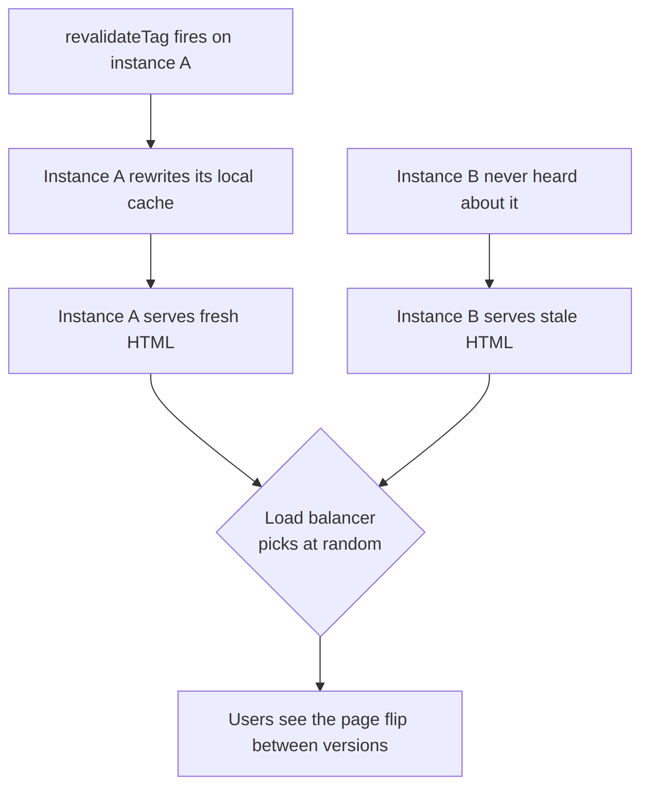

# Middleware, Runtime ও Deployment {#ch-nextjs-middleware-and-the-edge}

> একটি Next.js app-এর প্রতিটি অংশ কোথায় চলে তা জানুন, request layer ছোট রাখুন, আর build output এমনভাবে জুড়ুন যাতে এটা দ্বিতীয় একটি server-এও টিকে থাকে।

**এই অধ্যায়ে:** নাম বদলে `proxy` · এখানে auth check কেন optimistic · edge বনাম Node.js · `next build` কী তৈরি করে · যে cache দ্বিতীয় instance-এ ভেঙে যায়

## 💡 মূল ধারণা

একটি Next.js app তিন জায়গায় চলে। **Request layer** চলে router একটি route বাছাই করার আগে। **Render** চলে একটি
server runtime-এ, সাধারণত Node.js-এ, কখনো কখনো edge-এ। **Deployment target** ঠিক করে কে static file serve করবে,
কে server চালাবে, আর cache কোথায় থাকবে।

Production-এর বেশিরভাগ bug হলো ভুল জায়গায় করা কাজ: এমন auth check যেটা আর কেউ আবার করে না, database থেকে বহু
দূরে একটি edge query, load balancer-এর পেছনে একটি local cache। প্রতিটিই development-এ চলে, আর scale-এ গিয়ে
ভেঙে পড়ে।

> ⚠️ **যা বদলাতে থাকে:** Next.js 16 `middleware.ts`-এর নাম বদলে `proxy.ts` করেছে, আর `middleware` export-কে
> `proxy`। `proxy` শুধু Node.js-এ চলে। যে code-এর edge runtime লাগে, সেটা আপাতত `middleware.ts`-এই থাকে।
> 16 `'use cache'`-এর জন্য একটি `cacheHandlers` map-ও যোগ করেছে। যে নীতি টিকে থাকবে: routing-এর সিদ্ধান্ত ছোট
> থাকে, আর কয়েকটি process যে cache ভাগ করে, সেটাকে এমন জায়গায় থাকতে হবে যেখানে সবাই পৌঁছাতে পারে।

## কীভাবে কাজ করে

### Request layer

Request layer URL, header আর cookie দেখে। এটা redirect, rewrite বা একটি header যোগ করতে পারে। এটা চলে **তার
pattern-এর সঙ্গে মেলে এমন প্রতিটি request-এ**। তাই এখানে রাখা কাজ traffic দিয়ে গুণ হয়।

**`proxy.ts`-এ একটি locale rewrite, এমন একটি matcher-সহ যেটা static output বাদ দেয়**

```typescript
// proxy.ts — at the project root
import { NextResponse } from "next/server";
import type { NextRequest } from "next/server";

export function proxy(request: NextRequest): NextResponse {
  const locale = request.cookies.get("locale")?.value ?? "en";
  return NextResponse.rewrite(new URL(`/${locale}${request.nextUrl.pathname}`, request.url));
}

export const config = {
  matcher: ["/((?!_next/static|_next/image|favicon.ico).*)"],
};
```

`matcher`-ই খরচ নিয়ন্ত্রণ করে। এটা না থাকলে function-টি প্রতিটি image আর প্রতিটি chunk-এর জন্য চলে।
এই layer redirect, locale rewrite, A/B bucketing আর সস্তা cookie check-এ ভালো।

### এখানে auth optimistic, আর শুধুই optimistic

এখানে একটি cookie check হলো একটি **উপস্থিতির check**, session যাচাই নয়।

**Sign-out করা user-দের জন্য একটি optimistic redirect**

```typescript
// ✅ Is there a session cookie at all? Cheap, and correct as a redirect.
export function proxy(request: NextRequest): NextResponse | undefined {
  const hasSession = request.cookies.has("session");
  if (!hasSession && request.nextUrl.pathname.startsWith("/dashboard")) {
    return NextResponse.redirect(new URL("/login", request.url));
  }
}
```

এটা আসল check হতে পারে না। একটি cookie উপস্থিত থেকেও invalid হতে পারে। সরাসরি call করা একটি Server Action
pattern-এর সঙ্গে নাও মিলতে পারে। আর ঠিকমতো যাচাই করতে আপনার সবচেয়ে ব্যস্ত path-এ একটি round trip খরচ হয়।

**আসল check-এর জায়গা যেখানে data পড়া হয়**: Server Component-এ, Server Action-এ, বা দুটিই যে data access
layer call করে সেখানে। একই নিয়মের mutation-এর অংশটি আছে [Chapter ?? — Server Action](#ch-server-actions)-এ।

### Dynamic না হয়েও personalisation

Request layer route-কে dynamic না করেই *route* বদলাতে পারে। Country header দেখে `/uk/pricing`-এ rewrite করুন,
তাহলে প্রতিটি দেশের page prerender করা থাকে। Page-এর ভেতরে header পড়লে তা থাকত না।

> ⚠️ `NextResponse.next({ headers })` header-গুলো browser-এ পাঠায়, আপনার route-এ নয়। এগুলো framework-এর বসানো
> header-কেও override করতে পারে। নিচের দিকে একটি value পাঠাতে চাইলে সেটা **request** header-এ বসান।

### Edge বনাম Node.js

Edge runtime একটি ছোট JavaScript runtime, যেটা user-দের কাছাকাছি অনেক জায়গায় চলে। এটা দ্রুততর Node.js নয়।
এটা ভিন্ন এক সেট tradeoff।

| দিক        | Edge                                    | Node.js                              |
| ---------------- | --------------------------------------- | ------------------------------------ |
| Cold start       | খুব ছোট                              | বড়, আর বেশিরভাগ সময় warm    |
| User থেকে দূরত্ব | কাছে                                   | এক বা কয়েকটি region                 |
| Data থেকে দূরত্ব | সাধারণত দূরে — database-এর একটিই ঠিকানা | সাধারণত একই জায়গায়                   |
| API surface      | শুধু Web API — `fs` নেই, crypto সীমিত | সবকিছু, আর প্রতিটি npm package    |
| সবচেয়ে ভালো যেখানে          | Header আর cookie-র সিদ্ধান্ত, redirect  | Rendering, database-এর কাজ, ভারী logic |

ব্যর্থতার ধরন হলো: data পড়ে এমন একটি route edge-এ, অথচ database বসে আছে একটি region-এ। প্রতিটি query একটি
মহাদেশ পার হয়। তাই যে function 20 ms আগে শুরু হয়েছিল, সেটা 200 ms পরে শেষ হয়। **User পর্যন্ত latency সংখ্যার
অর্ধেক। Data পর্যন্ত latency বাকি অর্ধেক।** Node.js-ই default।

### `next build` কী তৈরি করে

একটি build "একটি app" তৈরি করে না। এটা তিনটি জিনিস তৈরি করে, যাদের hosting-এর চাহিদা আলাদা। এটা যে route table
print করে, সেটাই deployment-এর চুক্তি।

| Output                     | কোথায় থাকতে পারে      | Runtime-এ কী লাগে          |
| -------------------------- | ---------------------- | --------------------------------- |
| Static asset আর page    | একটি CDN বা একটি bucket      | কিছুই না                           |
| মেয়াদসহ cached page | একটি CDN, পেছনে একটি server | Store আর revalidate করার একটি জায়গা |
| Dynamic route             | একটি server process       | Request, আর আপনার data        |

একটি managed platform এগুলো আপনার হয়ে জুড়ে দেয়। Self-host করলে আপনি নিজে জোড়েন, আর image optimiser-এর CPU-র
দায়ও আপনার। পুরনো page আর হারিয়ে যাওয়া style মানে তিনটির একটি ভুলভাবে সামলানো হয়েছে।

Container-এর জন্য `output: 'standalone'` set করুন। এটা server-এর যেসব file লাগে, সেগুলো trace করে একটি folder-এ
রাখে, `server.js` entry point-সহ। **এটা `.next/static` আর `public/` বাদ দেয়**, কারণ আপনি হয়তো
সেগুলো একটি CDN থেকে serve করবেন। দুটিই নিজে image-এ copy করুন, নইলে app চালু হবে, কিন্তু style ছাড়া দেখাবে।

### দ্বিতীয় instance-এ cache ভেঙে যায়

Incremental cache প্রতিটি process-এর ভেতরে থাকে, memory-তে আর disk-এ। Load balancer-এর পেছনে দুটি process এটা ভেঙে দেয়:



**প্রতি instance-এর cache একটি revalidation-কে প্রতিটি visitor-এর জন্য টস করার খেলায় পরিণত করে।**

সমাধান হলো একটি shared cache handler, যার পেছনে Redis, S3, বা এমন কিছু যেখানে প্রতিটি process পৌঁছাতে পারে।
In-memory copy বন্ধ করুন, যাতে instance-গুলোর মধ্যে অমিল না হয়।

**একটি shared cache handler, প্রতি instance-এর memory cache বন্ধ করে**

```typescript
// next.config.ts
import path from "node:path";
import type { NextConfig } from "next";

const config: NextConfig = {
  cacheHandler: path.resolve("./cache-handler.js"),
  cacheMaxMemorySize: 0, // no per-instance memory cache
};
export default config;
```

একটি handler `get`, `set` আর tag invalidation implement করে। Team-গুলো tag-এর অংশটি বাদ দেয়, আর এটা চুপচাপ ব্যর্থ হয়।
`revalidateTag`-কে **প্রতিটি** instance-এ পৌঁছাতে হবে। দুটি process আর একটি revalidation দিয়ে এটা test করুন।

### Environment variable-এর দুটি জীবনকাল

| ধরন                   | কখন পড়া হয় | কে দেখতে পায়  | বদলাতে কী লাগে |
| ---------------------- | ------- | ----------- | ----------------- |
| `NEXT_PUBLIC_ANYTHING` | Build   | Browser | একটি rebuild         |
| অন্য যেকোনো variable     | Request | Server  | একটি restart         |

`NEXT_PUBLIC_` value-গুলো `next build`-এর সময় **bundle-এর ভেতরে inline হয়ে যায়**। এগুলো secret নয়, আর
artefact-এর ভেতরে জমে যায়। একটি server variable runtime-এ পড়া হয় শুধু dynamic render-এ।
Prerender করা route-এর ভেতরে build-time-এর value বসে যায়। `next/server` থেকে `await connection()`
সেই render-কে request time-এ সরিয়ে নেয়।

## কখন ব্যবহার করবেন

| পরিস্থিতি                                       | কোথায় রাখবেন                               |
| ----------------------------------------------- | ---------------------------------------------- |
| Sign-out করা user-দের `/dashboard` থেকে redirect করা | Request layer — একটি optimistic cookie check |
| User এই record পড়তে পারেন কিনা নিশ্চিত করা           | যে Server Component বা action এটা পড়ে   |
| প্রতি দেশে `/pricing` serve করা, তবুও prerender করা | Request layer-এ একটি rewrite                 |
| Database read লাগে এমন যেকোনো কিছু             | Node.js, কখনো request layer নয়               |
| পুরোপুরি static একটি marketing site                   | একটি CDN-এ `output: 'export'`                    |
| একাধিক server instance                   | একটি shared cache handler, সবসময়                 |

Preview, promotion আর version skew platform-এর বিষয়, সেগুলো আছে [Chapter ?? — Platform Deploys](#ch-platform-deploys)-এ।

## সাধারণ ভুল

**❌ Request layer-কে authorisation layer হিসেবে ধরা।** এটা routing-এর আগে চলে, প্রতিটি data access-এর আগে নয়।
Data যেখানে পড়া হয়, সেখানে check করুন।

**❌ কোনো matcher নেই, বা এমন matcher যেটা static asset ধরে ফেলে।** Function-টি প্রতিটি image আর chunk-এর জন্য চলে।
খরচটা development-এ চোখে পড়ে না, bill-এ স্পষ্ট দেখা যায়।

**❌ Cache handler ছাড়া দুটি instance-এ scale করা।** Revalidation একটি process-এ পৌঁছায়, আর একই
URL দুটি আলাদা page serve করে।

**❌ `NEXT_PUBLIC_`-এর পেছনে একটি secret রাখা।** এটা client bundle-এ compile হয়ে যায়। Prefix-টি value-কে
public হিসেবে চিহ্নিত করে।

## 🔑 মূল শিক্ষা

- Request layer প্রতিটি মিলে যাওয়া request-এ routing-এর আগে চলে, তাই `matcher`-ই এর সবচেয়ে গুরুত্বপূর্ণ line।
- Next.js 16-এ file-টি `proxy.ts`, export-টি `proxy`, আর এটা শুধু Node.js-এ চলে।
- Request layer-এ auth একটি optimistic redirect; আসল check-এর জায়গা যেখানে data পড়া হয়।
- Edge user-দের কাছে আর আপনার data থেকে দূরে, তাই Node.js-ই default, আর edge বেছে নিতে একটি কারণ লাগে।
- একটি build static asset, server code আর একটি cache তৈরি করে, আর দুটি instance-এর একটি shared cache handler লাগে।

## Interview-এর প্রশ্ন

**Q: Middleware-এ authentication check করা কেন যথেষ্ট নয়?**

একটি উপস্থিত cookie মানেই valid session নয়, আর middleware আপনার data-তে পৌঁছানোর প্রতিটি path-এ নাও চলতে পারে।
প্রতিটি request-এ ঠিকমতো একটি token যাচাই করাও খুব খরচসাপেক্ষ। এটা ভালো redirect হয়, কিন্তু access control-এর
সিদ্ধান্ত হিসেবে খারাপ। সেই সিদ্ধান্তের জায়গা query-র পাশে।

**Q: কখন edge runtime ভুল পছন্দ?**

যখন কাজের জন্য আপনার data লাগে। Edge function user-দের কাছে চলে, আর একটি region-এর database থেকে দূরে। তাই
প্রতিটি query সেই দূরত্বই পার হয়, যেটা function বাঁচিয়েছিল। Edge-এ কোনো filesystem-ও নেই, আর অনেক npm
package সেখানে চলে না। তাই rendering আর read-এর জন্য Node.js-ই যুক্তিসঙ্গত default।

**Q: Prerendering না ছেড়ে কীভাবে দেশ অনুযায়ী আলাদা pricing page serve করবেন?**

Request layer-এ country header পড়ুন, আর `/uk/pricing` বা `/us/pricing`-এ rewrite করুন। দুটিই
prerender করা থাকে, আর CDN থেকে serve করা যায়। Page-এর ভেতরে header পড়লে প্রতিটি visitor-এর জন্য সেটা dynamic হয়ে যেত।

**Q: Load balancer-এর পেছনে incremental regeneration কেন ভুল হয়?**

Default cache প্রতি instance-এর। একটি revalidation সেই instance-এই পৌঁছায়, যেটা ওই request সামলেছে। বাকিরা
পুরনো page serve করতে থাকে। Routing অনুযায়ী user-রা page-টি বদলাতে-ফিরতে দেখেন। সমাধান: shared storage-এর ওপর
একটি handler, `cacheMaxMemorySize` শূন্যে, আর এমন tag invalidation যেটা প্রতিটি instance-এ পৌঁছায়।

**Q: একই build তিনটি environment-এ কীভাবে deploy করবেন?**

একবার build করুন, আর environment-নির্দিষ্ট প্রতিটি value server-side-এ রাখুন। কোনো `NEXT_PUBLIC_` variable
আলাদা হতে পারবে না, কারণ এটা build time-এ inline হয়। Browser এমন value পায় একটি endpoint বা server props থেকে।
যেখানে একটি static route কোনো server value পড়ে, সেখানে `connection()` সেই render-কে request time-এ সরিয়ে নেয়।

## এরপর কী পড়বেন

- [Chapter ?? — Next.js-এ Rendering](#ch-rendering-in-nextjs) — একটি rewrite কেন route-কে prerender করা রাখে
- [Chapter ?? — Data Fetching ও Caching](#ch-nextjs-data-and-caching) — cache handler কী store করছে
- [Chapter ?? — Platform Deploys](#ch-platform-deploys) — preview, promotion আর version skew
