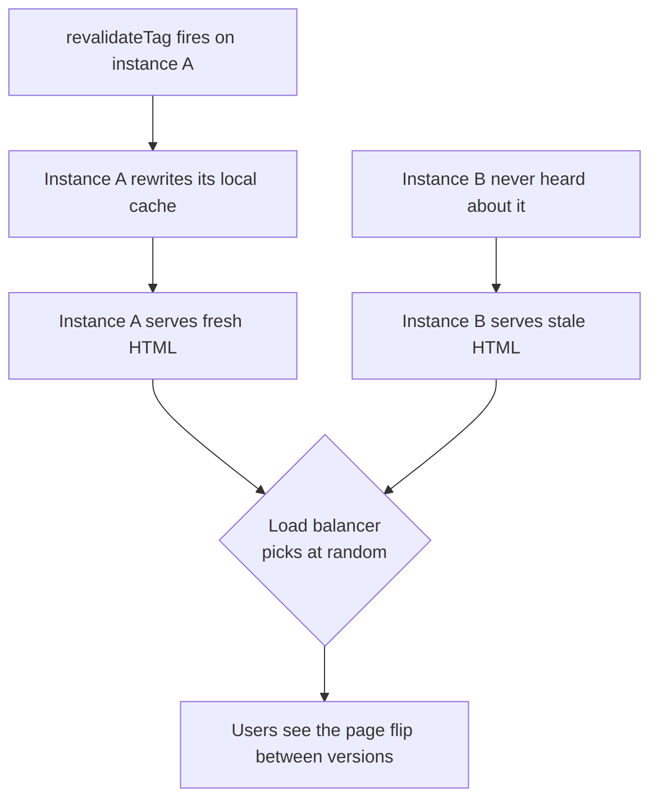

# Middleware, Runtime ও Deployment {#ch-nextjs-middleware-and-the-edge}

> Next.js app-এর কোন অংশ কোথায় চলে, তা জেনে নিন। Request layer ছোট রাখুন। আর build output এমনভাবে সাজান, যাতে দ্বিতীয় server যোগ করলেও সব ঠিক থাকে।

**এই অধ্যায়ে:** নাম বদলে `proxy` · এখানে auth check কেন শুধু optimistic · edge বনাম Node.js · `next build` আসলে কী বানায় · যে cache দ্বিতীয় instance-এ গিয়ে ভাঙে

## 💡 মূল ধারণা

একটি Next.js app চলে তিন জায়গায়। **Request layer** চলে router কোনো route বেছে নেওয়ার আগেই। **Render** চলে
server runtime-এ, সাধারণত Node.js-এ, কখনো edge-এ। আর **deployment target** ঠিক করে static file কে serve করবে,
server কে চালাবে, আর cache থাকবে কোথায়।

Production-এর বেশিরভাগ bug আসলে ভুল জায়গায় রাখা কাজ। যেমন এমন auth check, যা পরে আর কোথাও আবার হয় না। Database
থেকে অনেক দূরে edge-এ বসে query। কিংবা load balancer-এর পেছনে local cache। Development-এ এগুলো সবই চলে, ভাঙে
scale-এ গিয়ে।

> ⚠️ **যা বদলাতে থাকে:** Next.js 16-এ `middleware.ts`-এর নাম হয়েছে `proxy.ts`, আর `middleware` export হয়েছে
> `proxy`। `proxy` চলে শুধু Node.js-এ। যে code-এর edge runtime লাগে, সেটা আপাতত `middleware.ts`-এই থাকে।
> 16-এ `'use cache'`-এর জন্য `cacheHandlers` map-ও এসেছে। টেকসই নীতি: routing-এর সিদ্ধান্ত ছোট রাখুন, আর
> কয়েকটি process যে cache ভাগ করে, সেটা এমন জায়গায় রাখুন যেখানে সবাই পৌঁছাতে পারে।

## কীভাবে কাজ করে

### Request layer

Request layer দেখতে পায় URL, header আর cookie। এখান থেকে redirect, rewrite করা যায়, header যোগ করা যায়। এটা
চলে **pattern-এর সঙ্গে মেলা প্রতিটি request-এ**। তাই এখানে যত কাজ রাখবেন, traffic-এর সঙ্গে সেই কাজ তত গুণ বাড়বে।

**`proxy.ts`-এ locale rewrite, এমন matcher সহ যা static output বাদ দেয়**

```typescript
// proxy.ts — at the project root
import { NextResponse } from "next/server";
import type { NextRequest } from "next/server";

export function proxy(request: NextRequest): NextResponse {
  const locale = request.cookies.get("locale")?.value ?? "en";
  return NextResponse.rewrite(new URL(`/${locale}${request.nextUrl.pathname}`, request.url));
}

export const config = {
  matcher: ["/((?!_next/static|_next/image|favicon.ico).*)"],
};
```

খরচ সামলায় `matcher`। Matcher না থাকলে function-টা প্রতিটি image আর প্রতিটি chunk-এর জন্য চলবে। এই layer
ভালো redirect, locale rewrite, A/B bucketing আর সস্তা cookie check-এ।

### এখানে auth optimistic, শুধুই optimistic

এখানে cookie check মানে শুধু **cookie আছে কি না দেখা**। Session verify করা নয়।

**Sign out করা user-দের জন্য optimistic redirect**

```typescript
// ✅ Is there a session cookie at all? Cheap, and correct as a redirect.
export function proxy(request: NextRequest): NextResponse | undefined {
  const hasSession = request.cookies.has("session");
  if (!hasSession && request.nextUrl.pathname.startsWith("/dashboard")) {
    return NextResponse.redirect(new URL("/login", request.url));
  }
}
```

আসল check এটা হতে পারে না। Cookie থাকতে পারে, অথচ সেটা invalid। সরাসরি call করা Server Action pattern-এর সঙ্গে
না-ও মিলতে পারে। আর ঠিকমতো verify করতে গেলে আপনার সবচেয়ে ব্যস্ত path-এ একটি round trip বাড়তি লাগে।

**আসল check হবে যেখানে data পড়া হয়**: Server Component-এ, Server Action-এ, কিংবা দুটিই যে data access layer
call করে সেখানে। একই নিয়মের mutation-এর দিকটা আছে [Chapter ?? — Server Action](#ch-server-actions)-এ।

### Dynamic না হয়েও personalisation

Request layer route-কে dynamic না বানিয়েই *route* বদলে দিতে পারে। Country header দেখে `/uk/pricing`-এ rewrite
করুন, তাহলে প্রতিটি দেশের page prerendered থাকে। Page-এর ভেতরে header পড়লে সেটা আর থাকত না।

> ⚠️ `NextResponse.next({ headers })` header পাঠায় browser-এ, আপনার route-এ নয়। Framework নিজে যে header বসায়,
> এগুলো সেটাও override করে ফেলতে পারে। পরের ধাপে কোনো value পাঠাতে চাইলে সেটা বসান **request** header-এ।

### Edge বনাম Node.js

Edge runtime হলো ছোট একটি JavaScript runtime, যা user-দের কাছাকাছি অনেক জায়গায় চলে। এটা দ্রুততর Node.js নয়।
এটা আলাদা কিছু tradeoff-এর সেট।

| দিক              | Edge                                     | Node.js                                  |
| ---------------- | ---------------------------------------- | ---------------------------------------- |
| Cold start       | খুবই ছোট                                  | বড়, তবে বেশিরভাগ সময় warm থাকে            |
| User থেকে দূরত্ব  | কাছে                                      | এক বা কয়েকটি region                       |
| Data থেকে দূরত্ব  | সাধারণত দূরে — database থাকে এক জায়গায়    | সাধারণত একই জায়গায়                        |
| API surface      | শুধু Web API — `fs` নেই, crypto সীমিত      | সবকিছু, আর প্রতিটি npm package             |
| সবচেয়ে ভালো      | Header আর cookie-র সিদ্ধান্ত, redirect      | Rendering, database-এর কাজ, ভারী logic     |

গোলমাল হয় যখন data পড়া route থাকে edge-এ, আর database থাকে একটি region-এ। প্রতিটি query তখন মহাদেশ পার হয়। ফলে
যে function 20 ms আগে শুরু হয়েছিল, সেটা শেষ হয় 200 ms পরে। **User পর্যন্ত latency হিসাবের অর্ধেক। বাকি অর্ধেক
data পর্যন্ত latency।** Default হলো Node.js।

### `next build` কী বানায়

Build "একটি app" বানায় না। বানায় তিনটি জিনিস, যাদের hosting-এর চাহিদা আলাদা। Build যে route table print করে,
সেটাই deployment-এর চুক্তি।

| Output                         | কোথায় রাখা যায়              | Runtime-এ কী লাগে                  |
| ------------------------------ | -------------------------- | --------------------------------- |
| Static asset আর page           | CDN বা bucket              | কিছুই না                            |
| নির্দিষ্ট মেয়াদের cached page    | CDN, পেছনে একটি server       | Store আর revalidate করার জায়গা     |
| Dynamic route                  | Server process             | Request, আর আপনার data             |

Managed platform এগুলো আপনার হয়ে জুড়ে দেয়। Self-host করলে জোড়ার কাজ আপনার, আর image optimiser-এর CPU-ও আপনার
দায়িত্ব। Page stale থাকলে বা style হারিয়ে গেলে বুঝবেন, এই তিনটির কোনো একটি ভুলভাবে সামলানো হয়েছে।

Container-এর জন্য `output: 'standalone'` দিন। এটা server-এর দরকারি file খুঁজে বের করে একটি folder-এ রাখে, সঙ্গে
`server.js` entry point। **তবে `.next/static` আর `public/` বাদ পড়ে**, কারণ এগুলো আপনি CDN থেকে serve করতে
পারেন। দুটিই নিজে image-এ copy করুন। নইলে app চালু হবে, কিন্তু দেখাবে style ছাড়া।

### দ্বিতীয় instance-এ cache ভাঙে

Incremental cache থাকে প্রতিটি process-এর নিজের memory আর disk-এ। Load balancer-এর পেছনে দুটি process থাকলেই সেটা ভাঙে:



**Instance-প্রতি cache থাকলে একটি revalidation প্রতিটি visitor-এর জন্য হয়ে যায় টস করার মতো।**

সমাধান হলো shared cache handler, যার পেছনে Redis, S3, বা এমন কিছু যেখানে প্রতিটি process পৌঁছাতে পারে।
In-memory copy বন্ধ করে দিন, যাতে instance-গুলোর মধ্যে অমিল না হয়।

**Shared cache handler, instance-প্রতি memory cache বন্ধ রেখে**

```typescript
// next.config.ts
import path from "node:path";
import type { NextConfig } from "next";

const config: NextConfig = {
  cacheHandler: path.resolve("./cache-handler.js"),
  cacheMaxMemorySize: 0, // no per-instance memory cache
};
export default config;
```

Handler-কে `get`, `set` আর tag invalidation implement করতে হয়। Team-গুলো tag-এর অংশটা বাদ দেয়, আর তখন কোনো
শব্দ ছাড়াই সব ভেঙে যায়। `revalidateTag`-কে **প্রতিটি** instance-এ পৌঁছাতে হবে। দুটি process আর একটি
revalidation দিয়ে test করুন।

### Environment variable-এর দুই রকম আয়ু

| ধরন                    | কখন পড়া হয় | কে দেখতে পায় | বদলাতে কী লাগে |
| ---------------------- | --------- | ----------- | ------------- |
| `NEXT_PUBLIC_ANYTHING` | Build-এ    | Browser     | নতুন build     |
| অন্য যেকোনো variable    | Request-এ  | Server      | Restart       |

`NEXT_PUBLIC_` value-গুলো `next build`-এর সময় **bundle-এর ভেতরে বসিয়ে দেওয়া হয়**। এগুলো গোপন নয়, আর artefact-এর
ভেতরে জমে থাকে। Server variable runtime-এ পড়া হয় শুধু dynamic render-এ। Prerendered route-এর ভেতরে build-এর সময়ের
value-ই বসে যায়। `next/server` থেকে `await connection()` দিলে সেই render request-এর সময়ে সরে যায়।

## কখন ব্যবহার করবেন

| পরিস্থিতি                                          | কোথায় রাখবেন                                    |
| ------------------------------------------------- | ---------------------------------------------- |
| Sign out করা user-কে `/dashboard` থেকে সরিয়ে দেওয়া  | Request layer — optimistic cookie check         |
| User এই record পড়তে পারবেন কি না, তা নিশ্চিত করা   | যে Server Component বা action record-টা পড়ে      |
| দেশভেদে `/pricing` serve করা, তবু prerendered      | Request layer-এ rewrite                         |
| Database read লাগে এমন যেকোনো কাজ                  | Node.js, request layer কখনোই নয়                 |
| পুরোপুরি static marketing site                     | CDN-এ `output: 'export'`                         |
| একাধিক server instance                            | Shared cache handler, সবসময়                     |

Preview, promotion আর version skew platform-এর বিষয়। সেগুলো আছে [Chapter ?? — Platform Deploys](#ch-platform-deploys)-এ।

## সাধারণ ভুল

**❌ Request layer-কে authorisation layer ধরে নেওয়া।** এটা চলে routing-এর আগে, প্রতিটি data access-এর আগে নয়।
Check করুন যেখানে data পড়া হয় সেখানে।

**❌ Matcher না রাখা, বা এমন matcher যা static asset-ও ধরে ফেলে।** তখন function-টা প্রতিটি image আর chunk-এর
জন্য চলে। Development-এ খরচটা চোখে পড়ে না, bill-এ পড়ে স্পষ্টভাবে।

**❌ Cache handler ছাড়া দুটি instance-এ scale করা।** Revalidation পৌঁছায় একটি process-এ, আর একই URL দুই রকম
page দেখায়।

**❌ `NEXT_PUBLIC_`-এর পেছনে secret রাখা।** এটা client bundle-এ compile হয়ে যায়। এই prefix-এর মানেই হলো value-টা
public।

## 🔑 মূল শিক্ষা

- Request layer routing-এর আগে, মেলা প্রতিটি request-এ চলে। তাই এর সবচেয়ে জরুরি line হলো `matcher`।
- Next.js 16-এ file-টা `proxy.ts`, export-টা `proxy`, আর এটা চলে শুধু Node.js-এ।
- Request layer-এ auth মানে optimistic redirect। আসল check হবে যেখানে data পড়া হয়।
- Edge user-এর কাছে, কিন্তু আপনার data থেকে দূরে। তাই default হলো Node.js, edge বেছে নিতে কারণ লাগে।
- Build দেয় static asset, server code আর একটি cache। দুটি instance হলেই shared cache handler লাগবে।

## Interview-এর প্রশ্ন

**Q: Middleware-এ authentication check করা কেন যথেষ্ট নয়?**

Cookie থাকলেই session valid হয় না। আর আপনার data-য় পৌঁছানোর প্রতিটি পথে middleware চলবে, এমন নিশ্চয়তাও নেই।
তার ওপর প্রতিটি request-এ token ঠিকমতো verify করা খুব খরুচে। তাই middleware redirect-এর জন্য ভালো, কিন্তু
access control-এর সিদ্ধান্তের জন্য খারাপ। সেই সিদ্ধান্ত হবে query-র পাশে।

**Q: Edge runtime কখন ভুল পছন্দ?**

যখন কাজটায় আপনার data লাগে। Edge function চলে user-এর কাছে, আর এক region-এ থাকা database থেকে দূরে। ফলে function
যে দূরত্ব বাঁচিয়েছিল, প্রতিটি query সেই দূরত্বই আবার পার হয়। Edge-এ filesystem-ও নেই, আর অনেক npm package
সেখানে চলে না। তাই rendering আর read-এর জন্য যুক্তিসঙ্গত default হলো Node.js।

**Q: Prerendering না হারিয়ে দেশভেদে আলাদা pricing page কীভাবে serve করবেন?**

Request layer-এ country header পড়ে `/uk/pricing` বা `/us/pricing`-এ rewrite করুন। দুটিই prerendered থাকে, CDN
থেকে serve করা যায়। Page-এর ভেতরে header পড়লে প্রতিটি visitor-এর জন্য page-টা dynamic হয়ে যেত।

**Q: Load balancer-এর পেছনে incremental regeneration কেন গোলমাল করে?**

Default cache প্রতিটি instance-এর নিজের। Revalidation পৌঁছায় শুধু সেই instance-এ, যেটা ওই request সামলেছিল।
বাকিগুলো পুরনো page-ই দেখাতে থাকে। Routing অনুযায়ী user দেখেন page একবার এটা, একবার ওটা। সমাধান হলো shared
storage-এ handler, `cacheMaxMemorySize` শূন্য, আর এমন tag invalidation যা প্রতিটি instance-এ পৌঁছায়।

**Q: একই build তিনটি environment-এ কীভাবে deploy করবেন?**

একবার build করুন, আর environment-ভেদে বদলায় এমন সব value server-side-এ রাখুন। কোনো `NEXT_PUBLIC_` variable
আলাদা হতে পারবে না, কারণ সেটা build-এর সময়েই বসে যায়। Browser এ ধরনের value পায় কোনো endpoint বা server props
থেকে। কোনো static route server value পড়লে `connection()` সেই render-কে request-এর সময়ে সরিয়ে দেয়।

## এরপর কী পড়বেন

- [Chapter ?? — Next.js-এ Rendering](#ch-rendering-in-nextjs) — rewrite কেন route-কে prerendered রাখে
- [Chapter ?? — Data Fetching ও Caching](#ch-nextjs-data-and-caching) — cache handler আসলে কী store করছে
- [Chapter ?? — Platform Deploys](#ch-platform-deploys) — preview, promotion আর version skew
