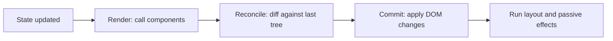

# React-এর Mental Model {#ch-react-mental-model}

> State বদলালে React কী করবে, আগে থেকেই বলতে পারুন। আর ক্রম বদলানো list-এর input-এ কেন ভুল লেখা রয়ে গেল, তা ব্যাখ্যা করতে পারুন।

**এই অধ্যায়ে:** render বনাম commit · reconciliation · component কেন re-render হয় · পরিচয় হিসেবে key · snapshot হিসেবে state

## 💡 মূল ধারণা

React আপনাকে বলে, একটি নির্দিষ্ট state-এ screen দেখতে কেমন হওয়া উচিত, সেটা বর্ণনা করুন। আগের screen থেকে সেখানে কীভাবে
পৌঁছাবেন, তা বলতে বলে না। আপনি state থেকে element বানানোর একটি function লেখেন; পার্থক্যটা React নিজেই হিসাব করে বের করে
আর প্রয়োগ করে।

React-এর যত আচরণ মানুষকে অবাক করে, তার বেশিরভাগ এই একটি বাক্যেই ব্যাখ্যা হয়ে যায়। **Render মানে হিসাব, DOM-এ লেখা নয়।**
আপনার component call করা সস্তা, আর সেটা প্রায়ই হয়। DOM-এ হাত দেওয়া দামি, আর সেটা হয় কালেভদ্রে, শুধু যে অংশগুলো সত্যিই
আলাদা সেখানে।

> আপনার component function পাঁচবার চলতে পারে, আর screen-এ কিছুই না বদলাতে পারে। এটা React-এর কাজ করা, শ্রম নষ্ট করা নয়।
> জিজ্ঞেস করার মতো প্রশ্ন কখনোই "render হয়েছে কি?" নয়, বরং "commit হয়েছে কি?"

## কীভাবে কাজ করে

### দুটি phase: আগে render, তারপর commit

একটি update নির্দিষ্ট কয়েকটি ধাপ পার হয়। শেষ দুটির আগে কিছুই DOM-এ হাত দেয় না।



**`setState` থেকে pixel পর্যন্ত পথ। শুধু Commit ধাপ DOM-এ লেখে।**

Render phase-কে pure হতে হবে। সেটা যাচাই করতে development-এ React আপনার component দুবার call করতে পারে। আরও জরুরি কোনো
update এলে result পুরোটা ফেলেও দিতে পারে। Side effect-এর জায়গা event handler বা effect-এ, component-এর body-তে কখনো নয়।

### Reconciliation

Reconciliation হলো diff করার ধাপ। এইমাত্র বানানো element tree-কে React আগেরটার সঙ্গে node ধরে ধরে মেলায়, আর তিনটি নিয়ম মানে।

| কী বদলেছে | React কী করে | খরচ |
| --------- | ----------- | --- |
| Element-এর type একই | DOM node আর তার state রেখে দেয়, শুধু props update করে | সস্তা |
| Element-এর type আলাদা | পুরো subtree ভেঙে আবার বানায় | দামি, আর state হারিয়ে যায় |
| List-এ অবস্থান | `key` দিয়ে মেলায়, key না থাকলে index দিয়ে | পুরোটাই key-এর ওপর নির্ভর করে |

দ্বিতীয় row-টাই ভোগায়। `<div>` থেকে `<span>` করলে নিচের প্রতিটি child, প্রতিটি DOM node আর প্রতিটি state ফেলে দেওয়া হয়।
একই জায়গায় দুটি আলাদা component-এর মধ্যে বদলাবদলি করলেও একই ঘটনা।

### Component কেন re-render হয়

কারণের তালিকা ছোট, আর জনপ্রিয় একটি উত্তর তাতে নেই।

| কারণ | Re-render হয়? |
| ---- | ------------- |
| নিজের state বদলেছে | ✅ হ্যাঁ |
| Parent re-render হয়েছে | ✅ হ্যাঁ — default-এ, props যা-ই হোক |
| যে context পড়ে, তার value বদলেছে | ✅ হ্যাঁ |
| Props বদলেছে | ❌ নিজে থেকে কোনো কারণ নয় |

Child re-render হয়, কারণ parent re-render হয়েছে। Props শুধু সঙ্গে আসে। Props তখনই *কারণ* হয়ে ওঠে, যখন child-কে `memo` দিয়ে
মুড়ে দেন। তাতে React-কে বলা হয় props মিলিয়ে দেখতে, আর মিলে গেলে render বাদ দিতে। ক্রমটা মনে রাখুন: আগে parent, তারপর props।
"এটা কেন re-render হচ্ছে?" প্রশ্নে আসল উত্তর আর আন্দাজের পার্থক্য এখানেই।

### State একটি snapshot

প্রতিটি render সেই state value দেখে, যা নিয়ে তাকে call করা হয়েছিল। Render চলার মাঝখানে সেগুলো বদলায় না।

**তিনটি update, বাড়ল মাত্র এক:**

```tsx
const [count, setCount] = useState<number>(0);

function handleClick(): void {
  setCount(count + 1); // count is 0 in this render
  setCount(count + 1); // still 0
  setCount(count + 1); // still 0 — final value is 1
}
```

**সমাধান — result নয়, বদলটা বর্ণনা করুন:**

```tsx
function handleClick(): void {
  setCount((c: number) => c + 1); // React applies each in turn — final value is 3
}
```

Updater form রুচির ব্যাপার নয়। পরের value আগেরটার ওপর নির্ভর করলে এটাই একমাত্র সঠিক উপায়। আর এর জন্যই একটি callback নতুন করে
না বানিয়ে নিরাপদে নিচে পাঠানো যায়।

### Key মানে পরিচয়

`key` React-কে বলে, render-এর পর render list-এর কোন item কোনটা। এটা label নয়, ক্রম সাজানোর জন্যও নয়। React-কে ভুল পরিচয় দিলে
সে state ভুল row-তে সরিয়ে দেয়।

**❌ Key হিসেবে index — state অবস্থানের পিছু নেয়:**

```tsx
{rows.map((row: Row, i: number) => <EditableRow key={i} row={row} />)}
```

প্রথম row মুছে দিলে বাকি প্রতিটি row এক index করে নিচে নামে। React দেখে "index 0-এর item-এর props বদলেছে", আর আগে থেকে থাকা
DOM node-টাই রেখে দেয়। ফলে row 1-এ অর্ধেক টাইপ করা লেখা এখন বসে আছে আগের row 2-এর জায়গায়।

**✅ Data থেকে আসা স্থির একটি পরিচয়:**

```tsx
{rows.map((row: Row) => <EditableRow key={row.id} row={row} />)}
```

একই কৌশল উল্টো দিকেও কাজ করে। ইচ্ছে করে key বদলালে React subtree ভেঙে আবার বানায়। যা edit হচ্ছে তা বদলালে state reset করার এটাই
সবচেয়ে পরিষ্কার উপায়।

```tsx
// Every piece of state inside EditForm resets when a different contact is selected.
<EditForm key={contact.id} contact={contact} />
```

## কখন ব্যবহার করবেন

Re-render-এর সমস্যা সাধারণত চার রকম চেহারায় আসে, আর memoisation দিয়ে মেটে শুধু একটি।

| লক্ষণ | কী ব্যবহার করবেন | কেন |
| ----- | --------------- | --- |
| প্রতিটি key চাপায় পুরো page re-render হয় | State-কে নামিয়ে input-এর ভেতরে নিন | যা সত্যিই বদলেছে, update সেখানেই সীমিত থাকে |
| একটি child-এর state বদলালে পুরো layout re-render হয় | দামি অংশটা `children` হিসেবে পাঠান | `children` parent বানায়, তাই সেটা re-render হয় না |
| একটি leaf সত্যিই দামি আর props স্থির | ওই leaf-এ `memo` | Props তখন সত্যিকারের skip-এর শর্ত হয়ে ওঠে |
| List-এর ক্রম বদলালে state হারায় | Render নয়, key ঠিক করুন | এটা পরিচয়ের bug, performance-এর নয় |

তৃতীয়টার আগে প্রথম দুটি চেষ্টা করুন। কাঠামো বদলাতে runtime-এ কোনো খরচ নেই। Memoisation প্রতিটি render-এ একটি তুলনা যোগ করে,
সঙ্গে একটি cache entry, যা ঠিক রাখতে হয়।

## সাধারণ ভুল

**❌ একটি component-এর ভেতরে আরেকটি component define করা:**

```tsx
function Page() {
  // A new function identity on every render — React sees a different type each time.
  function Row({ item }: { item: Item }) {
    return <li>{item.name}</li>;
  }
  return <ul>{items.map((i: Item) => <Row key={i.id} item={i} />)}</ul>;
}
```

প্রতিটি render-এ নতুন একটি `Row` তৈরি হয়, তাই reconciliation "আলাদা type"-এর পথ ধরে, subtree ভেঙে আবার বানায়। ভেতরের সব state
হারায়, প্রতিবার। **✅ `Row`-কে module scope-এ সরিয়ে দিন।**

**❌ State mutate করে একই reference দিয়ে `set` call করা:**

```tsx
items.push(newItem);
setItems(items); // Same array identity — React skips the update
```

**✅ নতুন একটি value বানান:**

```tsx
setItems((prev: Item[]) => [...prev, newItem]);
```

**❌ "Render হয়েছে"-কেই bug ভাবা।** যে render কিছুই commit করে না, তার খরচ প্রায় শূন্য। Optimise করার আগে profile করুন, আর
render-এর সংখ্যা নয়, commit মাপুন।

## 🔑 মূল শিক্ষা

- Render মানে হিসাব; DOM-এ লেখে শুধু commit phase।
- Component re-render হয় কারণ parent re-render হয়েছে — props গুরুত্ব পায় শুধু `memo` এলে।
- Element-এর type আলাদা হলে subtree আর তার ভেতরের সব state ভেঙে যায়।
- Key list-এর item-কে পরিচয় দেয়, তাই index-কে key বানালে ক্রম বদলালে বা কিছু মুছলে state ভুল row-তে চলে যায়।
- একটি render-এর ভেতরে state একটি snapshot; পরের value আগেরটার ওপর নির্ভর করলে সবসময় updater form ব্যবহার করুন।

## Interview-এর প্রশ্ন

**Q: Props না বদলালেও এই component re-render হয় কেন?**

কারণ এর parent re-render হয়েছে। Default-এ React একটি update-এর নিচের পুরো subtree re-render করে। আগে props মিলিয়ে দেখে না।
Child-কে `memo` দিয়ে মুড়লে সেই তুলনা যোগ হয়। কিন্তু তাতে লাভ হয় শুধু তখনই, যখন render-এর পর render props একই reference রাখে।
Parent-এর render-এ নতুন বানানো একটি object বা arrow function সঙ্গে সঙ্গে সেটা ব্যর্থ করে দেয়।

**Q: Array-র index-কে key বানালে আসলে কী ভুল হয়?**

React render-এর পর render list-এর item মেলায় key দিয়ে। Index হলে একটি item মুছলে বা ঢোকালে তার পরের প্রতিটি key সরে যায়। React
ভাবে item সরেনি, বরং আগে থেকে থাকা component-গুলো নতুন props পেয়েছে। DOM node আর তাদের ভেতরের state যেখানে ছিল সেখানেই থাকে,
আর data পাশ দিয়ে সরে যায়। চোখে পড়ে ভুল row-তে লেগে থাকা input-এর লেখা, scroll-এর অবস্থান বা focus হিসেবে।

**Q: বাছাই করা record বদলালে form কীভাবে reset করবেন — আর effect দিয়ে কেন নয়?**

Record-এর id-কে form component-এর `key` হিসেবে দিন। React আলাদা পরিচয় দেখে পুরনো subtree unmount করে নতুন একটি mount করে, ফলে
একটি render-এই সব field reset হয়ে যায়। Field খালি করার effect চলে browser পুরনো value paint করে ফেলার *পরে*, আর user সেগুলো দেখে
ফেলতে পারেন। তা ছাড়া নতুন যত state যোগ করবেন, সেই effect-কেও প্রতিবার তার সঙ্গে মিলিয়ে রাখতে হবে।

**Q: কখন `memo`-র দিকে হাত বাড়াবেন না?**

যখন component সস্তা, যখন তার props হলো parent-এর inline বানানো object বা callback, অথবা যখন আসল সমাধান state নিচে নামানো। `memo`
প্রতিটি render-এ একটি তুলনা যোগ করে, আর সঠিক রাখার একটি বোঝাও। React Compiler 1.0 থেকে stable, আর default-এ React 19 লক্ষ্য করে।
এর বেশিরভাগ সিদ্ধান্ত এটা আপনার হয়ে নেয়, তাই হাতে memoise করা এখন default নয়, বরং এমন কিছু যার পক্ষে যুক্তি দিতে হয়।

## এরপর কী পড়বেন

- [Chapter ?? — Hook-এর গভীরে](#ch-react-hooks-in-depth) — state আর effect কীভাবে component-এর instance-এর সঙ্গে জোড়া লাগে
- [Chapter ?? — `useEffect` and When Not to Use It](#ch-when-not-to-use-effect) — এই অধ্যায়ের model যে effect-গুলোকে অপ্রয়োজনীয় করে দেয়
- [Chapter ?? — Component Composition Pattern](#ch-react-composition-patterns) — যে কাঠামো বদল memoisation-কে হারিয়ে দেয়
