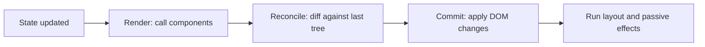

# React-এর Mental Model {#ch-react-mental-model}

> State বদলালে React কী করবে তা আগে থেকে বলতে পারুন, আর ব্যাখ্যা করুন কেন যে list-টি আপনি reorder করলেন, তার input-গুলোতে ভুল text থেকে গেল।

**এই অধ্যায়ে:** render বনাম commit · reconciliation · একটি component কেন re-render হয় · identity হিসেবে key · snapshot হিসেবে state

## 💡 মূল ধারণা

React আপনাকে বলতে বলে, একটি নির্দিষ্ট state-এ screen দেখতে কেমন হওয়া উচিত। আগের screen থেকে সেখানে কীভাবে
পৌঁছাবেন, সেটা বলতে বলে না। আপনি state থেকে element-এ যাওয়ার একটি function লেখেন। React পার্থক্যটা বের করে
আর সেটা প্রয়োগ করে।

এই এক বাক্যই React-এর বেশিরভাগ অবাক করা আচরণ ব্যাখ্যা করে। **Rendering একটি হিসাব, DOM-এ লেখা নয়।** আপনার
component call করা সস্তা, আর এটা প্রায়ই ঘটে। DOM ছোঁয়া দামি, আর এটা কমই ঘটে, শুধু সেই অংশগুলোর জন্য যেগুলো সত্যিই
আলাদা।

> আপনার component function পাঁচবার চলতে পারে, অথচ screen-এ কিছুই না বদলাতে পারে। এটা React-এর কাজ করা, React-এর
> পরিশ্রম নষ্ট করা নয়। জিজ্ঞেস করার মতো প্রশ্ন কখনো "এটা কি render হয়েছে?" নয়, বরং "এটা কি commit হয়েছে?"

## কীভাবে কাজ করে

### দুটি phase: আগে render, তারপর commit

একটি update কয়েকটি নির্দিষ্ট ধাপ পার হয়। শেষ দুটির আগে কিছুই DOM ছোঁয় না।



**`setState` থেকে pixel পর্যন্ত পথ। শুধু Commit ধাপই DOM-এ লেখে।**

Render phase-কে pure হতে হবে। সেটা যাচাই করতে React development-এ আপনার component দুবার call করতে পারে, আর আরও
জরুরি কোনো update এলে ফলাফলটা পুরোপুরি ফেলে দিতে পারে। Side effect-এর জায়গা event handler বা effect-এ, কখনো
component-এর body-তে নয়।

### Reconciliation

Reconciliation হলো diff-এর ধাপ। React এইমাত্র তৈরি করা element tree-টিকে আগেরটার সাথে node ধরে ধরে তুলনা করে, আর
তিনটি নিয়ম মেনে চলে।

| কী বদলেছে                | React কী করে                                     | খরচ                        |
| --------------------------- | --------------------------------------------------- | --------------------------- |
| Element type একই    | DOM node আর তার state রেখে দেয়, শুধু props update করে | সস্তা                       |
| Element type আলাদা   | পুরো subtree ভেঙে ফেলে আবার তৈরি করে           | দামি, আর state হারিয়ে যায় |
| List-এ অবস্থান            | `key` দিয়ে মেলায়, key না দিলে index দিয়ে   | পুরোটাই key-এর ওপর নির্ভর করে |

দ্বিতীয় row-টাই ভোগায়। `<div>` থেকে `<span>` করলে নিচের প্রতিটি child, প্রতিটি DOM node আর প্রতিটি state ফেলে দেওয়া
হয়। একই জায়গায় দুটি আলাদা component-এর মধ্যে অদলবদল করলেও তাই হয়।

### একটি component কেন re-render হয়

তালিকাটা ছোট, আর একটি জনপ্রিয় উত্তর এতে নেই।

| কারণ                                     | Re-render হয়?                                       |
| ----------------------------------------- | ------------------------------------------------- |
| এর নিজের state বদলেছে                     | ✅ হ্যাঁ                                            |
| এর parent re-render হয়েছে                    | ✅ হ্যাঁ — default-এ, props যা-ই হোক          |
| এটা যে context পড়ে, তার value বদলেছে          | ✅ হ্যাঁ                                            |
| এর props বদলেছে                         | ❌ নিজে থেকে কোনো কারণ নয়                         |

একটি child re-render হয়, কারণ তার parent হয়েছে। Props শুধু সাথে আসে। Child-কে `memo`-তে wrap করলে তবেই props একটি
*কারণ* হয়ে ওঠে। তখন React সেগুলো তুলনা করে, আর মিলে গেলে render বাদ দেয়। ক্রমটা মনে রাখুন: আগে parent, তারপর
props। "এটা কেন re-render হচ্ছে?" প্রশ্নের আসল উত্তরকে আন্দাজ থেকে এটাই আলাদা করে।

### State একটি snapshot

প্রতিটি render সেই state value-গুলো দেখে, যেগুলো নিয়ে তাকে call করা হয়েছিল। Render চলার মাঝে সেগুলো বদলায় না।

**তিনটি update, একটি increment:**

```tsx
const [count, setCount] = useState<number>(0);

function handleClick(): void {
  setCount(count + 1); // count is 0 in this render
  setCount(count + 1); // still 0
  setCount(count + 1); // still 0 — final value is 1
}
```

**সমাধান — ফলাফল নয়, পরিবর্তনটা বর্ণনা করুন:**

```tsx
function handleClick(): void {
  setCount((c: number) => c + 1); // React applies each in turn — final value is 3
}
```

Updater রূপটা পছন্দের ব্যাপার নয়। পরের value আগেরটার ওপর নির্ভর করলে এটাই একমাত্র সঠিক পথ। আর এটার জন্যই একটি
callback নতুন করে তৈরি না করে নিরাপদে নিচে পাঠানো যায়।

### Key হলো identity

একটি `key` React-কে বলে, render থেকে render-এ list-এর কোন item কোনটা। এটা কোনো label নয়, আর ক্রম ঠিক করার জন্যও
নয়। React-কে ভুল identity দিলে সে state ভুল row-তে সরিয়ে দেয়।

**❌ Key হিসেবে index — state অবস্থানের পেছনে যায়:**

```tsx
{rows.map((row: Row, i: number) => <EditableRow key={i} row={row} />)}
```

প্রথম row মুছে দিন, বাকি প্রতিটি row এক index নিচে সরে যাবে। React দেখে "index 0-এর item-এর props বদলেছে", আর তার
আগের DOM node-টিই রেখে দেয়। Row 1-এ অর্ধেক টাইপ করা text এখন বসে থাকে আগে যেটা row 2 ছিল, সেখানে।

**✅ Data থেকে আসা একটি স্থির identity:**

```tsx
{rows.map((row: Row) => <EditableRow key={row.id} row={row} />)}
```

একই mechanism উল্টো দিকেও কাজ করে। ইচ্ছা করে একটি key বদলান, React subtree ভেঙে আবার তৈরি করবে। যে জিনিস edit
হচ্ছে সেটা বদলালে state reset করার সবচেয়ে পরিষ্কার উপায় এটাই।

```tsx
// Every piece of state inside EditForm resets when a different contact is selected.
<EditForm key={contact.id} contact={contact} />
```

## কখন ব্যবহার করবেন

Re-render সমস্যা সাধারণত চার রকমের হয়, আর memoisation দিয়ে সমাধান হয় তার শুধু একটির।

| লক্ষণ                                      | কী ব্যবহার করবেন                              | কেন                                          |
| -------------------------------------------- | -------------------------------------- | --------------------------------------------- |
| প্রতিটি keystroke-এ পুরো page re-render হয়   | State-কে নামিয়ে input-এর ভেতরে নিন     | Update-কে সীমিত রাখুন যা সত্যিই বদলেছে তার মধ্যে |
| একটি child-এর state বদলালে layout re-render হয় | দামি অংশটা `children` হিসেবে পাঠান | `children` parent তৈরি করে, তাই এটা re-render হয় না |
| একটি leaf সত্যিই দামি, আর props স্থির | ওই leaf-এ `memo`                | Props-কে একটি সত্যিকারের skip condition বানায়        |
| List reorder হলে state হারিয়ে যায়           | Render নয়, key ঠিক করুন            | এটা identity bug, performance bug নয় |

তৃতীয়টার আগে প্রথম দুটি চেষ্টা করুন। Restructure করার runtime-এ কোনো খরচ নেই। Memoisation প্রতিটি render-এ একটি
তুলনা যোগ করে, আর একটি cache entry, যেটা সঠিক রাখতে হয়।

## সাধারণ ভুল

**❌ একটি component-এর ভেতরে আরেকটি component define করা:**

```tsx
function Page() {
  // A new function identity on every render — React sees a different type each time.
  function Row({ item }: { item: Item }) {
    return <li>{item.name}</li>;
  }
  return <ul>{items.map((i: Item) => <Row key={i.id} item={i} />)}</ul>;
}
```

প্রতিটি render একটি নতুন `Row` তৈরি করে, তাই reconciliation "আলাদা type"-এর পথ নেয়, subtree ভেঙে আবার তৈরি করে।
ভেতরের সব state হারিয়ে যায়, প্রতিবার। **✅ `Row`-কে module scope-এ সরিয়ে নিন।**

**❌ State mutate করে একই reference দিয়ে `set` call করা:**

```tsx
items.push(newItem);
setItems(items); // Same array identity — React skips the update
```

**✅ একটি নতুন value তৈরি করুন:**

```tsx
setItems((prev: Item[]) => [...prev, newItem]);
```

**❌ "এটা render হয়েছে"-কে bug মনে করা।** যে render কিছুই commit করে না, সেটা প্রায় বিনা খরচের। Optimise করার আগে
profile করুন, আর render-এর সংখ্যা নয়, commit মাপুন।

## 🔑 মূল শিক্ষা

- Rendering একটি হিসাব; শুধু commit phase DOM-এ লেখে।
- একটি component re-render হয় কারণ তার parent re-render হয়েছে — props গুরুত্ব পায় শুধু `memo` এলে।
- আলাদা element type পুরো subtree আর তার ভেতরের প্রতিটি state ভেঙে ফেলে।
- Key list item-কে identity দেয়, তাই index key reorder বা delete-এ state ভুল row-তে সরিয়ে দেয়।
- একটি render-এর ভেতরে state একটি snapshot; পরের value আগেরটার ওপর নির্ভর করলেই updater রূপ ব্যবহার করুন।

## Interview-এর প্রশ্ন

**Q: Props না বদলালেও এই component কেন re-render হয়?**

কারণ এর parent re-render হয়েছে। Default-এ React একটি update-এর নিচের পুরো subtree re-render করে। সে আগে props
তুলনা করে না। Child-কে `memo`-তে wrap করলে সেই তুলনাটা যোগ হয়। কিন্তু এটা তখনই কাজে দেয়, যখন render থেকে
render-এ props একই reference রাখে। Parent-এর render-এ তৈরি হওয়া একটি নতুন object বা arrow function সাথে সাথে এটাকে
ব্যর্থ করে দেয়।

**Q: Array index-কে key হিসেবে ব্যবহার করলে আসলে কী ভুল হয়?**

React render থেকে render-এ list item-গুলো key দিয়ে মেলায়। Index থাকলে, একটি item মুছলে বা ঢোকালে তার পরের প্রতিটি
key সরে যায়। React ভাবে, বিদ্যমান component-গুলো নতুন props পেয়েছে, item-গুলো সরেছে তা নয়। DOM node আর তাদের
ভেতরের state জায়গায় থেকে যায়, আর data তাদের পাশ দিয়ে সরে যায়। আপনি এটা দেখেন input text, scroll position বা
focus ভুল row-তে লেগে থাকা হিসেবে।

**Q: Selected record বদলালে একটি form কীভাবে reset করবেন — আর effect দিয়ে কেন নয়?**

Record-এর id-কে form component-এর `key` হিসেবে পাঠান। React একটি আলাদা identity দেখে, পুরনো subtree unmount করে আর
একটি নতুন mount করে, তাই একটি render-এই প্রতিটি field reset হয়ে যায়। Field খালি করার একটি effect চলে browser পুরনো
value-গুলো paint করে ফেলার *পরে*, আর user সেগুলো দেখতে পান। তার ওপর, আপনি যে নতুন state যোগ করবেন, প্রতিটির সাথে
ওই effect-কে মিলিয়ে রাখতে হবে।

**Q: কখন `memo`-র দিকে হাত বাড়াবেন না?**

যখন component সস্তা, যখন এর props parent-এর inline-এ তৈরি করা object বা callback, অথবা যখন আসল সমাধান হলো state
নিচে নামানো। `memo` প্রতিটি render-এ একটি তুলনা যোগ করে, আর সঠিকতার একটি বোঝা। React Compiler 1.0 থেকে stable,
আর default-এ React 19-কে target করে। এটা এই সিদ্ধান্তগুলোর বেশিরভাগ আপনার হয়ে নেয়, তাই হাতে memoise করা এখন
default নয়, বরং এমন কিছু যার পক্ষে যুক্তি দিতে হয়।

## এরপর কী পড়বেন

- [Chapter ?? — Hook-এর গভীরে](#ch-react-hooks-in-depth) — state আর effect কীভাবে একটি component instance-এর সাথে যুক্ত হয়
- [Chapter ?? — `useEffect`, আর কখন এটা ব্যবহার করবেন না](#ch-when-not-to-use-effect) — যে effect-গুলো এই অধ্যায়ের model অপ্রয়োজনীয় করে দেয়
- [Chapter ?? — Component Composition Pattern](#ch-react-composition-patterns) — যে restructuring memoisation-কে হারিয়ে দেয়
