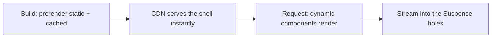

# Next.js-এ Rendering {#ch-rendering-in-nextjs}

> পুরো route-এর জন্য static নাকি dynamic বেছে নেওয়া বন্ধ করুন। তার বদলে ship করুন এমন static shell, যার ভেতরে dynamic ফাঁকা জায়গা আছে।

**এই অধ্যায়ে:** তিন ধরনের content · কীসে route dynamic হয় · Partial Prerendering · Suspense, যে boundary এটা সম্ভব করে · build output পড়া

## 💡 মূল ধারণা

আগে প্রশ্ন ছিল "এই page static নাকি dynamic?", আর প্রতিটি route-এর উত্তর একটিই। Page-এর কোনো অংশের request লাগলেই,
যেমন header-এ একটি নাম বা cart-এর সংখ্যা, পুরো page dynamic হয়ে যেত। ছয় মাসে একবারও না বদলানো marketing hero-ও
প্রতিটি visit-এ আবার render হতো।

**Partial Prerendering প্রশ্নটাই তুলে দেয়।** একটি route এখন static shell, আর তাতে ফাঁকা জায়গা থাকে, যেখানে
request-নির্ভর অংশগুলো বসে। Shell build-এর সময় prerender হয়, আর CDN থেকে serve করা যায়। সেটা সঙ্গে সঙ্গে পৌঁছায়,
আর ফাঁকা জায়গাগুলো stream হয়ে আসে যখন তাদের data resolve হয়। Next.js 16-এ `cacheComponents` flag এটা চালু করে।
এর ফলে তিন ধরনের content একই response-এ পাশাপাশি থাকতে পারে।

> Rendering-এর সিদ্ধান্ত এখন আর route ধরে হয় না, হয় component ধরে। পুরো ধারণা এটুকুই। API-র নামগুলো শুধু এ বছরের
> বানান।

> ⚠️ **যা বদলাতে থাকে:** এটা প্রথম এসেছিল `experimental.ppr` নামে, তারপর `dynamicIO`, আর Next.js 16-এ এর নাম
> `cacheComponents`। Version 16 প্রতিটি route-এর `experimental_ppr` export পুরোপুরি তুলেও দিয়েছে। টেকসই নীতি:
> rendering প্রতিটি component-এর আলাদা সিদ্ধান্ত, আর একটি static shell-এর ভেতরে dynamic ফাঁকা জায়গা থাকতে পারে।

## কীভাবে কাজ করে

### তিন ধরনের content

| ধরন         | কী এটা                                          | কখন render হয়              | কোথা থেকে আসে        |
| ----------- | ---------------------------------------------- | -------------------------- | ------------------- |
| **Static**  | Async data ছাড়া markup — header, nav, লেখা     | Build-এর সময়               | Prerender করা shell  |
| **Cached**  | `use cache` চিহ্ন দেওয়া async data              | Build-এ বা প্রথম request-এ, তারপর বারবার ব্যবহার | এটাও shell থেকে |
| **Dynamic** | Request পড়ে এমন যেকোনো কিছু                     | প্রতিটি request-এ, stream হয়ে | Shell-এর পরে       |

এই table-এর আসল line দ্বিতীয়টি। **Cached content static shell-এরই অংশ।** প্রতি ঘণ্টায় refresh হওয়া product list
header-এর সঙ্গেই CDN থেকে serve হয়, user আসার পরে fetch হয় না।

```tsx
export default function BlogPage() {
  return (
    <>
      <header><h1>Our Blog</h1></header>   {/* static */}
      <BlogPosts />                        {/* cached — in the shell */}
      <Suspense fallback={<PrefsSkeleton />}>
        <UserPreferences />                {/* dynamic — streams in */}
      </Suspense>
    </>
  );
}

async function BlogPosts() {
  "use cache";
  cacheLife("hours");
  return <PostList posts={await fetchPosts()} />;
}

async function UserPreferences() {
  const theme = (await cookies()).get("theme")?.value ?? "light";
  return <Prefs theme={theme} />;
}
```

### কীসে কোনো কিছু dynamic হয়

একটিমাত্র জিনিসে: এমন data পড়া, যা আছে শুধু একটি request এসেছে বলেই।

- `cookies()`, `headers()`, `draftMode()`
- Page-এ `searchParams`
- `connection()` — "request-এর জন্য অপেক্ষা করো" বলার explicit উপায়, request-এর সময়ের randomness-এর জন্য দরকার

বাকি সবকিছু static বা cache করার মতো, যতক্ষণ না উল্টোটা প্রমাণ হয়। Next.js 16-এ এগুলো সবই asynchronous, যাতে
এগুলো resolve হওয়ার আগেই prerendering শুরু হতে পারে।

### Suspense থাকলেই shell সম্ভব

যে dynamic component-এর চারপাশে কোনো Suspense boundary নেই, তার ফাঁকা জায়গা হওয়ার কোনো জায়গাই নেই। ফলে পুরো
route-কে তার জন্য অপেক্ষা করতে হয়। **Boundary শুধু loading-এর সৌন্দর্য নয়। এটাই সেই seam, যা ধরে prerenderer
কাটে।**



**একটি route, দুটি ধাপ: shell তৈরি হয় একবার, ফাঁকা জায়গা ভরে প্রতিটি request-এ।**

Boundary কোথায় টানবেন, সেটা design-এর সিদ্ধান্ত। বেশি ওপরে টানলে একটি ধীর query-র পেছনে অর্ধেক page অপেক্ষা করে।
বেশি নিচে টানলে user পড়ে চকচকে আয়তক্ষেত্রে ভরা একটি page। যে নিয়ম টেকে: **user যা যা আলাদাভাবে অপেক্ষা করবে,
তার প্রতিটির জন্য একটি boundary।**

### Dynamic segment আর `generateStaticParams`

`[slug]` থাকা route কিছুই prerender করে না, যতক্ষণ না আপনি বলেন কোন কোন slug আছে।

```tsx
export async function generateStaticParams(): Promise<{ slug: string }[]> {
  const posts = await getPosts();
  return posts.map((post) => ({ slug: post.slug }));
}
```

পঞ্চাশ হাজারের সবগুলো নয়, ওপরের কয়েকশো return করুন। যা বাদ পড়ল, সেটা প্রথম request-এ render হয়, আর তারপর থেকে
cache থাকে। এই আচরণকে আগে বলা হতো incremental static regeneration (ISR)।

### পুরনো configuration-এর নতুন রূপ

কোনো পুরনো codebase পড়লে route segment export-গুলো এখন কী হয়েছে, তা এই রকম।

| পুরনো                          | এখন                                    |
| ---------------------------- | ------------------------------------- |
| `experimental.ppr` config     | `cacheComponents: true`               |
| `export const experimental_ppr` | বাদ — flag-ই এটা সামলায়            |
| `dynamic = "force-dynamic"`   | কিছুই না — এটাই default               |
| `dynamic = "force-static"`    | `"use cache"`, সঙ্গে `cacheLife("max")` |
| `revalidate = 60`             | `cacheLife({ revalidate: 60 })`       |
| `unstable_cache(...)`         | `"use cache"`                         |

### Build output পড়া

`next build` প্রতিটি route-এর পাশে একটি চিহ্ন print করে, কী সিদ্ধান্ত নিল তা দেখাতে। List-টা দেখে নিন। যে route-কে
static shell ভেবেছিলেন, সেটা পুরো dynamic চিহ্নিত হলে কোনো user-এর আগেই bug-টা দেখতে পাবেন। সাধারণ কারণ হলো
সব Suspense boundary-র ওপরে একটি `cookies()` call, যা পুরো route-টাকেই dynamic করে দেয়।

## কখন ব্যবহার করবেন

| Route                                          | গঠন                                                        |
| ---------------------------------------------- | --------------------------------------------------------- |
| Marketing বা documentation page                 | পুরো static; কোনো boundary লাগে না                         |
| প্রতি ঘণ্টায় refresh হওয়া product listing      | `cacheLife("hours")` সহ `use cache` — তবু shell-এর ভেতরে |
| Live stock সহ product page                       | Static shell, stock থাকে Suspense boundary-র ভেতরে          |
| Dashboard, যার পুরোটাই প্রতিটি user-এর আলাদা     | Static chrome, বাকি সব stream হয়                          |
| Checkout                                        | পুরোটাই dynamic — first paint-এর চেয়ে সঠিকতা আগে          |
| Fold-এর ওপরে personalise করা route              | Dynamic না করে request layer-এ personalise করুন            |

## সাধারণ ভুল

**❌ Page component-এর একদম ওপরে `cookies()`।** এর নিচের সবকিছু এখন dynamic, shell নেই, আর একটি theme preference-এর
জন্য page request-time-এর খরচ দেয়। যে সবচেয়ে ছোট component-এর দরকার, সেখানেই পড়ুন, একটি boundary-র ভেতরে।

**❌ Stale data ঠিক করতে `force-dynamic` ধরা।** এর চেয়ে বড় হাতুড়ি আর নেই। যে সমস্যা ছিল একটি হারানো cache tag,
তার সমাধানে এটা route থেকে static shell-টাই সরিয়ে দেয়।

**❌ Suspense boundary ছাড়া dynamic content।** Stream হয়ে ঢোকার মতো কোনো ফাঁকা জায়গা নেই, তাই পুরো response অপেক্ষা
করে। লক্ষণ হলো এমন route, যা চুপচাপ prerender হওয়া বন্ধ করে দিয়েছে।

**❌ `generateStaticParams` সবকিছু return করছে।** Build-এর সময় পঞ্চাশ হাজার page মানে চল্লিশ মিনিটের deploy, এমন
page-এর জন্য যা কেউ চায়ই না। জনপ্রিয়গুলো prerender করুন, বাকিগুলো চাহিদামতো render হোক।

**❌ `use cache`-এর ভেতরে `Date.now()` বা `Math.random()`।** এটা চলে একবারই, cache ভরার সময়, আর পরে যে-ই পড়ুক,
একই জমে থাকা value দেখে। Request-এর সময়ের randomness চাইলে আগে `await connection()`।

**❌ এটাকে শুধু Vercel-এর জিনিস ভাবা।** Partial Prerendering একটি rendering কৌশল: shell বানাও, বাকিটা stream করো।
যে host static file serve করতে আর Node.js server চালাতে পারে, সে-ই এটা পারে। Platform-গুলোর পার্থক্য শুধু shell
কোথায় cache হয় আর server-এর cold start কত ধীর, তাতে।

## 🔑 মূল শিক্ষা

- Route এখন আর static বা dynamic নয় — এটা static shell, যার ফাঁকা জায়গায় dynamic অংশ stream হয়ে আসে।
- Cached content shell-এরই অংশ; শুধু request data dynamic।
- `cookies()`, `headers()` বা `searchParams` পড়াই একমাত্র জিনিস, যা কোনো কিছুকে dynamic করে।
- Suspense boundary শুধু spinner দেখায় না, এটা থাকলেই shell সম্ভব হয়।
- `cacheComponents: true` এসেছে `experimental.ppr`-এর জায়গায়, আর প্রতিটি route-এর `experimental_ppr` export আর নেই।

## Interview-এর প্রশ্ন

**Q: Partial Prerendering কোন সমস্যার সমাধান করে?**

সব-অথবা-কিছুই-না rendering-এর সিদ্ধান্ত। এর আগে page-এর যেকোনো জায়গায় একটি personalised element থাকলেই পুরো
route প্রতিটি request-এ render করতে হতো। প্রায় পুরো static একটি page header-এর একটি নামের জন্য dynamic-এর খরচ
দিত। PPR request-এর ওপর নির্ভর করে না এমন সবকিছু একটি shell-এ prerender করে, যা CDN সঙ্গে সঙ্গে serve করতে পারে।
আর request-নির্ভর অংশগুলো stream করে Suspense boundary দিয়ে চিহ্নিত ফাঁকা জায়গায়।

**Q: Suspense boundary কোথায় বসবে, তা কীভাবে ঠিক করবেন?**

User যে content-এর জন্য যুক্তিসঙ্গতভাবে আলাদা অপেক্ষা করবে, তার প্রতিটির জন্য একটি। প্রতিটি boundary একটি seam, যা
ধরে prerenderer কাটতে পারে। খুব কম হলে ধীর content দ্রুত content-কে আটকে রাখে। খুব বেশি হলে first paint হয় skeleton-এর
একটি grid। যা একসঙ্গে আসে, তা এক group-এ রাখুন, আর shell-এ যা থাকা উচিত, boundary রাখুন তার নিচে।

**Q: যে route prerender হবে ভেবেছিলেন, build output-এ সেটা পুরো dynamic দেখাচ্ছে। কী খুঁজবেন?**

সব Suspense boundary-র ওপরে call করা কোনো request API। সাধারণত সেটা layout-এ বা page-এর একদম ওপরে `cookies()` বা
`headers()`। এমন call-এর নিচের সবকিছু dynamic, তাই এক line-এই পুরো route-এর shell চলে যায়। সমাধান হলো read-টা যে
সবচেয়ে ছোট component-এর দরকার সেখানে নামিয়ে দেওয়া, আর সেই component-কে একটি boundary-তে মুড়ে দেওয়া।

**Q: কখন পুরো dynamic route-ই ঠিক উত্তর?**

যখন first paint-এর চেয়ে সঠিকতা বেশি জরুরি, আর page-এর কিছুই user-দের মধ্যে shared নয়। যেমন checkout, account
settings screen, বা admin tool। যে page-এর প্রতিটি element প্রতিটি user-এর আলাদা, তার shell দিয়ে শুধু একটি skeleton
পাওয়া যায়, আর মাথা ঘামানোর মতো একটি বাড়তি caching surface যোগ হয়। Senior উত্তর default-এর কথা বলে না, tradeoff-টার
নাম বলে।

## এরপর কী পড়বেন

- [Chapter ?? — Rendering Spectrum ও Hydration-এর খরচ](#ch-rendering-spectrum) — CSR, SSR, SSG আর island-এর মধ্যে PPR কোথায়
- [Chapter ?? — Data Fetching ও Caching](#ch-nextjs-data-and-caching) — কীসে content shell-এ ঢোকে
- [Chapter ?? — Suspense, Streaming ও Error Boundary](#ch-suspense-and-streaming) — ফাঁকা জায়গাগুলোর নিচের React mechanism
