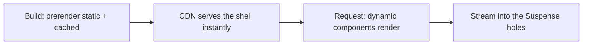

# Next.js-এ Rendering {#ch-rendering-in-nextjs}

> পুরো route-এর জন্য static না dynamic, সেটা বাছাই করা বন্ধ করুন। এর বদলে এমন একটি static shell পাঠান, যার ভেতরে dynamic ফাঁকা জায়গা আছে।

**এই অধ্যায়ে:** তিন ধরনের content · কী একটি route-কে dynamic করে · Partial Prerendering · Suspense, যে boundary এটা সম্ভব করে · build output পড়া

## 💡 মূল ধারণা

পুরনো প্রশ্ন ছিল "এই page কি static, না dynamic?", আর প্রতিটি route-এর জন্য একটাই উত্তর। Page-এর কোনো অংশের
request লাগলে, যেমন header-এ একটি নাম বা cart-এর count, পুরো page dynamic হয়ে যেত। যে marketing hero ছয় মাসে
বদলায়নি, সেটাও প্রতিটি visit-এ নতুন করে render হতো।

**Partial Prerendering প্রশ্নটাই সরিয়ে দেয়।** এখন একটি route হলো একটি static shell, যেখানে request-নির্ভর অংশগুলোর
জন্য ফাঁকা জায়গা রাখা থাকে। Shell-টি build time-এ prerender হয়, আর CDN থেকে serve করা যায়। এটা সঙ্গে সঙ্গে
পৌঁছায়। ফাঁকা জায়গাগুলো তাদের data resolve হলে stream হয়ে আসে। Next.js 16-এ `cacheComponents`
flag এটা চালু করে। এর ফলে তিন ধরনের content একই response-এ পাশাপাশি থাকতে পারে।

> Rendering-এর সিদ্ধান্তের একক route থেকে component-এ সরে গেছে। পুরো ধারণাটা এটুকুই। API-এর নামগুলো শুধু
> এই বছরের বানান।

> ⚠️ **যা বদলাতে থাকে:** এটা প্রথমে এসেছিল `experimental.ppr` হিসেবে, তারপর `dynamicIO`, আর Next.js 16-এ এটা
> `cacheComponents`। Version 16 প্রতি route-এর `experimental_ppr` export-টিও পুরোপুরি সরিয়ে দিয়েছে। যে নীতি টিকে
> থাকবে: rendering প্রতি component-এর সিদ্ধান্ত, আর একটি static shell-এর ভেতরে dynamic ফাঁকা জায়গা থাকতে পারে।

## কীভাবে কাজ করে

### তিন ধরনের content

| ধরন         | এটা কী                                          | কখন render হয়              | কোথা থেকে আসে |
| ----------- | ---------------------------------------------- | -------------------------- | ------------------- |
| **Static**  | Async data ছাড়া markup — header, nav, লেখা       | Build time                  | Prerender করা shell |
| **Cached**  | `use cache` চিহ্নিত async data                   | Build-এ বা প্রথম request-এ, তারপর বারবার ব্যবহার | এটাও shell থেকে |
| **Dynamic** | Request পড়ে এমন যেকোনো কিছু                       | প্রতি request-এ, stream করে      | Shell-এর পরে      |

এই table-এর গুরুত্বপূর্ণ line হলো দ্বিতীয়টি। **Cached content static shell-এরই অংশ।** যে product list প্রতি ঘণ্টায়
refresh হয়, সেটা header-এর সঙ্গে CDN থেকে serve হয়। User আসার পর fetch হয় না।

```tsx
export default function BlogPage() {
  return (
    <>
      <header><h1>Our Blog</h1></header>   {/* static */}
      <BlogPosts />                        {/* cached — in the shell */}
      <Suspense fallback={<PrefsSkeleton />}>
        <UserPreferences />                {/* dynamic — streams in */}
      </Suspense>
    </>
  );
}

async function BlogPosts() {
  "use cache";
  cacheLife("hours");
  return <PostList posts={await fetchPosts()} />;
}

async function UserPreferences() {
  const theme = (await cookies()).get("theme")?.value ?? "light";
  return <Prefs theme={theme} />;
}
```

### কী একটি জিনিসকে dynamic করে

শুধু একটি জিনিস: এমন data পড়া, যেটা কেবল একটি request আসার কারণেই আছে।

- `cookies()`, `headers()`, `draftMode()`
- একটি page-এ `searchParams`
- `connection()` — "একটি request-এর জন্য অপেক্ষা করো" বলার স্পষ্ট উপায়, request-time randomness-এর জন্য লাগে

বাকি সবকিছু static বা cache করার যোগ্য, যতক্ষণ না উল্টোটা প্রমাণ হয়। Next.js 16-এ এগুলো সবই asynchronous,
যাতে এগুলো resolve হওয়ার আগেই prerendering শুরু হতে পারে।

### Suspense-ই shell-কে সম্ভব করে

যে dynamic component-এর চারপাশে কোনো Suspense boundary নেই, তার ফাঁকা জায়গা হওয়ার কোনো জায়গা নেই। তাই পুরো
route-কে তার জন্য অপেক্ষা করতে হয়। **Boundary শুধু loading-এর সৌন্দর্য নয়। এটাই সেই seam, যেখান দিয়ে prerenderer কাটে।**



**একটি route, দুটি ধাপ: shell একবার build হয়, ফাঁকা জায়গাগুলো প্রতি request-এ ভরা হয়।**

Boundary কোথায় টানবেন, সেটা একটি design-এর সিদ্ধান্ত। খুব ওপরে হলে অর্ধেক page একটি ধীর query-র পেছনে অপেক্ষা
করে। খুব নিচে হলে user ঝিকমিক করা আয়তক্ষেত্রে ভরা একটি page পড়ে। যে নিয়ম টেকে: **user যেসব জিনিসের জন্য আলাদা
করে অপেক্ষা করবেন, তার প্রতিটির জন্য একটি boundary।**

### Dynamic segment আর `generateStaticParams`

`[slug]` আছে এমন route কিছুই prerender করে না, যদি না আপনি বলে দেন কোন কোন slug আছে।

```tsx
export async function generateStaticParams(): Promise<{ slug: string }[]> {
  const posts = await getPosts();
  return posts.map((post) => ({ slug: post.slug }));
}
```

প্রথম কয়েকশো return করুন, পঞ্চাশ হাজারের সবগুলো নয়। যেগুলো বাদ পড়ে, সেগুলো প্রথম request-এ render হয়, আর
তারপর থেকে cache-এ থাকে। এই আচরণকে আগে incremental static regeneration (ISR) বলা হতো।

### পুরনো configuration-এর সঙ্গে মিলিয়ে দেখা

আপনি যদি কোনো পুরনো codebase পড়েন, route segment export-গুলো এখন এই রূপ নিয়েছে।

| আগে                          | এখন                                   |
| ---------------------------- | ------------------------------------- |
| `experimental.ppr` config     | `cacheComponents: true`               |
| `export const experimental_ppr` | সরানো হয়েছে — flag-টিই এটা সামলায়        |
| `dynamic = "force-dynamic"`   | কিছুই না — এটাই default          |
| `dynamic = "force-static"`    | `"use cache"` সঙ্গে `cacheLife("max")` |
| `revalidate = 60`             | `cacheLife({ revalidate: 60 })`       |
| `unstable_cache(...)`         | `"use cache"`                         |

### Build output পড়া

`next build` প্রতিটি route-এর পাশে একটি চিহ্ন print করে, সে কী সিদ্ধান্ত নিয়েছে তা দেখাতে। এই list-টি দেখে নিন।
যে route-কে আপনি static shell ভেবেছিলেন, সেটা যদি পুরোপুরি dynamic দেখায়, তাহলে কোনো user-এর আগেই আপনি bug-টি
দেখতে পাবেন। সাধারণ কারণ হলো সব Suspense boundary-র ওপরে একটি `cookies()` call, যা পুরো route-কে
dynamic করে দেয়।

## কখন ব্যবহার করবেন

| Route                                          | আকার                                                     |
| ---------------------------------------------- | --------------------------------------------------------- |
| Marketing বা documentation page                 | পুরোপুরি static; কোনো boundary লাগে না                        |
| প্রতি ঘণ্টায় refresh হওয়া product listing          | `cacheLife("hours")` সহ `use cache` — তবুও shell-এর ভেতরে |
| Live stock সহ product page                    | Static shell, stock একটি Suspense boundary-র ভেতরে            |
| Dashboard, যার পুরোটাই প্রতি user-এর                   | Static কাঠামো, বাকি সব stream করা                   |
| Checkout                                        | পুরোটাই dynamic — প্রথম paint-এর চেয়ে সঠিকতা বেশি জরুরি        |
| যে route-এর ওপরের অংশ personalised             | Request layer-এ personalise করুন, dynamic হয়ে গিয়ে নয়    |

## সাধারণ ভুল

**❌ Page component-এর একেবারে ওপরে `cookies()`।** এর নিচের সবকিছু এখন dynamic, shell চলে গেছে, আর একটি theme
preference-এর জন্য page-কে request-time খরচ দিতে হয়। যে সবচেয়ে ছোট component-এর এটা লাগে, সেখানে একটি boundary-র
ভেতরে পড়ুন।

**❌ পুরনো data ঠিক করতে `force-dynamic` ব্যবহার করা।** এটা সবচেয়ে বড় হাতুড়ি। একটি missing cache tag-এর সমস্যা
সমাধান করতে এটা route থেকে static shell-টাই সরিয়ে দেয়।

**❌ Suspense boundary ছাড়া dynamic content।** এর stream হয়ে ঢোকার মতো কোনো ফাঁকা জায়গা নেই, তাই পুরো
response অপেক্ষা করে। লক্ষণ: একটি route, যেটা চুপচাপ prerender হওয়া বন্ধ করে দিয়েছে।

**❌ `generateStaticParams` সবকিছু return করছে।** Build time-এ পঞ্চাশ হাজার page মানে চল্লিশ মিনিটের deploy, এমন page-এর
জন্য যেগুলো কেউ চায় না। জনপ্রিয়গুলো prerender করুন, বাকিগুলো চাহিদামতো render হতে দিন।

**❌ `use cache`-এর ভেতরে `Date.now()` বা `Math.random()`।** এটা একবারই চলে, যখন cache ভরে। পরের প্রতিটি
reader একই জমে যাওয়া value দেখে। Request-time randomness-এর জন্য আগে `await connection()` করুন।

**❌ ধরে নেওয়া যে এটা শুধু Vercel-এ চলে।** Partial Prerendering একটি rendering কৌশল: একটি shell build করো, বাকিটা
stream করো। যে host static file serve করতে পারে আর একটি Node.js server চালাতে পারে, সেটাই এটা করতে পারে। Platform-গুলোর
পার্থক্য শুধু shell কোথায় cache হয়, আর server-এর cold start কতটা ধীর।

## 🔑 মূল শিক্ষা

- একটি route আর static বা dynamic নয় — এটা একটি static shell, যার dynamic ফাঁকা জায়গাগুলোতে content stream হয়ে আসে।
- Cached content shell-এর অংশ; শুধু request data dynamic।
- `cookies()`, `headers()` বা `searchParams` পড়াই একমাত্র জিনিস, যা কোনো কিছুকে dynamic করে।
- Suspense boundary-ই shell-কে থাকতে দেয়, এটা শুধু একটি spinner দেখানোর জিনিস নয়।
- `cacheComponents: true` `experimental.ppr`-এর জায়গা নিয়েছে, আর প্রতি route-এর `experimental_ppr` export আর নেই।

## Interview-এর প্রশ্ন

**Q: Partial Prerendering কোন সমস্যার সমাধান করে?**

সব-অথবা-কিছুই-না rendering সিদ্ধান্তের সমস্যা। এর আগে page-এর যেকোনো জায়গায় একটি personalised element থাকলে পুরো
route-কে প্রতি request-এ render হতে হতো। প্রায় static একটি page header-এর একটি নামের জন্য dynamic খরচ দিত। PPR
request-এর ওপর নির্ভর করে না এমন সবকিছু একটি shell-এ prerender করে, যেটা CDN সঙ্গে সঙ্গে serve করতে পারে।
Request-নির্ভর অংশগুলো এটা Suspense boundary দিয়ে চিহ্নিত ফাঁকা জায়গায় stream করে।

**Q: Suspense boundary কোথায় বসবে, সেটা কীভাবে ঠিক করেন?**

যে content-এর জন্য user যুক্তিসঙ্গতভাবে আলাদা করে অপেক্ষা করবেন, তার প্রতিটির জন্য একটি। প্রতিটি boundary একটি seam,
যেখান দিয়ে prerenderer কাটতে পারে। খুব কম হলে ধীর content দ্রুত content-কে আটকে দেয়। খুব বেশি হলে প্রথম
paint হয় skeleton-এর একটি grid। যেগুলো একসঙ্গে আসে সেগুলো এক group-এ রাখুন, আর boundary-কে shell-এ থাকার কথা এমন সব কিছুর
নিচে রাখুন।

**Q: যে route prerender হবে বলে আশা করেছিলেন, build output-এ সেটা পুরোপুরি dynamic দেখাচ্ছে। আপনি কী
খুঁজবেন?**

সব Suspense boundary-র ওপরে call করা একটি request API। সাধারণত এটা কোনো layout-এ বা page-এর একেবারে ওপরে
`cookies()` বা `headers()`। এমন call-এর নিচের সবকিছু dynamic, তাই একটি line পুরো route-এর shell সরিয়ে দেয়।
সমাধান হলো read-টিকে যে সবচেয়ে ছোট component-এর এটা লাগে সেখানে ঠেলে নামানো, আর সেই component-কে একটি boundary
দিয়ে ঘিরে দেওয়া।

**Q: কখন পুরোপুরি dynamic route-ই সঠিক উত্তর?**

যখন প্রথম paint-এর চেয়ে সঠিকতা বেশি গুরুত্বপূর্ণ, আর page-এর কিছুই user-দের মধ্যে ভাগ হয় না। উদাহরণ: checkout, account
settings screen, বা একটি admin tool। যে page-এর প্রতিটি element প্রতি user-এর, তার shell শুধু একটি skeleton দেয়,
আর ভাবার মতো একটি বাড়তি caching surface যোগ করে। Senior উত্তর default-এর নাম বলে না, tradeoff-এর নাম বলে।

## এরপর কী পড়বেন

- [Chapter ?? — Rendering Spectrum ও Hydration-এর খরচ](#ch-rendering-spectrum) — CSR, SSR, SSG আর island-এর মধ্যে PPR কোথায় বসে
- [Chapter ?? — Data Fetching ও Caching](#ch-nextjs-data-and-caching) — কী content-কে shell-এ রাখে
- [Chapter ?? — Suspense, Streaming ও Error Boundary](#ch-suspense-and-streaming) — ফাঁকা জায়গাগুলোর নিচের React mechanism
