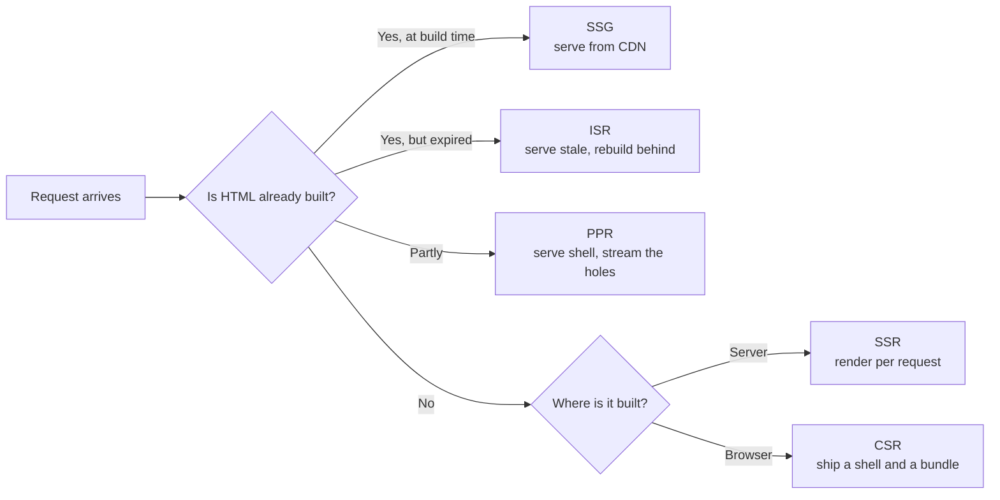

# Rendering Spectrum ও Hydration-এর খরচ {#ch-rendering-spectrum}

> CSR থেকে Server Components পর্যন্ত spectrum-এর প্রতিটি বিন্দুর নাম বলুন। তারপর একটি বেছে নেওয়ার আগে বলুন, প্রতিটি browser-এর কাছে কত খরচ চায়।

**এই অধ্যায়ে:** প্রতিটি strategy-র পেছনের দুটি প্রশ্ন · CSR, SSR, SSG, ISR, PPR · hydration কী আবার তৈরি করে · islands, progressive hydration আর resumability · সিদ্ধান্তের table

## 💡 মূল ধারণা

প্রতিটি rendering strategy দুটি প্রশ্নের উত্তর দেয়, শুধু দুটিই।

**HTML কখন তৈরি হয়?** Build-এর সময়, request-এর সময়, নাকি page load হওয়ার পর browser-এ।
**JavaScript কোথায় চলে?** একটি server-এ, একটি CDN edge location-এ, নাকি user-এর device-এ।

এই দুটি প্রশ্নকে আড়াআড়ি মেলালেই grid-টি পেয়ে যান। SSG হলো build-এর সময়, একটি server-এ। SSR হলো request-এর
সময়, একটি server-এ। CSR হলো request-এর সময়, device-এ। ISR হলো build-এর সময়, তারপর আবার তৈরি করে cache করা।
Partial Prerendering একই response-এ দুটিই একসাথে।

তবে server HTML-এর একটি ফাঁদ আছে। এতে কোনো listener নেই, কোনো state নেই। তাই framework সেগুলো জুড়তে browser-এ
একই component-গুলো আবার চালায়। এই দ্বিতীয় দফাটিই **hydration**। এর খরচ পুরো tree-র সমান, শুধু interactive অংশের
নয়।

এই খরচই spectrum-টিকে ব্যাখ্যা করে। SSR থেকে islands আর Server Components-এর দিকে প্রতিটি ধাপ কম JavaScript ship
করা আর চালানোর একেকটি চেষ্টা। Acronym-গুলো কয়েক বছর পরপর বদলায়। Grid আর খরচ বদলায় না।

> ⚠️ **বদলাতে থাকা লক্ষ্য:** এই spectrum-এর নামগুলো ধারণাগুলোর চেয়ে দ্রুত বদলায়। "ISR" একটি Next.js term।
> SvelteKit, Nuxt আর Astro সবাই এটা নিজেদের নামে implement করে। Partial Prerendering Next.js 16-এ
> `experimental` flag থেকে বেরিয়ে এসেছে, আর এখন Cache Components-এর অংশ হিসেবে ship হয়। টেকসই নীতিটি হলো
> **HTML কখন তৈরি হয়, code কোথায় চলে, আর browser-কে তার কতটা আবার চালাতে হয়**।

## কীভাবে কাজ করে

### এক ছবিতে spectrum

**পাঁচটি strategy, যাদের পার্থক্য শুধু একটিই: request আসার আগে কতটা HTML তৈরি হয়ে আছে।**

| Strategy | HTML তৈরি হয় | প্রতি request-এ server-এর কাজ | Data কতটা fresh |
| -------- | ---------- | ----------------------- | -------------- |
| **CSR** | Browser-এ, bundle চলার পর | কিছুই না | Live, fetch শেষ হলেই |
| **SSR** | Server-এ, প্রতিটি request-এ | পুরো render | Live |
| **SSG** | একবার, build-এর সময় | কিছুই না | শেষ build-এর সময়কার |
| **ISR** | Build-এর সময়, তারপর background-এ আবার তৈরি | প্রতি revalidation-এ একটি render | সর্বোচ্চ revalidation window পর্যন্ত stale |
| **PPR** | Shell build-এর সময়, hole-গুলো প্রতি request-এ | আংশিক render | Shell stale, hole-গুলো live |

বেশিরভাগ তর্কের নিষ্পত্তি করে তৃতীয় column। Server-এর কাজের জন্যই আপনি টাকা দেন, আর load-এর মুখে সেটাই ভেঙে
পড়ে। যে strategy-তে প্রতি request-এ কোনো কাজ নেই, traffic তাকে কাবু করতে পারে না। শুধু একটি cache miss-ই তার ক্ষতি
করতে পারে।

### ISR একটি caching চুক্তি, rendering mode নয়

ISR ঠিক SSR-এর মতোই render করে। পার্থক্য হলো output কোথায় যায়। এটা একটি নির্দিষ্ট মেয়াদসহ টেকসই cache-এ লেখা হয়,
আর পরের request render না করে cache থেকে পড়ে।

মেয়াদ শেষ হলে দুই রকম আচরণ সম্ভব। এ দুটি গুলিয়ে ফেললে সত্যিকারের incident ঘটে:

- **Invalidate** — stale copy-টি সঙ্গে সঙ্গে serve করুন, আর background-এ আবার তৈরি করুন। User কোনো কিছুর জন্য
  অপেক্ষা করে না। এটাই *stale-while-revalidate*, ISR ship করা প্রতিটি framework-এর default।
- **Delete** — entry-টি ফেলে দিন, যাতে page আবার তৈরি হওয়া পর্যন্ত পরের request আটকে থাকে। একটি দামের জন্য এটা
  ঠিক। অন্য সব জায়গায় এটা একটি latency spike।

> ⚠️ Invalidation সাধারণত একটি **tag** দিয়ে চিহ্নিত হয়, আর মোটা দাগের tag-এর blast radius বড়। 40,000 page-এ
> একটি `products` tag মানে একটি catalogue import সবগুলোকে আবার তৈরি করে। Identity দিয়ে tag দিন, যেমন
> `product:${id}`। Roll-up tag শুধু সেখানেই যোগ করুন, যেখানে আপনি হাতুড়িটাই চান।

### PPR: একটি response, দুটি উৎস

Partial Prerendering একটি route-কে ভাগ করে। Static অংশগুলো prerender হয়ে cache হয়। Dynamic অংশগুলো hole হিসেবে
চিহ্নিত থাকে। একটি request এলে cache করা shell সঙ্গে সঙ্গে চলে যায়, আর একটি function hole-গুলোকে একই response-এ
stream করে। কোনো দ্বিতীয় request নেই, কোনো client-side waterfall-ও (একটির পর একটি fetch) নেই।

যে অংশটি candidate-রা ভুল বলেন: **PPR server invocation বাদ দেয় না।** Hole আছে এমন একটি route প্রতিটি request-এ
একটি function চালায়। PPR যা বাদ দেয়, তা হলো *অপেক্ষা*।

### Hydration আসলে কত খরচ করে

ওপরের সবকিছু HTML নিয়ে। Hydration হলো সেই HTML পৌঁছানোর পর browser যা দেয়। Page দেখতে তৈরি মনে হয়, কিন্তু
চারটি ধাপ শেষ না হওয়া পর্যন্ত সাড়া দিতে পারে না:

| খরচ | যার সাথে বাড়ে | সাধারণ সমাধান |
| ---- | ----------- | ----------- |
| **Download** | Network-এ যাওয়া byte | Code splitting, compression |
| **Parse আর compile** | JavaScript-এর byte | কম byte; আর কোনো উপায় নেই |
| **Execute** | Tree-তে component-এর সংখ্যা | Tree-র কম অংশ hydrate করুন |
| **Attach আর state restore** | Listener আর props-এর সংখ্যা | ছোট props পাঠান |

মানুষ execute ধাপটিকে কম করে ধরে। বেশিরভাগ framework-এ এটা একটি লম্বা task। সেই লম্বা task-টিকেই
[Chapter ?? — Core Web Vitals](#ch-core-web-vitals) blocking time হিসেবে মাপে। User একটি আঁকা page দেখে click করে,
আর কিছুই হয় না, কারণ main thread তখন component-গুলো আবার চালাচ্ছে।

এই সময়টুকুই **uncanny valley**: page দেখতে শেষ, কিন্তু আচরণ করে একটি screenshot-এর মতো। First paint আর first
response-এর মাঝের ফাঁকটি হলো time-to-interactive (TTI) gap।

Hydration-এর জন্য সেই data-ও লাগে, যা দিয়ে server render করেছিল। Framework-গুলো এটা document-এর ভেতরে serialise
করে, JSON-এর একটি `<script>` block হিসেবে বা React Server Components payload হিসেবে। যে page 200 KB-র একটি
product list render করে, সেটা list-টি দুবার ship করে: একবার HTML হিসেবে, একবার JSON হিসেবে। Component যে field-গুলো
render করে, শুধু সেগুলোই পাঠান।

### Hydration mismatch

Hydration ধরে নেয় যে client render server-এর মতো একই markup তৈরি করবে। না করলে framework-এর সামনে একটি
**mismatch**। সাধারণ কারণগুলো হলো একটি তারিখ, একটি random value, বা একটি `typeof window` check।

React পার্থক্যটি চুপচাপ patch করে না। সে ওই subtree-র server HTML ফেলে দেয় আর client-এ আবার render করে। আপনি
server rendering-এর খরচ দিলেন, HTML ship করলেন, তারপর সেটা দ্বিতীয়বার render করলেন।

### কম hydrate করার চারটি উপায়

Spectrum-এর ডান প্রান্তটি এখান থেকেই এসেছে।

**Partial hydration (islands)** page-টিকে static HTML হিসেবে render করে, আর শুধু চিহ্নিত component-গুলো hydrate করে।
Astro এটাকে mainstream করেছে, প্রতিটি island-এর জন্য directive দিয়ে: তাৎক্ষণিকের জন্য `client:load`, browser শান্ত
হলে `client:idle`, component scroll করে চোখে এলে `client:visible`। Page-এর বাকি অংশ কোনো JavaScript ship করে না।
এর execute খরচ কমে না। খরচটা **থাকেই না**।

**Progressive আর selective hydration** একটিই application রাখে, কিন্তু লম্বা task-টিকে অনেকগুলোতে ভেঙে দেয়। React
এটা Suspense boundary ঘিরে করে। প্রতিটি boundary আলাদাভাবে hydrate হয়। যে boundary এখনো hydrate হয়নি, তাতে click
করলে React সেটাকেই আগে hydrate করে। মোট কাজ একই থাকে। Interactivity আসে user-এর প্রয়োজনের ক্রমে।

**Server Components**, React 19 থেকে stable, খরচটাকে framework-এর দিক থেকে আক্রমণ করে। যে component কখনো client-এ
চলে না, সেটা bundle-এ কিছু যোগ করে না, hydration-এও কিছু যোগ করে না। Islands static থাকে, যতক্ষণ না আপনি opt in
করেন। React client-এ থাকে, যতক্ষণ না আপনি boundary-র server দিকে থাকেন।

**Resumability** হলো বিপরীত উদাহরণ: এটা দ্বিতীয় দফাটিকে ছোট না করে বাদই দেয়। Qwik listener reference আর state
HTML-এর ভেতরে serialise করে, তাই browser শুরুতে কিছুই জোড়ে না। প্রথম click handler-এর chunk-টি fetch করে, আর
server যেখানে থেমেছিল সেখান থেকে চালিয়ে যায়।

| পদ্ধতি | Execute খরচ | যার জন্য সবচেয়ে ভালো | যে খরচ মেনে নেন |
| -------- | ------------ | -------- | --------------- |
| Full hydration | পুরো tree, একটি task | যে app-এর সবখানেই interactivity | Load-এর সময় আটকে থাকা main thread |
| Islands | শুধু চিহ্নিত component | কয়েকটি widget-সহ content site | Island-গুলো সহজে client state share করতে পারে না |
| Progressive | পুরো tree, অনেক task | বড় single-page app | জটিলতা, আর byte-এর কোনো সাশ্রয় নেই |
| Server Components | শুধু client component | যে React app-এর বেশিরভাগটাই static | Design করার মতো একটি serialisation boundary |
| Resumability | শুরুতে প্রায় শূন্য | খুব বড় page, দুর্বল device | বড় HTML, প্রথম interaction-এ fetch |

### অনুমান নয়, মেপে দেখুন

Lab run-এ **Total Blocking Time** দেখুন, আর load-এর পরপরই interaction-এর জন্য field থেকে **INP** দেখুন। Flame
chart-এ আপনার framework-এর root render নামে চিহ্নিত একটি চওড়া block-ই hydration। TBT ছোট কিন্তু INP খারাপ হলে
hydration সমস্যা নয়। তার বদলে একটি ব্যয়বহুল event handler খুঁজুন।

## কখন ব্যবহার করবেন

| Route | বেছে নিন | কারণ |
| ----- | ------ | ------- |
| Marketing page, docs, changelog | **SSG** | Content deploy-এর ছন্দে বদলায়; server খরচ শূন্য |
| Product listing, article index | **ISR** | নির্দিষ্ট interval-এ যথেষ্ট fresh, দাম static-এর মতো |
| Logged-in dashboard | **CSR** বা **SSR shell**, route অনুযায়ী ভাগ করে | কোনো crawler-এর মাথাব্যথা নেই, আর বাঁচানোর মতো static অংশও বেশি নেই |
| Personalised strip-সহ public page | **PPR** | Shell সবার জন্য এক, strip নয় |
| Search result, query parameter-চালিত যেকোনো কিছু | **SSR** | Cache key-এর কোনো সীমা নেই, তাই caching কিছুই দেয় না |
| কয়েকটি interactive widget-সহ content site | **SSG + islands** | Page-এর বেশিরভাগ অংশে কখনো JavaScript লাগেনি |
| বড় app, field-এ ধীর device | **Server Components** বা resumability | Tree-র আকারই খরচ |

দুটি নিয়ম সব ক্ষেত্রেই খাটে। প্রথমত: **যা shared, তা cache করুন; যা personal, তা render করুন।** দ্বিতীয়ত: **একটি
route-এর আলাদা cache key যত বেশি, caching-এর মূল্য তত কম।** User অনুযায়ী key করা একটি page-এর hit rate প্রায় শূন্য।

## সাধারণ ভুল

**❌ পুরো application-এর জন্য একটিই strategy বেছে নেওয়া।**
✅ একই codebase-এ একটি marketing site, একটি dashboard আর একটি search page-এর তিনটি আলাদা সঠিক উত্তর আছে।
[Chapter ?? — প্রতিটি Route-এর জন্য Rendering Strategy বাছাই, SEO সহ](#ch-choosing-per-route)-এর পুরো যুক্তি এটাই।

**❌ ধীর page ঠিক করতে SSR ধরা।**
✅ SSR কাজটাকে server-এ সরিয়ে দেয়। মুছে ফেলে না। Page যদি 900 KB JavaScript ship করে, SSR একটি server bill যোগ
করে, আর তবুও ওই 900 KB hydrate করে। First paint দ্রুত হয়। First response হয় না।

**❌ সহজ directive বলে প্রতিটি island-কে `client:load` দেওয়া।**
✅ সেটা আসলে বাড়তি ধাপসহ full hydration। Default হিসেবে `client:visible` বা `client:idle` নিন। প্রতিটি `client:load`-এর পক্ষে যুক্তি দিন।

**❌ Hydration mismatch warning চাপা দিয়ে "ঠিক" করা।**
✅ Warning-টি ওই subtree-র একটি দ্বিতীয় render আড়াল করে। যে value আলাদা হচ্ছে, সেটা খুঁজে বের করে মিলিয়ে দিন।
[Chapter ?? — Suspense, Streaming ও Error Boundary](#ch-suspense-and-streaming)-এ diagnosis আছে।

## 🔑 মূল শিক্ষা

- প্রতিটি strategy দুটি প্রশ্নের উত্তর দেয়: HTML কখন তৈরি হয়, আর code কোথায় চলে।
- ISR হলো SSR আর একটি মেয়াদসহ cache, আর hole আছে এমন প্রতিটি request-এ PPR এখনো একটি function চালায়।
- Hydration পুরো component tree আবার চালায়, আর এর execute ধাপটিই সেই লম্বা task, যা প্রথম click আটকে রাখে।
- Islands আর Server Components client-এর কাজ বাদ দেয়, progressive hydration শুধু সেটা নতুন করে সাজায়, আর resumability দ্বিতীয় দফাটাই এড়িয়ে যায়।
- Total Blocking Time সুস্থ থাকলে, page ধীর লাগার কারণ hydration নয়।

## Interview-এর প্রশ্ন

**Q: Server কী করে, সেই হিসেবে SSR আর SSG-র পার্থক্য কী?**

SSG render একবার চালায়, build-এর সময়, আর তারপর server শুধু একটি file host। SSR প্রতিটি request-এ render করে, তাই
server-এর লাগে data source, render budget, আর একটি spike সামলানোর capacity। HTML byte-এর হিসাবে হুবহু এক হতে পারে।
পার্থক্য হলো খরচ আর freshness।

**Q: একটি page 60 সেকেন্ডের revalidation-সহ ISR ব্যবহার করে। একজন user পাঁচ মিনিট পুরোনো data-র কথা জানিয়েছেন। এটা কি bug?**

অগত্যা নয়। Stale-while-revalidate cache করা copy serve করে আর তার পেছনে আবার তৈরি করে, তাই fresh data পায় *পরের*
visitor। Page-এ যদি পাঁচ মিনিটে একবার visit আসে, প্রতিটি visitor একটি stale page দেখেন। কম traffic-এর route-এর
দরকার on-demand invalidation, ছোট interval নয়।

**Q: Page 800 ms-এ paint হয়, কিন্তু আরও দুই সেকেন্ড click-এ সাড়া দেয় না। কী ঘটছে?**

HTML paint হয়ে গেছে, কিন্তু framework তখনো listener জোড়ার জন্য bundle download, parse আর execute করছে। সমাধান
হলো কম hydrate করা: route অনুযায়ী split করুন, component-গুলো server-এ সরান, বা static অংশটিকে islands-এ পরিণত করুন।
বেশি server rendering ফাঁকটি আরও বড় করে, কারণ page আরও আগে paint হয়।

**Q: একটি hydration mismatch-এর খরচ একটি console warning-এর চেয়ে বেশি কেন?**

React server HTML-কে বিশ্বাস করে, আর শুধু যতটুকু না করলেই নয় ততটুকু patch করে। Client render না মিললে সে ওই
subtree-র server output ফেলে দিয়ে আবার তৈরি করে। আপনি server rendering-এর খরচ দিলেন, HTML পাঠালেন, তারপর আবার
render করলেন। Root-এ হলে এর মানে হতে পারে পুরো page আবার render করা।

**Q: Resumability progressive hydration থেকে কীভাবে আলাদা?**

Progressive hydration তবুও client-এ প্রতিটি component চালায়, ছোট ছোট টুকরোয় আর ভালো ক্রমে। Resumability সেগুলো
চালায় না। Server state আর listener reference HTML-এর ভেতরে serialise করে, আর code আসে প্রথম যে interaction-এ
সেটা লাগে তখন। একটি কাজটাকে নতুন করে সাজায়। অন্যটি তার বেশিরভাগই মুছে ফেলে।

**Q: কখন islands ভুল architecture, আর কখন CSR সঠিক?**

Interactive অংশগুলো state share করলে islands ভুল। এরা আলাদা root, তাই একটি filter আর তার result-এর দরকার হয়
দুটির বাইরের একটি store, একটি URL parameter, বা একটি বড় island। CSR সঠিক, যখন কোনো crawler নেই আর cache করার মতো
shared HTML-ও নেই, যেমন একটি authenticated dashboard। সেখানে server rendering কেনে সামান্য দ্রুত একটি paint আর
একটি uncacheable server bill।

## এরপর কী পড়বেন

- [Chapter ?? — Streaming HTML](#ch-streaming-html) — hydration শুরু হওয়ার আগে markup কীভাবে পৌঁছায়
- [Chapter ?? — প্রতিটি Route-এর জন্য Rendering Strategy বাছাই, SEO সহ](#ch-choosing-per-route) — এই table-টিকে এমন একটি সিদ্ধান্তে পরিণত করা, যার পক্ষে আপনি যুক্তি দিতে পারেন
- [Chapter ?? — Server Component ও Client Component](#ch-server-components-vs-client-components) — React boundary কোথায় বসে, আর কী সেটা পার হয়
