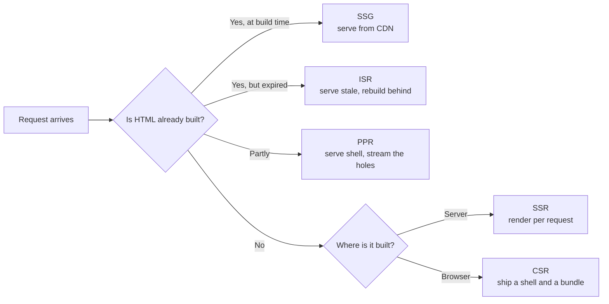

# Rendering Spectrum ও Hydration-এর খরচ {#ch-rendering-spectrum}

> CSR থেকে Server Components পর্যন্ত spectrum-এর প্রতিটি বিন্দুর নাম বলতে পারুন, আর কোনোটা বেছে নেওয়ার আগে বলুন প্রতিটির জন্য browser-কে কী দাম দিতে হয়।

**এই অধ্যায়ে:** প্রতিটি strategy-র পেছনের দুটি প্রশ্ন · CSR, SSR, SSG, ISR, PPR · hydration কী আবার বানায় · islands, progressive hydration আর resumability · সিদ্ধান্তের table

## 💡 মূল ধারণা

প্রতিটি rendering strategy দুটি প্রশ্নের উত্তর দেয়, শুধু এই দুটিরই।

**HTML কখন তৈরি হয়?** Build-এর সময়, request-এর সময়, নাকি page load হওয়ার পরে browser-এ।
**JavaScript কোথায় চলে?** Server-এ, CDN-এর কোনো edge location-এ, নাকি user-এর device-এ।

এই দুটি প্রশ্ন আড়াআড়ি মেলালেই grid পেয়ে যান। SSG হলো build-এর সময়, server-এ। SSR হলো request-এর সময়, server-এ।
CSR হলো request-এর সময়, device-এ। ISR হলো build-এর সময়, তারপর আবার বানিয়ে আবার cache করা। Partial Prerendering
একসঙ্গে দুটিই, একটি response-এর ভেতরে।

তবে server-এর HTML-এ একটি ফাঁক আছে। এতে কোনো listener নেই, কোনো state নেই। তাই সেগুলো জুড়তে framework একই
component-গুলো browser-এ আবার চালায়। এই দ্বিতীয় দফাটাই **hydration**, আর এর খরচ পুরো tree-র সমান, শুধু interactive
অংশগুলোর নয়।

Spectrum কেন আছে, তা এই খরচ থেকেই বোঝা যায়। SSR থেকে islands আর Server Components-এর দিকে প্রতিটি ধাপ হলো কম
JavaScript পাঠানো আর কম চালানোর একেকটি চেষ্টা। কয়েক বছর পরপর acronym বদলায়। Grid আর খরচ বদলায় না।

> ⚠️ **যা বদলাতে থাকে:** এই spectrum-এর নামগুলো ধারণাগুলোর চেয়ে দ্রুত বদলায়। "ISR" একটি Next.js-এর শব্দ।
> SvelteKit, Nuxt আর Astro সবাই এটা implement করে নিজেদের নামে। Partial Prerendering Next.js 16-এ `experimental`
> flag ছেড়ে বেরিয়েছে, এখন আসে Cache Components-এর অংশ হিসেবে। টেকসই নীতি হলো **HTML কখন তৈরি হয়, code কোথায়
> চলে, আর তার কতটা browser-কে আবার চালাতে হয়**।

## কীভাবে কাজ করে

### এক ছবিতে spectrum

**পাঁচটি strategy, যাদের আলাদা করা যায় শুধু request আসার আগে কতটা HTML তৈরি থাকে তা দিয়ে।**

| Strategy | HTML তৈরি হয় | প্রতি request-এ server-এর কাজ | Data কতটা টাটকা |
| -------- | ---------- | ----------------------- | -------------- |
| **CSR** | Browser-এ, bundle চলার পরে | কিছুই না | Live, fetch শেষ হলে |
| **SSR** | Server-এ, প্রতিটি request-এ | পুরো render | Live |
| **SSG** | একবার, build-এর সময় | কিছুই না | শেষ build-এর সময়কার |
| **ISR** | Build-এ, তারপর background-এ আবার | প্রতি revalidation-এ একটি render | Revalidation window পর্যন্ত stale হতে পারে |
| **PPR** | Shell build-এ, ফাঁকগুলো প্রতি request-এ | আংশিক render | Shell stale, ফাঁকগুলো live |

বেশিরভাগ তর্কের মীমাংসা হয় তৃতীয় column-এ। Server-এর কাজের জন্যই আপনি টাকা দেন, আর load-এর চাপে সেটাই ভেঙে পড়ে।
যে strategy-তে প্রতি request-এ কোনো কাজ নেই, traffic তাকে কাবু করতে পারে না। তার ক্ষতি করতে পারে শুধু cache miss।

### ISR হলো caching-এর চুক্তি, rendering mode নয়

ISR ঠিক SSR-এর মতোই render করে। পার্থক্য হলো output কোথায় যায়। সেটা লেখা হয় নির্দিষ্ট মেয়াদের একটি টেকসই cache-এ,
আর পরের request render না করে cache থেকে পড়ে।

মেয়াদ ফুরোলে দুই রকম আচরণ হতে পারে। এ দুটি গুলিয়ে ফেললে সত্যিকারের incident হয়:

- **Invalidate** — stale copy সঙ্গে সঙ্গে serve করুন, আর background-এ আবার বানান। User-কে কিছুর জন্য অপেক্ষা করতে
  হয় না। এটাই *stale-while-revalidate*, ISR থাকা প্রতিটি framework-এর default।
- **Delete** — entry-টা মুছে দিন, ফলে পরের request page আবার তৈরি না হওয়া পর্যন্ত আটকে থাকে। দামের মতো জিনিসের
  জন্য এটা ঠিক। বাকি সব জায়গায় এটা একটি latency spike।

> ⚠️ Invalidation সাধারণত হয় **tag** ধরে, আর মোটা দাগের tag-এর blast radius বড়। 40,000 page-এ একটিমাত্র
> `products` tag থাকলে একটি catalogue import-এই সবগুলো আবার তৈরি হয়। Tag দিন identity ধরে, যেমন
> `product:${id}`। হাতুড়ি যেখানে সত্যিই চান, শুধু সেখানে একটি roll-up tag যোগ করুন।

### PPR: একটি response, দুটি উৎস

Partial Prerendering একটি route-কে ভাগ করে। Static অংশগুলো prerender হয়ে cache-এ থাকে। Dynamic অংশগুলো চিহ্নিত
থাকে ফাঁক হিসেবে। Request এলে cached shell সঙ্গে সঙ্গে চলে যায়, আর একটি function ফাঁকগুলো একই response-এ stream করে।
দ্বিতীয় কোনো request নেই, client-side waterfall-ও (একটির পর একটি fetch) নেই।

Candidate-রা যেখানে ভুল করেন: **PPR server invocation বাদ দেয় না।** ফাঁক থাকা route প্রতিটি request-এ একটি function
চালায়। PPR যা বাদ দেয়, তা হলো *অপেক্ষা*।

### Hydration-এর আসল খরচ

ওপরের সবকিছু HTML নিয়ে। HTML পৌঁছানোর পরে browser যে দাম দেয়, সেটাই hydration। Page দেখতে তৈরি মনে হয়, কিন্তু চারটি
ধাপ শেষ না হওয়া পর্যন্ত সাড়া দিতে পারে না:

| খরচ | বাড়ে যার সঙ্গে | সাধারণ সমাধান |
| ---- | ----------- | ----------- |
| **Download** | Network-এ যাওয়া byte | Code splitting, compression |
| **Parse আর compile** | JavaScript-এর byte | কম byte; আর কোনো উপায় নেই |
| **Execute** | Tree-তে component-এর সংখ্যা | Tree-র কম অংশ hydrate করা |
| **Attach আর state ফেরানো** | Listener আর props-এর সংখ্যা | ছোট props পাঠানো |

Execute ধাপটাকে মানুষ কম করে ধরে। বেশিরভাগ framework-এ এটা একটি long task। সেই long task-কেই
[Chapter ?? — Core Web Vitals](#ch-core-web-vitals) blocking time হিসেবে মাপে। User আঁকা page দেখে click করেন, কিন্তু
কিছুই হয় না, কারণ main thread তখন component-গুলো আবার চালাচ্ছে।

এই সময়টুকুই **uncanny valley**: page দেখতে শেষ, অথচ আচরণ করে screenshot-এর মতো। First paint আর প্রথম সাড়ার মাঝের
ফাঁকটাই time-to-interactive (TTI) gap।

Server যে data দিয়ে render করেছিল, hydration-এর সেটাও লাগে। Framework-গুলো সেটা document-এর ভেতরে serialise করে
রাখে, JSON-এর একটি `<script>` block হিসেবে, বা React Server Components payload হিসেবে। 200 KB-র product list render
করা page সেটা পাঠায় দুবার: একবার HTML হিসেবে, একবার JSON হিসেবে। Component যে field-গুলো render করে, শুধু সেগুলোই পাঠান।

### Hydration mismatch

Hydration ধরে নেয় client-এর render server-এর মতো একই markup দেবে। না দিলে framework পায় একটি **mismatch**। সাধারণ
কারণ হলো কোনো date, কোনো random value, বা `typeof window` check।

React পার্থক্যটা চুপচাপ patch করে দেয় না। ওই subtree-র server HTML ফেলে দিয়ে client-এ আবার render করে। আপনি server
rendering-এর দাম দিলেন, HTML পাঠালেন, তারপর দ্বিতীয়বার render করলেন।

### কম hydrate করার চারটি উপায়

Spectrum-এর ডান দিকটা এখান থেকেই এসেছে।

**Partial hydration (islands)** পুরো page static HTML হিসেবে render করে, আর hydrate করে শুধু চিহ্নিত component-গুলো।
Astro এটাকে mainstream বানিয়েছে, প্রতিটি island-এর জন্য directive দিয়ে: সঙ্গে সঙ্গে চাইলে `client:load`, browser
শান্ত হলে `client:idle`, আর component scroll করে চোখে এলে `client:visible`। Page-এর বাকি অংশে কোনো JavaScript যায়
না। সেখানে execute-এর খরচ কমে না, **একেবারেই থাকে না**।

**Progressive আর selective hydration** application একটিই রাখে, কিন্তু long task-টাকে অনেকগুলো ছোট task-এ ভাঙে।
React এটা করে Suspense boundary ধরে। প্রতিটি boundary নিজের মতো hydrate হয়, আর এখনো hydrate না হওয়া boundary-তে click
পড়লে React সেটাকেই আগে hydrate করে। মোট কাজ একই থাকে। Interactivity আসে user-এর যে ক্রমে দরকার, সেই ক্রমে।

**Server Components**, React 19 থেকে stable, খরচটাকে আক্রমণ করে framework-এর দিক থেকে। যে component কখনো client-এ চলে
না, সেটা bundle-এ কিছু যোগ করে না, hydration-এও না। Islands static থাকে, যতক্ষণ না আপনি চালু করেন। React client-এ
থাকে, যতক্ষণ না আপনি boundary-র server দিকে থাকেন।

**Resumability** উল্টো উদাহরণ: দ্বিতীয় দফাটা ছোট না করে পুরোপুরি বাদ দেয়। Qwik listener reference আর state HTML-এর
ভেতরে serialise করে রাখে, তাই browser শুরুতে কিছুই জোড়ে না। প্রথম click handler-এর chunk fetch করে, আর server যেখানে
থেমেছিল সেখান থেকে কাজ চালিয়ে যায়।

| পদ্ধতি | Execute-এর খরচ | সবচেয়ে ভালো | যে দাম মেনে নেন |
| -------- | ------------ | -------- | --------------- |
| Full hydration | পুরো tree, একটি task | পুরোটাই interactive এমন app | Load-এর সময় main thread আটকে থাকে |
| Islands | শুধু চিহ্নিত component | কয়েকটি widget-ওয়ালা content site | Island-গুলো সহজে client state ভাগ করতে পারে না |
| Progressive | পুরো tree, অনেক task | বড় single-page app | জটিলতা, আর কোনো byte বাঁচে না |
| Server Components | শুধু client component | বেশিরভাগ static এমন React app | Design করার মতো একটি serialisation boundary |
| Resumability | শুরুতে প্রায় শূন্য | খুব বড় page, দুর্বল device | বড় HTML, প্রথম interaction-গুলোতে fetch |

### অনুমান নয়, মাপুন

Lab run-এ দেখুন **Total Blocking Time**, আর load-এর পরপরই হওয়া interaction-এর জন্য field থেকে **INP**। Flame chart-এ
আপনার framework-এর root render লেখা একটি চওড়া block-ই hydration। TBT ছোট অথচ INP খারাপ হলে সমস্যা hydration নয়।
বরং কোনো খরুচে event handler খুঁজুন।

## কখন ব্যবহার করবেন

| Route | বেছে নিন | কারণ |
| ----- | ------ | ------- |
| Marketing page, docs, changelog | **SSG** | Content বদলায় deploy-এর তালে; server-এর খরচ শূন্য |
| Product listing, article index | **ISR** | নির্দিষ্ট বিরতিতে যথেষ্ট টাটকা, খরচ static-এর মতো |
| Log in করা dashboard | **CSR** বা **SSR shell**, route ধরে ভাগ করে | কোনো crawler-এর মাথাব্যথা নেই, আর বাঁচানোর মতো static অংশও বেশি নেই |
| ব্যক্তিগত একটি strip-ওয়ালা public page | **PPR** | Shell সবার, strip সবার নয় |
| Search result, query parameter-চালিত যেকোনো কিছু | **SSR** | Cache key-এর কোনো সীমা নেই, তাই caching-এ লাভ নেই |
| কয়েকটি interactive widget-ওয়ালা content site | **SSG + islands** | Page-এর বেশিরভাগের কখনো JavaScript লাগেনি |
| বড় app, field-এ ধীর device | **Server Components** বা resumability | খরচটাই tree-র আকার |

দুটি নিয়ম সব ক্ষেত্রে খাটে। প্রথমত: **যা সবার, তা cache করুন; যা ব্যক্তিগত, তা render করুন।** দ্বিতীয়ত: **কোনো route-এর
আলাদা cache key যত বেশি, caching-এর মূল্য তত কম।** User ধরে key করা page-এর hit rate প্রায় শূন্য।

## সাধারণ ভুল

**❌ পুরো application-এর জন্য একটিই strategy বেছে নেওয়া।**
✅ একই codebase-এ marketing site, dashboard আর search page থাকলে সঠিক উত্তর তিনটি। এটাই
[Chapter ?? — প্রতিটি Route-এর জন্য Rendering Strategy বাছাই, SEO সহ](#ch-choosing-per-route)-এর পুরো যুক্তি।

**❌ ধীর page ঠিক করতে SSR-এর কাছে যাওয়া।**
✅ SSR কাজটা server-এ সরায়, মুছে দেয় না। Page যদি 900 KB JavaScript পাঠায়, SSR server-এর একটি bill যোগ করে, আর
তবুও ওই 900 KB hydrate করে। First paint দ্রুত হয়, প্রথম সাড়া হয় না।

**❌ সহজ directive বলে প্রতিটি island-কে `client:load` দেওয়া।**
✅ সেটা আসলে বাড়তি ধাপসহ full hydration। Default হিসেবে নিন `client:visible` বা `client:idle`। প্রতিটি `client:load`-এর
পক্ষে যুক্তি দিন।

**❌ Hydration mismatch-এর warning চেপে দিয়ে সমাধান করা।**
✅ Warning-এর আড়ালে থাকে ওই subtree-র দ্বিতীয় render। যে value আলাদা হচ্ছে সেটা খুঁজে বের করে দুই দিকে মিলিয়ে দিন।
কীভাবে ধরবেন, তা আছে [Chapter ?? — Suspense, Streaming ও Error Boundary](#ch-suspense-and-streaming)-এ।

## 🔑 মূল শিক্ষা

- প্রতিটি strategy দুটি প্রশ্নের উত্তর দেয়: HTML কখন তৈরি হয়, আর code কোথায় চলে।
- ISR হলো SSR, সঙ্গে নির্দিষ্ট মেয়াদের একটি cache। আর PPR ফাঁক থাকা প্রতিটি request-এ এখনো একটি function চালায়।
- Hydration পুরো component tree আবার চালায়, আর এর execute ধাপটাই সেই long task, যা প্রথম click আটকে রাখে।
- Islands আর Server Components client-এর কাজ বাদ দেয়, progressive hydration শুধু সেটা পিছিয়ে-এগিয়ে সাজায়, আর resumability দ্বিতীয় দফাটাই এড়িয়ে যায়।
- Total Blocking Time ঠিক থাকলে page ধীর লাগার কারণ hydration নয়।

## Interview-এর প্রশ্ন

**Q: Server কী করে, সেই হিসেবে SSR আর SSG-এর পার্থক্য কী?**

SSG render চালায় একবার, build-এর সময়, তারপর server শুধু file host। SSR render করে প্রতিটি request-এ, তাই server-এর
লাগে data source, render-এর বাজেট, আর spike সামলানোর ক্ষমতা। HTML byte-by-byte একই হতে পারে। পার্থক্য খরচে আর
data কতটা টাটকা তাতে।

**Q: একটি page 60 সেকেন্ডের revalidation-সহ ISR ব্যবহার করে। একজন user জানালেন, data পাঁচ মিনিট পুরনো। এটা কি bug?**

জরুরি নয়। Stale-while-revalidate cached copy serve করে আর পেছনে আবার বানায়, ফলে টাটকা data পান *পরের* visitor। Page-এ
যদি পাঁচ মিনিটে একবার visit আসে, তাহলে প্রতিটি visitor-ই stale page দেখবেন। কম traffic-এর route-এ ছোট interval নয়,
on-demand invalidation লাগে।

**Q: Page paint হয় 800 ms-এ, কিন্তু আরও দুই সেকেন্ড click-এ সাড়া দেয় না। কী হচ্ছে?**

HTML paint হয়ে গেছে, কিন্তু listener জুড়তে framework তখনো bundle download, parse আর execute করছে। সমাধান হলো কম
hydrate করা: route ধরে split করুন, component server-এ সরান, বা static অংশগুলোকে islands বানান। বেশি server rendering
দিলে ফাঁকটা আরও বাড়ে, কারণ page আরও আগে paint হয়।

**Q: Hydration mismatch-এর দাম একটি console warning-এর চেয়ে বেশি কেন?**

React server-এর HTML বিশ্বাস করে, আর শুধু যতটুকু না করলেই নয় ততটুকু patch করে। Client-এর render না মিললে React ওই
subtree-র server output ফেলে দিয়ে আবার বানায়। আপনি server rendering-এর দাম দিলেন, HTML পাঠালেন, তারপর আবার render
করলেন। Root-এ হলে এর মানে হতে পারে পুরো page আবার render করা।

**Q: Resumability progressive hydration থেকে কীভাবে আলাদা?**

Progressive hydration তবুও প্রতিটি component client-এ চালায়, ছোট ছোট টুকরোয় আর ভালো ক্রমে। Resumability এগুলো চালায়ই
না। Server state আর listener reference HTML-এ serialise করে রাখে, আর code আসে প্রথম যে interaction-এ দরকার, তখন।
একটি কাজটা নতুন করে সাজায়। অন্যটি বেশিরভাগ কাজ মুছে দেয়।

**Q: Islands কখন ভুল architecture, আর CSR কখন সঠিক?**

Interactive অংশগুলো state ভাগ করলে islands ভুল। এরা আলাদা আলাদা root, তাই একটি filter আর তার result-এর লাগে দুটির
বাইরের কোনো store, একটি URL parameter, অথবা একটি বড় island। CSR সঠিক যখন কোনো crawler নেই আর cache করার মতো shared
HTML-ও নেই, যেমন authenticated dashboard। সেখানে server rendering দিয়ে পাবেন সামান্য দ্রুত paint, আর এমন একটি server
bill যা cache করা যায় না।

## এরপর কী পড়বেন

- [Chapter ?? — Streaming HTML](#ch-streaming-html) — hydration শুরু হওয়ার আগে markup কীভাবে পৌঁছায়
- [Chapter ?? — প্রতিটি Route-এর জন্য Rendering Strategy বাছাই, SEO সহ](#ch-choosing-per-route) — এই table-কে defend করার মতো সিদ্ধান্তে রূপ দেওয়া
- [Chapter ?? — Server Component ও Client Component](#ch-server-components-vs-client-components) — React-এর boundary কোথায় বসে, আর কী পার হয়
