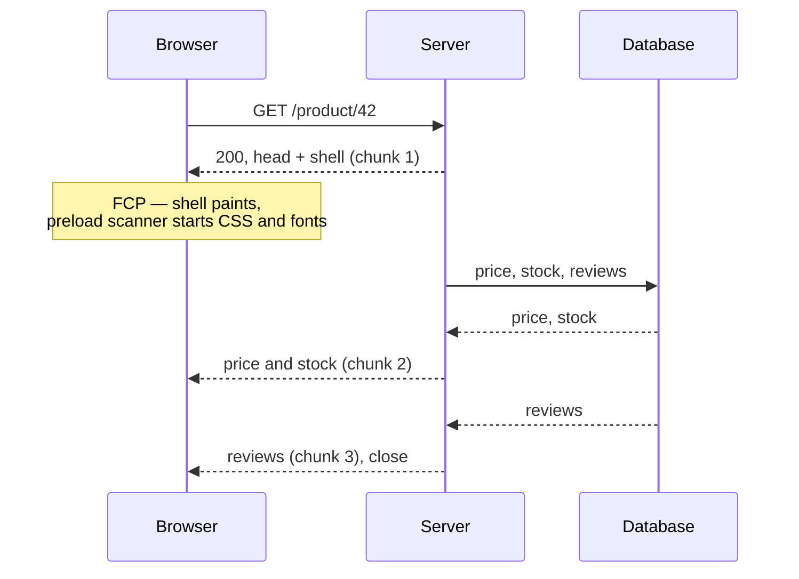

# Streaming HTML {#ch-streaming-html}

> Page-এর নিচের অংশ তৈরি হওয়ার আগেই ওপরের অংশ পাঠিয়ে দিন, আর জানুন সেটা আসলে কোন metric নড়ায়।

**এই অধ্যায়ে:** wire-এ chunked response · out-of-order streaming · TTFB বনাম FCP বনাম LCP · কী চুপচাপ streaming বন্ধ করে দেয় · যে header-গুলো আর set করতে পারবেন না

## 💡 মূল ধারণা

একটি HTTP response পাঠানোর আগে পুরোটা জোড়া লাগাতে হয় না। Server প্রথম byte-গুলো লিখতে পারে, connection খোলা
রাখতে পারে, আর এগোতে এগোতে আরও লিখতে পারে। 1990-এর দশক থেকেই browser HTML টুকরো টুকরো করে parse করে। যা
পৌঁছেছে তা render করে, আর চালিয়ে যায়।

Streaming সেই পুরোনো ক্ষমতাটি ইচ্ছাকৃতভাবে ব্যবহার করে। Server page-এর সবচেয়ে ধীর query-র জন্য অপেক্ষা করে না।
সে shell (`<head>`, layout, navigation) সঙ্গে সঙ্গে flush করে দেয়। তারপর প্রতিটি region-এর data resolve হলে সেটা
flush করে।

User page-টি দেখেন সেই ক্রমে, যে ক্রমে *server* সেটা তৈরি করতে পারে, page-এর সবচেয়ে ধীর জিনিসের ক্রমে নয়। Page-এর
কিছুই দ্রুত হয়নি। অপেক্ষাটা নতুন করে সাজানো হয়েছে, যাতে তার বেশিরভাগই ঘটে এমন কিছুর পেছনে, যা user ইতিমধ্যে পড়তে
পারছেন।

## কীভাবে কাজ করে

### Wire-এ

Stream না করা response `Content-Length` বহন করে আর একবারে পুরোটা পৌঁছায়। Stream করা response
`Transfer-Encoding: chunked` (HTTP/1.1) বা DATA frame-এর একটি stream (HTTP/2 আর HTTP/3) ব্যবহার করে, আর শেষ না
হওয়া পর্যন্ত এর দৈর্ঘ্য অজানা।



**প্রথম chunk paint-এর দাম দেয়; বাকিগুলো content-এর।**

প্রথম chunk-এর গুরুত্ব তার আকারের তুলনায় অনেক বেশি। এতে `<head>` থাকে, তাই server যখন database-এর জন্য অপেক্ষা
করছে, browser-এর preload scanner তখনই CSS, font আর JavaScript bundle fetch করা শুরু করতে পারে। এই download-গুলো
এখন query-র পেছনে লাইনে না দাঁড়িয়ে তার সাথে একসাথে চলে।

### Out-of-order streaming

একটি সরল stream document-এর ক্রম মেনে চলে। Server মাঝের অংশের আগে footer পাঠাতে পারে না। মাঝের অংশটিই যখন ধীর,
তখন এটা একটি সমস্যা।

Framework-গুলো এর সমাধান করে একটি placeholder-and-swap কৌশলে। ধীর region-টি একটি identifier-সহ খালি placeholder
হিসেবে পাঠানো হয়। তার data resolve হলে server আসল markup document-এর *শেষে* জুড়ে দেয়, সাথে একটি ছোট inline
script, যা সেটাকে ঠিক জায়গায় সরিয়ে দেয়।

**Wire দিয়ে আসলে যা যায়:**

```html
<main>
  <div id="reviews"><!--fallback skeleton--></div>
</main>
<!-- ...later in the same response... -->
<template id="chunk:reviews"><ul><li>Great product</li></ul></template>
<script>document.getElementById('reviews').replaceWith(
  document.getElementById('chunk:reviews').content)</script>
```

একটি `<Suspense>` boundary-র পেছনে React এটাই করে, আর এ কারণেই region-গুলো document-এর ক্রমে না এসে শেষ হওয়ার
ক্রমে আসতে পারে। [Chapter ?? — Suspense, Streaming ও Error Boundary](#ch-suspense-and-streaming)-এ React-এর
দিকের API আছে। এই অধ্যায় তার নিচের transport নিয়ে।

### TypeScript-এ একটি stream তৈরি করা

প্রতিটি server runtime একই আকার দেয়: একটি stream, যাতে আপনি লেখেন, আর framework সেটা flush করে।

**Web Streams API দিয়ে হাতে লেখা একটি streaming response:**

```typescript
export async function handler(): Promise<Response> {
  const encoder = new TextEncoder();

  const stream = new ReadableStream<Uint8Array>({
    async start(controller: ReadableStreamDefaultController<Uint8Array>) {
      // Chunk 1 — flush immediately. The preload scanner starts work here.
      controller.enqueue(encoder.encode('<!doctype html><head>...</head><body><nav>...</nav>'));

      const reviews: string = await renderReviews(); // the slow part
      controller.enqueue(encoder.encode(`<main>${reviews}</main></body>`));
      controller.close();
    },
  });

  return new Response(stream, {
    headers: { 'content-type': 'text/html; charset=utf-8' },
  });
}
```

উদাহরণটি একটি নিয়ম দেখায়: **প্রথম `enqueue`-এর আগে কিছুই `await` করবেন না।** ওই line-এর ওপরে একটি awaited call
একটি streamed response-কে আবার buffered response-এ পরিণত করে। কেউ কোনো error জানায় না।

### কোন metric নড়ে

| Metric | যা মাপে | Streaming কি সাহায্য করে? |
| ------ | ---------------- | -------------------- |
| **TTFB** | Response-এর প্রথম byte | হ্যাঁ, নাটকীয়ভাবে — shell আর data-র জন্য অপেক্ষা করে না |
| **FCP** | Content-এর প্রথম pixel | হ্যাঁ, যদি shell-এ দৃশ্যমান content আর তার CSS থাকে |
| **LCP** | সবচেয়ে বড় element-এর paint | শুধু যদি সবচেয়ে বড় element-টি shell-এ থাকে |
| **INP** | Interaction-এ সাড়া | না — সেটা hydration, streaming নয় |

এই table rendering নিয়ে interview-এর সবচেয়ে সাধারণ প্রশ্নের উত্তর দেয়। Streaming একটি **time to first byte**
কৌশল, যা first paint-এও সাহায্য করে। Hero image-এর জন্য এটা কিছুই করে না। সেটা
[Chapter ?? — Caching ও Asset Delivery](#ch-asset-delivery)-এর সমস্যা। Interactivity-র জন্যও কিছু করে না, সেটা
[Chapter ?? — Rendering Spectrum ও Hydration-এর খরচ](#ch-rendering-spectrum)-এর সমস্যা।

> ⚠️ **Streaming LCP খারাপ করতে পারে।** সবচেয়ে বড় element-টি যদি একটি streamed region-এর ভেতরে থাকে, browser
> আগে একটি skeleton paint করে, তারপর আসল content। LCP মাপা হয় দ্বিতীয় paint-এ, data পৌঁছানোর পর। একটি buffered
> page একবারই paint করত, দেরিতে, কিন্তু ভালো LCP নিয়ে। LCP element-টিকে ধীর region-এর বাইরে রাখুন।

### যে header-গুলো ছেড়ে দিয়েছেন

প্রথম byte বেরিয়ে গেলে response-এর status আর header স্থির হয়ে যায়। এর তিনটি ফল আছে, যা একটি design round-এ জোরে
বলার মতো:

- **Flush-এর পরের failure আর 500 হতে পারে না।** সবচেয়ে বেশি যা পারেন, তা হলো page-এর ভেতরে একটি error message
  stream করা। এ কারণেই streaming framework-গুলো আপনাকে error boundary-র দিকে ঠেলে দেয়।
- **Flush-এর পর redirect সম্ভব নয়।** Authentication check আর redirect shell বেরোনোর আগেই হতে হবে। এগুলো middleware-এ
  থাকার আসল কারণ এটাই।
- **Flush-এর পর `Set-Cookie` উপেক্ষা করা হয়।** Session rotation-এর জায়গা render-এর ওপরে।

### কী চুপচাপ এটা বন্ধ করে দেয়

Streaming কোনো error ছাড়াই ভেঙে ফেলা অস্বাভাবিক রকম সহজ, কারণ একটি buffered response-ও একটি বৈধ response।

| কারণ | লক্ষণ |
| ----- | ------- |
| প্রথম flush-এর আগে একটি `await` | TTFB সবচেয়ে ধীর query-র সমান |
| Body buffer করে এমন একটি proxy বা WAF | Local-এ কাজ করে, production-এ buffered |
| পুরো response buffer করার মতো করে configure করা compression | একই, আর প্রায়ই দোষ পড়ে CDN-এর ঘাড়ে |
| Response body পড়ে এমন একটি framework middleware | Buffered, আর খুঁজে পাওয়া কঠিন |
| পুরো response cache করে এমন platform দিয়ে serve করা | Output ঠিক, কিন্তু streaming নেই |

যাচাই করতে একটি command-ই যথেষ্ট। Route-টিতে `curl -N` চালান আর দেখুন byte-গুলো দলে দলে আসে কি না। সবকিছু একবারে
এলে, আপনার code আর terminal-এর মাঝখানে কিছু একটি buffer করছে।

## কখন ব্যবহার করবেন

| পরিস্থিতি | Stream করবেন? | কেন |
| --------- | ------- | --- |
| একটি ধীর region আর দ্রুত shell-সহ page | **হ্যাঁ** | পাঠ্যবইয়ের উদাহরণ |
| প্রতিটি query দ্রুত (~50 ms-এর নিচে) | **না** | জটিলতা মাপার মতো কিছুই দেয় না |
| পুরোপুরি static বা ISR-cached page | **না** | অপেক্ষা করার মতো কিছু নেই |
| যে page-এর সবচেয়ে বড় element ধীর query-র ওপর নির্ভর করে | **সাবধানে** | হয়তো TTFB-র বিনিময়ে LCP দিয়ে দেবেন |
| Client-কে JSON return করা API | **আলাদা সমস্যা** | দেখুন [Chapter ?? — Real-Time ও Streaming API](#ch-realtime-streaming) |

## সাধারণ ভুল

**❌ Layout-এ data await করা।**
✅ যে layout await করে, সেটা shell আটকে দেয়, তাই কিছুই stream হয় না। Await-টিকে নিচে নামিয়ে সেই component-এ নিন,
যার এটা লাগে, একটি boundary-র পেছনে।

**❌ পুরো page ঘিরে একটি boundary দেওয়া।**
✅ সবকিছু ধারণ করা একটি boundary আসলে একটি spinner-সহ buffered page। Boundary শুধু সেই অংশগুলো ঘিরবে, যেগুলো
আসলেই ধীর।

**❌ জায়গা সংরক্ষণ করে না এমন fallback নিয়ে stream করা।**
✅ শূন্য উচ্চতার skeleton থাকলে content পৌঁছানোর সময় page-কে নিচে ঠেলে দেয়। আপনি latency-র একটি জয়কে layout
shift-এ পরিণত করেছেন।

**❌ ধরে নেওয়া যে crawler একটি streamed page পড়তে পারে না।**
✅ পারে। Chunked transfer সাধারণ HTTP। সতর্কতাটি অন্য জায়গায়, আর সেটা আছে
[Chapter ?? — প্রতিটি Route-এর জন্য Rendering Strategy বাছাই, SEO সহ](#ch-choosing-per-route)-এ।

**❌ Local-এ কাজ করছে বলে streaming কাজ করছে ঘোষণা দেওয়া।**
✅ Local-এ কোনো CDN নেই, WAF নেই, reverse proxy নেই। Deploy করা URL-এ যাচাই করুন।

## 🔑 মূল শিক্ষা

- Streaming data resolve হওয়ার আগেই shell flush করে, তাই download-গুলো query-র পেছনে লাইনে না দাঁড়িয়ে তার সাথে একসাথে চলে।
- Out-of-order delivery একটি placeholder আর একটি inline script ব্যবহার করে, এ কারণেই region-গুলো আগে পৌঁছাতে পারে।
- এটা TTFB নড়ায়, আর সাধারণত FCP-ও। LCP নড়ায় শুধু তখনই, যখন সবচেয়ে বড় element-টি shell-এ থাকে।
- প্রথম byte-এর পর status, redirect আর cookie আগেই ঠিক হয়ে গেছে।
- প্রথম flush-এর ওপরে একটি মাত্র `await`, বা একটি buffering proxy, চুপচাপ এটা বন্ধ করে দেয়।

## Interview-এর প্রশ্ন

**Q: একটি server-rendered page-এ আপনার TTFB 1.8 সেকেন্ড। কী করবেন?**

প্রথম byte-এর আগে server কীসের জন্য অপেক্ষা করছে, তা বের করুন। সাধারণত একটি layout-এর একটি query পুরো render
আটকে দেয়। আগে shell flush করুন, আর ধীর region-টিকে একটি boundary-র পেছনে সরান। তখন TTFB হয়ে দাঁড়ায় layout
render করার খরচ, page-এর সবচেয়ে ধীর query-র খরচ নয়।

**Q: Streaming কি একটি page-কে খারাপ করতে পারে?**

হ্যাঁ, দুইভাবে। Largest contentful element যদি একটি streamed region-এ থাকে, LCP মাপা হয় swap-এর পরে, আর সেটা
খারাপ হয়। আর যে fallback সঠিক জায়গা সংরক্ষণ করে না, সেটা অপেক্ষাকে cumulative layout shift-এ পরিণত করে।
Streaming তখনই লাভ দেয়, যখন shell-টি দেখার মতো।

**Q: Authentication মাঝপথে fail করলে একটি streamed response কেন redirect করতে পারে না?**

Status line আর header প্রথম chunk-এর সাথে বেরিয়ে গেছে, আর সেগুলো ফেরানো যায় না। পুরো response-কে বদলায় এমন যেকোনো
কিছু (status, redirect, `Set-Cookie`) shell flush হওয়ার আগেই ঠিক করতে হবে। এ কারণেই authentication check
render-এর ওপরে middleware-এ বসে।

**Q: Production-এ streaming আসলেই ঘটছে, তা কীভাবে প্রমাণ করবেন?**

Deploy করা URL-এ `curl -N` দিয়ে request করুন, আর দেখুন byte-গুলো আলাদা আলাদা দলে আসছে কি না। যাচাই করুন response
chunked transfer ব্যবহার করছে, `Content-Length` নয়। Field data-র TTFB-কে সবচেয়ে ধীর query-র সময়ের সাথে তুলনা করুন।
দুটি মিলে গেলে, পথের কোথাও কিছু একটি response buffer করছে।

## এরপর কী পড়বেন

- [Chapter ?? — Suspense, Streaming ও Error Boundary](#ch-suspense-and-streaming) — boundary-গুলো চালায় যে React API
- [Chapter ?? — প্রতিটি Route-এর জন্য Rendering Strategy বাছাই, SEO সহ](#ch-choosing-per-route) — বিকল্পগুলোর মধ্যে streaming কোথায় খাপ খায়
- [Chapter ?? — Core Web Vitals](#ch-core-web-vitals) — metric table-এর পেছনের সংজ্ঞাগুলো
