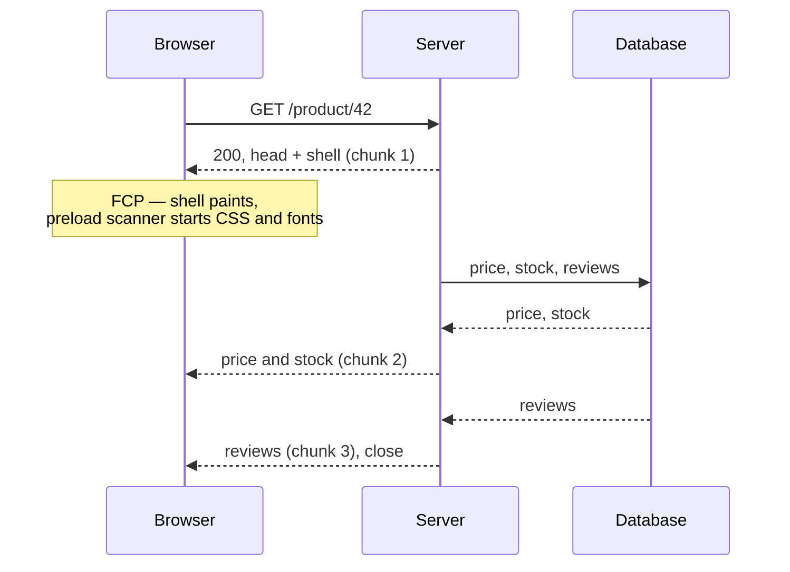

# Streaming HTML {#ch-streaming-html}

> Page-এর নিচের অংশ তৈরি হওয়ার আগেই ওপরের অংশ পাঠিয়ে দিন। আর জেনে রাখুন, এতে আসলে কোন metric-টা বদলায়।

**এই অধ্যায়ে:** wire-এ chunked response · out-of-order streaming · TTFB, FCP আর LCP-এর তুলনা · কী কী চুপচাপ streaming বন্ধ করে দেয় · যে header-গুলো আর set করা যায় না

## 💡 মূল ধারণা

HTTP response পাঠানোর আগে পুরোটা জোড়া লাগানোর দরকার নেই। Server প্রথম কয়েকটি byte লিখে connection খোলা
রাখতে পারে, তারপর যেমন যেমন তৈরি হয় তেমন আরও লিখতে পারে। Browser-ও 1990-এর দশক থেকেই HTML টুকরো টুকরো করে
parse করে। যতটুকু এসেছে, ততটুকু render করে, তারপর বাকিটার জন্য এগোতে থাকে।

Streaming এই পুরনো ক্ষমতাটাই জেনে-বুঝে কাজে লাগায়। Page-এর সবচেয়ে ধীর query-র জন্য server বসে থাকে না।
Shell, মানে `<head>`, layout আর navigation, সঙ্গে সঙ্গে flush করে দেয়। তারপর যে region-এর data যখন তৈরি হয়,
সেটা তখন flush করে।

ফলে user page-টা দেখেন সেই ক্রমে, যে ক্রমে *server* সেটা বানাতে পারে। Page-এর সবচেয়ে ধীর জিনিসটার জন্য পুরো
page আটকে থাকে না। আসলে page-এর কিছুই দ্রুত হয়নি। অপেক্ষাটা শুধু নতুন করে সাজানো হয়েছে, যাতে বেশিরভাগ
অপেক্ষা হয় এমন কিছুর পেছনে, যা user ততক্ষণে পড়তে পারছেন।

## কীভাবে কাজ করে

### Wire-এ যা ঘটে

Stream না করা response-এ `Content-Length` থাকে, আর পুরোটা একবারে আসে। Streamed response ব্যবহার করে
`Transfer-Encoding: chunked` (HTTP/1.1), অথবা DATA frame-এর stream (HTTP/2 আর HTTP/3)। শেষ না হওয়া পর্যন্ত
এর length জানা যায় না।



**প্রথম chunk-টা দিয়ে paint হয়, বাকিগুলো দিয়ে content আসে।**

প্রথম chunk আকারে ছোট, কিন্তু গুরুত্ব অনেক বেশি। এতে `<head>` থাকে। তাই server যখন database-এর জন্য অপেক্ষা
করছে, browser-এর preload scanner তখনই CSS, font আর JavaScript bundle আনা শুরু করে দিতে পারে। এই download-গুলো
আর query-র পেছনে লাইনে দাঁড়িয়ে থাকে না, query-র সঙ্গে একই সময়ে চলে।

### Out-of-order streaming

সরল stream document-এর ক্রম মেনে চলে। মাঝের অংশ পাঠানোর আগে server footer পাঠাতে পারে না। মাঝের অংশটাই ধীর
হলে এটা সমস্যা।

Framework-গুলো এর সমাধান করে placeholder বসিয়ে পরে বদলে দেওয়ার কৌশলে। ধীর region-টার জায়গায় একটি id-সহ
খালি placeholder পাঠানো হয়। Data তৈরি হলে server আসল markup-টা document-এর *একদম শেষে* জুড়ে দেয়, সঙ্গে ছোট্ট
একটি inline script, যেটা markup-টা সরিয়ে ঠিক জায়গায় বসিয়ে দেয়।

**Wire-এ আসলে যা যায়:**

```html
<main>
  <div id="reviews"><!--fallback skeleton--></div>
</main>
<!-- ...later in the same response... -->
<template id="chunk:reviews"><ul><li>Great product</li></ul></template>
<script>document.getElementById('reviews').replaceWith(
  document.getElementById('chunk:reviews').content)</script>
```

`<Suspense>` boundary-র পেছনে React ঠিক এটাই করে। এ কারণেই region-গুলো document-এর ক্রমে নয়, যেটা আগে তৈরি
হয় সেই ক্রমে পৌঁছাতে পারে। React-এর দিকের API আছে [Chapter ?? — Suspense, Streaming ও Error Boundary](#ch-suspense-and-streaming)-এ।
এই অধ্যায় তার নিচের transport নিয়ে।

### TypeScript-এ stream তৈরি করা

সব server runtime একই রকম জিনিস দেয়: একটি stream, যাতে আপনি লেখেন, আর framework সেটা flush করে।

**Web Streams API দিয়ে নিজে হাতে লেখা streaming response:**

```typescript
export async function handler(): Promise<Response> {
  const encoder = new TextEncoder();

  const stream = new ReadableStream<Uint8Array>({
    async start(controller: ReadableStreamDefaultController<Uint8Array>) {
      // Chunk 1 — flush immediately. The preload scanner starts work here.
      controller.enqueue(encoder.encode('<!doctype html><head>...</head><body><nav>...</nav>'));

      const reviews: string = await renderReviews(); // the slow part
      controller.enqueue(encoder.encode(`<main>${reviews}</main></body>`));
      controller.close();
    },
  });

  return new Response(stream, {
    headers: { 'content-type': 'text/html; charset=utf-8' },
  });
}
```

উদাহরণটা একটি নিয়মই দেখায়: **প্রথম `enqueue`-এর আগে কোনো কিছু `await` করবেন না।** ওই line-এর ওপরে একটি
await-করা call থাকলেই streamed response আবার buffered response হয়ে যায়। কোনো error-ও দেখায় না।

### কোন metric বদলায়

| Metric | কী মাপে | Streaming-এ লাভ হয়? |
| ------ | ------- | -------------------- |
| **TTFB** | Response-এর প্রথম byte | হ্যাঁ, অনেকখানি — shell আর data-র জন্য অপেক্ষা করে না |
| **FCP** | Content-এর প্রথম pixel | হ্যাঁ, যদি shell-এ দেখার মতো content আর তার CSS থাকে |
| **LCP** | সবচেয়ে বড় element-এর paint | শুধু তখনই, যখন সবচেয়ে বড় element-টা shell-এ আছে |
| **INP** | Interaction-এর response | না — এটা hydration-এর ব্যাপার, streaming-এর নয় |

Rendering নিয়ে interview-এ সবচেয়ে বেশি যে প্রশ্ন আসে, এই table-টাই তার উত্তর। Streaming মূলত **time to first
byte** কমানোর কৌশল, যেটা first paint-এও সাহায্য করে। Hero image-এর জন্য এটা কিছুই করে না। ওটা
[Chapter ?? — Caching ও Asset Delivery](#ch-asset-delivery)-এর সমস্যা। Interactivity-র জন্যও কিছু করে না, ওটা
[Chapter ?? — Rendering Spectrum ও Hydration-এর খরচ](#ch-rendering-spectrum)-এর সমস্যা।

> ⚠️ **Streaming-এ LCP খারাপও হতে পারে।** সবচেয়ে বড় element-টা streamed region-এর ভেতরে থাকলে browser আগে
> একটি skeleton paint করে, তারপর আসল content। LCP মাপা হয় দ্বিতীয় paint-এ, data আসার পরে। Buffered page একবারই
> paint করত, দেরিতে ঠিকই, কিন্তু LCP ভালো আসত। তাই LCP element-টা ধীর region-এর বাইরে রাখুন।

### যে header-গুলো ছেড়ে দিলেন

প্রথম byte বেরিয়ে গেলে response-এর status আর header আর বদলানো যায় না। এর তিনটি ফল আছে, design round-এ যেগুলো
মুখে বলা দরকার:

- **Flush-এর পরে কিছু fail করলে সেটা আর 500 হতে পারে না।** বড়জোর page-এর ভেতরে একটি error message stream
  করতে পারেন। এ কারণেই streaming framework-গুলো আপনাকে error boundary-র দিকে ঠেলে দেয়।
- **Flush-এর পরে redirect করা যায় না।** Authentication check আর redirect shell বেরোনোর আগেই সেরে ফেলতে হয়।
  এগুলো middleware-এ থাকার আসল কারণ এটাই।
- **Flush-এর পরে `Set-Cookie` দিলে কাজ করে না।** Session rotation তাই render-এর আগেই করতে হয়।

### কী চুপচাপ এটা বন্ধ করে দেয়

Streaming কোনো error ছাড়াই খুব সহজে ভেঙে যায়, কারণ buffered response-ও একটি বৈধ response।

| কারণ | লক্ষণ |
| ---- | ----- |
| প্রথম flush-এর আগে একটি `await` | TTFB সবচেয়ে ধীর query-র সমান |
| Body buffer করে এমন proxy বা WAF | Local-এ চলে, production-এ buffered |
| Compression, যেটা পুরো response buffer করার মতো করে configure করা | একই লক্ষণ, আর দোষটা প্রায়ই পড়ে CDN-এর ঘাড়ে |
| Framework-এর middleware, যেটা response body পড়ে | Buffered, আর খুঁজে বের করা কঠিন |
| এমন platform দিয়ে serve করা, যেটা পুরো response cache করে | Output ঠিক, কিন্তু streaming নেই |

যাচাই করতে একটি command-ই যথেষ্ট। Route-টায় `curl -N` চালিয়ে দেখুন byte-গুলো দলে দলে আসছে কি না। সব একসঙ্গে
এসে পড়লে বুঝবেন, আপনার code আর terminal-এর মাঝে কিছু একটা buffer করছে।

## কখন ব্যবহার করবেন

| পরিস্থিতি | Stream করবেন? | কেন |
| --------- | ------------- | --- |
| Page-এ একটি ধীর region, আর shell দ্রুত | **হ্যাঁ** | একদম বইয়ের উদাহরণ |
| সব query দ্রুত (মোটামুটি 50 ms-এর কম) | **না** | এত জটিলতায় মাপার মতো কোনো লাভ হয় না |
| পুরোপুরি static বা ISR-cached page | **না** | অপেক্ষা করার মতো কিছুই নেই |
| এমন page, যার সবচেয়ে বড় element ধীর query-র ওপর নির্ভর করে | **সাবধানে** | TTFB-র বদলে LCP হারাতে পারেন |
| Client-কে JSON দেয় এমন API | **আলাদা সমস্যা** | দেখুন [Chapter ?? — Real-Time ও Streaming API](#ch-realtime-streaming) |

## সাধারণ ভুল

**❌ Layout-এর ভেতরে data await করা।**
✅ Layout await করলে shell আটকে যায়, তাই কিছুই stream হয় না। Await-টা নামিয়ে দিন সেই component-এ, যার ওটা
দরকার, একটি boundary-র পেছনে।

**❌ পুরো page-এর চারপাশে একটি boundary বসানো।**
✅ সবকিছু একটি boundary-র ভেতরে রাখলে সেটা আসলে spinner-ওয়ালা একটি buffered page। Boundary দিয়ে ঘিরুন শুধু
সেই অংশগুলো, যেগুলো সত্যিই ধীর।

**❌ জায়গা ধরে রাখে না এমন fallback নিয়ে stream করা।**
✅ Skeleton-এর height শূন্য হলে content এসে পুরো page নিচে ঠেলে দেয়। Latency-তে যা জিতেছিলেন, সেটা layout
shift হয়ে ফিরে আসে।

**❌ ধরে নেওয়া যে crawler streamed page পড়তে পারে না।**
✅ পারে। Chunked transfer সাধারণ HTTP-ই। আসল সতর্কতাটা অন্য জায়গায়, সেটা আছে
[Chapter ?? — প্রতিটি Route-এর জন্য Rendering Strategy বাছাই, SEO সহ](#ch-choosing-per-route)-এ।

**❌ Local-এ চলছে বলে ধরে নেওয়া যে streaming কাজ করছে।**
✅ Local-এ CDN নেই, WAF নেই, reverse proxy-ও নেই। Deploy করা URL-এ যাচাই করুন।

## 🔑 মূল শিক্ষা

- Streaming data তৈরি হওয়ার আগেই shell flush করে দেয়, তাই download-গুলো query-র পেছনে লাইনে না দাঁড়িয়ে একসঙ্গে চলে।
- Out-of-order delivery চলে placeholder আর inline script দিয়ে। এজন্যই region-গুলো আগেভাগে পৌঁছাতে পারে।
- এতে TTFB কমে, সাধারণত FCP-ও। LCP কমে শুধু তখন, যখন সবচেয়ে বড় element-টা shell-এ থাকে।
- প্রথম byte বেরোনোর পরে status, redirect আর cookie আগেই ঠিক হয়ে গেছে।
- প্রথম flush-এর ওপরে একটি `await`, বা buffer করা একটি proxy থাকলেই streaming চুপচাপ বন্ধ হয়ে যায়।

## Interview-এর প্রশ্ন

**Q: Server-rendered একটি page-এ আপনার TTFB 1.8 সেকেন্ড। কী করবেন?**

আগে বের করুন, প্রথম byte পাঠানোর আগে server কীসের জন্য অপেক্ষা করছে। সাধারণত layout-এর একটি query পুরো render
আটকে রাখে। Shell আগে flush করুন, আর ধীর region-টা একটি boundary-র পেছনে সরিয়ে দিন। তখন TTFB হবে layout render
করার খরচ, page-এর সবচেয়ে ধীর query-র খরচ নয়।

**Q: Streaming কি page খারাপও করতে পারে?**

হ্যাঁ, দুইভাবে। Largest contentful element যদি streamed region-এ থাকে, LCP মাপা হয় swap-এর পরে, তাই LCP খারাপ
হয়। আর fallback যদি ঠিকঠাক জায়গা ধরে না রাখে, অপেক্ষাটা cumulative layout shift হয়ে দাঁড়ায়। Shell যখন দেখার
মতো কিছু, তখনই streaming-এ লাভ।

**Q: মাঝপথে authentication fail করলে streamed response কেন redirect করতে পারে না?**

Status line আর header প্রথম chunk-এর সঙ্গেই চলে গেছে, সেগুলো আর ফেরানো যায় না। পুরো response বদলে দেয় এমন যেকোনো
কিছু (status, redirect, `Set-Cookie`) shell flush হওয়ার আগেই ঠিক করতে হয়। এজন্যই authentication check বসে
render-এর ওপরে, middleware-এ।

**Q: Production-এ streaming সত্যিই হচ্ছে, সেটা কীভাবে প্রমাণ করবেন?**

Deploy করা URL-এ `curl -N` দিয়ে request পাঠান, আর দেখুন byte-গুলো আলাদা আলাদা দলে আসছে কি না। Response
`Content-Length` নয়, chunked transfer ব্যবহার করছে কি না দেখুন। Field data-র TTFB-কে সবচেয়ে ধীর query-র সময়ের
সঙ্গে মিলিয়ে দেখুন। দুটি সমান হলে বুঝবেন, পথের কোথাও কিছু একটা response buffer করছে।

## এরপর কী পড়বেন

- [Chapter ?? — Suspense, Streaming ও Error Boundary](#ch-suspense-and-streaming) — যে React API boundary-গুলো চালায়
- [Chapter ?? — প্রতিটি Route-এর জন্য Rendering Strategy বাছাই, SEO সহ](#ch-choosing-per-route) — অন্য বিকল্পগুলোর মাঝে streaming-এর জায়গা কোথায়
- [Chapter ?? — Core Web Vitals](#ch-core-web-vitals) — metric table-এর পেছনের সংজ্ঞাগুলো
