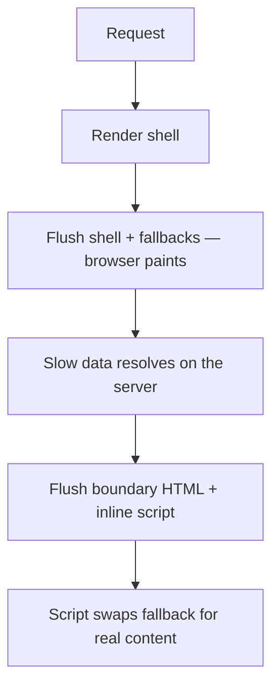

# Suspense, Streaming ও Error Boundary {#ch-suspense-and-streaming}

> Page-এর কোন অংশ দেরিতে আসতে পারে আর কোন অংশ ব্যর্থ হতে পারে, তা ঠিক করুন। আর প্রতিটির জন্য এক জোড়া boundary বসান।

**এই অধ্যায়ে:** দুটি boundary, দুই রকম ব্যর্থতা · network দিয়ে streaming SSR · error boundary যা ধরে না · boundary কোথায় বসাবেন · hydration mismatch

## 💡 মূল ধারণা

React-এ boundary দুটি, আর তারা ভাইবোনের মতো। **Suspense boundary** ধরে "এখনো তৈরি নয়"। **Error boundary** ধরে "ব্যর্থ হয়েছে"। কোনোটাই data
fetch করে না, কোনো bug-ও ঠিক করে না। প্রতিটি শুধু ঘোষণা করে তার বদলে user কী দেখবেন, আর এর বাইরের সবকিছুকে নিজের মতো চলতে দেয়।

এগুলো না থাকলে page কখন দেখা দেবে তা ঠিক করে সবচেয়ে ধীর query, আর render-এর সময় throw হওয়া একটি error পুরো React tree unmount করে দেয়। এগুলো
থাকলে ধীর panel দেখায় একটি skeleton, আর ভাঙা panel একটি message।

> Boundary হলো code হিসেবে লেখা একটি product-এর সিদ্ধান্ত। আপনি ঠিক করেন screen-এর কোন অংশ দেরিতে আসতে পারে, কোন অংশ ব্যর্থ হতে পারে, আর
> প্রতিটি ক্ষেত্রে user কী দেখবেন।

## কীভাবে কাজ করে

### দুটি boundary, একটি অংশ

যে অংশ data load করে, সেটা loading, loaded বা failed, যেকোনো অবস্থায় থাকতে পারে। তাই সাধারণত সেই অংশ দুটি boundary-ই পায়।

**একটি অংশ, দুটি boundary:**

```tsx
<ErrorBoundary fallback={<ChartUnavailable />}>
  <Suspense fallback={<ChartSkeleton />}>
    <RevenueChart /> {/* suspends while loading, throws if the fetch fails */}
  </Suspense>
</ErrorBoundary>
```

যে component throw করে, error boundary-কে তার ওপরে বসতে হবে। React-এর docs-এর মতো একে Suspense boundary-র বাইরে রাখুন, যাতে ব্যর্থতার message পুরো
অংশটা, skeleton-সহ, বদলে দেয়।

### Streaming server rendering

Server-এ React যতদূর পারে render করে, আর সেই HTML সঙ্গে সঙ্গে পাঠিয়ে দেয়। আপনার Suspense boundary-গুলোর ওপরে আর চারপাশে যা আছে, সেটাই **shell**।
Resolve না হওয়া প্রতিটি boundary যায় তার fallback হিসেবে।



**একটি response, কয়েকটি flush। Browser আঁকে প্রথমটার পরেই, শেষটার পরে নয়।**

বদলটা হয় HTML আর ছোট একটি inline script দিয়ে, কোনো client fetch বা hydration-এর অপেক্ষা ছাড়াই। তাই ধীর device-এও streaming কাজে আসে। কাজটা করে
server renderer: Node-এ `renderToPipeableStream`, আর Web stream-এ `renderToReadableStream`। প্রতিটি meta-framework এর একটিকে আপনার হয়ে call করে।

পাঠানো HTML React ফিরিয়ে নিতে পারে না। Shell পাঠানোর পরে কোনো component throw করলে React client-কে সেই subtree আবার render করতে বলে। হয় একটু দেরিতে
সেটা সফল হয়, নয়তো error boundary-র fallback দেখা দেয়।

### Error boundary নিজে

Error boundary এখনো একটি class component। এর যে দুটি lifecycle method লাগে, তাদের hook-এর কোনো সমতুল্য নেই। পুরো codebase-এ একবার লিখুন, অথবা
`react-error-boundary` package ব্যবহার করুন।

**ছোট্ট একটি boundary:**

```tsx
import React from "react";
import { logError } from "./monitoring"; // your error tracker

type BoundaryProps = { fallback: React.ReactNode; children: React.ReactNode };

class ErrorBoundary extends React.Component<BoundaryProps, { hasError: boolean }> {
  state = { hasError: false };

  // Pure — decides what renders next. No side effects here.
  static getDerivedStateFromError(): { hasError: boolean } {
    return { hasError: true };
  }

  // The side-effect half: this is where reporting belongs.
  componentDidCatch(error: Error, info: React.ErrorInfo): void {
    logError(error, info.componentStack); // componentStack, not error.stack
  }

  render(): React.ReactNode {
    return this.state.hasError ? this.props.fallback : this.props.children;
  }
}
```

`getDerivedStateFromError` চলে render-এর সময়, আর একে pure থাকতে হবে। `componentDidCatch` চলে তার পরে, আর log বা report করতে পারে শুধু এটাই।
`info.componentStack` ধরে রাখুন। JavaScript stack বলে কোন function throw করেছে। Component stack বলে route, layout আর list item-এর নাম, আর
সাধারণত এটা দিয়েই bug খুঁজে পাওয়া যায়।

### Error boundary যা ধরে না

| Error কোথায় হয় | ধরা পড়ে? | তার বদলে কী ধরে |
| --------------- | -------- | -------------- |
| কোনো child component render করার সময় | ✅ | ওপরের সবচেয়ে কাছের boundary |
| Child-এর lifecycle বা effect-এ | ✅ | ওপরের সবচেয়ে কাছের boundary |
| `onClick`-এর মতো event handler-এ | ❌ | একটি `try`/`catch`, আর আপনার render করা state |
| `setTimeout`, `requestAnimationFrame` | ❌ | Callback-এর ভেতরে একটি `try`/`catch` |
| Boundary-র নিজের render-এ | ❌ | তার ওপরের একটি boundary |

Event handler-এর ক্ষেত্রটা মানুষকে অবাক করে। Click handler চলার সময় React call stack-এ থাকে না। ব্যর্থ save-এ যদি একটি message দেখাতে হয়, সেই
message একটি `catch` block-এ state হিসেবে বসান।

### Client-এ Suspense

Load-এর পরেও দুটি boundary কাজ করে। React 19-এর `use(promise)` promise settle না হওয়া পর্যন্ত suspend করে, আর সবচেয়ে কাছের Suspense fallback
দেখা দেয়। Promise reject হলে দায়িত্ব নেয় সবচেয়ে কাছের error boundary।

**Stream হয়ে আসা একটি promise পড়া:**

```tsx
"use client";

export function Comments({ commentsPromise }: { commentsPromise: Promise<Comment[]> }) {
  const comments: Comment[] = use(commentsPromise);
  return <ul>{comments.map((c: Comment) => <li key={c.id}>{c.text}</li>)}</ul>;
}
```

Render-এর *সময়* বানানো promise প্রতিটি render-এ নতুন, তাই চিরকাল suspend করে থাকে। এটা নিন স্থির কোনো জায়গা থেকে: Server Component-এর prop,
একটি cache, বা একটি query library।

### Hydration mismatch

Hydration মানে server-এর HTML-এ React-এর নিজের handler জুড়ে দেওয়া। এর জন্য client-এর প্রথম render-কে মিলতে হয়। না মিললে React সেই subtree ফেলে
দিয়ে client-এ আবার render করে, যা ধীর আর চোখে পড়ে।

| কারণ | সমাধান |
| ---- | ------ |
| Render-এ `Date.now()`, `Math.random()`, `new Date()` | Effect-এ হিসাব করুন, অথবা নির্দিষ্ট একটি value নিচে পাঠান |
| `typeof window !== "undefined"` দিয়ে branch করা | আগে server-এর version render করুন, তারপর effect-এ বদলান |
| ভুল nesting — `<p>`-এর ভেতরে একটি `<div>` | Markup ঠিক করুন; parse করার সময় browser সেটা মেরামত করে ফেলেছিল |

Production-এর error reporter-এর জন্য React 19 root-এ তিনটি option দেয়: `onCaughtError`, `onUncaughtError` আর `onRecoverableError`। শেষটা আগেভাগেই
জুড়ে দিন। Hydration mismatch ধরা পড়ে সেখানেই, আর React চুপচাপ সামলে নেয়, তাই এটা না থাকলে bug অদৃশ্যই থেকে যায়।

> ⚠️ `suppressHydrationWarning` message-টা চুপ করায়, mismatch নয়। এটা ঠিক শুধু একটি ক্ষেত্রে: এমন value, যা আলাদা হবে বলে *জানা*, যেমন render করা
> একটি timestamp। এটা খাটে শুধু ওই একটি element-এ।

## কখন ব্যবহার করবেন

| পরিস্থিতি | কী ব্যবহার করবেন |
| --------- | --------------- |
| ধীর একটি query, যা page-এর বাকি অংশের লাগে না | ✅ সেই অংশের চারপাশে Suspense |
| এমন fetch, যা ব্যর্থ হতে পারে, বা third-party content | ✅ ভেতরে Suspense, বাইরে error boundary |
| যে data ছাড়া page-এর কোনো অর্থ নেই | ❌ কোনো boundary নয় — shell-এই await করুন |
| User ইতিমধ্যে দেখছেন এমন list filter করা | ❌ Suspense নয় — transition পুরনো list রেখে দেয় |
| ব্যর্থ form submission বা না পাওয়া record | ❌ Error boundary নয় — state হিসেবে render করুন |

Suspense সেই content-এর জন্য, যা **এখনো নেই**। Transition সেই content-এর জন্য, যা **বদলানো হচ্ছে**। Error boundary সেসব ব্যর্থতার জন্য, যার
পরিকল্পনা আপনি করেননি। প্রত্যাশিত ব্যর্থতা হলো state, যা আপনি render করেন।

### কোথায় বসাবেন

| স্তর | Suspense fallback | Error fallback |
| ---- | ----------------- | -------------- |
| Application-এর root | ❌ পুরো page জুড়ে একটি spinner | Reload-সহ পুরো page-এর error — শেষ ভরসা |
| প্রতিটি route | Shell, ভেতরে page load হচ্ছে | Shell আর navigation, ভেতরে page ব্যর্থ |
| প্রতিটি স্বাধীন অংশ | ✅ Nav, content, sidebar আলাদা আলাদা ভরে ওঠে | ✅ একটি card-এর জায়গায় retry |
| List-এর প্রতিটি row | ❌ Content হঠাৎ উদয় হয়, layout লাফায় | ❌ শুধু কোলাহল — একক তো পুরো list |

Suspense group করুন **user কোন জিনিসগুলোর জন্য একসঙ্গে অপেক্ষা করতে রাজি হবেন** তা দেখে। Comment-এর সংখ্যা আর comment-এর list একটি boundary
ভাগ করে নেয়। Comment-এর list আর article নেয় না। Error boundary বসান **সেখানে, যেখানে নিচের subtree ছাড়াও page-টার এখনো কোনো অর্থ থাকে**। না থাকলে
boundary-র জায়গা আরও ওপরে।

Next.js App Router-এ `loading.tsx` হয়ে যায় route-level Suspense boundary, আর `error.tsx` route-level error boundary। কোথায় বসাবেন, সেই সিদ্ধান্ত
তবু আপনার।

## সাধারণ ভুল

**❌ Root-এ একটি boundary, আর কিছুই না।** সবকিছু একসঙ্গে অপেক্ষা করে, একসঙ্গে ব্যর্থ হয়।

**❌ Content-এর চেয়ে আলাদা মাপের fallback।** ছোট একটি spinner-এর জায়গায় লম্বা একটি list এলে page সরে যায়, আর Cumulative Layout Shift-এর খরচ
হয়। **✅ Skeleton-কে জিনিসটার আকারেই বানান।**

**❌ এগোনোর কোনো পথ ছাড়া error fallback।** **✅ একটি "আবার চেষ্টা করুন" reset দিন, আর এমন একটি key, যা navigation-এ বদলায়, যাতে route ছেড়ে
গেলে error মুছে যায়।**

**❌ Error গিলে ফেলা, বা কাঁচা অবস্থায় দেখানো।** ফাঁকা `componentDidCatch` মানে কেউ কখনো জানতেই পারবে না। `error.message`-এ ভেতরের identifier বা
একটি query থাকতে পারে। **✅ ধরা পড়া প্রতিটি error report করুন, আর user-কে দেখান মানুষের জন্য লেখা একটি বাক্য।**

## 🔑 মূল শিক্ষা

- Suspense boundary ধরে "এখনো তৈরি নয়", আর error boundary ধরে "ব্যর্থ হয়েছে"। কোনোটাই কিছু fetch করে না, কিছু ঠিকও করে না।
- Streaming SSR আগে shell পাঠায়, তারপর data resolve হলে প্রতিটি boundary-র HTML বসিয়ে দেয়, hydration-এর আগেই।
- Error boundary নিচের render, lifecycle আর effect-এর error ধরে — কখনো event handler, timer বা নিজের render-এর error নয়।
- User যে অংশগুলোকে আলাদা দেখেন, সেগুলোর চারপাশে দুটি boundary বসান, error boundary থাকবে Suspense boundary-র বাইরে।
- Hydration mismatch হলে React client-এ subtree আবার render করে, আর data-র মতোই ভুল HTML nesting-ও প্রায়ই এর কারণ।

## Interview-এর প্রশ্ন

**Q: একটি Suspense boundary যোগ করলে response-এর আসলে কী হয়?**

Response ভাগ হয়ে যায়। Boundary-র বাইরের সবকিছু React সঙ্গে সঙ্গে flush করে, boundary-র জায়গায় fallback রেখে, যাতে browser আঁকতে পারে। Data
resolve হলে React সেই HTML একই response-এ stream করে পাঠায়, সঙ্গে একটি inline script, যা সেটা জায়গামতো বসিয়ে দেয়। Query একটুও দ্রুত হয়নি।
Page শুধু তার জন্য অপেক্ষা করা বন্ধ করেছে।

**Q: Error boundary কী ধরে, আর কী ধরে না?**

এর subtree render করার সময় throw হওয়া error ধরে, আর নিচের lifecycle আর effect-এর error-ও। যেখানে React call stack-এ থাকে না, সেসব ধরে না: event
handler, timer, আর boundary-র নিজের error। এগুলোর জন্য লাগে সাধারণ একটি `try`/`catch`, আর result state-এ রাখা।

**Q: এক ডজন স্বাধীন widget-ওয়ালা dashboard-এ boundary কীভাবে বসাবেন?**

প্রতিটি widget পায় একটি error boundary, ভেতরে একটি Suspense boundary, সঙ্গে route-level একটি boundary। তাহলে third-party একটি chart ব্যর্থ হলে
user হারান শুধু ওই chart-টা। Route-এর boundary navigation চালু রাখে, যাতে user reload না করেই বেরিয়ে যেতে পারেন। প্রতিটি row-এ boundary বসানো
বাড়াবাড়ি।

**Q: Search filter-এর জন্য Suspense, নাকি transition?**

Transition। User ইতিমধ্যে result দেখছেন, আর Suspense প্রতিটি key চাপায় একটি ভালো list-এর জায়গায় skeleton বসিয়ে দিত। `useTransition` বা
`useDeferredValue` পুরনো result screen-এ রাখে, পুরনো বলে চিহ্নিত করে, আর ততক্ষণে নতুনগুলো render হয়। Suspense প্রথম load-এর জন্য, যখন ধরে রাখার
মতো কিছুই নেই।

**Q: কখন error boundary ভুল tool?**

যখন ব্যর্থতাটা প্রত্যাশিত। ফাঁকা result, ব্যর্থ validation, unauthorised response আর না পাওয়া record হলো এমন state, যা interface-এর ইচ্ছে করেই
render করা উচিত। এগুলোর জন্য throw করলে স্বাভাবিক flow-গুলো exception-এর পথে চলে যায়, আর একই alert-এর ভিড়ে আসল crash চাপা পড়ে।

## এরপর কী পড়বেন

- [Chapter ?? — Performance, Transition ও Compiler](#ch-react-performance-and-the-compiler) — যে content আগে থেকেই আছে, তার tool
- [Chapter ?? — Server Component ও Client Component](#ch-server-components-vs-client-components) — stream হয়ে আসা promise কোথা থেকে আসে
- [Chapter ?? — Action ও Form](#ch-react-actions-and-forms) — mutation-এর ব্যর্থতার আসল জায়গা
