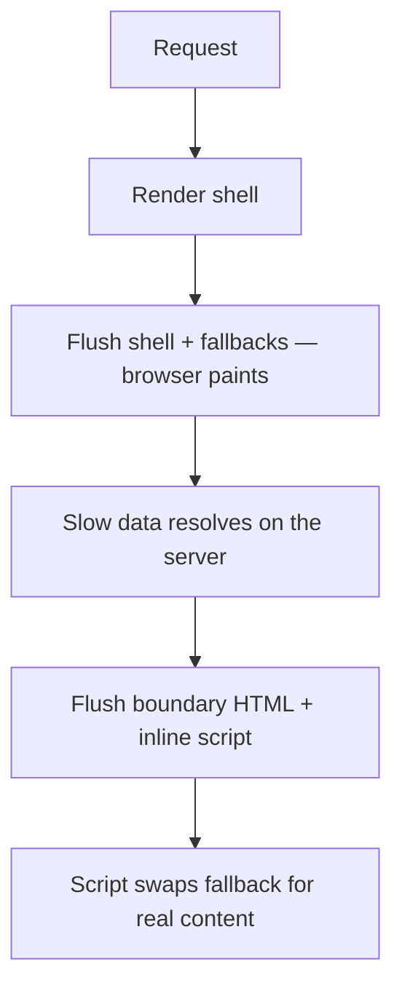

# Suspense, Streaming ও Error Boundary {#ch-suspense-and-streaming}

> একটি page-এর কোন অংশ দেরিতে আসতে পারে আর কোন অংশ ব্যর্থ হতে পারে, তা ঠিক করুন, আর প্রতিটির জন্য এক জোড়া boundary বসান।

**এই অধ্যায়ে:** দুটো boundary, দুই ধরনের ব্যর্থতা · network দিয়ে streaming SSR · error boundary যা ধরে না · boundary কোথায় বসাবেন · hydration mismatch

## 💡 মূল ধারণা

React-এ দুটো boundary আছে, আর এরা ভাইবোনের মতো। একটি **Suspense boundary** ধরে "এখনো তৈরি নয়"। একটি **error
boundary** ধরে "ব্যর্থ হয়েছে"। কোনোটাই data fetch করে না বা bug ঠিক করে না। প্রতিটি শুধু ঘোষণা করে, তার বদলে user
কী দেখবেন, আর তার বাইরের সবকিছুকে চলতে দেয়।

এগুলো ছাড়া, সবচেয়ে ধীর query ঠিক করে page কখন দেখা যাবে, আর render-এর সময় throw হওয়া একটি error পুরো React
tree-কে unmount করে দেয়। এগুলো থাকলে, একটি ধীর panel একটি skeleton দেখায়, আর একটি ভাঙা panel একটি message।

> Boundary হলো code হিসেবে লেখা একটি product সিদ্ধান্ত। আপনি বেছে নেন screen-এর কোন অংশ দেরিতে আসতে পারে, কোন অংশ
> ব্যর্থ হতে পারে, আর প্রতিটি ক্ষেত্রে user কী দেখবেন।

## কীভাবে কাজ করে

### দুটো boundary, একটি region

যে region data load করে, সেটা loading, loaded বা failed হতে পারে, তাই সাধারণত এটা দুটো boundary-ই পায়।

**একটি region, দুটো boundary:**

```tsx
<ErrorBoundary fallback={<ChartUnavailable />}>
  <Suspense fallback={<ChartSkeleton />}>
    <RevenueChart /> {/* suspends while loading, throws if the fetch fails */}
  </Suspense>
</ErrorBoundary>
```

Error boundary-কে যে component throw করে, তার ওপরে বসতে হবে। React docs যেমন করে, এটাকে Suspense boundary-র
বাইরে রাখুন, যাতে ব্যর্থতার message skeleton-সহ পুরো region-টাকে প্রতিস্থাপন করে।

### Streaming server rendering

Server-এ React যতদূর পারে render করে, আর সেই HTML সাথে সাথে পাঠিয়ে দেয়। আপনার Suspense boundary-গুলোর ওপরে আর
চারপাশে যা কিছু আছে, সেটাই **shell**। প্রতিটি unresolved boundary তার fallback হিসেবে পাঠানো হয়।



**একটি response, কয়েকটি flush। Browser প্রথমটার পরেই paint করে, শেষটার পরে নয়।**

অদলবদলটা হলো HTML আর একটি ছোট্ট inline script, কোনো client fetch নেই, hydration-এর জন্য অপেক্ষাও নেই। তাই ধীর
device-এও streaming কাজে লাগে। কাজটা করে server renderer: Node-এ `renderToPipeableStream`, আর Web stream-এ
`renderToReadableStream`। প্রতিটি meta-framework আপনার হয়ে এদের একটিকে call করে।

React পাঠানো HTML ফেরত নিতে পারে না। Shell পাঠানোর পরে কোনো component throw করলে, React client-কে সেই subtree আবার
render করতে বলে। হয় একটু দেরিতে সেটা সফল হয়, নয়তো error boundary-র fallback দেখা দেয়।

### Error boundary নিজে

Error boundary এখনো একটি class component। এর যে দুটো lifecycle method লাগে, তাদের কোনো hook সমতুল্য নেই। প্রতিটি
codebase-এ আপনি এটা একবার লেখেন, অথবা `react-error-boundary` package ব্যবহার করেন।

**একটি ন্যূনতম boundary:**

```tsx
import React from "react";
import { logError } from "./monitoring"; // your error tracker

type BoundaryProps = { fallback: React.ReactNode; children: React.ReactNode };

class ErrorBoundary extends React.Component<BoundaryProps, { hasError: boolean }> {
  state = { hasError: false };

  // Pure — decides what renders next. No side effects here.
  static getDerivedStateFromError(): { hasError: boolean } {
    return { hasError: true };
  }

  // The side-effect half: this is where reporting belongs.
  componentDidCatch(error: Error, info: React.ErrorInfo): void {
    logError(error, info.componentStack); // componentStack, not error.stack
  }

  render(): React.ReactNode {
    return this.state.hasError ? this.props.fallback : this.props.children;
  }
}
```

`getDerivedStateFromError` render-এর সময় চলে, আর একে pure থাকতে হবে। `componentDidCatch` চলে পরে, আর শুধু এটাই log
বা report করতে পারে। `info.componentStack` ধরে রাখুন। একটি JavaScript stack সেই function-এর নাম বলে, যেটা throw
করেছে। Component stack বলে route, layout আর list item-এর নাম, যেটা দিয়ে সাধারণত bug-টা খুঁজে পাওয়া যায়।

### Error boundary যা ধরে না

| Error কোথায় ঘটে               | ধরা পড়ে? | এর বদলে কে ধরে                |
| ------------------------------------- | ------- | -------------------------------------- |
| একটি child component render করার সময়           | ✅      | এর ওপরের সবচেয়ে কাছের boundary          |
| একটি child-এর lifecycle বা effect         | ✅      | এর ওপরের সবচেয়ে কাছের boundary          |
| `onClick`-এর মতো একটি event handler    | ❌      | একটি `try`/`catch`, আর আপনি render করেন এমন state  |
| `setTimeout`, `requestAnimationFrame` | ❌      | Callback-এর ভেতরে একটি `try`/`catch`    |
| Boundary-র নিজের render             | ❌      | এর ওপরের একটি boundary                    |

Event handler-এর ক্ষেত্রটা মানুষকে অবাক করে। Click handler চলার সময় React call stack-এ থাকে না। একটি ব্যর্থ save-এ
যদি একটি message দেখানো দরকার হয়, তাহলে একটি `catch` block-এ সেই message-কে state হিসেবে set করুন।

### Client-এ Suspense

Load হওয়ার পরেও দুটো boundary কাজ করে। React 19-এর `use(promise)` promise settle না হওয়া পর্যন্ত suspend করে, আর
সবচেয়ে কাছের Suspense fallback দেখা যায়। Promise reject হলে সবচেয়ে কাছের error boundary দায়িত্ব নেয়।

**একটি streamed promise পড়া:**

```tsx
"use client";

export function Comments({ commentsPromise }: { commentsPromise: Promise<Comment[]> }) {
  const comments: Comment[] = use(commentsPromise);
  return <ul>{comments.map((c: Comment) => <li key={c.id}>{c.text}</li>)}</ul>;
}
```

Render-এর *সময়* তৈরি হওয়া promise প্রতিটি render-এ নতুন হয়, আর চিরকাল suspend করে থাকে। এটাকে কোনো স্থির জায়গা
থেকে নিন: একটি Server Component prop, একটি cache, বা একটি query library।

### Hydration mismatch

Hydration হলো server HTML-এ React-এর তার handler-গুলো জুড়ে দেওয়া। এর জন্য প্রথম client render-কে মিলতে হয়। না
মিললে React সেই subtree ফেলে দিয়ে client-এ আবার render করে, যেটা বেশি ধীর আর চোখে পড়ে।

| কারণ                                                 | সমাধান                                                   |
| ----------------------------------------------------- | ----------------------------------------------------- |
| Render-এ `Date.now()`, `Math.random()`, `new Date()` | একটি effect-এ হিসাব করুন, অথবা নিচে একটি নির্দিষ্ট value পাঠান   |
| `typeof window !== "undefined"` দিয়ে branching             | Server version render করুন, তারপর একটি effect-এ বদলান   |
| অবৈধ nesting — একটি `<p>`-এর ভেতরে একটি `<div>`            | Markup ঠিক করুন; parse করার সময় browser এটা মেরামত করেছিল |

Production error reporter-এর জন্য React 19 তিনটি root option দেয়: `onCaughtError`, `onUncaughtError` আর
`onRecoverableError`। শেষেরটা আগেভাগেই জুড়ে দিন। Hydration mismatch সেখানে ধরা পড়ে, আর React চুপচাপ recover করে,
তাই এটা ছাড়া bug-টা অদৃশ্য থেকে যায়।

> ⚠️ `suppressHydrationWarning` message-টা চুপ করায়, mismatch-টা নয়। এটা একটি ক্ষেত্রে সঠিক: এমন একটি value, যেটা
> আলাদা হবে বলে *জানা*, যেমন একটি render করা timestamp। এটা শুধু সেই একটি element-এ খাটে।

## কখন ব্যবহার করবেন

| পরিস্থিতি                                      | কী ব্যবহার করবেন                                        |
| ---------------------------------------------- | ------------------------------------------------ |
| একটি ধীর query, যেটা page-এর বাকি অংশের লাগে না | ✅ সেই region-এর চারপাশে Suspense                  |
| এমন একটি fetch, যেটা ব্যর্থ হতে পারে, বা third-party content   | ✅ ভেতরে Suspense, বাইরে error boundary      |
| যে data ছাড়া page-এর কোনো মানে নেই            | ❌ কোনো boundary নয় — shell-এ এটা await করুন          |
| User আগে থেকেই দেখছেন এমন একটি list filter করা          | ❌ Suspense নয় — একটি transition পুরনো list রেখে দেয় |
| একটি ব্যর্থ form submission বা একটি হারানো record    | ❌ Error boundary নয় — এটাকে state হিসেবে render করুন       |

Suspense সেই content-এর জন্য, যেটা **এখনো নেই**। Transition সেই content-এর জন্য, যেটা **প্রতিস্থাপিত হচ্ছে**।
Error boundary সেই ব্যর্থতার জন্য, যেটার পরিকল্পনা আপনি করেননি। প্রত্যাশিত ব্যর্থতা হলো state, যেটা আপনি render
করেন।

### এগুলো কোথায় বসাবেন

| স্তর                    | Suspense fallback                | Error fallback                              |
| ------------------------ | -------------------------------- | ------------------------------------------- |
| Application-এর root  | ❌ পুরো page জুড়ে একটি spinner           | Reload-সহ পুরো page-এর একটি error — শেষ উপায় |
| প্রতি route-এ                | Shell, আর page loading অবস্থায় | Shell আর navigation, আর page ব্যর্থ অবস্থায় |
| প্রতিটি স্বাধীন region-এ   | ✅ Nav, content, sidebar আলাদাভাবে ভরে ওঠে | ✅ একটি card retry-সহ প্রতিস্থাপিত হয়  |
| একটি list-এর প্রতিটি row-এ        | ❌ Content হঠাৎ চলে আসে, layout লাফায় | ❌ শুধু গোলমাল — list-টাই একক            |

Suspense-কে group করুন **user কোন জিনিসগুলোর জন্য একসাথে অপেক্ষা করতে রাজি হবেন** তা দিয়ে। একটি comment count আর
একটি comment list একটি boundary ভাগ করে নেয়। একটি comment list আর article নেয় না। Error boundary বসান **সেখানে,
যেখানে এর নিচের subtree ছাড়াও page-এর একটি মানে থাকে**। না থাকলে boundary-টা আরও ওপরে থাকা উচিত।

Next.js App Router-এ `loading.tsx` একটি route-level Suspense boundary হয়ে যায়, আর `error.tsx` একটি route-level error
boundary। কোথায় বসাবেন, সেই সিদ্ধান্ত তবু আপনার।

## সাধারণ ভুল

**❌ Root-এ একটি boundary, আর কিছু না।** সবকিছু একসাথে অপেক্ষা করে আর একসাথে ব্যর্থ হয়।

**❌ Content-এর চেয়ে আলাদা আকারের একটি fallback।** ছোট একটি spinner-এর জায়গায় লম্বা একটি list এলে page সরে যায়,
আর Cumulative Layout Shift-এর খরচ হয়। **✅ Skeleton-কে জিনিসটার আকারে বানান।**

**❌ সামনে এগোনোর কোনো পথ ছাড়া একটি error fallback।** **✅ একটি "আবার চেষ্টা করুন" reset যোগ করুন, আর এমন একটি key,
যেটা navigation-এ বদলায়, যাতে route ছেড়ে গেলে error মুছে যায়।**

**❌ Error গিলে ফেলা, বা কাঁচা অবস্থায় দেখানো।** একটি ফাঁকা `componentDidCatch` মানে কেউ কখনো জানতে পারবে না।
`error.message`-এ internal identifier বা একটি query থাকতে পারে। **✅ ধরা পড়া প্রতিটি error report করুন, আর user-কে
মানুষের জন্য লেখা একটি বাক্য দেখান।**

## 🔑 মূল শিক্ষা

- একটি Suspense boundary ধরে "এখনো তৈরি নয়", আর একটি error boundary ধরে "ব্যর্থ হয়েছে"। কোনোটাই কিছু fetch বা ঠিক করে না।
- Streaming SSR প্রথমে shell পাঠায়, আর প্রতিটি boundary-র data resolve হলে তার HTML বসিয়ে দেয়, hydration-এর আগেই।
- একটি error boundary এর নিচের rendering, lifecycle আর effect-এর error ধরে — event handler, timer বা নিজের render কখনো নয়।
- User যে region-গুলোকে আলাদা হিসেবে দেখেন, সেগুলোর চারপাশে দুটো boundary-ই বসান, error boundary-কে Suspense boundary-র বাইরে রেখে।
- একটি hydration mismatch React-কে client-এ subtree আবার render করতে বাধ্য করে, আর অবৈধ HTML nesting data-র মতোই প্রায়ই এর কারণ হয়।

## Interview-এর প্রশ্ন

**Q: একটি Suspense boundary যোগ করলে response-এ আসলে কী হয়?**

এটা response-কে ভাগ করে দেয়। React boundary-র বাইরের সবকিছু সাথে সাথে flush করে, boundary-র জায়গায় fallback রেখে,
যাতে browser paint করতে পারে। Data resolve হলে React সেই HTML একই response-এ stream করে, সাথে একটি inline script,
যেটা সেটাকে জায়গামতো বসিয়ে দেয়। Query একটুও দ্রুত হয়নি। Page শুধু এর জন্য অপেক্ষা করা বন্ধ করেছে।

**Q: একটি error boundary কী ধরে, আর কী মিস করে?**

এটা এর subtree render করার সময় throw হওয়া error ধরে, আর এর নিচের lifecycle আর effect-এর error-ও। এটা সেই সবকিছু
মিস করে, যেগুলোর সময় React call stack-এ থাকে না: event handler, timer, আর boundary-র নিজের error। এগুলোর জন্য একটি
সাধারণ `try`/`catch` লাগে, যার ফলাফল state-এ রাখা হয়।

**Q: এক ডজন স্বাধীন widget-ওয়ালা একটি dashboard-এ boundary কীভাবে বসাবেন?**

প্রতিটি widget একটি error boundary পায়, যার ভেতরে একটি Suspense boundary, সাথে একটি route-level boundary। তাহলে একটি
ব্যর্থ third-party chart user-এর শুধু সেই chart-টাই নষ্ট করে। Route boundary navigation-কে বাঁচিয়ে রাখে, যাতে user
reload ছাড়াই চলে যেতে পারেন। প্রতি row-এ একটি boundary বাড়াবাড়ি।

**Q: একটি search filter-এর জন্য Suspense, নাকি একটি transition?**

একটি transition। User আগে থেকেই result দেখছেন, আর Suspense প্রতিটি keystroke-এ একটি ভালো list-কে একটি skeleton দিয়ে
বদলে দেবে। `useTransition` বা `useDeferredValue` পুরনো result-গুলো screen-এ রাখে, stale হিসেবে চিহ্নিত করে, যতক্ষণ
নতুনগুলো render হয়। Suspense প্রথম load-এর জন্য, যখন রেখে দেওয়ার মতো কিছু নেই।

**Q: কখন error boundary ভুল tool?**

যখন ব্যর্থতাটা প্রত্যাশিত। ফাঁকা result, ব্যর্থ validation, একটি unauthorised response আর একটি হারানো record হলো এমন
state, যেগুলো interface-এর ইচ্ছা করেই render করা উচিত। এগুলোর জন্য throw করলে স্বাভাবিক flow exception-এর পথে চলে
যায়, আর আসল crash একই alert-গুলোর ভিড়ে লুকিয়ে যায়।

## এরপর কী পড়বেন

- [Chapter ?? — Performance, Transition ও Compiler](#ch-react-performance-and-the-compiler) — যে content আগে থেকেই আছে, তার জন্য tool
- [Chapter ?? — Server Component ও Client Component](#ch-server-components-vs-client-components) — streamed promise কোথা থেকে আসে
- [Chapter ?? — Action ও Form](#ch-react-actions-and-forms) — mutation-এর ব্যর্থতা বরং যেখানে থাকা উচিত
