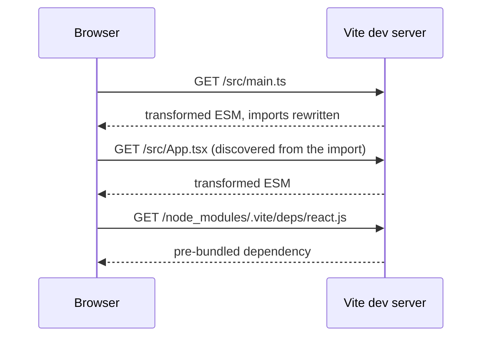
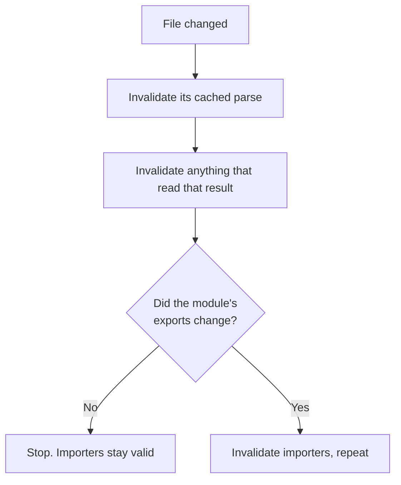

# Vite, Rust Bundler ও Dev Loop {#ch-vite-and-the-dev-loop}

> ব্যাখ্যা করুন, dev server কেন সঙ্গে সঙ্গে চালু হয় আর build কেন হয় না। আর benchmark নয়, compatibility দেখে bundler বেছে নিন।

**এই অধ্যায়ে:** দুটো program, একটি config · unbundled dev server আর HMR · environment variable inline হয়ে যায় · bundler-গুলো কেন Rust-এ নতুন করে লেখা হলো · দ্রুততর bundler কী ঠিক করে না

## 💡 মূল ধারণা

একটি dev server আর একটি production build ঠিক উল্টো দুটো সমস্যার সমাধান করে।

Dev server localhost-এ একজন developer-কে serve করে। একটি request-এর খরচ প্রায় শূন্য, আর code কয়েক সেকেন্ড পরপর
বদলায়। এর উচিত **প্রতিটি পরিবর্তনে যতটা সম্ভব কম কাজ করা**।

Build একটি সত্যিকারের network-এ প্রত্যেক user-কে serve করে। প্রতিটি request-এ একটি round trip লাগে, আর output একবার
লেখা হয়, পড়া হয় লক্ষবার। এর উচিত **শুরুতেই যতটা সম্ভব বেশি কাজ করে ফেলা**।

Vite-এর মূল অন্তর্দৃষ্টি ছিল, এ দুটোকে একই program বলে ভান করা বন্ধ করা। Development-এ এটা একেবারেই bundle করে না।
Browser native ESM দিয়ে module চায়, আর Vite চাহিদামতো সেগুলো transform করে। নিচের Rust-এ নতুন করে লেখা tool-গুলো
আরও এগিয়ে যায়: একটি rebuild-এর খরচ হয় যা _বদলেছে_ তার সমান, যা আছে তার সমান নয়।

> ⚠️ **যা বদলাতে থাকে:** এটা বইয়ের সবচেয়ে দ্রুত বদলানো কোণ। Vite 2–7 development-এ esbuild আর build-এ Rollup ব্যবহার
> করত। Vite 8 দুটোকেই **Rolldown**-এ এক করেছে, যেটা Rollup-compatible plugin-সহ একটি Rust bundler। Next.js-এর ভেতরে
> default হলো Turbopack, আর Rspack-এর লক্ষ্য Webpack build। Default, stability status আর benchmark আবার বদলাবে, তাই
> নিজের version দেখে নিন। যে ধারণাগুলো টিকে থাকবে: development-এ কম কাজ, build-এ বেশি। আর bundler বেছে নিন **সেটা কোন
> ecosystem রক্ষা করে** তা দেখে।

## কীভাবে কাজ করে

### Unbundled dev server



**Graph-এর ভেতর দিয়ে হাঁটাটা চালায় browser, তাই একটি page আসলে যা import করে, শুধু সেটাই transform হয়।**

Cold start application-এর আকারের সাথে বাড়ে না, কারণ কেউ না চাওয়া পর্যন্ত কিছুই process হয় না। একটি file-এর
পরিবর্তন একটি module-কে invalidate করে, একটি bundle-কে নয়। এ কারণেই update সঙ্গে সঙ্গে হয়েছে বলে মনে হয়।

Vite source file কাঁচা অবস্থায় serve করে, কিন্তু `node_modules` নয়। Dependency-গুলোকে এটা একবার **pre-bundle** করে
`node_modules/.vite`-এর নিচে cache করে রাখে। কিছু package এখনো CommonJS ship করে, যেটা browser import করতে পারে না।
আর শত শত ছোট file-এ ভাগ করা একটি ESM package একটি import-এর জন্য শত শত request তৈরি করত।

Pre-bundling শুধু development-এর জন্য। Scanner একটি dynamically import করা dependency মিস করতে পারে, আর তখন session-এর
মাঝখানে page reload হয়। সেটা `optimizeDeps.include`-এ তালিকাভুক্ত করলেই ঠিক হয়।

### HMR কীভাবে ঠিক করে কী reload হবে

Hot Module Replacement (HMR) একটি ছোট protocol, জাদু নয়। একটি file বদলালে server import graph ধরে **ওপরের দিকে**
হাঁটে। সে এমন একটি module খোঁজে, যেটা ঘোষণা করেছে যে সে update গ্রহণ করতে পারে।

- কোনো module নিজের update গ্রহণ করলে শুধু সেই module-টিই বদলানো হয়।
- না করলে খোঁজ চলতে থাকে তার importer-দের দিকে।
- কেউ গ্রহণ না করে খোঁজ একটি entry point-এ পৌঁছালে page পুরোপুরি reload হয়।

Framework plugin আপনার হয়ে এই accept handler-গুলো register করে দেয়। React Fast Refresh আর Svelte-এর HMR integration
বলতে এটুকুই।

**একটি value রাখা module-এর জন্য হাতে একটি ঘোষণা করা:**

```typescript
export const config: AppConfig = { theme: 'dark', locale: 'en-GB' };

if (import.meta.hot) {
  // Accept this module's own updates; without this the page reloads instead.
  import.meta.hot.accept();
  // Hand state to the replacement module rather than losing it.
  import.meta.hot.dispose(() => saveScrollPosition());
}
```

"HMR পুরো page reload করে" মানে chain-এর কেউ গ্রহণ করেনি। সাধারণ কারণ হলো একটি component file, যেটা একটি সাধারণ
value-ও export করে। Framework plugin সেটা hot-swap করতে পারে না।

### Plugin আর environment variable

Vite plugin হলো বাড়তি hook-সহ Rollup plugin, তাই Rollup-এর জন্য লেখা একটি plugin সাধারণত কোনো বদল ছাড়াই কাজ করে।
মূল hook-গুলো হলো `resolveId`, `load` আর `transform`। দুটো field ক্রম নিয়ন্ত্রণ করে, আর এগুলো ভুল করাই একটি plugin
"কিছুই করে না" হওয়ার সাধারণ কারণ। `enforce: 'pre' | 'post'` একটি plugin-কে core plugin-গুলোর সাপেক্ষে বসায়।
`apply: 'serve' | 'build'` এটাকে দুটো program-এর একটিতে সীমাবদ্ধ করে।

`VITE_` prefix-যুক্ত variable client code-এর কাছে `import.meta.env.VITE_*` হিসেবে খোলা থাকে। Prefix-টি একটি নিরাপত্তার
গেট: environment-এর বাকি সবকিছু bundle-এর বাইরে থাকে। এই value-গুলো **build-এর সময় বদলে বসানো হয়**, runtime-এ পড়া
হয় না। `import.meta.env.VITE_API_URL` output-এ একটি string literal হয়ে যায়।

> ⚠️ **একটি `VITE_` variable-এ রাখা secret publish হয়ে যায়**, plain text-এ, যে-ই bundle খোলে তার কাছে। আর value
> inline হয় বলে একটি artefact বিভিন্ন environment-এ promote করা যায় না। সেটার জন্য value পড়ুন একটি runtime
> endpoint বা inject করা একটি script tag থেকে।

### নিচের স্তরটা কেন Rust-এ নতুন করে লেখা হলো

কারণ দুটো, আর আকর্ষণীয়টা "JavaScript-এর চেয়ে Rust দ্রুত" নয়।

**Parallelism।** Module parse আর transform করা পুরোপুরি parallel করা যায়: প্রতিটি file স্বাধীন, তাই কাজ পরিষ্কারভাবে
ভাগ হয়ে যায়। একটি single-threaded JavaScript process machine-এর অন্য core-গুলো ব্যবহার করতে পারে না।

**Incrementality।** পুরোনো model একটি pipeline: প্রতিটি file পড়া, transform করা, link করা আর emit করা। নতুন model
একক operation memoise করে, যেমন একটি file parse করা বা একটি specifier resolve করা। প্রতিটি কীসের ওপর নির্ভর করেছিল,
সেটাও এটা লিখে রাখে। এতে অনেক memory আর হিসাব রাখা লাগে, যেটা একটি garbage-collected ভাষায় কঠিন।



**Cache invalidate হয় আসলে যা বদলেছে তা দিয়ে, কোন file ছোঁয়া হয়েছে তা দিয়ে নয়।**

Application বড় হলেও hot update আর ধীর হয় না। Disk-এ রাখা একটি cache restart-কেও প্রায় একটি hot update-এর মতোই সস্তা
করে দেয়। **একই architecture-কে দ্রুত করলে আপনি একটি constant factor পান। Architecture বদলালে বদলায় build time কীসের
সমানুপাতিক।**

### তিনটি project

| | Turbopack | Rspack | Rolldown |
| --- | --- | --- | --- |
| **কোথা থেকে** | Vercel | ByteDance | VoidZero |
| **যা রক্ষা করে** | Next.js configuration | **Webpack config, loader আর plugin** | **Rollup plugin** |
| **এর কাজ** | Next.js-এর ভেতরের bundler | Webpack-এর সরাসরি বিকল্প | Vite-এর ভেতরের bundler |

"যা রক্ষা করে" সারিটাই পুরো সিদ্ধান্ত। Team-গুলো throughput দেখে এই tool বেছে নেয় না। তারা বেছে নেয় কী নতুন করে
লিখতে হবে না তা দেখে। সাধারণত আপনি বেছেই নেন না: আপনি একটি framework বাছেন, আর framework আগেই বেছে রেখেছে।
পার্থক্যগুলো জানা জরুরি migration আর সমস্যা নির্ণয়ের জন্য।

Transform স্তরও একই দিকে গেছে। **SWC** (Rust) Next.js আর Turbopack-এ Babel-এর জায়গা নিয়েছে। **Oxc** (Rust)
Rolldown-এর parsing আর Oxlint linter চালায়। **esbuild** (Go) এখনো ব্যাপকভাবে ব্যবহৃত।

> ⚠️ **এই tool-গুলো type মুছে ফেলে। Check করে না।** এরা type graph তৈরি না করেই TypeScript annotation মুছে দেয়,
> আর এ কারণেই এরা দ্রুত। একটি সবুজ build type-এর সঠিকতা নিয়ে কিছুই প্রমাণ করে না।
> Check কোথায় হবে, তা আছে [Chapter ?? — বড় পরিসরে Type-Checking ও Linting](#ch-type-checking-and-linting)-এ।

### দ্রুততর bundler যা ঠিক করে না

| এখনো আপনার সমস্যা | Bundler কেন সাহায্য করতে পারে না |
| ------------------ | --------------------------- |
| একটি barrel file, যেটা পুরো একটি component library-তে পৌঁছায় | Graph তো আপনিই লিখেছেন |
| একটি date format-এর জন্য 900 KB-র একটি dependency | যা import করেছেন, তা কেউ সরায় না |
| বিশ মিনিটের একটি continuous integration run | Bundling অনেক কাজের মধ্যে একটি মাত্র |
| Migration-এর পর loader আর plugin-এর ফাঁক | Compatibility বেশি, কিন্তু পুরোপুরি নয় |

## কখন ব্যবহার করবেন

| পরিস্থিতি | পরামর্শ |
| --------- | -------- |
| নতুন single-page application, যেকোনো framework | Vite-ই default। এ নিয়ে আর কোনো বিতর্ক নেই |
| একটি meta-framework project | যেটার সাথে আসে, সেটাই। SvelteKit আর Nuxt Vite ব্যবহার করে; Next.js ব্যবহার করে Turbopack |
| বড় Webpack build, ধীর dev loop | Rspack যাচাই করে দেখুন। Configuration-এর বেশিরভাগই চলে আসে |
| অদ্ভুত plugin-সহ Webpack build | সিদ্ধান্ত নেওয়ার আগে সমতা যাচাই করুন, আর fallback-এর পথ রাখুন |
| Bundler benchmark দেখে framework বাছা | করবেন না। Framework দেখে বাছুন |

## সাধারণ ভুল

**❌ একটি `VITE_` variable-এ secret রাখা।**
✅ এটা client bundle-এ inline হয়ে যায়। এই prefix-যুক্ত যেকোনো কিছু public।

**❌ ধরে নেওয়া যে dev-এর আচরণ আর build-এর আচরণ একই।**
✅ Dev unbundled module serve করে। Build bundle করে, tree-shake করে আর minify করে। প্রতিটি পরিবর্তনে continuous
integration-এ production build চালান, শুধু release-এর আগে নয়।

**❌ বিশ্বাস করা যে build আপনার type যাচাই করে।**
✅ এটা type মুছে ফেলে। Continuous integration-এ `tsc --noEmit` চালান, নইলে type error ship হবে।

**❌ না মেপেই ধীর pipeline ঠিক করতে bundler migrate করা।**
✅ বিশ মিনিটের বেশিরভাগ যদি test আর linting হয়, দ্রুততর bundler প্রায় কিছুই বদলায় না।

**❌ এক Rust bundler থেকে আরেকটিতে configuration copy করা।**
✅ এরা _আলাদা_ ecosystem রক্ষা করে। একটি Webpack loader একটি Rollup plugin নয়।

## 🔑 মূল শিক্ষা

- Dev server আর build দুটো আলাদা program: একদিকে প্রতিটি পরিবর্তনে সবচেয়ে কম কাজ, অন্যদিকে শুরুতেই সবচেয়ে বেশি কাজ।
- Development unbundled native ESM serve করে, আর HMR import graph ধরে ওপরে হাঁটে update গ্রহণ করে এমন একটি module-এর খোঁজে।
- `VITE_` variable build-এর সময় inline হয়, তাই এগুলো public, আর বদলাতে হলে rebuild লাগে।
- Rust এনে দিয়েছে সত্যিকারের parallelism আর একটি incremental cache, যাতে rebuild-এর খরচ পরিবর্তনের আকার অনুসরণ করে।
- Turbopack, Rspack আর Rolldown মূলত আলাদা কোন ecosystem রক্ষা করে তাতে, আর এদের কেউই type check করে না।

## Interview-এর প্রশ্ন

**Q: একটি বড় application-এও Vite dev server কেন সঙ্গে সঙ্গে চালু হয়?**

এটা bundle করে না। এটা source file-গুলোকে native ES module হিসেবে serve করে, আর প্রতিটি transform করে শুধু browser
চাইলে। Startup-এর খরচ নির্ভর করে প্রথম page কী import করে তার ওপর, codebase-এর আকারের ওপর নয়। Dependency একবার
pre-bundle হয়ে cache হয়, আর শুরুর কাজ বলতে শুধু এটুকুই।

**Q: একটি file save করলে কখনো কখনো পুরো page কেন reload হয়?**

HMR বদলানো file থেকে ওপরের দিকে হাঁটে, update গ্রহণ করে এমন একটি module খুঁজতে। Chain-এর কেউ গ্রহণ না করলে খোঁজ
entry point-এ পৌঁছায়, আর Vite পুরো reload করে। সাধারণ কারণ হলো একটি component-এর পাশে export করা একটি constant।
সেটাকে তার নিজের module-এ সরালেই ঠিক হয়।

**Q: কিছু একটা development-এ কাজ করে কিন্তু production build-এ ভেঙে যায়। কোথা থেকে শুরু করবেন?**

Dev আর build-এর মাঝের ফাঁক থেকে। Development unbundled module serve করে, কোনো tree shaking বা minification ছাড়া।
Build তিনটিই করে। Vite 8-এর আগে এটা আলাদা CommonJS interop-সহ একটি আলাদা bundler-ও ব্যবহার করত। খুঁজুন এমন একটি
dependency, যেটা শুধু একটি mode-এ resolve হয়, tree shaking-এ মুছে যাওয়া একটি side effect, বা এমন code, যেটা module
evaluation-এর ক্রমের ওপর নির্ভর করে।

**Q: Bundler-গুলোকে optimise না করে কেন Rust-এ নতুন করে লেখা হলো?**

Bundling পুরোপুরি parallel করা যায়, আর একটি single-threaded process অন্য core-গুলো ব্যবহার করতে পারে না। পরিবর্তনের
আকার অনুসরণ করে এমন rebuild-এর জন্য খুব সূক্ষ্ম একটি incremental cache লাগে। তার জন্য এমন memory নিয়ন্ত্রণ লাগে, যা
একটি garbage-collected runtime-এ বাস্তবসম্মত নয়। Optimisation একটি constant factor এনে দেয়। Architecture-এর পরিবর্তন
বদলে দেয় build time কীসের সমানুপাতিক।

**Q: আপনার production build সফল হয়, কিন্তু application একটি type error-এ crash করে। কীভাবে?**

Bundler-এর transformer TypeScript annotation check না করেই মুছে ফেলে। এটা দ্রুত হওয়ার একটি বড় কারণ। Build-এর পথে
কেউই type graph তৈরি করে না, তাই type-checking-কে নিজস্ব একটি ধাপ হিসেবে চালাতে হয়। সাধারণত continuous
integration-এ `tsc --noEmit`, merge-এর আগে একটি গেট হিসেবে।

**Q: আপনার team build speed-এর জন্য Webpack ছেড়ে যেতে চায়। প্রথমে কী জিজ্ঞেস করবেন?**

সময়টা আসলে কোথায় যায়। Cold dev start আর hot update যদি কষ্ট দেয়, Rspack সরাসরি সাহায্য করে আর configuration-এর
বেশিরভাগ রেখে দেয়। বিশ মিনিটের pipeline যদি মূলত test, type-checking আর linting হয়, তাহলে bundler একটি ছোট অংশ।
তখন উত্তর হলো task caching আর affected-package detection। আগে মাপুন।

## এরপর কী পড়বেন

- [Chapter ?? — Module ও Bundling](#ch-modules-and-bundling) — যে চারটি ধাপকে এই অধ্যায় দুই ভাগ করে
- [Chapter ?? — Monorepo](#ch-monorepos) — ধীর pipeline-এর অন্য অর্ধেক
- [Chapter ?? — বড় পরিসরে Type-Checking ও Linting](#ch-type-checking-and-linting) — যে ধাপ কোনো bundler করে না
