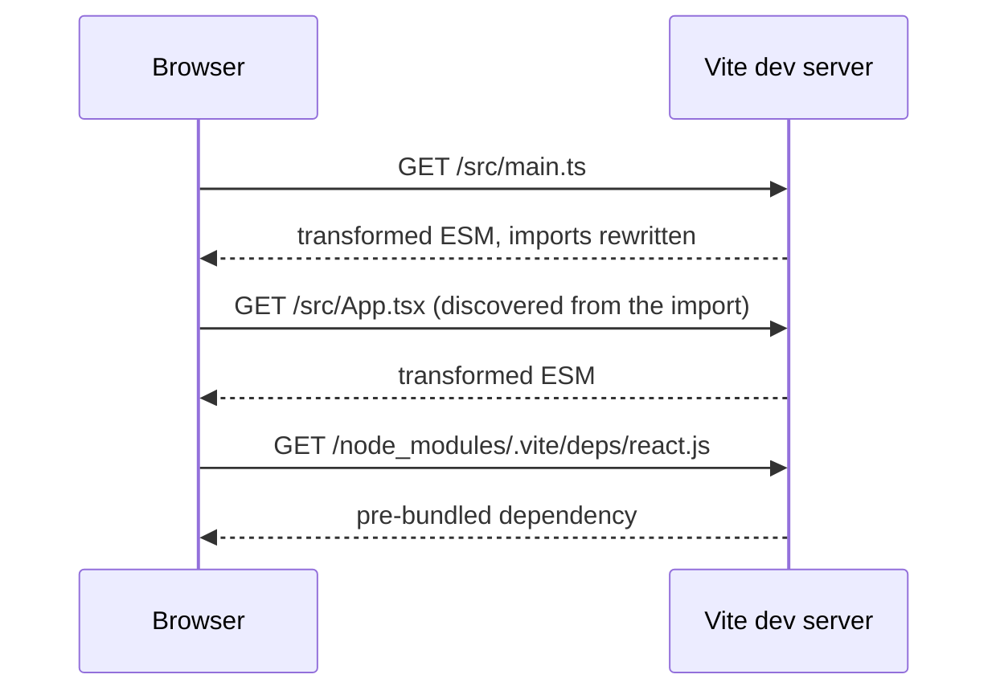
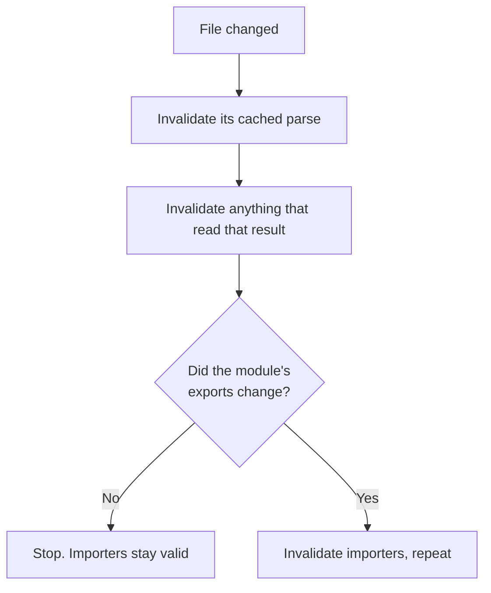

# Vite, Rust Bundler ও Dev Loop {#ch-vite-and-the-dev-loop}

> Dev server কেন মুহূর্তে চালু হয় আর build কেন হয় না, তা ব্যাখ্যা করুন, আর bundler বাছুন benchmark দেখে নয়, compatibility দেখে।

**এই অধ্যায়ে:** একই config, দুটি আলাদা program · unbundled dev server আর HMR · environment variable inline হয়ে যায় · bundler-গুলো কেন Rust-এ নতুন করে লেখা হলো · দ্রুত bundler যা ঠিক করে না

## 💡 মূল ধারণা

Dev server আর production build একেবারে উল্টো দুটি সমস্যার সমাধান করে।

Dev server কাজ করে localhost-এ একজন developer-এর জন্য। একেকটি request-এর খরচ প্রায় শূন্য, আর code বদলায় কয়েক
সেকেন্ড পরপর। তাই এর কাজ হলো **প্রতিটি পরিবর্তনে যতটা সম্ভব কম কাজ করা**।

Build কাজ করে আসল network-এ প্রত্যেক user-এর জন্য। প্রতিটি request-এ একটি round trip লাগে, আর output একবার লেখা
হয়, পড়া হয় লাখোবার। তাই এর কাজ হলো **আগেভাগেই যতটা সম্ভব বেশি কাজ সেরে রাখা**।

Vite-এর মূল উপলব্ধি ছিল, এ দুটিকে একই program বলে ভান করা বন্ধ করা। Development-এ Vite কিছুই bundle করে না।
Browser native ESM দিয়ে module চায়, আর Vite চাহিদামতো সেগুলো transform করে দেয়। নিচের স্তরের Rust rewrite-গুলো
আরও এগিয়ে যায়: rebuild-এর খরচ হয় যা _বদলেছে_ তার মাপে, যা আছে তার মাপে নয়।

> ⚠️ **যা বদলাতে থাকে:** বইয়ের সবচেয়ে দ্রুত বদলানো কোণ এটা। Vite 2–7 development-এ esbuild আর build-এ Rollup
> ব্যবহার করত। Vite 8 দুটিকেই এক করেছে **Rolldown**-এ, যেটা Rollup-compatible plugin সহ একটি Rust bundler।
> Next.js-এর ভেতরে default হলো Turbopack, আর Rspack-এর লক্ষ্য Webpack build। Default, stability-র অবস্থা আর
> benchmark আবার বদলাবে, তাই নিজের version দেখে নিন। টেকসই ধারণাগুলো: development-এ কম কাজ, build-এ বেশি কাজ,
> আর bundler বাছুন **কোন ecosystem সেটা বাঁচিয়ে রাখে** তা দেখে।

## কীভাবে কাজ করে

### Unbundled dev server



**Graph ধরে কোথায় যাওয়া হবে তা ঠিক করে browser, তাই page আসলে যা import করে, শুধু সেটুকুই transform হয়।**

Application যত বড়ই হোক, cold start বাড়ে না, কারণ কেউ না চাওয়া পর্যন্ত কিছুই process হয় না। একটি file বদলালে
invalidate হয় একটি module, পুরো bundle নয়। এজন্যই update মুহূর্তের মনে হয়।

Vite source file কাঁচা অবস্থায় serve করে, কিন্তু `node_modules` নয়। Dependency-গুলো একবার **pre-bundle** করে
`node_modules/.vite`-এর নিচে cache করে রাখে। কারণ কিছু package এখনো CommonJS ship করে, যেটা browser import করতে
পারে না। আবার শত শত ছোট file-এ ভাগ করা ESM package হলে একটি import-এই শত শত request হয়ে যেত।

Pre-bundling শুধু development-এ হয়। Dynamic-ভাবে import করা dependency scanner-এর চোখ এড়িয়ে যেতে পারে, আর তখন
session-এর মাঝখানে page reload হয়। সেটা `optimizeDeps.include`-এ তালিকাভুক্ত করলে সমস্যা মেটে।

### কী reload হবে, HMR তা কীভাবে ঠিক করে

Hot Module Replacement (HMR) কোনো জাদু নয়, ছোট একটি protocol। কোনো file বদলালে server import graph বেয়ে **ওপরের
দিকে** যায়। খোঁজে এমন একটি module, যেটা ঘোষণা করে রেখেছে যে update নিতে পারবে।

- কোনো module নিজের update নিজে নিলে শুধু সেই module-টাই বদলানো হয়।
- না নিলে খোঁজ চলে তাকে যারা import করে তাদের দিকে।
- কেউ update না নিয়েই খোঁজ entry point পর্যন্ত পৌঁছালে পুরো page reload হয়।

Framework plugin আপনার হয়ে এই accept handler-গুলো register করে দেয়। React Fast Refresh আর Svelte-এর HMR
integration আসলে এটুকুই।

**হাতে একটি handler ঘোষণা করা, value ধরে রাখা একটি module-এর জন্য:**

```typescript
export const config: AppConfig = { theme: 'dark', locale: 'en-GB' };

if (import.meta.hot) {
  // Accept this module's own updates; without this the page reloads instead.
  import.meta.hot.accept();
  // Hand state to the replacement module rather than losing it.
  import.meta.hot.dispose(() => saveScrollPosition());
}
```

"HMR পুরো page reload করে" মানে chain-এর কেউ update নেয়নি। সাধারণ কারণ হলো এমন component file, যেটা একটি সাধারণ
value-ও export করে। Framework plugin সেটা hot-swap করতে পারে না।

### Plugin আর environment variable

Vite plugin আসলে বাড়তি কিছু hook সহ Rollup plugin, তাই Rollup-এর জন্য লেখা plugin সাধারণত কোনো বদল ছাড়াই চলে। মূল
hook হলো `resolveId`, `load` আর `transform`। ক্রম ঠিক করে দুটি field, আর এগুলো ভুল হলেই সাধারণত plugin "কিছুই
করে না"। `enforce: 'pre' | 'post'` core plugin-গুলোর আগে না পরে বসবে তা ঠিক করে। `apply: 'serve' | 'build'`
plugin-টাকে দুটি program-এর একটিতে সীমাবদ্ধ রাখে।

`VITE_` prefix দেওয়া variable client code-এ পাওয়া যায় `import.meta.env.VITE_*` হিসেবে। Prefix-টা একটি নিরাপত্তার
গেট: environment-এর বাকি সবকিছু bundle-এর বাইরে থাকে। এই value-গুলো runtime-এ পড়া হয় না, **build-এর সময়
বসিয়ে দেওয়া হয়**। `import.meta.env.VITE_API_URL` output-এ একটি string literal হয়ে যায়।

> ⚠️ **`VITE_` variable-এ রাখা secret publish হয়ে যায়**, plain text-এ, যে bundle খুলবে তার কাছেই। আর value
> inline হয়ে যায় বলে একই artefact এক environment থেকে আরেকটিতে promote করা যায় না। সেজন্য value পড়ুন runtime
> endpoint থেকে, বা inject করা script tag থেকে।

### নিচের স্তর কেন Rust-এ নতুন করে লেখা হলো

কারণ দুটি, আর আকর্ষণীয় কারণটা "JavaScript-এর চেয়ে Rust দ্রুত" নয়।

**Parallelism।** Module parse আর transform করার কাজ একেবারে সহজে parallel করা যায়: প্রতিটি file স্বাধীন, তাই কাজ
পরিষ্কারভাবে ভাগ হয়ে যায়। Single-threaded JavaScript process machine-এর বাকি core-গুলো কাজে লাগাতে পারে না।

**Incrementality।** পুরনো model একটি pipeline: প্রতিটি file পড়ো, transform করো, link করো, emit করো। নতুন model
একেকটি ছোট কাজ memoise করে, যেমন একটি file parse করা বা একটি specifier resolve করা। আর প্রতিটি কাজ কীসের ওপর
নির্ভর করেছিল, তা লিখে রাখে। এতে অনেক memory আর হিসাব-নিকাশ লাগে, যা garbage-collected ভাষায় করা কঠিন।



**Cache invalidate হয় আসলে কী বদলেছে তা দেখে, কোন file ছোঁয়া হয়েছে তা দেখে নয়।**

Application বড় হতে থাকলেও hot update আর ধীর হয় না। Disk-এ persist করা cache থাকলে restart-ও প্রায় hot update-এর
মতোই সস্তা হয়। **একই architecture দ্রুত করলে একটি নির্দিষ্ট গুণ লাভ হয়। Architecture বদলালে build time কীসের
অনুপাতে বাড়ে, সেটাই বদলে যায়।**

### তিনটি project

| | Turbopack | Rspack | Rolldown |
| --- | --- | --- | --- |
| **কার তৈরি** | Vercel | ByteDance | VoidZero |
| **যা বাঁচিয়ে রাখে** | Next.js configuration | **Webpack config, loader আর plugin** | **Rollup plugin** |
| **এর কাজ** | Next.js-এর ভেতরের bundler | Webpack-এর জায়গায় সরাসরি বসানো যায় | Vite-এর ভেতরের bundler |

পুরো সিদ্ধান্তটাই "যা বাঁচিয়ে রাখে" row-তে। Team-গুলো এই tool throughput দেখে বাছে না। বাছে কী আবার লিখতে হবে
না, তা দেখে। সাধারণত আপনি বাছাই-ই করেন না: framework বেছে নেন, আর framework আগেই বেছে রেখেছে। পার্থক্যগুলো জানা
দরকার migration আর সমস্যা ধরার জন্য।

Transform-এর স্তরও একই পথে গেছে। Next.js আর Turbopack-এ Babel-এর জায়গা নিয়েছে **SWC** (Rust)। Rolldown-এর parsing
আর Oxlint linter চলে **Oxc** (Rust) দিয়ে। **esbuild** (Go) এখনো ব্যাপকভাবে ব্যবহার হয়।

> ⚠️ **এই tool-গুলো type মুছে ফেলে, যাচাই করে না।** Type graph তৈরি না করেই TypeScript annotation মুছে দেয়, আর
> এজন্যই এরা দ্রুত। Build সবুজ হলেও type ঠিক আছে কি না, তা প্রমাণ হয় না। যাচাইটা কোথায় হবে, তা আছে
> [Chapter ?? — বড় পরিসরে Type-Checking ও Linting](#ch-type-checking-and-linting)-এ।

### দ্রুত bundler যা ঠিক করে না

| এখনো আপনার সমস্যা | Bundler কেন সাহায্য করতে পারে না |
| ------------------ | --------------------------- |
| পুরো component library-তে পৌঁছে যাওয়া barrel file | Graph তো আপনিই লিখেছেন |
| একটি date format-এর জন্য 900 KB dependency | যা import করেছেন, তা কিছুই বাদ দেয় না |
| বিশ মিনিটের continuous integration run | Bundling অনেক কাজের মধ্যে একটি মাত্র |
| Migration-এর পরে loader আর plugin-এর ঘাটতি | Compatibility বেশি, কিন্তু পুরোপুরি নয় |

## কখন ব্যবহার করবেন

| পরিস্থিতি | পরামর্শ |
| --------- | -------- |
| নতুন single-page application, যেকোনো framework | Vite-ই default। এ নিয়ে আর তর্ক নেই |
| Meta-framework project | Framework-এর সঙ্গে যেটা আসে। SvelteKit আর Nuxt ব্যবহার করে Vite; Next.js ব্যবহার করে Turbopack |
| বড় Webpack build, ধীর dev loop | Rspack যাচাই করে দেখুন। Configuration-এর বেশিরভাগই চলে যায় |
| অদ্ভুত plugin সহ Webpack build | সিদ্ধান্তের আগে parity যাচাই করুন, আর ফিরে যাওয়ার পথ খোলা রাখুন |
| Bundler benchmark দেখে framework বাছা | করবেন না। Framework দেখেই বাছুন |

## সাধারণ ভুল

**❌ `VITE_` variable-এ secret রাখা।**
✅ এটা client bundle-এ inline হয়ে যায়। ওই prefix-ওয়ালা সবকিছুই public।

**❌ ধরে নেওয়া যে dev-এর আচরণ আর build-এর আচরণ একই।**
✅ Dev serve করে unbundled module। Build bundle করে, tree-shake করে, minify করে। Production build শুধু release-এর
আগে নয়, প্রতিটি পরিবর্তনে continuous integration-এ চালান।

**❌ বিশ্বাস করা যে build আপনার type যাচাই করে।**
✅ Build type মুছে ফেলে। Continuous integration-এ `tsc --noEmit` চালান, নইলে type error ship হয়ে যাবে।

**❌ না মেপেই ধীর pipeline ঠিক করতে bundler migrate করা।**
✅ বিশ মিনিটের বেশিরভাগই যদি test আর linting হয়, দ্রুত bundler প্রায় কিছুই বদলায় না।

**❌ এক Rust bundler থেকে আরেকটিতে configuration copy করা।**
✅ এরা _আলাদা আলাদা_ ecosystem বাঁচিয়ে রাখে। Webpack loader আর Rollup plugin এক জিনিস নয়।

## 🔑 মূল শিক্ষা

- Dev server আর build আলাদা program: একটির লক্ষ্য প্রতি পরিবর্তনে কম কাজ, অন্যটির আগেভাগে বেশি কাজ।
- Development-এ serve হয় unbundled native ESM, আর HMR import graph বেয়ে ওপরে উঠে update নিতে পারে এমন module খোঁজে।
- `VITE_` variable build-এর সময় inline হয়, তাই এগুলো public, আর বদলাতে হলে আবার build করতে হয়।
- Rust এনে দিয়েছে সত্যিকারের parallelism আর এমন incremental cache, যাতে rebuild-এর খরচ পরিবর্তনের মাপে চলে।
- Turbopack, Rspack আর Rolldown-এর মূল পার্থক্য তারা কোন ecosystem বাঁচিয়ে রাখে, আর কোনোটিই type যাচাই করে না।

## Interview-এর প্রশ্ন

**Q: বড় application-এও Vite dev server মুহূর্তে চালু হয় কেন?**

কারণ এটা bundle করে না। Source file serve করে native ES module হিসেবে, আর প্রতিটি file transform করে কেবল তখন,
যখন browser সেটা চায়। চালু হওয়ার খরচ নির্ভর করে প্রথম page কী import করে তার ওপর, codebase-এর আকারের ওপর নয়।
Dependency-গুলো একবার pre-bundle হয়ে cache-এ থাকে, আর আগেভাগে কাজ বলতে শুধু এটুকুই।

**Q: একটি file save করলে মাঝে মাঝে পুরো page reload হয় কেন?**

HMR বদলানো file থেকে ওপরের দিকে যায়, খোঁজে এমন module যেটা update নেয়। Chain-এর কেউ না নিলে খোঁজ entry point-এ
পৌঁছায়, আর Vite পুরো page reload করে। সাধারণ কারণ হলো component-এর পাশে export করা একটি constant। সেটাকে নিজের
module-এ সরিয়ে দিলেই ঠিক হয়।

**Q: কিছু একটা development-এ চলে, কিন্তু production build-এ ভেঙে যায়। কোথা থেকে শুরু করবেন?**

Dev আর build-এর মধ্যকার ফাঁক থেকে। Development-এ serve হয় unbundled module, কোনো tree shaking বা minification
ছাড়া। Build তিনটিই করে। Vite 8-এর আগে build আলাদা একটি bundler-ও ব্যবহার করত, যার CommonJS interop ছিল আলাদা।
খুঁজুন এমন dependency, যেটা কেবল একটি mode-এ resolve হয়; এমন side effect, যেটা tree shaking বাদ দিয়ে দিয়েছে;
অথবা এমন code, যেটা module evaluation-এর ক্রমের ওপর নির্ভর করে।

**Q: Bundler-গুলো optimise না করে Rust-এ নতুন করে লেখা হলো কেন?**

Bundling-এর কাজ খুব সহজে parallel করা যায়, আর single-threaded process বাকি core-গুলো কাজে লাগাতে পারে না। Rebuild-এর
খরচ পরিবর্তনের মাপে রাখতে খুব সূক্ষ্ম incremental cache লাগে। তার জন্য memory-র ওপর এমন নিয়ন্ত্রণ দরকার, যা
garbage-collected runtime-এ বাস্তবে সম্ভব নয়। Optimisation দেয় একটি নির্দিষ্ট গুণ লাভ। Architecture বদলালে build time
কীসের অনুপাতে বাড়ে, সেটাই বদলে যায়।

**Q: Production build সফল, অথচ application type error-এ crash করছে। কীভাবে?**

Bundler-এর transformer TypeScript annotation যাচাই না করেই মুছে দেয়। এটা দ্রুত হওয়ার একটি বড় কারণ। Build-এর পথে
কেউ type graph তৈরি করে না, তাই type-checking-কে আলাদা ধাপ হিসেবে চালাতে হয়। সাধারণত continuous integration-এ
`tsc --noEmit`, merge-এর আগে gate হিসেবে।

**Q: Build speed-এর জন্য আপনার team Webpack ছেড়ে যেতে চায়। প্রথমে কী জিজ্ঞেস করবেন?**

সময়টা আসলে কোথায় যাচ্ছে। যদি cold dev start আর hot update কষ্ট দেয়, Rspack সরাসরি সাহায্য করে, আর configuration-এর
বেশিরভাগই রেখে দেয়। যদি বিশ মিনিটের pipeline-এর বেশিরভাগ হয় test, type-checking আর linting, তাহলে bundler ছোট একটি
অংশ মাত্র। তখন উত্তর হলো task caching আর affected package বের করা। আগে মাপুন।

## এরপর কী পড়বেন

- [Chapter ?? — Module ও Bundling](#ch-modules-and-bundling) — এই অধ্যায় যে চারটি ধাপকে দুই ভাগ করে
- [Chapter ?? — Monorepo](#ch-monorepos) — ধীর pipeline-এর বাকি অর্ধেক
- [Chapter ?? — বড় পরিসরে Type-Checking ও Linting](#ch-type-checking-and-linting) — যে ধাপ কোনো bundler করে না
