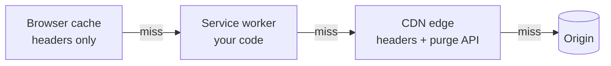

# Caching ও Asset Delivery {#ch-asset-delivery}

> প্রতিটি image, font আর stylesheet সঠিক আকারে পাঠান, প্রতিটিকে যতদিন যুক্তি দিয়ে সমর্থন করতে পারেন ততদিন cache করুন, আর নিশ্চিত করুন যে একটি deploy সবসময় সেটাকে বদলে দিতে পারে।

**এই অধ্যায়ে:** cache-এর স্তরগুলো আর প্রতিটি কে নিয়ন্ত্রণ করে · প্রতিটি resource-এর জন্য `Cache-Control` · content hashing আর CDN · image, format আর `srcset` · reflow ছাড়া font · render-blocking CSS

## 💡 মূল ধারণা

একটি page-এর বেশিরভাগ byte হলো static asset, আর এদের delivery ঠিক করে দুটি প্রশ্ন। প্রথমটি হলো **load হওয়ার সময় এটা কীভাবে
ব্যর্থ হয়**। একটি image নরমভাবে ব্যর্থ হয়: একটি ফাঁকা জায়গা, তারপর content। একটি stylesheet না থাকলে browser কিছুই paint
করে না, আর একটি font দেরিতে এলে text অদৃশ্য থাকে বা reflow হয়। তাই image জিজ্ঞেস করে "কত কম byte", আর font ও CSS জিজ্ঞেস করে
"এটা আসার আগে user কী দেখেন"।

দ্বিতীয়টি হলো **একটি copy কতদিন আবার ব্যবহার করা যায়**। Caching গতির বিনিময়ে পুরনো হয়ে যাওয়ার ঝুঁকি নেয়। আগ্রাসী caching-কে
নিরাপদ করে **URL দিয়ে immutability**: content বদলালেই যদি URL বদলায়, তাহলে এক বছরের জন্য cache করুন, কারণ পুরনো URL আর
কেউ চাইবে না।

## কীভাবে কাজ করে

### Cache-এর চারটি স্তর, আর প্রতিটি কে নিয়ন্ত্রণ করে



**প্রতিটি স্তর পরেরটি এড়িয়ে যাওয়ার একটি সুযোগ — আর একটি পুরনো copy লুকিয়ে থাকার একটি জায়গা।**

Browser cache আপনি set করেন **শুধু header দিয়ে**, আর এটা purge করতে পারেন না। CDN আপনি API দিয়ে purge করতে পারেন। Service
worker আপনার নিজের code, তাই সেখানে একটি bug চিরকাল একটি পুরনো app serve করে যেতে পারে।
[Chapter ?? — Service Worker, Caching ও Offline](#ch-service-workers) এর update lifecycle ব্যাখ্যা করে।

### Resource-এর ধরন অনুযায়ী `Cache-Control`

| Resource | Header | যুক্তি |
| -------- | ------ | --------- |
| HTML document | `no-cache` | Revalidate করতেই হবে: এটাই hashed asset-গুলোর নাম বলে |
| Hashed JS, CSS, image, font | `public, max-age=31536000, immutable` | Content বদলালে URL বদলায় |
| Public API response | `public, max-age=60, s-maxage=300, stale-while-revalidate=60` | Browser-এ কম সময়, edge-এ বেশি |
| User-নির্দিষ্ট data | `private, max-age=600` | Browser cache করতে পারে; একটি shared CDN পারবে না |
| সংবেদনশীল যেকোনো কিছু | `no-store` | কোথাও কোনো copy লেখা হয় না |

দুটি header সবসময় গুলিয়ে ফেলা হয়। `no-cache`-এর অর্থ "cache করো না" **নয়**। এর অর্থ "একটি copy রাখো, কিন্তু প্রতিবার
ব্যবহারের আগে revalidate করো"। কিছুই না রাখার অর্থ যেটার, সেটা `no-store`। একটি bank statement-এ `no-cache` দিলেও সেটা disk-এ
থেকে যায়। `immutable` একটি reload-কে asset revalidate করা থেকে আটকায়।

### Content hashing এক বছরের cache-কে নিরাপদ করে

**Cache busting — query string বনাম hashed path:**

```html
<!-- ❌ Some intermediaries strip or ignore the query, and the path is unchanged -->
<link rel="stylesheet" href="styles.css?v=2" />

<!-- ✅ The hash is in the path, so new content is a new URL -->
<link rel="stylesheet" href="styles.a1b2c3.css" />
```

প্রতিটি bundler default-এ hashed নাম তৈরি করে। HTML-কে `no-cache` হতেই হবে, কারণ hashed file-গুলোর নাম একমাত্র এটাই বলে।
এটাকে cache করলে user-রা গত সপ্তাহের bundle load করতেই থাকবেন। Pattern-টি হলো **immutable asset, revalidate করা document।**

### CDN একটি shared cache

একটি CDN user-এর কাছাকাছি edge server-এ copy রাখে, তাই বেশিরভাগ request কখনো আপনার origin-এ পৌঁছায় না। এটা browser-এর মতো
একই header পড়ে, সাথে আরো দুটি, যা edge-এ গুরুত্বপূর্ণ।

- **`s-maxage`** শুধু shared cache-এর জন্য আয়ু ঠিক করে। আপনি একটি API response edge-এ পাঁচ মিনিট আর browser-এ এক মিনিট cache
  করতে পারেন, আর data বদলালে edge-এর copy purge করতে পারেন।
- **`stale-while-revalidate`** edge-কে পুরনো copy সাথে সাথে serve করতে দেয়, আর সেই সময় background-এ নতুনটি fetch করে।
  User-রা কখনো origin-এর জন্য অপেক্ষা করেন না, আর copy সর্বোচ্চ একটি request পিছিয়ে থাকে।

বিপদটা *shared* শব্দটিতে। `private` ছাড়া cache করা একটি personalised page একজন user-এর data পরের জনের হাতে তুলে দেয়।
`Vary: Cookie` সেটা এড়ায়, কিন্তু cache-কে প্রতি user-এ ভাগ করে ফেলে, তাই ব্যক্তিগত data এর বাইরে রাখুন।

> ⚠️ **যা বদলাতে থাকে:** framework caching, বিশেষ করে Next.js, কয়েকটি major version জুড়ে তার default বদলেছে। প্রতিটি
> hosting platform-ও নিজস্ব cache header যোগ করে। টেকসই নীতি হলো, প্রতিটি cache-এর একটি স্পষ্ট freshness window আর একটি
> স্পষ্ট invalidation trigger লাগে। আপনার framework response header-এ আসলে কী পাঠায়, তা যাচাই করুন।

### Image: format, আকার, আর box

একই ছবির জন্য AVIF মোটামুটি JPEG-এর অর্ধেক আকারের, আর WebP প্রায় 70%। Logo আর icon-এর জন্য SVG মানানসই। একটি সীমার পরে
quality দৃশ্যমান কিছুই দেয় না: **JPEG 85, WebP 80, AVIF 65**। AVIF একটি আলাদা scale ব্যবহার করে, এ কারণেই এর সংখ্যাটি কম
দেখায়।

**একই image কয়েকটি width-এ:**

```html

```

`srcset` বিদ্যমান width-গুলোর তালিকা দেয়। `sizes` browser-কে বলে image-টি কত চওড়া হয়ে *render* হবে, যা তার layout-এর আগেই
দরকার। ভুল `sizes` সাধারণ bug: browser ভুল file বেছে নেয়, আর হয় byte নষ্ট করে, নয়তো ঝাপসা দেখায়। Image নিজেই যখন বদলায়, তখন
`<picture>` ব্যবহার করুন: প্রতিটি breakpoint-এ আলাদা crop, বা একটি JPEG `` fallback সহ AVIF। সেই fallback ছাড়া একটি পুরনো
browser কিছুই দেখায় না। User upload-এর জন্য একটি image CDN URL parameter দিয়ে এর সবটাই করে, কারণ variant-গুলো আগে থেকে বানানো
যায় না।

### Font: কোন ব্যর্থতা পাবেন, বেছে নিন

একটি web font load হওয়ার সময় browser-কে কিছু একটি দেখাতেই হয়। `font-display` ব্যর্থতার ধরনটি বেছে নেয়।

| Value | Behaviour | খরচ |
| ----- | --------- | ----- |
| `block` | প্রায় 3 s অদৃশ্য text, তারপর web font | ফাঁকা text, আর সেই text LCP element হলে দেরিতে LCP |
| `swap` | সাথে সাথে fallback, তৈরি হলে swap | একটি reflow, যা CLS |
| `optional` | Web font প্রায় 100 ms-এর মধ্যে এলেই শুধু ব্যবহার হয় | কোনোটাই নয়, কিন্তু ধীর connection-এ হয়তো কখনো দেখাই যাবে না |

`swap` default পছন্দ, কারণ একটি reflow সরানো যায়, কিন্তু একটি ফাঁকা page নয়। Reflow হয় কারণ fallback আর web font-এর মাপ
আলাদা। তাই দুটির মাপ এক করুন।

**একটি subset variable font, সাথে মেলানো metrics-এর একটি fallback:**

```css
@font-face {
  font-family: "Inter";
  src: url("/fonts/inter-latin-var.woff2") format("woff2");
  font-weight: 100 900; /* one variable file instead of six static weights */
  font-display: swap;
  unicode-range: U+0000-00FF, U+2018-201E; /* Latin plus real quote marks */
}

@font-face {
  font-family: "Inter Fallback";
  src: local("Arial");
  size-adjust: 107%;
  ascent-override: 90%;
  descent-override: 22%;
}
```

তারপর `font-family: "Inter", "Inter Fallback", sans-serif` ব্যবহার করুন। `next/font`-এর মতো build tool আপনার জন্য সেই fallback
face তৈরি করে দেয়। শুধু প্রথম viewport-এর face-গুলো preload করুন, আর সবসময় `crossorigin` সহ। Font request CORS mode ব্যবহার
করে, তাই এটা ছাড়া browser file-টি দুবার fetch করে।

> ⚠️ **যা বদলাতে থাকে:** font tooling-এর নাম কয়েক বছর পরপর বদলায়। টেকসই নীতি হলো font নিজে host করা, subset করা, আর
> metrics মেলানো একটি fallback-এর সাথে জুড়ে দেওয়া।

### CSS render-blocking, আর সেটাই ঠিক

Style ছাড়া content paint করে তারপর আবার style করা অপেক্ষা করার চেয়েও খারাপ। তাই stylesheet-কে unblock করবেন না। ছোট করুন।

**Critical CSS inline, বাকিটা deferred:**

```html
<!-- Under ~14 kB keeps the first-viewport rules in the first network round trip -->
<style>.header { height: 64px; } .hero { min-height: 60vh; }</style>
<link rel="stylesheet" href="/styles/rest.css" media="print" onload="this.media='all'" />
```

`media="print"` swap একটি hack। Route ধরে CSS split করলে একই ফল পাওয়া যায়। Icon-এর জন্য `<use>` সহ একটি SVG sprite ব্যবহার
করুন: একটি cache করার মতো request। একটি icon font rendering আটকায় আর accessibility-র ক্ষতি করে।

## কখন ব্যবহার করবেন

| পরিস্থিতি | যা করবেন | কেন |
| --------- | -- | --- |
| Hashed JS, CSS, image, font | `max-age=31536000, immutable` | Content-এর সাথে URL বদলায় |
| HTML document | `no-cache` | এটাই hashed asset-গুলোর নাম বলে |
| একটি CDN-এর পেছনে একটি public API response | `s-maxage` সাথে `stale-while-revalidate` | Edge-এ দ্রুত, কখনো origin-এর জন্য অপেক্ষা করে না |
| প্রতি-user data | `private`, অথবা কোনো CDN caching নয় | নইলে একজন user-এর data আরেকজনের কাছে পৌঁছায় |
| Web font-এ body text | `swap` সাথে একটি মেলানো fallback | ফাঁকা text নেই, reflow-ও নেই |

## সাধারণ ভুল

❌ **Asset-এর সাথে HTML-ও cache করা।** User-রা পুরনো release load করতেই থাকেন, আর কোনো deploy সেটা ঠিক করে না।
✅ Document-এ `no-cache`, hashed asset-এ `immutable`।

❌ **সংবেদনশীল data-র জন্য `no-cache`।** এটা একটি stored copy রাখতে দেয়। এটা শুধু revalidation দাবি করে।
✅ কিছুই না রাখার অর্থ যেটার, সেটা `no-store`।

❌ **`width`/`height` বা `aspect-ratio` ছাড়া একটি image।** আপনি byte-এর বদলে একটি layout shift নিয়েছেন।
✅ সবসময় box-এর জায়গা রাখুন — দেখুন [Chapter ?? — Core Web Vitals](#ch-core-web-vitals)।

❌ **`crossorigin` ছাড়া একটি font-এ `preload`।** File-টি দুবার fetch হয়।
✅ সবসময় `crossorigin` যোগ করুন, একই origin হলেও।

## 🔑 মূল শিক্ষা

- Content-hashed URL-ই এক বছরের cache-কে নিরাপদ করে, কারণ নতুন content মানেই সবসময় নতুন URL।
- Revalidate করা একটি HTML document-এর সাথে immutable asset — এই pattern-টিই একটি deploy-কে সাথে সাথে কার্যকর হতে দেয়।
- `no-cache` মানে ব্যবহারের আগে revalidate করা, `no-store` মানে কোনো copy না রাখা, আর `private` একটি response-কে CDN-এর বাইরে রাখে।
- Image নরমভাবে ব্যর্থ হয়, কিন্তু font আর CSS হয় না, তাই font আর CSS আসার আগের মুহূর্তটির জন্য একটি পরিকল্পনা লাগে।
- Metrics মেলানো একটি fallback face-এর সাথে `font-display: swap` ফাঁকা text-ও দেয় না, reflow-ও দেয় না।

## Interview-এর প্রশ্ন

**Q: একটি single-page application-এর cache header আপনি কীভাবে set করবেন?**

প্রতিটি asset hash করুন আর `max-age=31536000, immutable` দিয়ে serve করুন। HTML serve করুন `no-cache` দিয়ে। Hashed file-গুলোর
নাম একমাত্র document-ই বলে, তাই প্রতিটি load-এ এটাকে revalidate করতে হবে। এটাকে cache করলে user-রা একটি warm cache থেকে আগের
release boot করতেই থাকবেন।

**Q: `no-cache` আর `no-store`-এর মধ্যে পার্থক্য কী?**

`no-cache` একটি stored copy রাখতে দেয়, কিন্তু ব্যবহারের আগে revalidate করে, তাই একটি 304 তবুও download বাঁচায়। `no-store`
কোনো copy-ই রাখতে দেয় না। তাই সংবেদনশীল data-য় `no-cache` দিলেও সেটা disk-এ থেকে যায়।

**Q: একজন user বলছেন app একটি পুরনো version-এ আটকে আছে, আর reload করলেও কাজ হচ্ছে না। আপনি প্রথমে কী দেখবেন?**

একটি service worker, যা update-এর কোনো পথ ছাড়া একটি cached shell serve করছে। এটাই একমাত্র স্তর, যেখানে bug device-এ থাকে আর
server থেকে purge করা যায় না। দ্বিতীয় সন্দেহভাজন হলো লম্বা `max-age` দিয়ে cache করা HTML। দুটিই কয়েক সেকেন্ডে দেখে নিন:
document-এর response header, আর কোনো service worker register করা আছে কিনা।

**Q: কখন আপনি CDN-এ একটি API response cache করবেন না?**

যখন response নির্ভর করে কে জিজ্ঞেস করছে তার ওপর। একটি shared cache সবাইকে একটি copy serve করে, তাই একটি personalised response
ফাঁস হয়ে যায়। `Vary: Cookie` ফাঁস হওয়া এড়ায়, কিন্তু প্রতিটি user-কে নিজস্ব cache entry দেয়, ফলে hit rate ধসে পড়ে। বরং page-টি
ভাগ করুন: public data cache করুন, আর ব্যক্তিগত অংশটি `private` দিয়ে আলাদাভাবে fetch করুন।

**Q: দেরিতে আসা একটি font কেন শুধু দেখতে খারাপ লাগার সমস্যা নয়, বরং একটি Core Web Vitals সমস্যা?**

দুটি option-ই একটি metric-এর খরচ করে। Block করলে text লুকিয়ে থাকে, যা LCP পিছিয়ে দেয় যদি সেটাই সবচেয়ে বড় element হয়। Swap
করলে text reflow হয়, যা CLS। Fix হলো `swap`, সাথে override করা metrics-এর একটি fallback, যাতে swap glyph বদলায় কিন্তু line-এর
সংখ্যা নয়।

## এরপর কী পড়বেন

- [Chapter ?? — Core Web Vitals](#ch-core-web-vitals) — এই সিদ্ধান্তগুলো যে LCP আর CLS সংখ্যা নড়ায়
- [Chapter ?? — Loading, Code Splitting ও Bundle Budget](#ch-loading-and-code-splitting) — কেন vendor chunk আর cache-এর আয়ু একই যুক্তি
- [Chapter ?? — Caching](#ch-caching) — server আর database স্তরে একই বিনিময়
