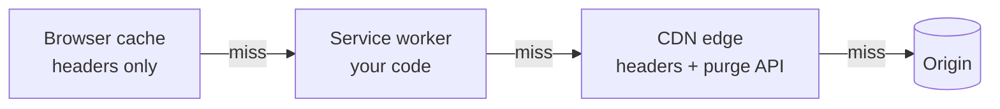

# Caching ও Asset Delivery {#ch-asset-delivery}

> প্রতিটি image, font আর stylesheet ঠিক size-এ পাঠান, প্রতিটি cache করুন যতদিন যুক্তি দিয়ে টেকানো যায়, আর নিশ্চিত করুন যে deploy করলেই সেটা বদলানো যায়।

**এই অধ্যায়ে:** cache-এর layer আর কে কোনটা নিয়ন্ত্রণ করে · প্রতিটি resource-এর জন্য `Cache-Control` · content hashing আর CDN · image, format আর `srcset` · reflow ছাড়া font · render-blocking CSS

## 💡 মূল ধারণা

Page-এর byte-এর বেশিরভাগই static asset, আর এদের delivery ঠিক করে দুটি প্রশ্ন। প্রথমটা হলো **load হওয়ার সময় এটা কীভাবে
ব্যর্থ হয়**। Image ব্যর্থ হয় নরমভাবে: আগে একটি ফাঁকা জায়গা, তারপর content। Stylesheet না থাকলে browser কিছুই paint করে
না, আর font দেরিতে এলে text অদৃশ্য থাকে বা reflow হয়। তাই image-এর প্রশ্ন "কত কম byte", আর font ও CSS-এর প্রশ্ন "এটা
আসার আগে user কী দেখেন"।

দ্বিতীয়টা হলো **একটি copy কতদিন আবার ব্যবহার করা যায়**। Caching-এ গতির বিনিময়ে পুরনো হওয়ার ঝুঁকি নিতে হয়। জোরালো caching
নিরাপদ হয় **URL দিয়ে immutability** থাকলে: content বদলালেই যদি URL বদলায়, তবে এক বছরের জন্য cache করুন, কারণ পুরনো URL
আর কেউ চাইবে না।

## কীভাবে কাজ করে

### Cache-এর চারটি layer, আর কে কোনটা নিয়ন্ত্রণ করে



**প্রতিটি layer পরেরটা এড়ানোর একটি সুযোগ — আবার পুরনো copy লুকিয়ে থাকার একটি জায়গাও।**

Browser cache আপনি ঠিক করেন **শুধু header দিয়ে**, আর এটা purge করতে পারেন না। CDN purge করা যায় API দিয়ে। Service worker
আপনার নিজের code, তাই সেখানে একটি bug থাকলে পুরনো app চিরকাল serve হতে পারে। এর update lifecycle নিয়ে আছে
[Chapter ?? — Service Worker, Caching ও Offline](#ch-service-workers)।

### প্রতিটি resource-এর জন্য `Cache-Control`

| Resource | Header | যুক্তি |
| -------- | ------ | --------- |
| HTML document | `no-cache` | Revalidate করতেই হবে: hashed asset-গুলোর নাম এখানেই থাকে |
| Hashed JS, CSS, image, font | `public, max-age=31536000, immutable` | Content বদলালে URL বদলায় |
| Public API response | `public, max-age=60, s-maxage=300, stale-while-revalidate=60` | Browser-এ কম সময়, edge-এ বেশি |
| User-নির্দিষ্ট data | `private, max-age=600` | Browser cache করতে পারে; shared CDN পারবে না |
| সংবেদনশীল যেকোনো কিছু | `no-store` | কোথাও কোনো copy লেখা হয় না |

দুটি header সারাক্ষণ গুলিয়ে যায়। `no-cache` মানে "cache করবেন না" **নয়**। এর মানে "copy রাখুন, কিন্তু প্রতিবার ব্যবহারের আগে
revalidate করুন"। কিছুই না রাখার মানে যেটার, সেটা হলো `no-store`। Bank statement-এ `no-cache` দিলেও সেটা disk-এ থেকে যায়।
`immutable` দিলে reload-এর সময় asset revalidate হয় না।

### Content hashing এক বছরের cache-কে নিরাপদ করে

**Cache busting — query string বনাম hashed path:**

```html
<!-- ❌ Some intermediaries strip or ignore the query, and the path is unchanged -->
<link rel="stylesheet" href="styles.css?v=2" />

<!-- ✅ The hash is in the path, so new content is a new URL -->
<link rel="stylesheet" href="styles.a1b2c3.css" />
```

প্রতিটি bundler default-এই hashed নাম বানায়। HTML-কে `no-cache` রাখতেই হবে, কারণ hashed file-গুলোর নাম শুধু HTML-এই থাকে।
এটা cache করলে user-রা গত সপ্তাহের bundle-ই load করতে থাকবেন। Pattern-টা হলো **asset immutable, document revalidate হয়।**

### CDN একটি shared cache

CDN user-এর কাছাকাছি edge server-এ copy রাখে, তাই বেশিরভাগ request আপনার origin পর্যন্ত পৌঁছায়ই না। Browser যে header পড়ে,
CDN-ও সেগুলোই পড়ে, সঙ্গে আরও দুটি, যা edge-এ গুরুত্বপূর্ণ।

- **`s-maxage`** lifetime ঠিক করে শুধু shared cache-এর জন্য। একটি API response edge-এ পাঁচ মিনিট আর browser-এ এক মিনিট cache
  করতে পারেন, আর data বদলালে edge-এর copy purge করে দিতে পারেন।
- **`stale-while-revalidate`** দিলে edge সঙ্গে সঙ্গে পুরনো copy serve করে, আর background-এ নতুনটা আনে। User-দের কখনো origin-এর
  জন্য অপেক্ষা করতে হয় না, আর copy-টা বড়জোর এক request পিছিয়ে থাকে।

বিপদটা লুকিয়ে আছে *shared* শব্দটায়। `private` ছাড়া cache করা personalised page এক user-এর data পরের user-এর হাতে তুলে দেয়।
`Vary: Cookie` এটা এড়ায়, কিন্তু cache-কে প্রতিটি user-এর জন্য আলাদা করে ফেলে, তাই personal data এর বাইরে রাখুন।

> ⚠️ **যা বদলাতে থাকে:** framework-এর caching, বিশেষ করে Next.js-এর, কয়েকটি major version জুড়ে default বদলেছে। প্রতিটি
> hosting platform নিজের cache header-ও যোগ করে। টেকসই নীতি হলো: প্রতিটি cache-এর একটি স্পষ্ট freshness window আর একটি স্পষ্ট
> invalidation trigger লাগে। আপনার framework response header-এ আসলে কী পাঠায়, তা দেখে নিন।

### Image: format, size, আর box

একই ছবির জন্য AVIF মোটামুটি JPEG-এর অর্ধেক size, আর WebP প্রায় 70%। Logo আর icon-এর জন্য SVG মানায়। একটি সীমার পরে quality
বাড়ালে চোখে পড়ার মতো কিছুই বাড়ে না: **JPEG 85, WebP 80, AVIF 65**। AVIF-এর scale আলাদা, তাই এর সংখ্যাটা কম দেখায়।

**একই image কয়েকটি width-এ:**

```html

```

`srcset` জানায় কোন কোন width আছে। `sizes` browser-কে বলে image-টা কত চওড়া হয়ে *render* হবে, আর layout-এর আগেই browser-এর
সেটা জানা দরকার। ভুল `sizes` হলো সাধারণ bug: browser ভুল file বেছে নেয়, ফলে হয় byte নষ্ট হয়, নয়তো ছবি ঝাপসা দেখায়।
Image নিজেই বদলালে `<picture>` ব্যবহার করুন: প্রতিটি breakpoint-এ আলাদা crop, কিংবা JPEG `` fallback-সহ AVIF। ওই fallback
না থাকলে পুরনো browser কিছুই দেখায় না। User-এর upload করা ছবির জন্য image CDN এই সবকিছু URL parameter দিয়েই করে, কারণ
variant-গুলো আগে থেকে build করে রাখা যায় না।

### Font: কোন ব্যর্থতা নেবেন, বেছে নিন

Web font load হওয়ার সময় browser-কে কিছু একটা দেখাতেই হয়। কোন ব্যর্থতা হবে, তা বেছে নেয় `font-display`।

| Value | আচরণ | খরচ |
| ----- | --------- | ----- |
| `block` | ~3 s অদৃশ্য text, তারপর web font | ফাঁকা text, আর সেই text LCP element হলে দেরিতে LCP |
| `swap` | সঙ্গে সঙ্গে fallback, তৈরি হলে বদলে যায় | একটি reflow, মানে CLS |
| `optional` | ~100 ms-এর মধ্যে এলে তবেই web font ব্যবহার | কোনোটাই নয়, কিন্তু ধীর connection-এ হয়তো কখনো দেখাই যাবে না |

Default বাছাই `swap`, কারণ reflow দূর করা যায়, কিন্তু ফাঁকা page দূর করা যায় না। Reflow হয়, কারণ fallback আর web font-এর
মাপ আলাদা। তাই দুটির মাপ এক করে দিন।

**Subset করা একটি variable font, সঙ্গে মাপ মিলিয়ে নেওয়া একটি fallback:**

```css
@font-face {
  font-family: "Inter";
  src: url("/fonts/inter-latin-var.woff2") format("woff2");
  font-weight: 100 900; /* one variable file instead of six static weights */
  font-display: swap;
  unicode-range: U+0000-00FF, U+2018-201E; /* Latin plus real quote marks */
}

@font-face {
  font-family: "Inter Fallback";
  src: local("Arial");
  size-adjust: 107%;
  ascent-override: 90%;
  descent-override: 22%;
}
```

তারপর লিখুন `font-family: "Inter", "Inter Fallback", sans-serif`। `next/font`-এর মতো build tool ওই fallback face আপনার জন্য
বানিয়ে দেয়। Preload করুন শুধু প্রথম viewport-এর face-গুলো, আর সবসময় `crossorigin`-সহ। Font request CORS mode-এ যায়, তাই
এটা ছাড়া browser file-টা দুবার fetch করে।

> ⚠️ **যা বদলাতে থাকে:** font-এর tooling দু-এক বছর পরপর নতুন নাম পায়। টেকসই নীতি হলো font নিজে host করা, subset করা, আর মাপ
> মিলিয়ে নেওয়া একটি fallback-এর সঙ্গে জোড়া দেওয়া।

### CSS render-blocking, আর সেটাই ঠিক

Style ছাড়া content paint করে তারপর আবার style বসানো অপেক্ষা করার চেয়েও খারাপ। তাই stylesheet-কে unblock করবেন না। ছোট
করুন।

**Critical CSS inline, বাকিটা পিছিয়ে:**

```html
<!-- Under ~14 kB keeps the first-viewport rules in the first network round trip -->
<style>.header { height: 64px; } .hero { min-height: 60vh; }</style>
<link rel="stylesheet" href="/styles/rest.css" media="print" onload="this.media='all'" />
```

`media="print"` দিয়ে বদলানোর কৌশলটা একটি hack। Route ধরে CSS ভাগ করলেও একই ফল পাওয়া যায়। Icon-এর জন্য `<use>`-সহ একটি SVG
sprite ব্যবহার করুন: cache করা যায় এমন একটিই request। Icon font rendering আটকায়, আর accessibility-র ক্ষতি করে।

## কখন ব্যবহার করবেন

| পরিস্থিতি | কী করবেন | কেন |
| --------- | -- | --- |
| Hashed JS, CSS, image, font | `max-age=31536000, immutable` | Content-এর সঙ্গে URL বদলায় |
| HTML document | `no-cache` | Hashed asset-গুলোর নাম এখানেই থাকে |
| CDN-এর পেছনে public API response | `s-maxage` আর সঙ্গে `stale-while-revalidate` | Edge-এ দ্রুত, origin-এর জন্য কখনো অপেক্ষা নেই |
| প্রতিটি user-এর নিজস্ব data | `private`, অথবা CDN-এ কোনো caching নয় | নইলে এক user-এর data আরেকজনের কাছে পৌঁছায় |
| Web font-এ লেখা মূল text | `swap` আর মাপ মেলানো fallback | ফাঁকা text নেই, reflow-ও নেই |

## সাধারণ ভুল

❌ **Asset-এর সঙ্গে HTML-ও cache করা।** User-রা পুরনো release-ই load করতে থাকেন, আর কোনো deploy দিয়ে এটা ঠিক হয় না।
✅ Document-এ `no-cache`, hashed asset-এ `immutable`।

❌ **সংবেদনশীল data-য় `no-cache`।** এতে copy রাখা যায়। শুধু revalidate করতে হয়।
✅ কিছুই না রাখার মানে যেটার, সেটা `no-store`।

❌ **`width`/`height` বা `aspect-ratio` ছাড়া image।** Byte বাঁচাতে গিয়ে layout shift কিনে নিলেন।
✅ সবসময় box-এর জায়গা রাখুন — দেখুন [Chapter ?? — Core Web Vitals](#ch-core-web-vitals)।

❌ **`crossorigin` ছাড়া font-এ `preload`।** File দুবার fetch হয়।
✅ সবসময় `crossorigin` যোগ করুন, একই origin হলেও।

## 🔑 মূল শিক্ষা

- Content-hashed URL-ই এক বছরের cache-কে নিরাপদ করে, কারণ নতুন content মানেই সবসময় নতুন URL।
- Immutable asset আর revalidate হওয়া HTML document, এই pattern-এর জোরেই deploy সঙ্গে সঙ্গে কার্যকর হয়।
- `no-cache` মানে ব্যবহারের আগে revalidate, `no-store` মানে কোনো copy নয়, আর `private` response-কে CDN-এর বাইরে রাখে।
- Image নরমভাবে ব্যর্থ হয়, font আর CSS হয় না, তাই font আর CSS আসার আগের মুহূর্তটার জন্য পরিকল্পনা লাগে।
- মাপ মেলানো fallback face-সহ `font-display: swap` দিলে ফাঁকা text-ও হয় না, reflow-ও হয় না।

## Interview-এর প্রশ্ন

**Q: Single-page application-এর cache header কীভাবে ঠিক করবেন?**

প্রতিটি asset hash করে `max-age=31536000, immutable` দিয়ে serve করব। HTML serve করব `no-cache` দিয়ে। Hashed file-গুলোর নাম
শুধু document-টাতেই থাকে, তাই প্রতিটি load-এ এটা revalidate হতেই হবে। এটা cache করলে user-রা warm cache থেকে আগের release-ই
চালু করতে থাকবেন।

**Q: `no-cache` আর `no-store`-এর পার্থক্য কী?**

`no-cache` copy রাখতে দেয়, কিন্তু ব্যবহারের আগে revalidate করে, তাই 304 এলেও download বেঁচে যায়। `no-store` কোনো copy-ই রাখতে
দেয় না। তাই সংবেদনশীল data-য় `no-cache` দিলেও সেটা disk-এ থেকে যায়।

**Q: একজন user বলছেন app পুরনো version-এ আটকে আছে, আর reload করেও লাভ হচ্ছে না। প্রথমে কী দেখবেন?**

এমন একটি service worker, যা update-এর কোনো পথ ছাড়াই cache করা shell serve করছে। এটাই একমাত্র layer, যেখানে bug থাকে device-এ,
আর server থেকে purge করা যায় না। দ্বিতীয় সন্দেহ হলো লম্বা `max-age` দিয়ে cache করা HTML। দুটিই কয়েক সেকেন্ডে দেখা যায়:
document-এর response header, আর কোনো service worker register করা আছে কি না।

**Q: কখন CDN-এ API response cache করবেন না?**

যখন response নির্ভর করে কে চাইছে তার ওপর। Shared cache সবাইকে একই copy দেয়, তাই personalised response ফাঁস হয়ে যায়।
`Vary: Cookie` ফাঁস হওয়া আটকায়, কিন্তু প্রতিটি user-কে আলাদা cache entry দেয়, ফলে hit rate ধসে পড়ে। তার চেয়ে page-টা ভাগ
করুন: public data cache করুন, আর personal অংশটা আলাদা করে `private` দিয়ে fetch করুন।

**Q: দেরিতে আসা font কেন শুধু দেখার সমস্যা নয়, Core Web Vitals-এর সমস্যা?**

দুই বিকল্পেই কোনো একটি metric-এর ক্ষতি হয়। Block করলে text লুকিয়ে থাকে, আর সেটা সবচেয়ে বড় element হলে LCP পিছিয়ে যায়।
Swap করলে text reflow হয়, আর সেটা CLS। সমাধান হলো `swap`, সঙ্গে metric override করা একটি fallback, যাতে swap-এ glyph বদলায়,
কিন্তু line-এর সংখ্যা বদলায় না।

## এরপর কী পড়বেন

- [Chapter ?? — Core Web Vitals](#ch-core-web-vitals) — এই সিদ্ধান্তগুলো LCP আর CLS-এর যে সংখ্যা নড়ায়
- [Chapter ?? — Loading, Code Splitting ও Bundle Budget](#ch-loading-and-code-splitting) — vendor chunk আর cache lifetime কেন একই যুক্তি
- [Chapter ?? — Caching](#ch-caching) — server আর database layer-এ একই বিনিময়
