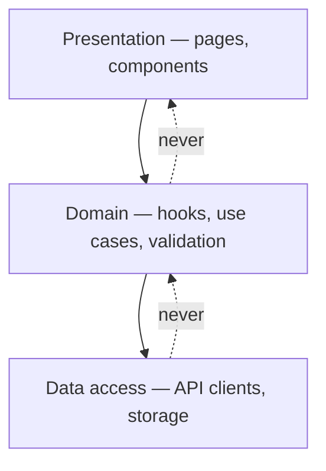

# Frontend Architecture Pattern {#ch-frontend-architecture-patterns}

> একটি বড় client app-এ সীমানা টানুন, যাতে একটি পরিবর্তন পাঁচ জায়গায় না পড়ে এক জায়গায় পড়ে।

**এই অধ্যায়ে:** architecture আপনাকে কী এনে দেয় · component-based · layered · clean architecture · এদের মধ্যে বাছাই · review-তে যে ভুলগুলো ধরা পড়ে

## 💡 মূল ধারণা

Architecture হলো এই নিয়মগুলোর set: **কোন file কোন file import করতে পারবে**। এটুকুই। বাকি সবকিছু আছে এই নিয়মগুলোকে
চোখে পড়ার মতো করতে, আর ভুল করে ভাঙা কঠিন করতে। এর মধ্যে পড়ে folder-এর নাম, layer diagram আর dependency-injection
container।

এটা গুরুত্বপূর্ণ সৌন্দর্যের জন্য নয়। গুরুত্বপূর্ণ পরিবর্তনের খরচের জন্য। সীমানাহীন একটি codebase-এ একটি API
response-এর আকৃতি বদলালে component, test আর সম্পর্কহীন তিনটি screen-এ হাত পড়ে। সীমানা আছে এমন codebase-এ হাত পড়ে
একটি file-এ। Senior interview এটা যাচাই করে একটি পরিবর্তন কোথায় পড়ে তা জিজ্ঞেস করে, কোনো pattern-এর নাম বলতে বলে নয়।

## কীভাবে কাজ করে

তিনটি pattern প্রায় প্রতিটি আসল frontend cover করে। এগুলো বিকল্প নয়। এগুলো একটির ওপর আরেকটি বসে।

| Pattern | যে নিয়ম যোগ করে | খরচ |
| ------- | ---------------- | ---- |
| **Component-based** | UI তৈরি হয় স্বাধীন, typed টুকরো দিয়ে | প্রায় কিছুই না — এটাই default |
| **Layered** | Import একদিকে যায়: UI → logic → data | একটি folder convention আর একটি lint rule |
| **Clean architecture** | Domain code কোনো framework-ই import করে না | সব জায়গায় interface আর indirection |

### Component-based

React, Svelte, Vue আর Angular — সবার ভিত্তি এটাই। একটিমাত্র সিদ্ধান্ত নেওয়ার যোগ্য: data fetching কোথায় থাকবে।
কারণ সেটাই ঠিক করে একটি component test করা যায় কি না।

**যে টুকরো fetch করে, তাকে যে টুকরো render করে তার থেকে আলাদা করুন:**

```tsx
interface User {
  id: string;
  name: string;
}

// Presentational — no data fetching, no router, no store. Trivial to test and to reuse.
interface UserCardProps {
  user: User;
  onEdit: () => void;
}

function UserCard({ user, onEdit }: UserCardProps) {
  return (
    <div className="card">
      <h3>{user.name}</h3>
      <button onClick={onEdit}>Edit</button>
    </div>
  );
}

// Container — owns the data and the side effects, renders no markup of its own.
function UserCardContainer({ userId }: { userId: string }) {
  const { data, isLoading } = useUser(userId);
  const router = useRouter();

  if (isLoading || !data) return <Skeleton />;
  return <UserCard user={data} onEdit={() => router.push(`/users/${userId}/edit`)} />;
}
```

> ⚠️ React 19-এ container/presentational ভাগটা আগের মতো testability-র বিষয় নয়। Server Component ইতিমধ্যে
> fetching-কে interactive tree-র বাইরে রাখে। টেকসই নীতিটি টিকে থাকে: যে component fetch করে আর যে component
> render করে, তাদের বদলানোর কারণ আলাদা।

### Layered

তিনটি layer, আর একটি নিয়ম: **import সবসময় শুধু নিচের দিকে নির্দেশ করে।**



**Import একদিকে যায়; একটি dotted arrow হলো এমন লঙ্ঘন, যেটা একটি lint rule-এর বাতিল করা উচিত।**

```tsx
// Data access — knows about HTTP, knows nothing about React
export const userApi = {
  getById: async (id: string): Promise<User> => {
    const res = await fetch(`/api/users/${id}`);
    if (!res.ok) throw new Error(`User ${id}: ${res.status}`);
    return res.json() as Promise<User>;
  },
};

// Domain — knows about caching and TanStack Query, knows nothing about the URL
export function useUser(id: string) {
  return useQuery({ queryKey: ["user", id], queryFn: () => userApi.getById(id) });
}

// Presentation — knows nothing about either
function UserPage({ id }: { id: string }) {
  const { data } = useUser(id);
  return data ? <UserCard user={data} onEdit={() => {}} /> : <Skeleton />;
}
```

কিছু একটি বলবৎ করলে তবেই layering টেকে। বাস্তবে সেটা একটি ESLint rule (`import/no-restricted-paths`) বা আপনার
monorepo tool-এর boundary plugin, code review-এর কোনো অভ্যাস নয়।

### Clean architecture

Framework-কে কিনারায় ঠেলে দিন, যাতে domain এর ওপর নির্ভর না করে। তত্ত্বে, আপনি React-কে Svelte দিয়ে বদলে core-এ
হাত না দিয়েই রেখে দিতে পারতেন।

**UI যে use case-এ call করে:**

```typescript
// Domain — plain TypeScript, no imports from any framework
interface AuthGateway {
  login(email: string, password: string): Promise<{ token: string }>;
}

export class LoginUseCase {
  constructor(private readonly gateway: AuthGateway) {}

  async execute(email: string, password: string): Promise<User> {
    if (!email.includes("@")) throw new Error("Invalid email");
    const { token } = await this.gateway.login(email, password);
    return decodeUser(token);
  }
}

// Presentation — depends on the use case, which depends on an interface, not on fetch
function LoginPage() {
  const useCase = useMemo(() => new LoginUseCase(new HttpAuthGateway()), []);
  // …
}
```

Team-গুলো সবচেয়ে বেশি এই pattern-টিই খুব আগেভাগে প্রয়োগ করে। আসল domain rule আছে এমন দীর্ঘজীবী app-এ এটা নিজের দাম
তুলে আনে, যেমন pricing, entitlement বা regulated workflow। একটি CRUD dashboard-এ এটা অকেজো বোঝা।

## কখন ব্যবহার করবেন

| পরিস্থিতি | কী ব্যবহার করবেন | কেন |
| --------- | --------- | --- |
| যেকোনো নতুন app | শুধু component-based | যে layer দরকার নেই, সেগুলো শুধু তর্ক করার মতো folder |
| তিনটি component-এ business logic দেখা দিচ্ছে | Layered | Signal হলো duplication, মানুষের সংখ্যা নয় |
| Domain rule framework-এর চেয়ে বেশিদিন টেকে | Clean architecture | Rewrite-এর পরেও rule টিকে থাকে; component টিকবে না |
| Deploy নিয়ে team-গুলো একে অপরকে আটকে দিচ্ছে | Micro-frontend — [Chapter ?? — Micro-Frontend](#ch-micro-frontends) দেখুন | বাধাটা প্রতিষ্ঠানগত, architecture-গত নয় |
| আলাদা আলাদা frontend-এর মধ্যে shared code | নতুন pattern নয়, একটি monorepo — [Chapter ?? — Monorepo](#ch-monorepos) দেখুন | Architecture-এর চেয়ে tooling এটা সস্তায় সমাধান করে |

Interview-এ সৎ উত্তর হলো একটি ক্রম, একটি বাছাই নয়। Component-based দিয়ে শুরু করুন। Logic পুনরাবৃত্তি হতে শুরু করলে
layering যোগ করুন। আরও ভারী কিছু বিবেচনা করুন শুধু তখন, যখন একটি নির্দিষ্ট কষ্টের একটি নাম আছে।

## সাধারণ ভুল

❌ **Component-এর ভেতরে business logic।** একটি JSX file-এ render না করে আপনি দামের হিসাব test করতে পারবেন না।
Server-এ এটা আবার ব্যবহার করতে পারবেন না, আর দ্বিতীয় একটি screen-এর দরকার হলে এটা copy হয়।
✅ এটাকে একটি সাধারণ function বা একটি hook-এ সরান, যেটা component call করে।

❌ **বলবৎ করা হয় না এমন layer।** একটি `data/` folder, যেখান থেকে component-গুলো সরাসরি import করে, সেটা একটি
naming convention, architecture নয়।
✅ যেদিন folder যোগ করবেন, সেদিনই lint rule-টি যোগ করুন।

❌ **CRUD app-এ clean architecture।** User-এর একটি list fetch করতে তিনটি interface আর একটি use-case class হলো
কোনো লাভ ছাড়া indirection।
✅ যখন রক্ষা করার মতো একটি domain rule আছে, তখন এটা আনুন।

❌ **Feature অনুযায়ী না সাজিয়ে type অনুযায়ী folder।** 200টি file নিয়ে `components/`, `hooks/` আর `utils/` থাকলে,
প্রতিটি feature পুরো tree জুড়ে ছড়িয়ে থাকে। নিরাপদে কিছুই মোছা যায় না।
✅ Feature অনুযায়ী group করুন, আর শুধু সত্যিকারের shared code একটি shared folder-এ রাখুন।

## 🔑 মূল শিক্ষা

- Architecture হলো import-এর নিয়মের একটি set। বাকি সবকিছু সেই নিয়মগুলো দেখানোর একটি উপায়।
- Component-based সঠিক default, আর এটা একটিমাত্র সিদ্ধান্ত নিতে বাধ্য করে: fetching কোথায় থাকবে।
- Business logic একাধিক component-এ দেখা দিতে শুরু করার মুহূর্তেই layering তার খরচের যোগ্য।
- Clean architecture domain rule-কে framework থেকে রক্ষা করে, আর domain rule ছাড়া এটা অকেজো বোঝা।
- যে সীমানা কিছুই বলবৎ করে না, সেটা একটি naming convention, যেটা ছয় মাসের মধ্যে হারিয়ে যাবে।

## Interview-এর প্রশ্ন

**Q: চল্লিশজন engineer কাজ করেন এমন একটি frontend আপনি কীভাবে সাজাবেন?**

File-এর type অনুযায়ী নয়, feature অনুযায়ী, নিচে ছোট একটি shared layer রেখে। Import কোন দিকে নির্দেশ করতে পারবে, তা
নিয়ে একটি বলবৎ করা নিয়ম যোগ করুন। কারণটা হলো মোছা: একটি feature folder এক commit-এ সরিয়ে ফেলা যায়। `components/`,
`hooks/` আর `utils/` জুড়ে ছড়ানো একটি feature নিরাপদে সরানোই যায় না। বলবৎ করার mechanism-এর নাম বলুন, যেমন একটি lint
rule বা একটি build-graph সীমানা। এতে উত্তরটা আকাঙ্ক্ষা নয়, বাস্তব হয়।

**Q: একটি React app-এ business logic কোথায় রাখবেন, আর component-এ কেন নয়?**

সাধারণ function-এ, বা সেগুলো call করে এমন hook-এ। Component ভুল জায়গা, কারণ এটা শুধু একটি render-এর ভেতরে চলতে
পারে। Logic তখন renderer ছাড়া test করা যায় না, server-এ ব্যবহার করা যায় না, আর খুঁজে পাওয়া কঠিন হয়। Logic
component-এ থাকা উচিত কি না পরীক্ষা করতে জিজ্ঞেস করুন: UI যদি একটি CLI হতো, তখনো কি এটা অর্থবহ হতো?

**Q: কখন আপনি layered architecture *আনবেন না*?**

যখন layer করার মতো কোনো business logic নেই। যে dashboard শুধু fetch করে আর দেখায়, তার জন্য তিনটি folder আর প্রতিটি
call-এ একটি indirection-এর চেয়ে colocated data fetching ভালো। Layering হলো duplication-এর, আর একটি screen ছাড়িয়ে
বেড়ে ওঠা logic-এর প্রতিক্রিয়া। সেই মুহূর্তের আগে এর খরচ হলো navigation-এর পরিশ্রম, আর বিনিময়ে কিছুই মেলে না।

**Q: একটি API response-এর আকৃতি বদলানোয় নয়টি file-এ হাত পড়েছে। কী ভুল হয়েছিল?**

Response type data-access সীমানা পেরিয়ে চুইয়ে বেরিয়েছে, আর সেটাই হয়ে গেছে সেই type, যেটা UI সরাসরি render করে।
সমাধান হলো একটি mapping ধাপ। Data layer wire shape-এর মালিক, আর সেটাকে একটি domain type-এ map করে। শুধু domain type
ওপরের দিকে যেতে পারে। এতে পরের আকৃতি বদল একটি file-এ সীমিত থাকে, আর সীমানার আসল উদ্দেশ্য এটাই।

## এরপর কী পড়বেন

- [Chapter ?? — Micro-Frontend](#ch-micro-frontends) — যখন বাধাটা code structure নয়, team-এর স্বাধীনতা, তখনকার pattern
- [Chapter ?? — Design System, Dependency ও Upgrade](#ch-design-systems-at-scale) — feature অনুযায়ী সাজানো tree-র নিচের shared layer
- [Chapter ?? — Four Kinds of State](#ch-four-kinds-of-state) — ওপরের প্রতিটি layer সীমানার ভেতরে যে সিদ্ধান্ত বসে আছে
